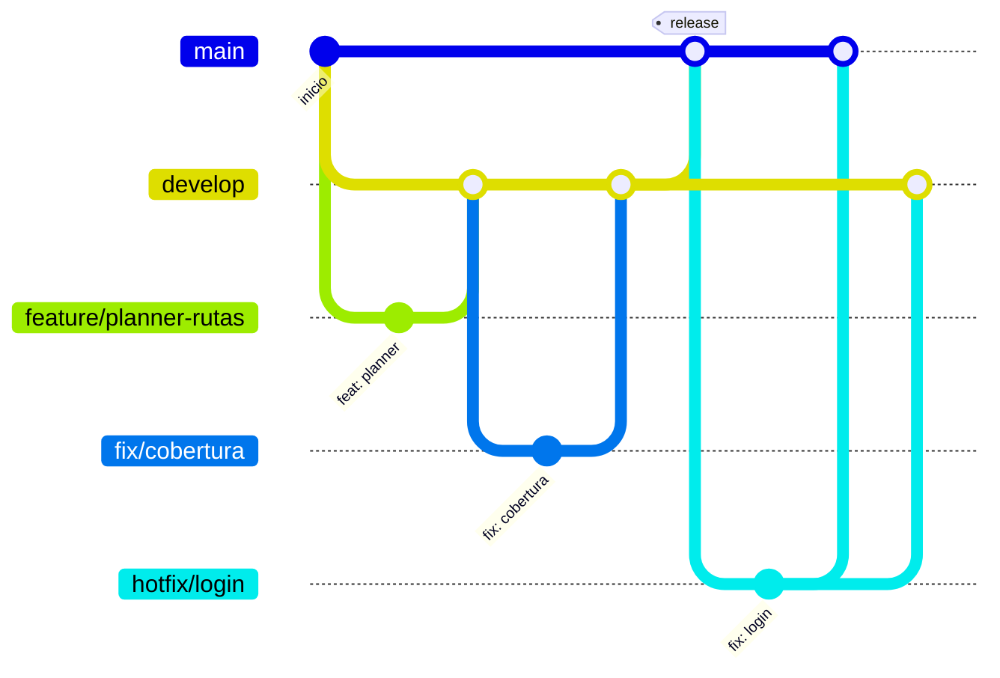

# Guía de contribución — IstpetDev

Flujo de ramas, Pull Requests y commits del repositorio `istpetdev-platform`.

---

## 1. Ramas permanentes

| Rama | Propósito | Despliega | Acepta PR desde |
|---|---|---|---|
| `main` | **Producción** y rama por defecto. Lo que está aquí es lo que ve el jurado. | Sí, cada push ejecuta `deploy.yml` | `develop`, `hotfix/*` |
| `develop` | Integración del trabajo diario del equipo. | No (solo CI) | `feature/*`, `fix/*`, `chore/*`, `docs/*`, `hotfix/*` |

Ninguna de las dos acepta push directo: todo cambio entra por Pull Request.

## 2. Ramas de trabajo

| Prefijo | Uso | Sale de | Entra a |
|---|---|---|---|
| `feature/` | Funcionalidad nueva | `develop` | `develop` |
| `fix/` | Corrección de un error en desarrollo | `develop` | `develop` |
| `chore/` | Configuración, dependencias, CI, infraestructura, scripts | `develop` | `develop` |
| `docs/` | Documentación | `develop` | `develop` |
| `hotfix/` | Corrección **urgente** de producción | `main` | `main` y luego `develop` |

**Formato del nombre:** `prefijo/descripcion-corta` en minúsculas, con guiones, sin espacios ni tildes.

```text
✅ feature/planner-rutas      ✅ fix/cobertura-dias-cero      ✅ hotfix/login-cognito
❌ Feature/Planner            ❌ planner-rutas                ❌ fix/cobertura días
```

> El prefijo es `feature/`, no `feat/`. `feat` solo se usa como tipo en el mensaje de commit (sección 5).

## 2.1 Validación automática

Las reglas viven en `.github/scripts/branch-policy.sh` y se aplican desde GitHub Actions:

| Dónde | Qué valida | Si falla |
|---|---|---|
| `branch-policy.yml` en cada PR a `main`/`develop` | Rama de origen permitida y que no venga de un fork | El check **Validar rama de origen** queda en rojo |
| `branch-policy.yml` en cada push a `main`/`develop` | Que el commit sea el merge de un PR desde una rama permitida | Marca el push directo en rojo (Actions no puede revertirlo) |
| `deploy.yml` → job **Validar Origen del Despliegue** | Push a `main` proveniente de un PR desde `develop` o `hotfix/*`; ejecución manual solo sobre `main` | **No se compila ni se despliega** |
| `rollback.yml` → job **Validar Rama de Ejecución** | Ejecución manual solo sobre `main` | No se ejecuta el rollback |

En los PR se usa el script de la rama destino, así un PR no puede relajar su propia validación.

## 3. Flujo diario



```bash
# 1. Partir siempre de develop actualizado
git switch develop
git pull --ff-only

# 2. Crear la rama de trabajo
git switch -c feature/planner-rutas

# 3. Commits pequeños (ver sección 5) y publicar
git push -u origin feature/planner-rutas

# 4. Abrir el PR hacia develop
gh pr create --base develop --fill
```

Antes de pedir revisión, ejecutar `npm run check` en local. Si `develop` avanzó mientras trabajabas, actualiza tu rama con `git pull --rebase origin develop` (o un merge si la rama ya es compartida).

## 4. Publicar a producción y hotfix

**Release (develop → main):** cuando `develop` tiene un conjunto estable y probado, se abre un PR `develop → main`. Al fusionarlo se despliega automáticamente.

```bash
gh pr create --base main --head develop --title "release: <resumen>"
```

**Hotfix (error en producción):**

```bash
git switch main && git pull --ff-only
git switch -c hotfix/login-cognito
# ...corregir y commitear...
git push -u origin hotfix/login-cognito
gh pr create --base main      # 1. publicar la corrección
gh pr create --base develop   # 2. llevar la misma corrección a develop
```

No borres la rama `hotfix/*` hasta que ambos PR estén fusionados; si no, `develop` pierde la corrección y vuelve a aparecer en la siguiente release.

Si el despliegue falla, usar el workflow manual **Rollback Rápido** (`rollback.yml`) con el SHA anterior.

## 5. Mensajes de commit

Seguimos [Conventional Commits](https://www.conventionalcommits.org/es/), como el historial existente:

```text
tipo(ámbito): descripción en minúsculas y en imperativo
```

| Tipo | Uso |
|---|---|
| `feat` | Funcionalidad nueva |
| `fix` | Corrección de error |
| `docs` | Documentación |
| `chore` | Mantenimiento, dependencias, configuración |
| `ci` | Workflows de GitHub Actions |
| `test` | Pruebas |
| `refactor` | Cambio interno sin alterar comportamiento |

Ámbitos habituales: `api`, `db`, `web`, `mobile`, `shared`, `infra`, `deploy`, `docker`, `scripts`.

Ejemplos: `feat(api): exponer cobertura por punto de servicio`, `fix(mobile): reintentar recepción sin duplicar`.

## 6. Pull Requests

- Un PR = un tema. Si toca backend y web por una misma funcionalidad, está bien; si mezcla temas, sepáralo.
- Título con el mismo formato de commit.
- La descripción indica **qué cambia, por qué y cómo se probó**.
- Deben pasar los checks obligatorios: **Validar rama de origen** y, cuando aplique, **CI - Integración Continua**.
- Tras el merge, borra la rama de trabajo (GitHub lo ofrece en el PR).

## 7. Configuración del repositorio (administrador)

GitHub Actions **valida** los PR y **detiene el despliegue** si el origen no es válido, pero solo la protección de ramas puede **impedir** un merge o un push directo. Un administrador del repositorio debe configurar una vez:

1. **Settings → General → Default branch:** cambiar a `main`.
2. **Settings → Rules → Rulesets → New branch ruleset** para `main`:
   - Target: `main` · Enforcement: *Active*.
   - ✅ Restrict deletions · ✅ Block force pushes.
   - ✅ Require a pull request before merging.
   - ✅ Require status checks to pass → agregar `Validar rama de origen`.
3. Otro ruleset igual para `develop`.
4. **No** activar *Automatically delete head branches*: borraría la rama `hotfix/*` al fusionar el primer PR y GitHub cerraría el segundo. Las ramas se borran a mano tras el merge.

El check `Validar rama de origen` aparece en la lista para marcarlo como obligatorio después de que el workflow se ejecute al menos una vez en un PR.
