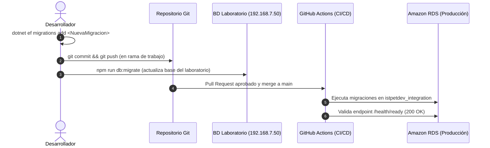

# Estrategia de tres entornos y ciclo de vida de base de datos

Esta nota define la arquitectura y el modelo operativo de persistencia para el proyecto IstpetDev, estructurado en tres entornos desacoplados para optimizar la velocidad del equipo durante el hackathon y garantizar la estabilidad del release en producción:

1. **Entorno Casa (Local Individual)**: Ejecución offline desacoplada en cada laptop con Docker local.
2. **Entorno Laboratorio (On-Premise Colaborativo)**: Servidor de pruebas en red local LAN (`192.168.7.50:15432`) para desarrollo conjunto en el instituto.
3. **Entorno Producción (AWS Cloud)**: Despliegue stateless en AWS EC2 y Amazon RDS (`istpetdev_integration`) para la demostración a jueces y evaluación técnica.

---

## 1. Topología y matriz comparativa de entornos

```mermaid
flowchart TD
    subgraph Amb1 ["1. ENTORNO CASA (Offline / Laptop)"]
        LaptopA["Laptop Desarrollador"] --> LocalDocker["Docker Compose Local<br>localhost:15432<br>Base: istpetdev_dev_01"]
    end

    subgraph Amb2 ["2. ENTORNO LABORATORIO (LAN On-Premise)"]
        EquipoLab["Laptops del Equipo (x5)"] -->|Red Local 192.168.7.0/24| ServidorLab["Servidor Laboratorio (192.168.7.50:15432)<br>PostGIS 16 + Redis<br>Base: istpetdev_dev_01"]
    end

    subgraph Amb3 ["3. ENTORNO PRODUCCIÓN (AWS Cloud)"]
        GitMain["GitHub Actions (Merge a main)"] -->|Deploy Inmutable| EC2Prod["AWS EC2: istpetdev-prod-host<br>https://istpetdev.doicela.dev"]
        EC2Prod -->|VPC 10.42.0.0/16<br>TCP 5432 Privado| RDSProd["Amazon RDS: istpetdev-rds-dev<br>Base: istpetdev_integration"]
    end
```



| Parámetro | 1. Casa (Local) | 2. Laboratorio (On-Premise) | 3. Producción (AWS RDS) |
|---|---|---|---|
| **Propósito** | Trabajo individual, pruebas destructivas y desarrollo offline. | Desarrollo colaborativo simultáneo del equipo de 5 integrantes. | Demostración oficial ante jueces y auditoría en vivo. |
| **Alojamiento** | Docker Desktop en la laptop de cada integrante. | Contenedor Docker en el servidor del laboratorio. | Instancia gestionada Amazon RDS PostgreSQL 16.13 en `us-east-1`. |
| **Endpoint / Host** | `localhost:15432` | `192.168.7.50:15432` | `istpetdev-rds-dev.cep4osawemm3.us-east-1.rds.amazonaws.com:5432` |
| **Base de datos** | `istpetdev_dev_01` | `istpetdev_dev_01` | `istpetdev_integration` |
| **Credenciales** | `postgres` / `postgres_dev_password_local` | `migrator_dev_01` / `12345` | `migrator_integration` (AWS Secrets Manager) |
| **Soporte PostGIS** | `postgis/postgis:16-3.4-alpine` | `postgis/postgis:16-3.4-alpine` | Extensión `postgis` nativa de AWS RDS (3.4.6) |
| **Dependencia Red** | Ninguna (100% offline). | Red física LAN del instituto (`192.168.7.0/24`). | Conectividad privada dentro de VPC `vpc-0217f06f82247cd0b`. |
| **Comando Switch** | `npm run db:local` | `npm run db:lab` | Automático vía CI/CD (`deploy.yml`) |

---

## 2. Entorno 1: Desarrollo en casa (Local)

El entorno local permite que cualquier integrante trabaje sin conexión a internet y sin requerir permisos de red institucional ni cuentas en AWS.

### Puesta en marcha

1. **Iniciar contenedores de soporte**:
   ```bash
   npm run docker:up
   ```
   Levanta los servicios definidos en `infra/compose/docker-compose.local.yml`:
   - PostgreSQL 16 con PostGIS en el puerto local `15432`.
   - Redis 7.4 en el puerto local `6379`.

2. **Asegurar modo local en la API**:
   ```bash
   npm run db:local
   ```
   Elimina cualquier sobreescritura de `ConnectionStrings:Main` en `dotnet user-secrets`, provocando que el backend lea la configuración por defecto de `src/Api/appsettings.Development.json`.

3. **Iniciar backend y frontend**:
   ```bash
   npm run dev:api    # Terminal 1: http://localhost:5000
   npm run dev:web    # Terminal 2: http://localhost:4200
   ```

4. **Reinicio de datos limpios**:
   ```bash
   npm run docker:reset
   ```
   Elimina los volúmenes locales y aprovisiona una base de datos vacía al instante.

---

## 3. Entorno 2: Desarrollo en laboratorio (On-Premise)

El entorno del laboratorio centraliza una única base de datos sobre la red local del instituto (`192.168.7.0/24`), permitiendo que los 5 integrantes compartan datos de prueba en tiempo real sin experimentar colisiones ni depender de túneles externos.

### Configuración del servidor del laboratorio (`192.168.7.50`)

En la máquina física del servidor del laboratorio:

1. **Definición de servicios (`infra/compose/docker-compose.lab.yml`)**:
   ```yaml
   services:
     db:
       image: postgis/postgis:16-3.4-alpine
       container_name: istpetdev-team-db
       restart: unless-stopped
       ports:
         - "15432:5432"
       environment:
         POSTGRES_USER: postgres
         POSTGRES_PASSWORD: 12345
         POSTGRES_DB: istpetdev_dev_01
       volumes:
         - team_pgdata:/var/lib/postgresql/data

     redis:
       image: redis:7.4-alpine
       container_name: istpetdev-team-redis
       restart: unless-stopped
       ports:
         - "6379:6379"
   ```

2. **Arranque en el servidor**:
   ```powershell
   docker compose -f infra/compose/docker-compose.lab.yml up -d
   ```

3. **Regla de Firewall de Windows en el servidor**:
   Para permitir que las laptops del equipo alcancen el puerto `15432`, se ejecuta en PowerShell como Administrador:
   ```powershell
   New-NetFirewallRule -DisplayName "PostgreSQL ISTPET Lab" -Direction Inbound -LocalPort 15432 -Protocol TCP -Action Allow
   ```

### Conexión de los 5 integrantes del equipo

Cada compañero, conectado al Wi-Fi o cable de la red `192.168.7.x`:

1. **Conmutar a la base del laboratorio**:
   ```bash
   npm run db:lab
   ```
   El script `scripts/ops/switch-db.mjs` verifica la conectividad TCP con `192.168.7.50:15432` y guarda la cadena de conexión en los `user-secrets` locales de .NET:
   `Host=192.168.7.50;Port=15432;Database=istpetdev_dev_01;Username=migrator_dev_01;Password=12345`

2. **Ejecutar la plataforma**:
   ```bash
   npm run dev:api
   npm run dev:web
   ```

---

## 4. Entorno 3: Producción (AWS EC2 + Amazon RDS)

El entorno de producción está reservado para la demostración oficial y el acceso público bajo el dominio [https://istpetdev.doicela.dev](https://istpetdev.doicela.dev).

### Especificaciones técnicas

* **Host Cómputo (EC2)**: Instancia `istpetdev-prod-host` (`i-0e0a979f8c0885a4f`, IP Pública `44.204.107.167`). Opera de forma 100% stateless sin almacenar bases de datos locales.
* **Base Gestionada (RDS)**: Instancia PostgreSQL 16.13 con PostGIS 3.4.6 (`istpetdev-rds-dev.cep4osawemm3.us-east-1.rds.amazonaws.com:5432`). Base de datos: `istpetdev_integration`.
* **Seguridad de Red**: Aislamiento dentro de la VPC `vpc-0217f06f82247cd0b`. RDS no tiene IP pública ni acceso directo desde internet; únicamente el Security Group de EC2 (`sg-0c4c0a0cff4fdc55f`) tiene autorizado el puerto `5432` hacia RDS (`sg-0c7bbe8a898ce393d`).
* **Despliegue Inmutable**: El workflow de GitHub Actions (`.github/workflows/deploy.yml`) genera imágenes etiquetadas con el SHA exacto del commit (`istpetdev-backend:${{ github.sha }}` y `istpetdev-web:${{ github.sha }}`) y las transfiere a EC2 sin fallbacks a `:latest`.
* **Caché y SPA**: Nginx en EC2 aplica encabezados estrictos `Cache-Control: no-cache, no-store, must-revalidate` para `/index.html` asegurando que los usuarios finales reciban la última versión de la SPA al instante.

---

## 5. Ciclo de vida y versionamiento de migraciones

Las definiciones de esquema no se modifican manualmente en las bases de datos. Todo cambio viaja a través del repositorio mediante migraciones de Entity Framework Core.



### Comandos de migración

1. **Generar una nueva migración**:
   ```bash
   dotnet ef migrations add <NombreMigracion> --project src/Infrastructure --startup-project src/Api
   ```

2. **Aplicar migraciones al entorno seleccionado**:
   ```bash
   npm run db:migrate
   ```
   *(Aplica los cambios a la base activa según el modo configurado: Laboratorio si está en `db:lab`, o Casa si está en `db:local`)*.

3. **Verificación de estado**:
   ```bash
   npm run db:status
   ```
   Indica claramente a qué base de datos apunta la máquina antes de ejecutar operaciones destructivas.

---

## Notas relacionadas

- [[Perfil A Reforzado - Despliegue Stateless y Amazon RDS]] — Arquitectura detallada del host EC2 y Amazon RDS.
- [[Entornos y operacion acordados]] — Acuerdos fundacionales de infraestructura y costos en AWS.
- [[Runbook de DevOps y base de datos para la demo]] — Procedimientos de contingencia y backup para la presentación a jueces.
- [[CI-CD y automatizacion de despliegue]] — Pipeline inmutable de GitHub Actions.
