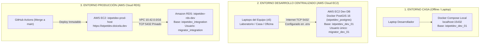
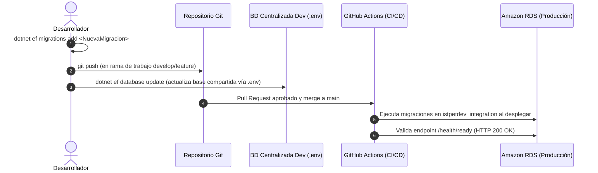

# Estrategia de tres entornos y ciclo de vida de base de datos

Esta nota define la arquitectura y el modelo operativo de persistencia para el proyecto IstpetDev, estructurado en tres entornos desacoplados para optimizar la velocidad del equipo durante el hackathon y garantizar la estabilidad del release en producción:

1. **Entorno Casa (Local Individual)**: Ejecución offline desacoplada en cada laptop con Docker local (`localhost:15432`) mediante `npm run db:local`.
2. **Entorno Desarrollo Centralizado (AWS Cloud EC2)**: Base de datos única compartida (`istpetdev_dev_01`) alojada en instancia dedicada de AWS EC2 con PostGIS 16 y usuario único `migrator_dev_01`. Proporciona acceso concurrente continuo a todo el equipo desde cualquier ubicación (laboratorio, casa u oficina). Su configuración se centraliza estrictamente en el archivo `.env` en la raíz (ignorado por Git) para no exponer IPs ni credenciales en el repositorio de código. Comandos: `npm run db:dev` o `npm run db:cloud`.
3. **Entorno Producción (AWS Cloud RDS)**: Despliegue stateless en AWS EC2 y Amazon RDS (`istpetdev_integration`) para la demostración a jueces y evaluación técnica oficial en [https://istpetdev.doicela.dev](https://istpetdev.doicela.dev).

---

## 1. Topología y matriz comparativa de entornos



| Parámetro | 1. Casa (Local) | 2. Desarrollo Centralizado (AWS EC2) | 3. Producción (AWS RDS) |
|---|---|---|---|
| **Propósito** | Trabajo individual offline y pruebas destructivas. | Desarrollo colaborativo unificado desde cualquier red (lab/casa/oficina). | Demostración oficial ante jueces y auditoría en vivo. |
| **Alojamiento** | Docker Desktop local en laptop. | Instancia dedicada AWS EC2 Debian en `us-east-1` (IP en `.env`). | Instancia gestionada Amazon RDS PostgreSQL 16.13 en `us-east-1`. |
| **Endpoint / Host** | `localhost:15432` | Host centralizado configurado en `.env` (puerto `5432`) | `istpetdev-rds-dev.cep4osawemm3.us-east-1.rds.amazonaws.com:5432` |
| **Base de datos** | `istpetdev_dev_01` | `istpetdev_dev_01` | `istpetdev_integration` |
| **Credenciales** | `postgres` / `postgres_dev_password_local` | `migrator_dev_01` (Usuario único; contraseña en `.env`) | `migrator_integration` (AWS Secrets Manager) |
| **Soporte PostGIS** | `postgis/postgis:16-3.4-alpine` | `postgis/postgis:16-3.4-alpine` | Extensión `postgis` nativa de AWS RDS (3.4.6) |
| **Dependencia Red** | Ninguna (100% offline). | Conectividad a Internet pública (Security Group puerto 5432). | Conectividad privada dentro de VPC `vpc-0217f06f82247cd0b`. |
| **Configuración** | `npm run db:local` (`dotnet user-secrets`) | Centralizada en `.env` (sin exponer IPs en Git); `npm run db:dev` | Variables inyectadas por host en despliegue inmutable |

---

## 2. Entorno 1: Desarrollo en casa (Local)

El entorno local permite que cualquier integrante trabaje sin conexión a internet y sin requerir permisos de red institucional ni cuentas en AWS.

### Puesta en marcha

1. **Iniciar contenedores de soporte**:
   ```bash
   npm run docker:up
   ```
   Levanta los servicios definidos en `infra/compose/docker-compose.local.yml`:
   - PostgreSQL 16 con PostGIS en el puerto local `15432`.
   - Redis 7.4 en el puerto local `6379`.

2. **Asegurar modo local en la API**:
   ```bash
   npm run db:local
   ```
   Configura `ConnectionStrings:Main` en `dotnet user-secrets` para apuntar al PostgreSQL local en `localhost:15432`. Si se desea volver a la base en la nube por defecto, se ejecuta `npm run db:cloud`.

3. **Iniciar backend y frontend**:
   ```bash
   npm run dev:api    # Terminal 1: http://localhost:5000
   npm run dev:web    # Terminal 2: http://localhost:4200
   ```

4. **Reinicio de datos limpios**:
   ```bash
   npm run docker:reset
   ```
   Elimina los volúmenes locales y aprovisiona una base de datos vacía al instante.

---

---

## 3. Entorno 2: Desarrollo Centralizado del Equipo (AWS Cloud EC2)

Para eliminar la dependencia de redes físicas locales y permitir que los integrantes del equipo colaboren en tiempo real con datos sincronizados desde cualquier ubicación (laboratorio, casa u oficina), el proyecto unificó toda la persistencia de desarrollo en una única base de datos centralizada en AWS EC2 con PostgreSQL 16 y PostGIS 3.4.

### Especificaciones técnicas de la base de datos de desarrollo

* **Host AWS EC2:** Instancia Debian en región `us-east-1` (dirección IP configurada en `.env`).
* **Puerto:** `5432` habilitado en el Security Group `istpetdev-ec2-access-sg-dev` (regla TCP 5432).
* **Motor y Contenedor:** Contenedor Docker `istpetdev_postgres` ejecutando la imagen oficial `postgis/postgis:16-3.4-alpine` con política de reinicio `restart: always`.
* **Persistencia:** Volumen Docker `pgdata` montado en `/var/lib/postgresql/data`.
* **Base de datos:** `istpetdev_dev_01` con las 27 tablas canónicas de `DemoCore` aplicadas mediante EF Core.

### Política de usuario único para desarrollo (`migrator_dev_01`)

Para eliminar cualquier fricción técnica de permisos:

1. **Usuario único estandarizado:** `migrator_dev_01` (contraseña protegida en `.env`).
2. **Atributos y Permisos:** Propietario (`OWNER`) de la base de datos `istpetdev_dev_01`, del esquema `public` y de las 27 tablas de `DemoCore`. Configurado con `CREATEDB`, `NOSUPERUSER` y `NOBYPASSRLS`, satisfaciendo las guardas de seguridad de las migraciones de EF Core.
3. **Rol de aplicación secundario:** `user_dev_01` aprovisionado para compatibilidad estricta con scripts DML de seguridad.

### Centralización de configuración en `.env` y protección de credenciales

Para evitar exponer IPs públicas y credenciales en el repositorio de Git (control de versiones):

* **Fuente única de verdad (`.env`):** La configuración completa de conexión para desarrollo reside exclusivamente en el archivo `.env` en la raíz del proyecto (ignorado por `.gitignore`). Contiene `ConnectionStrings__Main`, `DATABASE_HOST`, `DATABASE_PORT`, `DATABASE_NAME`, `DATABASE_USER` y `DATABASE_PASSWORD`.
* **Aislamiento estricto en Git:** Tanto `.env` como `src/Api/appsettings.json` local están ignorados por `.gitignore` y desindexados del repositorio. A GitHub viajan exclusivamente las plantillas `!.env.example` y `!src/Api/appsettings.example.json`. No se utiliza `appsettings.Development.json` para mantener una única fuente de configuración local y evitar duplicidad de parámetros.
* **Inyección automática en .NET:** En `src/Api/Program.cs`, el backend carga automáticamente las variables del archivo `.env` local en desarrollo e inyecta la configuración en `IConfiguration`. Quien ejecute `npm run dev:api` o `dotnet run` obtiene la conexión sin necesidad de archivos duplicados ni secretos quemados en el código.
* **Gestor de entorno (`scripts/ops/switch-db.mjs`):** Lee directamente los parámetros desde `.env` para verificar conectividad TCP y sincronizar `dotnet user-secrets`. No almacena IPs hardcodeadas y oculta contraseñas en consola.

```bash
npm run db:dev     # Sincroniza y activa el entorno de desarrollo centralizado desde .env
npm run db:local   # Conmuta a Docker Local en localhost:15432
npm run db:status  # Muestra el entorno activo y conectividad sin exponer credenciales
```

---

## 4. Entorno 3: Producción (AWS EC2 + Amazon RDS)

El entorno de producción está reservado para la demostración oficial y el acceso público bajo el dominio [https://istpetdev.doicela.dev](https://istpetdev.doicela.dev).

### Especificaciones técnicas

* **Host Cómputo (EC2)**: Instancia `istpetdev-prod-host` (`i-0e0a979f8c0885a4f`, IP Pública `44.204.107.167`). Opera de forma 100% stateless sin almacenar bases de datos locales.
* **Base Gestionada (RDS)**: Instancia PostgreSQL 16.13 con PostGIS 3.4.6 (`istpetdev-rds-dev.cep4osawemm3.us-east-1.rds.amazonaws.com:5432`). Base de datos: `istpetdev_integration`.
* **Seguridad de Red**: Aislamiento dentro de la VPC `vpc-0217f06f82247cd0b`. RDS no tiene IP pública ni acceso directo desde internet; únicamente el Security Group de EC2 (`sg-0c4c0a0cff4fdc55f`) tiene autorizado el puerto `5432` hacia RDS (`sg-0c7bbe8a898ce393d`).
* **Despliegue Inmutable**: El workflow de GitHub Actions (`.github/workflows/deploy.yml`) genera imágenes etiquetadas con el SHA exacto del commit (`istpetdev-backend:${{ github.sha }}` y `istpetdev-web:${{ github.sha }}`) y las transfiere a EC2 sin fallbacks a `:latest`.
* **Caché y SPA**: Nginx en EC2 aplica encabezados estrictos `Cache-Control: no-cache, no-store, must-revalidate` para `/index.html` asegurando que los usuarios finales reciban la última versión de la SPA al instante.

---

## 5. Ciclo de vida y versionamiento de migraciones

Las definiciones de esquema no se modifican manualmente en las bases de datos. Todo cambio viaja a través del repositorio mediante migraciones de Entity Framework Core.



### Comandos de migración

1. **Generar una nueva migración**:
   ```bash
   dotnet ef migrations add <NombreMigracion> --project src/Infrastructure --startup-project src/Api
   ```

2. **Aplicar migraciones a la base de desarrollo centralizada**:
   ```bash
   dotnet ef database update --project src/Infrastructure --startup-project src/Api
   ```
   *(Aplica los cambios directamente a la base configurada en `.env`)*.

3. **Verificación de estado e inspección**:
   ```bash
   dotnet ef dbcontext info --project src/Infrastructure --startup-project src/Api
   ```
   Confirma el Data source activo y el estado de la base de datos antes de proceder.

---

## Notas relacionadas

- [[Perfil A Reforzado - Despliegue Stateless y Amazon RDS]] — Arquitectura detallada del host EC2 y Amazon RDS.
- [[Entornos y operacion acordados]] — Acuerdos fundacionales de infraestructura y costos en AWS.
- [[Runbook de DevOps y base de datos para la demo]] — Procedimientos de contingencia y backup para la presentación a jueces.
- [[CI-CD y automatizacion de despliegue]] — Pipeline inmutable de GitHub Actions.
