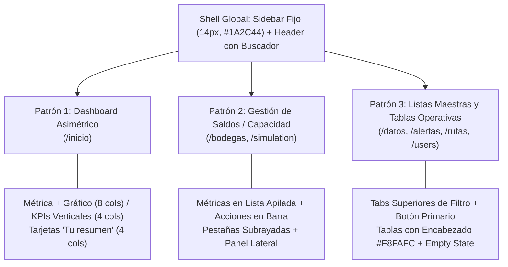

# Guía de maquetación y diseño UI-UX para IstpetDev Platform

Normativa técnica, reglas de diseño y catálogo de componentes visuales para la estandarización transversal de todas las pantallas de la plataforma web (`apps/web`).

> [!IMPORTANT] Principio de Fidelidad al Dominio del Sistema
> La estética visual, jerarquía tipográfica, geometría de contenedores y paleta de contrastes toman como referencia el estándar ejecutivo de **Stripe Dashboard**. No obstante, **queda estrictamente prohibido introducir conceptos, campos o elementos ajenos al dominio logístico de IstpetDev** (como claves de pasarelas de pago, cobros a clientes o formularios financieros). Las referencias visuales son exclusivas de UX/UI para estructurar la operación logística de insumos de higiene hospitalaria.

---

## 1. Fundamentos y Tokens de Diseño

### 1.1 Pila Tipográfica Universal

Toda la aplicación utiliza el stack tipográfico nativo de alta resolución del sistema operativo:

```css
font-family: -apple-system, BlinkMacSystemFont, "Segoe UI", Roboto, Helvetica, Arial, "Inter", sans-serif;
```

* **Texto Base (`body`):** `font-size: 14px; line-height: 20px; color: #30313D;`
* **Números de Métricas:** Tipografía sans-serif con `font-weight: 600`, tracking ajustado (`tracking-tight`) y alineación proporcional.
* **Prohibición de Cero Punteado:** La regla `"zero" 1` en fuentes monoespaciadas está deshabilitada en todo el sistema. Ninguna cifra, coordenada ni código debe renderizarse con punto central retro.

### 1.2 Paleta Cromática Institucional de Alto Contraste

| Token | Código Hex | Rol en la Interfaz | Ejemplo de Uso |
|---|---|---|---|
| **Text Primary** | `#1A2C44` | Títulos principales, navegación activa, métricas | Título `Hoy`, números `24px` |
| **Text Heading** | `#30313D` | Encabezados de tarjetas, columnas de tablas | Títulos de tarjetas `h3` (`14px`) |
| **Text Secondary**| `#3C4F69` | Subtextos descriptivos, comparativas temporales | `"1 bodega activa"`, `"período anterior"` |
| **Text Muted** | `#8792A2` | Iconos de ayuda `ⓘ`, etiquetas secundarias | Micro-iconos `ⓘ`, fechas de corte |
| **Accent / Link** | `#635BFF` | Enlaces de acción, pestañas activas, progreso | `Ver más →`, línea de jornada |
| **Border Card** | `#E3E8EE` | Bordes exteriores de tarjetas y modales | `border border-[#E3E8EE]` |
| **Border Divider**| `#F1F3F5` | Separadores internos y filas de lista | `divide-y divide-[#F1F3F5]` |
| **Surface Base** | `#FFFFFF` | Contenedores de tarjeta, paneles y modales | `bg-white` |
| **Surface Alt** | `#F8FAFC` | Fondo de sidebar, píldoras y filas hover | `bg-[#F8FAFC]` o `bg-slate-50` |

### 1.3 Geometría y Elevación

* **Radio de Borde (`border-radius`):** `8px` (`rounded-lg` en Tailwind). Prohibido utilizar esquinas exageradas (`rounded-2xl` o `rounded-3xl`) en tarjetas de métricas o tablas.
* **Borde:** Trazo sólido milimétrico `1px solid #E3E8EE`.
* **Sombras:** Micro-elevación imperceptible para evitar ruido: `box-shadow: 0 1px 2px rgba(0, 0, 0, 0.04);` o `shadow-2xs`.

---

## 2. Catálogo de Patrones de Pantalla

La plataforma IstpetDev se estructura bajo tres arquetipos de diseño para homogeneizar todas las vistas:



---

### Patrón 1: Dashboard y Métrica Temporal (Ejemplo: `/inicio`)

Utilizado para páginas de visión gerencial o resumen general.

#### Estructura del Layout
1. **Encabezado:** Título de sección (`text-[28px] font-bold text-[#1A2C44]`) alineado a la izquierda junto con el badge de rol del usuario. A la derecha, botón secundario discreto de actualización o acción.
2. **Fila Asimétrica Superior:**
   * **Columna Izquierda (8 de 12 cols):**
     * Selectores de métrica tipo botón con flecha `˅` (`text-[13px] font-medium text-[#4F5B66]`).
     * Métrica principal en `text-[32px] sm:text-[36px] font-semibold text-[#1A2C44] tracking-tight`.
     * Subtexto con corte horario y porcentaje de cobertura (`text-[13px] text-[#3C4F69]`).
     * Gráfico de línea temporal horizontal con tramo continuo hasta la hora actual y proyección punteada hasta el fin de ciclo (`07:00` a `17:00`).
   * **Columna Derecha (4 de 12 cols):**
     * Panel vertical con separador izquierdo `border-l border-[#E3E8EE] pl-8`.
     * Lista vertical de KPIs con enlace `Ver más` a la derecha en azul `#635BFF`.
     * Valor del KPI en `text-[20px] font-semibold text-[#1A2C44]` con micro-icono `ⓘ`.
3. **Sección "Tu resumen":**
   * Encabezado con título `text-[20px] font-bold text-[#1A2C44]`.
   * Barra de filtros de fecha y periodicidad en píldoras con borde (`rounded-full border border-[#E3E8EE] px-3 py-1.5 text-xs text-[#30313D]`).
   * Cuadrícula de 4 tarjetas de resumen correspondientes al flujo logístico (`Cargar Datos`, `Alertas`, `Rutas`, `Bodegas`).

#### Código HTML / Tailwind de Referencia (Tarjeta de Resumen)
```html
<div class="bg-white border border-[#E3E8EE] rounded-lg p-5 hover:border-slate-300 hover:shadow-[0_1px_3px_rgba(0,0,0,0.05)] transition-all flex flex-col justify-between group">
  <div>
    <!-- Encabezado con ⓘ -->
    <div class="flex items-center justify-between">
      <h3 class="text-[14px] leading-[20px] font-medium text-[#30313D] truncate">
        1. Cargar Datos Maestros
      </h3>
      <span class="text-[#8792A2] group-hover:text-[#3C4F69] transition-colors cursor-help text-[13px]" title="Información">&#9432;</span>
    </div>

    <!-- Métrica -->
    <div class="mt-2.5">
      <div class="text-[24px] leading-[32px] font-semibold text-[#1A2C44] tracking-tight">
        15 <span class="text-[14px] font-normal text-[#3C4F69]">puntos activos</span>
      </div>
      <div class="text-[13px] leading-[18px] text-[#3C4F69] mt-0.5 mb-[2px]">
        Bodegas, hospitales, consumos e insumos base.
      </div>
    </div>
  </div>

  <!-- Pie con enlace de acción -->
  <div class="mt-4 pt-3 border-t border-[#F1F3F5] flex items-center justify-between">
    <span class="text-[11px] px-2 py-0.5 rounded-full font-medium border bg-slate-50 text-slate-700 border-slate-200">
      Catálogo Base
    </span>
    <a routerLink="/datos" class="text-[13px] font-medium text-[#635BFF] hover:underline inline-flex items-center gap-1">
      <span>Ir a Datos</span>
      <span>&rarr;</span>
    </a>
  </div>
</div>
```

---

### Patrón 2: Vista de Saldos / Capacidad y Actividad (Ejemplo: `/bodegas`)

Utilizado para monitoreo de capacidades volumétricas, inventario central y rebalanceos entre almacenes.

#### Estructura del Layout
1. **Encabezado con Métrica Integrada:**
   * Título principal: `Existencias Centrales 1.450 m³ ⓘ` (`text-[28px] font-bold text-[#1A2C44]`).
   * Barra de herramientas superior con botones de acción alineados horizontalmente:
     * Botones secundarios: `px-3 py-1.5 rounded-md border border-[#E3E8EE] bg-white text-[13px] font-medium text-[#30313D] shadow-2xs hover:bg-slate-50`.
     * Botón de acción destacada (si aplica): `bg-[#635BFF] text-white`.
2. **Contenedor de Saldos Apilados:**
   * Caja blanca con borde `#E3E8EE` y esquinas de `8px`.
   * Filas interiores separadas por `divide-y divide-[#F1F3F5]`:
     * Fila 1: `Stock en Cuarentena` &bull; Valor a la derecha &bull; Tag informativo.
     * Fila 2: `Stock Disponible para Despacho` &bull; Valor en negrita &bull; Indicador de bodega base.
3. **Pestañas de Actividad:**
   * Barra horizontal con pestañas de texto: `Movimientos de Entrada`, `Despachos a Ruta`, `Sugerencias de Rebalanceo`.
   * La pestaña activa se marca con línea inferior `border-b-2 border-[#635BFF]` y texto `#1A2C44 font-semibold`.
4. **Columna Lateral de Acciones Sugeridas:**
   * Contenedor con borde discontinuo tenue (`border-2 border-dashed border-[#E3E8EE] rounded-lg p-5 text-center`).
   * Botón de acción para generar la orden o rebalanceo.

---

### Patrón 3: Listas Maestras y Tablas Operativas (Ejemplo: `/datos`, `/alertas`, `/rutas`)

Utilizado para catálogos de puntos de salud, alertas de insumos hospitalarios, manifiestos de ruta y auditoría de usuarios.

#### Estructura del Layout
1. **Pestañas Superiores de Segmentación:**
   * Fila superior de navegación por pestañas subrayadas:
     * En `/alertas`: `Todas las Alertas` | `Quiebres Críticos (<5d)` | `Margen Preventivo (5-10d)` | `Normal`.
     * En `/rutas`: `Todas las Rutas` | `Planificadas` | `En Tránsito` | `Entregadas` | `Con Incidencia`.
   * Pestaña activa: `text-[#1A2C44] border-b-2 border-[#635BFF] font-medium`.
   * Pestaña inactiva: `text-[#4F5B66] hover:text-[#1A2C44] transition-colors`.
2. **Barra de Acciones y Filtros:**
   * Input de búsqueda rápido con icono de lupa a la izquierda: `h-8 px-3 text-[13px] border border-[#E3E8EE] rounded-md bg-white focus:border-[#635BFF] focus:ring-1 focus:ring-[#635BFF]`.
   * Botones de exportación o filtro en grupo a la derecha.
   * Botón primario de creación: `bg-[#635BFF] hover:bg-[#5248E0] text-white text-[13px] font-medium px-3.5 py-1.5 rounded-md shadow-xs`.
3. **Diseño de Tablas de Datos (`stripe-table`):**
   * Contenedor de tabla con `border border-[#E3E8EE] rounded-lg overflow-hidden bg-white`.
   * Encabezado (`thead`): `bg-[#F8FAFC] border-b border-[#E3E8EE] text-[12px] font-medium uppercase tracking-wider text-[#697386] py-2.5 px-4`.
   * Filas (`tbody tr`): `text-[13px] text-[#30313D] border-b border-[#F1F3F5] hover:bg-[#F8FAFC]/80 transition-colors py-3 px-4`.
   * Columnas numéricas / códigos: `font-sans font-medium text-[#1A2C44]` alineadas a la derecha o con ancho fijo.
4. **Estado de Vacío (Empty State Clínico):**
   * Cuando no existen registros o el filtro devuelve cero resultados:
     * Contenedor centrado con altura de 240px a 320px.
     * Título conciso en `text-[18px] font-semibold text-[#1A2C44]`.
     * Párrafo explicativo en `text-[14px] text-[#3C4F69] max-w-md mx-auto mt-1`.
     * Botón de acción directo para resolver el estado (ej. `+ Cargar Insumos` o `Restablecer Filtros`).

---

## 3. Componentes de UI Estandarizados

### 3.1 Botones

| Tipo | Clases Tailwind | Estado Hover | Propósito |
|---|---|---|---|
| **Primario** | `bg-[#635BFF] text-white text-[13px] font-medium px-3.5 py-1.5 rounded-md shadow-xs` | `hover:bg-[#5248E0]` | Acción principal de la vista (Planificar, Guardar, Despachar) |
| **Secundario** | `bg-white border border-[#E3E8EE] text-[#30313D] text-[13px] font-medium px-3.5 py-1.5 rounded-md shadow-2xs` | `hover:bg-slate-50 hover:border-slate-300` | Filtros, Cancelar, Exportar, Actualizar Estado |
| **Enlace de Acción** | `text-[13px] font-medium text-[#635BFF] inline-flex items-center gap-1` | `hover:underline` | Enlaces dentro de tarjetas y tablas (`Ver más →`) |
| **Píldora Filtro** | `rounded-full border border-[#E3E8EE] px-3 py-1 text-xs font-medium text-[#30313D] bg-white` | `hover:bg-slate-50` | Selectores de rango de fecha o estado |

### 3.2 Badges de Estado Operativo

Los badges deben tener bordes suaves y tipografía legible, sin bordes exagerados:

```html
<!-- Estado Crítico / Quiebre -->
<span class="inline-flex items-center px-2 py-0.5 rounded text-[11px] font-medium bg-rose-50 text-rose-700 border border-rose-200/60">
  Quiebre Inminente
</span>

<!-- Estado Advertencia / Cobertura < 5 días -->
<span class="inline-flex items-center px-2 py-0.5 rounded text-[11px] font-medium bg-amber-50 text-amber-700 border border-amber-200/60">
  Cobertura Ajustada
</span>

<!-- Estado Óptimo / Recibido / Conectado -->
<span class="inline-flex items-center px-2 py-0.5 rounded text-[11px] font-medium bg-emerald-50 text-emerald-700 border border-emerald-200/60">
  Entregado
</span>

<!-- Estado Informativo / En Tránsito -->
<span class="inline-flex items-center px-2 py-0.5 rounded text-[11px] font-medium bg-blue-50 text-blue-700 border border-blue-200/60">
  En Tránsito
</span>
```

### 3.3 Formularios e Inputs

* **Inputs y Selects:** `h-9 px-3 text-[13px] text-[#1A2C44] bg-white border border-[#E3E8EE] rounded-md shadow-2xs placeholder:text-[#8792A2] focus:border-[#635BFF] focus:ring-1 focus:ring-[#635BFF] focus:outline-none transition-all`.
* **Labels:** `text-[13px] font-medium text-[#30313D] mb-1 block`.
* **Mensajes de Ayuda:** `text-[12px] text-[#697386] mt-1`.

---

## 4. UX Writing: Lenguaje Claro, Humano y Accesible para Todo Público

Una interfaz ejecutiva no solo debe verse limpia, sino ser **fácil de entender para cualquier persona** (administradores hospitalarios, gerentes de operaciones, supervisores de bodega o conductores de flota), sin exigir conocimientos de ingeniería de software o términos rebuscados.

### 4.1 Principios de Redacción de la Interfaz

1. **Claridad sobre Tecnicismos:** Explicar la realidad operativa de la salud y la logística, no la tecnología interna del backend.
2. **Acciones Directas en Botones:** Usar verbos directos en infinitivo o imperativo orientados al usuario (`Cargar datos`, `Ver alertas`, `Planificar ruta`, `Descargar reporte`, `Confirmar entrega`), nunca nombres de métodos o variables (`TriggerProcess`, `SyncHandler`, `SubmitEntity`).
3. **Mensajes de Ayuda Fácticos:** Los textos explicativos y los tooltips `ⓘ` deben responder: ¿Qué significa este número? y ¿Qué impacto tiene en la operación diaria?
4. **Manejo Amigable de Errores:** Explicar qué ocurrió en español cotidiano y cómo resolverlo de inmediato, sin exponer trazas de excepciones (`NullReference`, `500 Server Error`, etc.).

### 4.2 Glosario de Equivalencias: De Lenguaje Técnico a Lenguaje Claro

| ❌ Evitar (Jerga Técnica / Oculta) | ✅ Utilizar (Lenguaje Claro y Humano) | Dónde se Aplica |
|---|---|---|
| Ingesta de CSV de entidades maestras | **Cargar centros de salud y bodegas** | Módulo de Datos (`/datos`) |
| Quiebre de SKU en nodo periférico | **Centro de salud con insumos agotados o críticos** | Alertas de Stock (`/alertas`) |
| Cobertura de inventario menor a umbral | **Quedan menos de 5 días de insumos** | Tarjetas y Tablas de Riesgo |
| Algoritmo VRP determinista ejecutado | **Ruta óptima de entrega calculada** | Módulo de Ruteo (`/rutas`) |
| Sourcing multialmacén optimizado | **Despacho desde la bodega más cercana** | Selección de Suministro |
| Hash criptográfico y cadena de custodia | **Confirmación de entrega con firma y código QR** | Trazabilidad (`/public-trace`) |
| Modo de autonomía AutoWithLimits | **Planificación automática supervisada** | Motor Logístico en `/inicio` |
| Excepción de persistencia de base de datos | **No se pudo guardar la información. Por favor reintenta.** | Alertas del Sistema |
| Payload vacío / Empty collection | **No hay entregas pendientes para hoy** | Estados de Vacío (*Empty States*) |

---

## 5. Reglas de Validación para Futuras Pantallas

Antes de considerar terminada una pantalla en `apps/web/src/pages/`, verificar la siguiente lista de control:

1. **Lenguaje Claro y Comprensible:** Todos los textos, encabezados, botones y mensajes deben estar en español llano y profesional, sin jerga de ingeniería ni palabras difíciles.
2. **Cero Elementos Simulados:** No incluir claves de API simuladas, números de tarjetas de crédito o campos financieros. La interfaz debe reflejar exclusivamente insumos, hospitales, bodegas, conductores y rutas.
3. **Tipografía Unificada:** Verificar que no se utilicen fuentes monoespaciadas para valores de negocio ni se active `"zero" 1`.
4. **Radio de Borde Controlado:** Todos los contenedores deben usar `rounded-lg` (`8px`) o `rounded-md` (`6px`).
5. **Contraste y Colores de Texto:** Verificar que los títulos usen `#1A2C44`, los encabezados `#30313D` y los subtextos `#3C4F69`.
6. **Alineación con el Shell:** Toda vista se despliega dentro del layout principal con sidebar izquierdo fijo y header con buscador, sin barras de scroll horizontales indeseadas.
