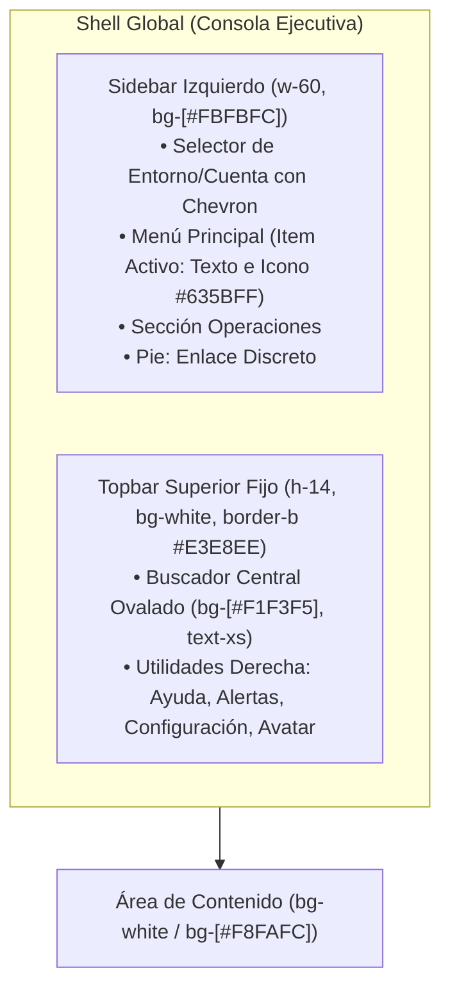
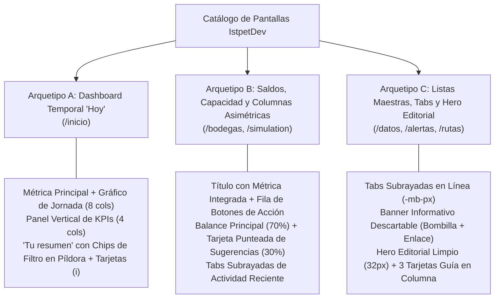

# Guía de maquetación y diseño UI-UX para IstpetDev Platform

Normativa técnica, reglas de diseño y catálogo de componentes visuales para la estandarización transversal de todas las pantallas de la plataforma web (`apps/web`).

> [!IMPORTANT] Principio de Fidelidad al Dominio del Sistema
> La estética visual, jerarquía tipográfica, geometría de contenedores y paleta de contrastes toman como referencia el estándar ejecutivo de **Stripe Dashboard**. No obstante, **queda estrictamente prohibido introducir conceptos, campos o elementos ajenos al dominio logístico de IstpetDev** (como claves de pasarelas de pago, cobros a clientes o formularios financieros). Las referencias visuales son exclusivas de UX/UI para estructurar la operación logística de insumos de higiene hospitalaria.

---

## 1. Fundamentos y Tokens de Diseño

### 1.1 Pila Tipográfica Universal

Toda la aplicación utiliza el stack tipográfico nativo de alta resolución del sistema operativo:

```css
font-family: -apple-system, BlinkMacSystemFont, "Segoe UI", Roboto, Helvetica, Arial, "Inter", sans-serif;
```

* **Texto Base (`body`):** `font-size: 14px; line-height: 20px; color: #30313D;`
* **Números de Métricas:** Tipografía sans-serif con `font-weight: 600`, tracking ajustado (`tracking-tight`) y alineación proporcional.
* **Prohibición de Cero Punteado:** La regla `"zero" 1` en fuentes monoespaciadas está deshabilitada en todo el sistema. Ninguna cifra, coordenada ni código debe renderizarse con punto central retro.

### 1.2 Paleta Cromática Institucional de Alto Contraste

| Token | Código Hex | Rol en la Interfaz | Ejemplo de Uso |
|---|---|---|---|
| **Text Primary** | `#1A2C44` | Títulos principales, navegación activa, métricas | Título `Hoy`, números `24px` |
| **Text Heading** | `#30313D` | Encabezados de tarjetas, columnas de tablas | Títulos de tarjetas `h3` (`14px`) |
| **Text Secondary**| `#3C4F69` | Subtextos descriptivos, comparativas temporales | `"1 bodega activa"`, `"período anterior"` |
| **Text Muted** | `#8792A2` | Iconos de ayuda `ⓘ`, etiquetas secundarias | Micro-iconos `ⓘ`, fechas de corte |
| **Accent / Link** | `#635BFF` | Enlaces de acción, pestañas activas, progreso | `Ver más →`, línea de jornada |
| **Border Card** | `#E3E8EE` | Bordes exteriores de tarjetas y modales | `border border-[#E3E8EE]` |
| **Border Divider**| `#F1F3F5` | Separadores internos y filas de lista | `divide-y divide-[#F1F3F5]` |
| **Surface Base** | `#FFFFFF` | Contenedores de tarjeta, paneles y modales | `bg-white` |
| **Surface Alt** | `#F8FAFC` | Fondo de sidebar, píldoras y filas hover | `bg-[#F8FAFC]` o `bg-slate-50` |

### 1.3 Geometría y Elevación

* **Radio de Borde (`border-radius`):** 
  * Tarjetas principales y modales: `8px` (`rounded-lg` o `rounded-xl`).
  * Controles de formulario y botones estándar: `6px` (`rounded-md`) con altura fija de 36px (`h-9`).
  * Chips y filtros de periodicidad: Píldoras completas (`rounded-full`) con altura de 28-32px (`h-7` a `h-8`).
* **Borde:** Trazo sólido milimétrico `1px solid #E3E8EE` para tarjetas y divisores.
* **Borde Punteado:** Trazo discontinuo sutil `1px dashed #D3D9E2` para bloques de sugerencia, configuración pendiente o vinculación de cuentas.
* **Sombras:** Micro-elevación imperceptible para evitar ruido: `box-shadow: 0 1px 2px rgba(0, 0, 0, 0.04);` o `shadow-2xs`.

---

## 2. Anatomía del Shell Global (Topbar y Sidebar)

Basado fielmente en la estructura observada en las capturas reales de la consola ejecutiva:



### 2.1 Especificación del Sidebar
1. **Selector de Entorno / Cuenta:**
   * Contenedor superior con padding `p-3.5 border-b border-[#E3E8EE]/70`.
   * Avatar cuadrado con esquinas redondeadas (`w-8 h-8 rounded-lg bg-[#E3E8EE] text-[#1A2C44] font-bold`).
   * Título superior en 12px font-medium (`Entorno operativo / IstpetDev`) y nombre de usuario en 11px color `#697386`.
   * Chevron vertical doble o simple a la derecha.
2. **Navegación Principal:**
   * Enlaces con tipografía de `14px`, `font-normal`, color `#4F5B66`.
   * **Estado Activo Real de Stripe:** Cuando una ruta está seleccionada, el texto y el icono adoptan el color morado institucional `#635BFF`, con tipografía seminegrita (`font-medium`) sobre un fondo limpio o sutil `bg-indigo-50/40`, sin marcos rectangulares pesados.
   * **Estado Hover:** `text-[#1A2C44] bg-[#F1F3F5]/60 rounded-md transition-colors`.

### 2.2 Especificación del Topbar
1. **Buscador Rápido:**
   * Posicionado a la izquierda o centro: `w-72 sm:w-80 h-9 bg-[#F1F3F5] rounded-lg px-3 flex items-center gap-2`.
   * Icono de lupa tenue `#8792A2` y placeholder conciso `"Buscar..."`.
2. **Iconos de Utilidad Derecha:**
   * Iconos compactos de 16-18px en `#697386` con efecto hover `#1A2C44`.
   * Indicador de estado operativo o progreso con badge circular tenue.
   * Avatar de usuario circular de 28px con tipografía de inicial en mayúscula.

---

## 3. Catálogo de Arquetipos de Pantalla

La plataforma IstpetDev replica con fidelidad los tres patrones de maquetación identificados en las capturas de producción:



---

### Arquetipo A: Dashboard Temporal Ejecutivo (Captura 3 - Ejemplo: `/inicio`)

Utilizado para páginas de visión general y monitoreo del estado operativo del día en curso.

#### Anatomía Visual
1. **Encabezado:**
   * Título directo: `Hoy` en `text-[26px] font-bold text-[#1A2C44]`.
   * Botón secundario a la derecha: `Actualizar datos` (`h-9 px-3.5 text-xs font-medium border border-[#E3E8EE] rounded-md bg-white text-[#30313D] shadow-2xs hover:bg-slate-50`).
2. **Fila Asimétrica Superior (División 8/4):**
   * **Columna Izquierda (8 cols):**
     * Selectores tipo chip con flecha hacia abajo: `Volumen de despachos ˅` | `Ayer ˅` (`text-xs font-medium text-[#4F5B66]`).
     * Métrica principal destacada: `text-[32px] font-semibold text-[#1A2C44] tracking-tight`.
     * Comparativa de período y hora de corte: `0 m³ ayer` | `19:18` (`text-xs text-[#697386]`).
     * Línea temporal horizontal: trazado continuo morado `#635BFF` hasta la hora actual con proyección al cierre de jornada. Eje temporal con horas `07:00` y `17:00`.
   * **Columna Derecha (4 cols):**
     * Panel vertical separado por divisor sutil `border-l border-[#E3E8EE] pl-8`.
     * Lista apilada de KPIs:
       * Encabezado con título del KPI y enlace de acción azul `#635BFF` (`Ver más` / `Ver datos`).
       * Cifra del KPI en `text-[20px] font-semibold text-[#1A2C44]` con micro-icono de información `ⓘ`.
       * Separador horizontal fino `border-b border-[#F1F3F5] my-4`.
3. **Sección "Tu resumen":**
   * Título de bloque: `Tu resumen` (`text-[22px] font-bold text-[#1A2C44] mb-3`).
   * **Fila de Filtros en Píldora (`rounded-full`):**
     * Botones pastilla redondeados con borde: `Intervalo de fechas: Últimos 7 días ˅` | `Diario ˅` | `⊗ Compara: Período anterior ˅`.
     * Clases exactas: `rounded-full border border-[#E3E8EE] bg-white px-3.5 py-1 text-xs text-[#30313D] hover:bg-slate-50 transition-colors inline-flex items-center gap-1.5`.
     * Acciones secundarias a la derecha: `+ Añadir` y `✎ Editar`.
   * **Cuadrícula de Tarjetas de Métricas:**
     * Tarjetas blancas con `border border-[#E3E8EE] rounded-xl p-5 shadow-2xs hover:border-slate-300 transition-all`.
     * Esquina superior: Nombre del indicador con icono de información `ⓘ` e icono sutil de cuadrícula.
     * Cifra principal en `text-[24px] font-semibold text-[#1A2C44]`.
     * Subtexto comparativo: `0 unidades período anterior` (`text-xs text-[#697386]`).

---

### Arquetipo B: Gestión de Capacidad y Recursos (Captura 2 - Ejemplo: `/bodegas`, `/simulation`)

Utilizado para monitoreo de stock disponible, niveles de reserva y corridas analíticas.

#### Anatomía Visual
1. **Encabezado con Cifra Integrada:**
   * Título principal: `Capacidad de Almacén 1.450 m³ ⓘ` (`text-[26px] font-bold text-[#1A2C44]`).
   * **Barra de Acciones en Fila Horizontal:**
     * Botones tipo chip: `⇄ Transferencia entre bodegas`, `⤓ Ingreso de insumos`, `↗ Despacho a ruta`, `💬 Registrar novedad`.
     * Estilo de botones: `h-8 px-3 rounded-md border border-[#E3E8EE] bg-white text-xs font-medium text-[#30313D] hover:bg-slate-50 flex items-center gap-2 shadow-2xs`.
     * Selector de vista a la derecha: botones compactos de vista cuadrícula y lista.
2. **Estructura Asimétrica de 2 Columnas (70% / 30%):**
   * **Columna Principal (Izquierda ~70%):**
     * Tarjetas de balance limpias en blanco con borde `#E3E8EE` y esquinas redondeadas.
     * Bloque de sugerencia o vinculación en contenedor punteado: `border border-dashed border-[#D3D9E2] rounded-xl p-5 text-center bg-white hover:bg-slate-50/50 transition-colors cursor-pointer`.
     * Sección inferior "Actividad reciente" con pestañas subrayadas (`Despachos`, `Recepciones`).
   * **Columna Lateral (Derecha ~30%):**
     * Tarjeta de recomendación con borde punteado suave `border border-dashed border-[#D3D9E2] rounded-xl p-5 text-center bg-white`:
       * Título conciso (`text-[15px] font-semibold text-[#1A2C44]`).
       * Párrafo explicativo (`text-xs text-[#697386] mt-2 mb-4 leading-relaxed`).
       * Botón de acción secundario compacto: `w-full h-8 border border-[#E3E8EE] rounded-md text-xs font-medium text-[#30313D] hover:bg-slate-50`.
     * Bloque inferior de "Recursos" con accesos directos a manuales operativos o reportes.

---

### Arquetipo C: Listas Maestras, Filtros y Hero Editorial (Captura 1 - Ejemplo: `/datos`, `/alertas`, `/rutas`)

Utilizado para catálogos de centros de salud, insumos hospitalarios, monitoreo de alertas y rutas.

#### Anatomía Visual
1. **Encabezado y Navegación por Pestañas:**
   * Título de pantalla: `Centros de Salud e Insumos` / `Transacciones` (`text-[26px] font-bold text-[#1A2C44]`).
   * A la derecha: botones de acción (`Exportar`, `Columnas`, `+ Cargar Insumos` o `+ Nuevo Registro`).
   * **Pestañas Horizontales Subrayadas Sin Caja:**
     * Fila en `-mb-px flex items-center gap-6 sm:gap-8 border-b border-[#E3E8EE]`.
     * Pestaña Activa: `text-[#1A2C44] font-semibold border-b-2 border-[#1A2C44] pb-3 text-[14px]`.
     * Pestaña Inactiva: `text-[#697386] hover:text-[#1A2C44] pb-3 text-[14px] transition-colors`.
2. **Banner Informativo Descartable (Callout de Consejo):**
   * Barra horizontal delgada: `bg-[#F8FAFC] border border-[#E3E8EE] rounded-lg px-4 py-2.5 flex items-center justify-between text-xs text-[#4F566B] my-4`.
   * Icono de bombilla `💡` tenue a la izquierda.
   * Texto informativo con enlace de acción morado `#635BFF` (`hover:underline font-medium`).
   * Botón de descarte `✕` discreto a la derecha.
3. **Hero Editorial / Estado Principal:**
   * Gran contenedor blanco o gris ultra-suave (`bg-white` o `bg-[#F8FAFC]` con `border border-[#E3E8EE] rounded-xl p-8 sm:p-12 text-left`):
     * Título prominente: `text-[28px] sm:text-[32px] font-bold text-[#1A2C44] tracking-tight`.
     * Subtítulo explicativo: `text-[15px] leading-relaxed text-[#4F566B] max-w-2xl mt-2 mb-6`.
     * Botón primario de acción: `h-9 px-4 bg-[#635BFF] hover:bg-[#5248E0] text-white text-xs font-medium rounded-md shadow-xs transition-colors inline-flex items-center gap-2`.
4. **Tarjetas Guía Inferiores (Fila de 3 Columnas):**
   * Debajo del Hero principal, cuadrícula de 3 tarjetas limpias:
     * Título descriptivo en `text-[14px] font-semibold text-[#1A2C44]`.
     * Explicación breve en `text-xs text-[#697386] mt-1.5 leading-relaxed`.
     * Borde suave `#E3E8EE` con hover sutil.

---

## 4. Componentes de UI Estandarizados

### 4.1 Botones e Interactivos

| Tipo | Altura / Clases Tailwind | Propósito |
|---|---|---|
| **Primario** | `h-9 px-4 bg-[#635BFF] hover:bg-[#5248E0] text-white text-xs font-medium rounded-md shadow-xs transition-colors` | Acción rectora (Guardar, Despachar, Confirmar) |
| **Secundario** | `h-9 px-3.5 bg-white border border-[#E3E8EE] hover:bg-slate-50 text-[#30313D] text-xs font-medium rounded-md shadow-2xs transition-colors` | Cancelar, Exportar, Filtros |
| **Chip / Acción Compacta** | `h-8 px-3 bg-white border border-[#E3E8EE] hover:bg-slate-50 text-[#30313D] text-xs font-medium rounded-md shadow-2xs inline-flex items-center gap-1.5` | Barra horizontal de herramientas |
| **Píldora Filtro** | `h-7 sm:h-8 px-3 rounded-full border border-[#E3E8EE] bg-white text-xs text-[#30313D] hover:bg-slate-50 inline-flex items-center gap-1.5` | Selectores de rango temporal y estado |
| **Enlace de Acción** | `text-xs sm:text-[13px] font-medium text-[#635BFF] hover:underline inline-flex items-center gap-1` | Enlaces en tarjetas (`Ver más →`) |

### 4.2 Badges de Estado Operativo

```html
<!-- Quiebre Inminente / Crítico -->
<span class="inline-flex items-center px-2 py-0.5 rounded text-[11px] font-medium bg-rose-50 text-rose-700 border border-rose-200/60">
  Quiebre Inminente
</span>

<!-- Alerta Preventiva -->
<span class="inline-flex items-center px-2 py-0.5 rounded text-[11px] font-medium bg-amber-50 text-amber-700 border border-amber-200/60">
  Cobertura Ajustada
</span>

<!-- Estado Óptimo / Entregado -->
<span class="inline-flex items-center px-2 py-0.5 rounded text-[11px] font-medium bg-emerald-50 text-emerald-700 border border-emerald-200/60">
  Entregado
</span>
```

### 4.3 Formularios e Inputs
* **Inputs de Texto:** `h-9 px-3 text-xs text-[#1A2C44] bg-white border border-[#E3E8EE] rounded-md shadow-2xs placeholder:text-[#8792A2] focus:border-[#635BFF] focus:ring-1 focus:ring-[#635BFF] focus:outline-none transition-all`.
* **Selects:** `h-9 px-3 text-xs text-[#1A2C44] bg-white border border-[#E3E8EE] rounded-md shadow-2xs focus:border-[#635BFF] focus:outline-none`.
* **Labels:** `text-xs font-medium text-[#30313D] mb-1.5 block`.

---

## 5. UX Writing: Lenguaje Claro, Humano y Accesible para Todo Público

Para preservar la sobriedad ejecutiva, se mantiene estrictamente la prohibición de tecnicismos crudos o jerga de desarrollo:

| ❌ Término Técnico Crudo | ✅ Término Claro en la Interfaz | Contexto |
|---|---|---|
| Ingesta de CSV masiva | **Cargar centros de salud y bodegas** | `/datos` |
| Quiebre de stock en nodo | **Centro de salud con insumos agotados o críticos** | `/alertas` |
| Cobertura menor a umbral | **Quedan menos de 5 días de insumos** | Tablas de Alertas |
| Matriz VRP ejecutada | **Ruta óptima de entrega calculada** | `/rutas` |
| Hash criptográfico y cadena de custodia | **Confirmación de entrega con firma y código QR** | `/public-trace` |
| Payload vacío / Empty collection | **No hay entregas pendientes para hoy** | Estados de Vacío (*Empty States*) |

---

## 6. Lista de Verificación de Calidad para Cada Pantalla

Antes de dar por concluida cualquier interfaz en el proyecto:
1. **Fidelidad Visual a Stripe:** Pestañas subrayadas sin cajas toscas, botones alineados en altura matemática (`h-9` o `h-8`), tipografía de alta jerarquía (`#1A2C44`).
2. **Dominio Estrictamente Logístico:** Insumos de salud, centros de salud, bodegas, conductores y rutas. Cero conceptos financieros simulados.
3. **Cero Emojis:** Todos los indicadores visuales emplean iconos SVG vectoriales limpios o caracteres tipográficos estándares (`ⓘ`, `→`).
4. **Espaciado y Limpieza:** Margen vertical generoso (`space-y-6`), sin apiñamiento ni scrollbars duplicadas.
5. **Tipos Fuertes y Reactividad:** Cero `any` en componentes TypeScript, uso de signals de Angular y enlaces funcionales.
