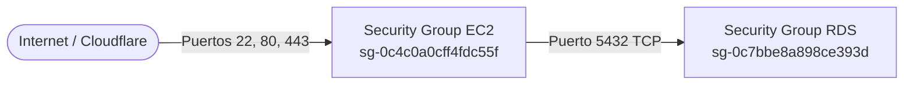

# Perfil A Reforzado: Despliegue Stateless en EC2 y Persistencia en Amazon RDS

> [!note] Estado Operativo
> Arquitectura implementada, validada y en producción en la región `us-east-1`. El host EC2 opera de forma 100% stateless (sin volúmenes locales de datos), comunicándose directamente con la instancia gestionada de Amazon RDS PostgreSQL 16 a través de la red privada interna de la VPC.

> [!warning] Complemento — 12 de octubre de 2026
> - **Esquema.** Las 95 tablas con RLS (Schema95) son el estado **actual** de `istpetdev_integration`, no el que se usará en la demo. ADR-21 (propuesta) lo reemplaza con el spec 001 por el núcleo `DemoCore` de 27 tablas, **sin RLS** ni RBAC administrable, con roles funcionales fijos en `Account.Role`. La guarda `Schema95Preflight.sql` y `tools/Schema95Check` se retiran con ese spec.
> - **Cambio y despliegue.** La secuencia de migraciones, el reset de las bases con respaldo previo y los cambios de infraestructura por spec están en [[Runbook de DevOps y base de datos para la demo]].
> - **Fuera de Terraform.** El host de la app de esta nota no está gestionado por Terraform y comparte security group con el nodo del túnel SSM ([issue #14](https://github.com/bryancito1090/istpetdev-platform/issues/14), R-33).
> - **Seguridad pendiente.** La cadena de conexión usa `Trust Server Certificate=true` y Swagger es público. Ambos puntos están pendientes de corregir en la misma issue.

---

## 1. Visión General de la Arquitectura

El **Perfil A Reforzado** evoluciona el diseño original de contenedor único hacia un modelo desacoplado de alta disponibilidad para la hackathon y fases operativas:

1. **Cómputo Stateless en EC2 (`istpetdev-prod-host`)**:
   - Aloja exclusivamente contenedores efímeros: Nginx Reverse Proxy, Backend API (.NET 8), Frontend Web (Angular 22 SPA) y Redis Cache.
   - No almacena bases de datos locales ni retiene volúmenes de datos (`istpetdev_pgdata` desmantelado).
   - Puede ser destruido y recreado en cualquier momento sin pérdida de datos ni configuración.

2. **Persistencia Gestionada en Amazon RDS (`istpetdev-rds-dev`)**:
   - Instancia dedicada de PostgreSQL 16.13 con soporte geoespacial PostGIS 3.4.6.
   - Retiene hoy las 95 tablas de Schema95 con RLS. Con el spec 001 pasa al núcleo `DemoCore` de 27 tablas sin RLS ([[Runbook de DevOps y base de datos para la demo]]).
   - Snapshots automáticos y aislamiento de red en subredes privadas.

```mermaid
flowchart TD
  Client([Usuario / Navegador]) -->|HTTPS: 443| CF[Cloudflare CDN & Proxy]
  CF -->|HTTP / HTTPS| Nginx[Nginx Reverse Proxy en EC2<br>Puerto 80 / 443]

  subgraph EC2_Host [AWS EC2 Stateless: istpetdev-prod-host<br>IP Pública: 44.204.107.167 | IP Privada: 10.42.0.185]
    Nginx -->|/| Web[istpetdev-web: Angular 22 SPA]
    Nginx -->|/api/*| API[istpetdev-backend: .NET 8 Web API]
    Nginx -->|/health/*| API
    API <-->|Caché en memoria| Redis[istpetdev-redis: 7.4-alpine]
  end

  subgraph RDS_Data [Amazon RDS: istpetdev-rds-dev<br>Subred Privada: 10.42.20.0/24 | Puerto 5432]
    API -->|TCP 5432 - SSL Require<br>Latencia: ~38ms| DB[(Base: istpetdev_integration<br>Núcleo DemoCore + PostGIS<br>hoy: Schema95 con RLS)]
  end
```

---

## 2. Topología de Red y Seguridad (VPC `10.42.0.0/16`)

Toda la infraestructura coexiste en la VPC oficial del proyecto (`vpc-0217f06f82247cd0b`), eliminando la necesidad de túneles complejos o VPC Peering entre entornos:

| Recurso | Identificador AWS | Zona / Subred | CIDR | Dirección IP |
|---|---|---|---|---|
| **VPC Proyecto** | `vpc-0217f06f82247cd0b` | `us-east-1` | `10.42.0.0/16` | N/A |
| **Subred Pública** | `subnet-0753b32e4f7c99913` | `us-east-1a` | `10.42.0.0/24` | N/A |
| **Instancia EC2** | `i-0e0a979f8c0885a4f` | `us-east-1a` (Pública) | `10.42.0.0/24` | Pública: `44.204.107.167`<br>Privada: `10.42.0.185` |
| **Subred Privada RDS** | Subnet Group Dev | `us-east-1a` / `us-east-1b` | `10.42.20.0/24` | N/A |
| **Instancia RDS** | `istpetdev-rds-dev` | `us-east-1` (Privada) | `10.42.20.0/24` | Endpoint DNS Privado (IP: `10.42.20.57`) |

### Matriz de Security Groups



- **`sg-0c4c0a0cff4fdc55f` (`istpetdev-ec2-access-sg-dev`)**:
  - Inbound: `22/tcp` (SSH), `80/tcp` (HTTP), `443/tcp` (HTTPS) desde `0.0.0.0/0`.
  - Outbound: Todo el tráfico permitido (`0.0.0.0/0`).
- **`sg-0c7bbe8a898ce393d` (`istpetdev-rds-dev-sg`)**:
  - Inbound: `5432/tcp` exclusivamente desde el origen `sg-0c4c0a0cff4fdc55f`.
  - Sin exposición a internet público.

---

## 3. Especificación de Base de Datos y Aislamiento de Roles

La instancia compartida de Amazon RDS implementa aislamiento lógico mediante bases de datos y roles específicos:

### Bases de Datos en la Instancia

| Base de Datos | Usuario Principal | Propósito |
|---|---|---|
| `istpetdev_integration` | `migrator_integration` | **Entorno Desplegado en la Nube (EC2)**. Base central de integración y demostración. |
| `istpetdev_dev_01` a `05` | `user_dev_01` a `05` | Bases personales aisladas de cada desarrollador para trabajo local vía túnel SSM. |

### Guarda de Seguridad de Migración (`Schema95Preflight.sql`) — se retira con el spec 001
Vigente hasta que se integre `DemoCore`; después queda solo en el tag `schema95-archivo`. La migración de EF Core (`CompleteSystemSchema95`) impone una regla estricta de seguridad en PL/pgSQL:
1. Exige que la base sea exactamente `istpetdev_integration` o la base personal correspondiente.
2. Exige que el rol que ejecuta la migración sea `migrator_integration`.
3. Falla intencionalmente si el rol es `SUPERUSER` o tiene privilegios `BYPASSRLS` (ej. `istpetadmin`).

### Propiedad y Permisos en `istpetdev_integration`
- **Owner del esquema `public`**: `migrator_integration`.
- **Owner de las tablas y secuencias**: `migrator_integration`.
- **Privilegios**: DDL completo para el rol migrador. Con `DemoCore` no hay RLS; cada migración termina con `DemoGrants.Sql`, que concede lectura y escritura a los roles `user_*`.

---

## 4. Pipeline de Despliegue Inmutable (GitHub Actions)

El flujo `.github/workflows/deploy.yml` despliega el sistema de forma idempotente:

1. **Variables y Secretos en GitHub Actions**:
   - `EC2_HOST`: `44.204.107.167`
   - `EC2_USER`: `admin`
   - `EC2_SSH_KEY`: Clave privada RSA 2048 (`login.pem`).
   - `DB_HOST`: `istpetdev-rds-dev.cep4osawemm3.us-east-1.rds.amazonaws.com`
   - `DB_NAME`: `istpetdev_integration`
   - `DB_USER`: `migrator_integration`
   - `DB_PASSWORD`: Clave sincronizada con AWS Secrets Manager (`/istpetdev/dev/db/integration/migrator`).
   - `DB_SSL_MODE`: `Require`
2. **Resiliencia en el Servidor**:
   - Las variables se persisten en `/var/www/istpetdev/.env`.
   - Si una ejecución de CD carece momentáneamente de variables en runner, el script en el host recurre al `.env` local preconfigurado.
3. **Arranque del Contenedor Backend**:
   - Cadena de conexión inyectada vía variable `ConnectionStrings__Main`.
   - `ApplyMigrations: "true"` ejecuta las comprobaciones y actualiza el esquema automáticamente al iniciar. Durante la hackathon, la base de integración solo la cambia el despliegue (propuesta en la sección 5 del [[Runbook de DevOps y base de datos para la demo]]).

---

## 5. Endpoints de Verificación y Telemetría

La plataforma expone endpoints estándar de observabilidad verificados en vivo:

| Endpoint | Método | Código Esperado | Descripción Técnica |
|---|---|---|---|
| `https://istpetdev.doicela.dev/health/live` | GET | `200 OK` | Confirma que el proceso .NET 8 está activo y respondiendo solicitudes HTTP. |
| `https://istpetdev.doicela.dev/health/ready` | GET | `200 OK` | Ejecuta `CanConnectAsync()` contra RDS y valida que no existan migraciones pendientes en `__EFMigrationsHistory`. |
| `https://istpetdev.doicela.dev/swagger` | GET | `200 OK` | Interfaz Swagger UI con la documentación OpenAPI interactiva. Hoy es pública; se va a restringir ([issue #14](https://github.com/bryancito1090/istpetdev-platform/issues/14)). |
| `https://istpetdev.doicela.dev/` | GET | `200 OK` | Aplicación Angular 22 SPA servida con compresión y caché por Nginx. |

---

## 6. Procedimiento para Sustitución o Recreación del Host EC2

Dado que el host es stateless, el reemplazo de la máquina ante incidentes o redimensionamiento sigue este procedimiento:

1. **Lanzamiento de Instancia**:
   - AMI: Debian 13 (amd64).
   - VPC: `vpc-0217f06f82247cd0b` (`istpetdev-vpc-dev`).
   - Subred: `subnet-0753b32e4f7c99913` (Pública).
   - Security Group: `sg-0c4c0a0cff4fdc55f`.
   - Key Pair: `login`.
2. **Actualización de Registros**:
   - Asignar o reasociar la Elastic IP, o actualizar el registro tipo `A` en Cloudflare con la nueva IP pública.
   - Si la IP cambia, actualizar `EC2_HOST` en los secretos de GitHub Actions.
3. **Despliegue Automático**:
   - Ejecutar el workflow manual de GitHub Actions (`workflow_dispatch`) o hacer push a `main`.
   - El pipeline instalará dependencias, transferirá configuraciones y levantará los servicios conectándose a la base de datos existente sin necesidad de intervención manual en la terminal.
