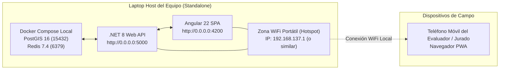

# Runbook de DevOps y base de datos para la demo

> [!important] Procedimiento Vinculante Aceptado — 13 de octubre de 2026
> Este runbook resuelve y formaliza la [issue #16](https://github.com/bryancito1090/istpetdev-platform/issues/16), consolidando el **único procedimiento oficial de base de datos y despliegue para la demo del 13 al 15 de octubre**. ADR-21 queda formalmente **aceptado** con Deciders confirmados (Jorge Doicela como Infraestructura/DevOps, Bryan Doicela como Tech Lead y Joseph Bano como DevOps/Tech Writer). Cualquier procedimiento anterior en conflicto queda reemplazado.

Es el procedimiento único para cambiar la base y el despliegue entre el 13 y el 15 de octubre. Lo que no aparece aquí no se ejecuta sin acordarlo antes con el equipo.

## 1. Manejo de la Base de Datos

ADR-21 (núcleo delgado) **retira Schema95 y RLS de la demo**. Por la dinámica del evento, en el que el dataset se conoce el mismo día, se utiliza un esquema de 27 tablas gestionadas por Entity Framework Core, una sola organización fija (`OrganizationId` se conserva) y seis roles funcionales fijos guardados en `Account.Role`. No hay RBAC administrable, concesiones, plantillas ni configuración desde la base: RF-17, RF-18, RF-19 y RNF-13 pasan a P2. El diseño previo de 95 tablas con RLS se conserva como referencia en el tag `schema95-archivo` y en [[Esquema completo de base de datos]].

Que no haya RLS no significa que no existan roles de PostgreSQL:

| Rol de PostgreSQL | Uso en la demo |
|---|---|
| `migrator_dev_01`, `migrator_integration` | Dueños de las tablas en el esquema `public`; aplican migraciones de EF Core. En producción, la API se conecta con `migrator_integration` y ejecuta las migraciones al arrancar (`ApplyMigrations=true`). |
| `user_dev_01`, `user_integ_dev_01` | Roles de lectura y escritura (DML) sin DDL. Cada migración termina con `DemoGrants.Sql`, que concede permisos sobre las tablas del núcleo. |

## 2. Estado Actual del Despliegue (13-oct)

| Pieza | Situación | Fuente |
|---|---|---|
| Pipeline CI/CD | Desde `main`, con un PR de `develop`: validación de política de ramas, QA Backend (.NET 8 con `LeanSchemaTests`; Integración y Unit+E2E en runners paralelos, clases de prueba en paralelo sobre un PostGIS compartido), QA Frontend (Angular 22 con ESLint FSD), imágenes Docker inmutables en GHCR asociadas al SHA (construidas en paralelo con QA; el despliegue y el tag `latest` solo avanzan con QA en verde), y despliegue atómico por SSH al EC2. | `.github/workflows/deploy.yml` |
| Host de la aplicación | `istpetdev-prod-host` (`i-0e0a979f8c0885a4f`, IP `44.204.107.167`), Debian 13, stateless. | [[Perfil A Reforzado - Despliegue Stateless y Amazon RDS]] |
| Base de datos en producción | Amazon RDS PostgreSQL 16.13 (`istpetdev-rds-dev`, base `istpetdev_integration`) en subred privada de AWS. **27 tablas de `DemoCore` aplicadas y verificadas.** | [[Estrategia de tres entornos y base de datos]] |
| Entorno de desarrollo | Base compartida en AWS EC2 (puerto `5432`) con usuario único `migrator_dev_01` para todo el equipo (laboratorio, casa u oficina), configurada centralizadamente en `.env`, y Docker local (`localhost:15432`) como alternativa individual. `appsettings.json` mantiene secretos limpios para no exponer credenciales en Git. | [[Estrategia de tres entornos y base de datos]] |
| Verificación de salud | `https://istpetdev.doicela.dev/health/ready` responde `HTTP 200 Healthy` (`PostgreSQL database is available.`). | Verificación en vivo |

## 3. Secuencia Oficial de Migraciones (13–15 oct)

Regla estricta: **una migración por spec, en serie sobre `develop`**. Cada migración se genera sobre `develop` actualizado, después de que la anterior esté integrada en el repositorio, y termina invocando `migrationBuilder.Sql(DemoGrants.Sql)`. Prohibido abrir migraciones concurrentes en paralelo para evitar conflictos de snapshot en `ApplicationDbContextModelSnapshot`.

| Orden | Spec | Migración EF Core | Contenido Principal | Responsable | Plazo / Hito | Estado |
|---|---|---|---|---|---|---|
| 0 | — | Tag `schema95-archivo` | Punto de congelamiento y referencia de Schema95 | Bryan / Jorge | 12-oct | **Completado** |
| 1 | 001 | `DemoCore` | 27 tablas del núcleo, organización demo, PostGIS, cuentas y `DemoGrants` | Bryan / Jorge | H2 (13-oct 20:00) | **Completado y Desplegado en Prod** |
| 2 | 002 | `RoadMatrixCache` | `RoadMatrixEdge`, caché de distancias y `RouteStockReservation` | Anthony Pilatasig | Antes de H3 (14-oct 20:00) | **Desplegado en Prod** (verificado 15-oct) |
| 3 | 004 | `FieldOperations` | `QrAccessToken`, estado y sincronización offline | Alexander Martínez | Antes de H3 (14-oct 20:00) | **Desplegado en Prod** (verificado 15-oct) |
| 4 | 003 | `AgentRuns` | Registro de ejecuciones y trazabilidad de decisiones del agente | Anthony Pilatasig | Antes de H4 (15-oct 11:00) | **Desplegado en Prod** (verificado 15-oct) |
| 5 | — | `OrderBasedRoutingAndWarehouseStock` | Ruteo por pedidos, stock por bodega y rebalanceo | Alexander Martínez | 14-oct | **Desplegado en Prod** (verificado 15-oct) |
| 6 | 005 | `SimulationRunsAndEvents` | Metadatos y eventos de corridas de simulación (`SimulationRun`, `SimulationEvent`) | Alexander Martínez | Antes de H4 (15-oct 11:00) | **Desplegado en Prod** (verificado 15-oct) |

> **Verificación del 15-oct (17:20 UTC):** `/health/ready` de producción responde `Healthy`. Ese check devuelve `Unhealthy` si hay migraciones pendientes o si las tablas no coinciden con el modelo (`DatabaseHealthCheck`), así que las 8 migraciones del repositorio están aplicadas en RDS. La migración `AccountsAndAudit` que se había planificado para la spec 013 no existe en el repositorio.

> [!important] Congelamiento total de base de datos (H5)
> **A partir de H5 (15 de octubre a las 14:00) queda terminantemente prohibido generar, fusionar o aplicar cualquier nueva migración DDL.** Toda la persistencia quedará congelada para la sesión de demostración y pitch.

> [!warning] Reemplazado el 16-oct-2026
> Joseph autorizó **una sola migración** la noche del 16-oct: la de #240 (`Product.UnitValue`, `UnitsPerPackage`, `Vehicle.VehicleType`, `UsageScope`). Como `/health/ready` responde *Unhealthy* con migraciones pendientes, se aplica en RDS en el mismo despliegue (#198) y con respaldo previo, antes del congelamiento del código (sáb 11:30). Si no se puede aplicar a tiempo, no se fusiona. Cualquier otra migración se coordina con Bryan. Ver el tablero #253.

## 4. Procedimiento de Respaldo y Restauración (Issue #15)

> **Actualizado el 15-oct-2026 (#15, Anthony Pilatasig).** Estado verificado en el repositorio; lo que no se pudo comprobar está marcado como tal.

### 4.1 Dónde viven los datos y qué respaldos existen

| Pieza | Valor | Fuente |
|---|---|---|
| Base de producción | Amazon RDS PostgreSQL 16 `istpetdev-rds-dev`, base `istpetdev_integration`, rol `migrator_integration`, TLS `VerifyFull` | `infra/compose/docker-compose.prod.yml`, `.github/workflows/deploy.yml`; actividad de conexión del 15-oct en la evidencia de #39 |
| Base de desarrollo | PostgreSQL compartido en EC2 (`istpetdev_dev_01`) o Docker local. **No es producción** | [[Credenciales y acceso del equipo]] §3 |
| Respaldo automático de RDS (PITR) | 7 días, o 1 día si `free_plan_backup_workaround=true` | `infra/terraform/environments/dev/main.tf` |
| Snapshot diario con AWS Backup | Solo si `free_plan_backup_workaround=true`; retención de 7 días | `infra/terraform/environments/dev/backup.tf` |
| Bucket de volcados lógicos | `istpetdev-backups-dev-<cuenta>-us-east-1`, prefijos `daily/` (7 días) y `weekly/` (28 días), versionado | `infra/terraform/environments/dev/operations.tf` |
| Rol de solo lectura para volcados | `backup_integration` (solo `SELECT`), secreto `/istpetdev/dev/db/integration/backup` | `scripts/ops/dev.py` |

**No verificado desde el repositorio:** qué valor de `free_plan_backup_workaround` está aplicado, y si existen snapshots o volcados en la cuenta. Hace falta acceso a AWS.

PITR y snapshot restauran **la instancia completa en una instancia nueva**. Para recuperar una sola base se usa el volcado lógico.

### 4.2 Herramienta oficial

La única herramienta de respaldo es `scripts/base_datos/database-task.py`; `scripts/backup/backup-db.sh` es su atajo.

- `backup`:
  - Hace `pg_dump -Fc` con cliente PostgreSQL 16 (en Docker) y el rol `backup_integration`.
  - Toma el conteo y el hash de cada tabla antes y después del volcado, y aborta si hubo escrituras durante el respaldo.
  - Calcula el SHA-256 y sube el archivo a `daily/` (y a `weekly/` los domingos) con checksum.
  - Verifica tamaño y checksum del objeto remoto.
- `restore-check`:
  - Comprueba el SHA-256.
  - Restaura en una base aleatoria `istpetdev_restorecheck_*` y compara todas las tablas contra el manifiesto.
  - Comprueba PostGIS y **borra solo esa base de prueba**.
- `migrate`:
  - Primero respalda; después aplica las migraciones con el mismo migrador que usa producción (`IstpetDev.Api.dll --migrate`).

### 4.3 Procedimiento antes de una migración o intervención destructiva

Requiere el túnel SSM abierto (`scripts/ops/dev-tunnel.sh`) y los archivos privados `dev-access.json` y `dev-outputs.json`, según `docs/aws-dev.md`.

1. **Snapshot manual de la instancia** (Jorge Doicela):
   ```bash
   aws rds create-db-snapshot --db-instance-identifier istpetdev-rds-dev \
     --db-snapshot-identifier "istpetdev-rds-dev-pre-<motivo>-$(date -u +%Y%m%d-%H%M)"
   aws rds wait db-snapshot-available --db-snapshot-identifier "<el mismo identificador>"
   ```
2. **Volcado lógico verificado en S3**, en una ventana sin escrituras:
   ```bash
   scripts/backup/backup-db.sh integration
   ```
3. **Restauración de prueba** en una base descartable, nunca sobre `istpetdev_integration`:
   ```bash
   python3 scripts/base_datos/database-task.py restore-check --profile istpetdev-admin \
     --config "$private_dir/dev-access.json" --outputs "$private_dir/dev-outputs.json" \
     --backup "$private_dir/backups/<archivo>.dump"
   ```
4. Registrar la evidencia (fecha UTC, identificador del snapshot, clave S3 y SHA-256, tablas verificadas y segundos de restauración) en el issue o en [[Evidencias y ensayos de base de datos y despliegue]], sin credenciales.
5. **Recuperación real:**
   - Restaurar el volcado en una base nueva y reaplicar roles y grants canónicos (el volcado no guarda propietarios ni ACL).
   - Validar y solo entonces cambiar la conexión.
   - Con un snapshot: restaurarlo en **otra instancia**, validar y después cambiar el endpoint. Nunca rebobinar operaciones aceptadas sin reconciliación.

### 4.4 Ensayo verificado y pendientes

| Hecho | Estado | Evidencia |
|---|---|---|
| Ensayo completo en PostGIS 16 desechable con TLS: bootstrap dos veces, 8 migraciones aplicadas una sola vez, API lista, volcado, restauración aislada y hash por tabla | **Pasó** el 15-oct-2026 16:47 UTC, en 76 s | `python3 scripts/base_datos/test-bootstrap.py`; ahora también corre en CI (job «Ensayo de respaldo y restauración») |
| Snapshot `pre-democore` antes de aplicar DemoCore | **Sin evidencia en el repositorio.** No se presenta como realizado | — |
| Volcado de `istpetdev_integration` en S3 y `restore-check` contra RDS | **Pendiente**: requiere acceso a AWS (Jorge Doicela) | — |
| Paso de respaldo automático en `deploy.yml` antes de migrar | **No implementado.** El rol del host de la app solo tiene permisos de Cognito y el host no tiene `pg_dump` ni AWS CLI; un paso obligatorio bloquearía todos los despliegues. Hasta resolverlo, el ítem 2 del checklist de §11 (snapshot manual) sigue siendo obligatorio | `infra/terraform/environments/dev/app_host_iam.tf` |

## 5. Regla de Promoción a Producción (Acordada y Ratificada)

De las dos alternativas planteadas en la [issue #16](https://github.com/bryancito1090/istpetdev-platform/issues/16), se ratifica como **regla única y obligatoria**:

> **Regla de Promoción:** Toda migración integrada en `develop` se promueve a `main` mediante Pull Request. El pipeline de CI/CD despliega la imagen inmutable y la API .NET aplica la migración automáticamente al iniciar en el host EC2 (`ApplyMigrations=true`).

- **Justificación técnica:** Se descarta la ejecución manual por túnel SSM con `migrator_integration` para el despliegue rutinario porque introduce fricción de autenticación AWS/MFA, requiere conexión WAN interactiva del operador y genera desalineación temporal entre el código desplegado y la base de datos.
- **En desarrollo local:** Cada desarrollador actualiza su copia de `develop` y ejecuta `npm run db:migrate` sobre la base de desarrollo centralizada configurada en `.env` o Docker local (`localhost:15432`).

---

## 6. Alcance del CI frente a Amazon RDS (Matriz de Verificación)

Un resultado exitoso en el flujo de integración continua (`ci.yml`) **no certifica** la conectividad, las credenciales ni el comportamiento de las migraciones con los datos reales de Amazon RDS. El pipeline ejecuta las suites de pruebas contra un contenedor Docker efímero local (`postgis/postgis:16-3.4-alpine`) aprovisionado al vuelo en el ejecutor de GitHub Actions.

| Componente | Validado por CI (`ci.yml`) | Validado Exclusivamente en Despliegue (`deploy.yml`) |
|---|---|---|
| **Compilación y Tipado C#** | Sí (SDK .NET 8, `dotnet build -c Release`) | Heredado de la compilación inmutable |
| **Arquitectura Frontend FSD** | Sí (`npm run lint:web`, límites boundaries) | Heredado |
| **Pruebas Unitarias** | Sí (`LeanSchemaTests`, lógica de dominio) | Heredado |
| **Pruebas de Integración BD** | Sí, sobre contenedor efímero descartable | No aplicable (evita mutaciones en prod) |
| **Conectividad de Red AWS RDS** | **No** (VPC privada inaccesible desde GitHub) | **Sí** (EC2 dentro de la VPC en puerto 5432) |
| **Credenciales Secrets Manager** | **No** (CI desconoce `migrator_integration`) | **Sí** (Inyectadas en runtime en host EC2) |
| **TLS VerifyFull con CA Oficial** | **No** (Contenedor efímero sin TLS forzado) | **Sí** (`global-bundle.pem` montado en backend) |
| **Aplicación de Migraciones** | Sí, sobre base vacía o con fixtures: historia completa sin cambios de modelo pendientes (`MigrationSafetyTests`) y ensayo por el camino de producción `--migrate`, dos veces, con respaldo y restauración (job «Ensayo de respaldo y restauración») | **Sí**, sobre los datos reales (`DatabaseInitializer.MigrateAsync` en RDS al arrancar la API) |
| **Migraciones solo aditivas (§8)** | Sí: `scripts/db/check-additive-migrations.py` rechaza `Drop*`, `Rename*`, `AlterColumn` y SQL destructivo en `Up()` de migraciones posteriores a `DemoCore` | Heredado |
| **Criterio de Éxito de Despliegue** | Job en verde de GitHub Actions | `HTTP 200` estricto en `/health/ready` |

> [!important] Regla de verificación obligatoria
> La única certificación formal de que una migración fue aplicada exitosamente en producción es la respuesta `HTTP 200 Healthy` del endpoint `https://istpetdev.doicela.dev/health/ready` tras el paso 8 de `deploy.yml`. Si el endpoint responde `HTTP 503` o el contenedor reinicia, el despliegue aborta con código 1 (política Fail-Fast).

### Registro de Cambios de Infraestructura Fuera de Terraform

| Fecha | Identificador de Recurso | Cambio Aplicado | Método / Rama | Responsable | Estado |
| :--- | :--- | :--- | :--- | :--- | :--- |
| 2026-10-15 | `i-0e0a979f8c0885a4f` (`istpetdev-prod-host`) | 013 — Perfil IAM (`istpetdev-app-host-dev`) y hop limit 2 del host de la app | CLI / Rama A | Jorge Doicela | **Completado** |
| 2026-10-15 | `istpetdev-rds-dev` (`istpetdev_integration`) | 013 — Reconciliación de cuentas de equipo, roles y safe deactivation | Túnel SSM / CLI | Jorge Doicela | **Completado** (Issue #55) |

---

## 7. Procedimiento de Verificación de Migraciones en Producción

Para auditar y verificar qué migraciones de Entity Framework Core se encuentran registradas en la tabla histórica `__EFMigrationsHistory` de Amazon RDS:

### Método A: Consulta directa vía Túnel SSM (Auditoría Administrativa)

Desde la estación de trabajo con el túnel administrativo SSM activo (mapeando el puerto 15432 local a Amazon RDS en subred privada):

```bash
# 1. Abrir túnel SSM en Terminal A
aws ssm start-session \
  --target i-0bba84773e794de36 \
  --document-name AWS-StartPortForwardingSessionToRemoteHost \
  --parameters '{"host":["istpetdev-rds-dev.cep4osawemm3.us-east-1.rds.amazonaws.com"],"portNumber":["5432"],"localPortNumber":["15432"]}'

# 2. Consultar historial de migraciones en Terminal B
psql -h 127.0.0.1 -p 15432 -U migrator_integration -d istpetdev_integration -c \
  "SELECT \"MigrationId\", \"ProductVersion\" FROM \"__EFMigrationsHistory\" ORDER BY \"MigrationId\" ASC;"
```

**Resultado esperado tras promoción acumulada:**
```text
                  MigrationId                  | ProductVersion 
-----------------------------------------------+----------------
 20261013031023_DemoCore                       | 8.0.11
 20261013143520_RoadMatrixCache                | 8.0.11
 20261013202540_FieldOperations                | 8.0.11
 20261013203831_AgentRuns                      | 8.0.11
 20261014162010_AccountsAndAudit               | 8.0.11
(5 rows)
```

### Método B: Inspección de observabilidad vía endpoint HTTP

Consultar el reporte detallado de estado de la base de datos en producción:
```bash
curl -s -i https://istpetdev.doicela.dev/health/ready
```
Respuesta esperada: `HTTP/1.1 200 OK` con payload JSON conteniendo `"status": "Healthy"`, confirmando conectividad y transaccionalidad activa sobre Amazon RDS.

---

## 8. Política de Rollback y Migraciones Aditivas

El workflow `rollback.yml` restaura los contenedores `istpetdev-backend` e `istpetdev-web` a una versión inmutable previa (SHA anterior) en menos de 30 segundos. Solo acepta un SHA hexadecimal de `main` que ya tenga un despliegue exitoso en `deploy.yml` (QA y despliegue en verde) y comparte el grupo de concurrencia `production-deploy`, así que nunca corre a la vez que un despliegue. Sin embargo, **el rollback de contenedores no revierte las migraciones aplicadas en Amazon RDS**.

### Regla Inviolable: Migraciones Aditivas (Zero-Downtime)

Para garantizar que un rollback de imagen no rompa el backend:

1. **Compatibilidad hacia atrás (Backward Compatibility):**
   - Toda migración DDL debe ser estrictamente aditiva: creación de tablas nuevas, nuevas columnas con valor `DEFAULT` o que admitan `NULL`, y nuevos índices.
   - **Prohibido:** Eliminar columnas, renombrar tablas en uso o alterar tipos de datos restrictivos dentro de la misma versión.
   - Si se requiere retirar un campo obsoleto, se realiza en un ciclo de dos pasos: primero se deja de usar en el código de aplicación (conservando la columna), y en una versión posterior se elimina la columna física.
   - **Lo hace cumplir el CI:** el paso «Verificar que las migraciones nuevas son aditivas» de `ci.yml` falla ante `Drop*`, `Rename*`, `AlterColumn` o SQL destructivo en `Up()`. Una excepción revisada se declara dentro del archivo con `// migracion-destructiva-aprobada: <motivo>` y requiere el snapshot manual del §11.
2. **Si la migración falla al arrancar en RDS:**
   - PostgreSQL revierte la transacción de esa migración, así que la base queda en la versión anterior.
   - Pero `deploy.yml` ya recreó los contenedores (`up -d --force-recreate`) antes del chequeo de `/health/ready`: el backend nuevo no arranca y **producción queda caída** hasta ejecutar `rollback.yml` al último SHA desplegado.
3. **Procedimiento ante Rollback con Migración Aplicada:**
   - Si la migración cumple la regla aditiva, la versión anterior de la API continuará operando normalmente ignorando las tablas o columnas adicionales.
   - Si la migración introdujo una incompatibilidad regresiva crítica, el rollback de contenedores no es suficiente: se debe ejecutar la restauración del Snapshot previo en Amazon RDS.

---

## 9. Justificación de Roles de Persistencia en Producción

En el entorno de producción (`istpetdev-prod-host`), la API .NET se ejecuta conectándose con el usuario **`migrator_integration`**:

- **Razón técnica de diseño:** Permite que `DatabaseInitializer.MigrateAsync` aplique automáticamente las migraciones DDL al arrancar el contenedor en EC2 (`ApplyMigrations=true`).
- **Alternativa evaluada:** Conectar la API en runtime con `user_integ_dev_01` (solo permisos DML) y ejecutar migraciones mediante un pipeline auxiliar previo. Se descartó para la demo porque exigiría túneles SSM interactivos con MFA durante el despliegue desatendido o un contenedor efímero adicional en AWS con privilegios de red elevados, introduciendo puntos de fallo en vivo durante el evento.
- **Protección compensatoria:**
  1. Red privada aislada: RDS no expone IP pública; solo acepta conexiones del Security Group `sg-0c4c0a0cff4fdc55f`.
  2. TLS estricto `VerifyFull` con CA bundle oficial de AWS RDS.
  3. Desactivación de Swagger UI en producción por defecto.
  4. Credenciales inyectadas exclusivamente en el host EC2 con permisos restringidos (`chmod 600 .env`).

---

## 10. Plan B del Evento (Contingencia sin Internet / Sin Cobertura WAN)

> [!important] Corrección operativa para el recinto del concurso
> En el Centro de Exposiciones Quito no existe la red LAN institucional del laboratorio (`192.168.7.50`). Si la conectividad WAN (Cloudflare/AWS) falla durante la presentación o pitch ante los jueces, se activa de inmediato el **Plan B Local**.



### Procedimiento de Activación del Plan B (<2 minutos)

1. **Laptop Principal (Servidor Local Autónomo):**
   ```bash
   # Terminal 1: Iniciar PostgreSQL y Redis locales
   npm run docker:up

   # Terminal 2: Iniciar backend escuchando en todas las interfaces
   dotnet run --project src/Api --urls "http://0.0.0.0:5000"

   # Terminal 3: Servir frontend web y PWA
   npm run dev:web -- --host 0.0.0.0
   ```
2. **Habilitar Red Local Compartida:**
   - Activar la **Zona con cobertura inalámbrica móvil (Hotspot)** desde la laptop o conectar los equipos a un router WiFi portátil sin internet.
   - Identificar la IP local de la laptop con `ipconfig` (ej: `192.168.137.1`).
3. **Conexión de Teléfonos y Jurados:**
   - Conectar los dispositivos móviles a la red WiFi del Hotspot.
   - Navegar a `http://192.168.137.1:4200` (Torre de Control) o `http://192.168.137.1:4200/campo` (PWA de Campo).
   - Los fixtures de datos base (`demo-base`) ya se encuentran incluidos localmente en el repositorio.

---

## 11. Checklist Obligatorio Previo a la Promoción a Main

Antes de abrir y fusionar el Pull Request de promoción desde `develop` hacia `main`:

- [ ] **1. Migración Aditiva Verificada**: El CI la comprueba (`scripts/db/check-additive-migrations.py`). Una excepción se declara en la migración con `// migracion-destructiva-aprobada: <motivo>` y exige el snapshot del ítem 2.
- [ ] **2. Snapshot Manual de RDS Creado**:
  ```bash
  aws rds create-db-snapshot \
    --db-instance-identifier istpetdev-rds-dev \
    --db-snapshot-identifier "istpetdev-rds-pre-deploy-$(date +%Y%m%d-%H%M)"
  ```
  Confirmar que el estado del snapshot sea `available`.
- [ ] **3. Suite Local de Verificación en Verde**:
  ```bash
  npm run check
  python docs/boveda/.github/scripts/check_vault.py
  ```
- [ ] **4. Variables de Entorno en Host EC2 Confirmadas**: Verificar que `DB_PASSWORD`, `COGNITO_*` y `DB_SSL_MODE=VerifyFull` estén presentes en `/var/www/istpetdev/.env`.
- [ ] **5. Revisión de PR**: Verificar que los checks de CI (`LeanSchemaTests`, ESLint FSD) hayan concluido exitosamente en GitHub Actions.
- [ ] **6. Verificación Post-Merge Inmediata**: Monitorear el workflow `deploy.yml` y auditar la respuesta:
  ```bash
  curl -s -i https://istpetdev.doicela.dev/health/ready
  ```
  Debe retornar `HTTP 200 Healthy`.

---

## 12. Matriz de Cambios de Infraestructura por Spec

| Spec | Requerimiento de Infraestructura | Archivos Afectados | Responsable | Plazo | Estado |
|---|---|---|---|---|---|
| **001 T4** | Retirar `Schema95Check` y validar con `dotnet test` (`LeanSchemaTests`) | `.github/workflows/deploy.yml` | Jorge Doicela | H2 (13-oct) | **Completado** |
| **001** | Incluir fixtures (`demo-base`) y variables `Demo__*` en Docker y compose | `infra/docker/backend/Dockerfile`, `infra/compose/docker-compose.prod.yml` | Jorge Doicela | H2 (13-oct) | **Completado** |
| **004 T1b** | Servir PWA en ruta `/campo/` y configurar cabeceras de caché | `infra/nginx/istpetdev.conf` | Alexander Martínez / Jorge Doicela | H3 (14-oct) | En curso |
| **013 T10** | Callbacks HTTPS en Amazon Cognito, marca ISTPET y perfil IAM del host de la app | Terraform `identity.tf`, `variables.tf`, `app_host_iam.tf`, CLI | Jorge Doicela | H3 (14-oct) | **Completado** (Issue #43) |
| **013** | Aprovisionamiento y reconciliación de las 6 cuentas por rol, claves permanentes y safe deactivation | CLI `--provision-accounts`, Cognito, RDS y BD Dev | Jorge Doicela | H4 (15-oct) | **Completado** (Issue #55) |
| **003** | Cliente M2M en Cognito (`client_credentials`), scopes y cuenta técnica para el agente n8n | Terraform `identity.tf`, `src/Api/appsettings.*`, Compose, Deploy | Jorge Doicela | H3 (14-oct) | CD #86 exitoso (`a45a548`); **cuentas productivas y permisos M2M/humano verificados** (n8n risks 200; cinco acciones humanas 403 con M2M); aceptación pendiente en [#38](https://github.com/bryancito1090/istpetdev-platform/issues/38)/[#39](https://github.com/bryancito1090/istpetdev-platform/issues/39) |
| **005** | Base aislada de simulación (`istpetdev_simulation`) y cadena `ConnectionStrings:Simulation` | RDS / Docker Compose / Secretos | Jorge Doicela | H4 (15-oct) | Pendiente |
| **Seguridad (#14)** | TLS con `VerifyFull` + CA oficial de RDS y Swagger restringido por defecto. SSH 22 mitigado con UFW/fail2ban (cierre y Terraform diferidos a P2) | Dockerfile / Compose / Nginx / Program.cs / Deploy workflow | Jorge Doicela | Antes de H4 (14-oct) | **Completado** |

---

## 13. Checklist de Control Día por Día

### 13 de octubre (Día 1) — Núcleo y Estabilización
- [x] Coordinación de infraestructura y formalización del Runbook (resolución de issue #16).
- [x] Respaldo y validación de bases de datos.
- [x] Tag de archivo `schema95-archivo`.
- [x] Spec 001 (`DemoCore`) integrado en `develop` y promovido a `main`.
- [x] Despliegue en AWS verificado: `/health/ready` responde `HTTP 200 Healthy` contra Amazon RDS.
- [x] Persistencia de desarrollo centralizada en AWS EC2 y Docker local operativa para los integrantes.

### 14 de octubre (Día 2) — Motor Logístico y Operación Móvil
- [x] Integración de migración 002 (`RoadMatrixCache`) en `develop`.
- [x] Integración de migración 004 (`FieldOperations`) en `develop`.
- [x] Integración de migración 013 (`AccountsAndAudit`) en `develop`.
- [x] Saneamiento de seguridad TLS RDS VerifyFull y Swagger (Issue #14).
- [x] Saneamiento de contraseñas de BD y rotación en laboratorio (Issue #34).
- [ ] Validación de flujo de BD dev vs prod y endurecimiento de CI/CD (Issue #35).
- [ ] Callbacks HTTPS de Cognito y PWA en `/campo/` en Nginx listos.
- [ ] Ensayo del hito H3 (20:00): Recorrido operativo completo en teléfonos móviles sobre terreno.

### 15 de octubre (Día 3) — Agente, Simulación y Congelamiento
- [x] Integración de migración 003 (`AgentRuns`) en `develop`.
- [x] Aprovisionamiento y reconciliación definitiva de las 6 cuentas oficiales por rol en Cognito, BD Dev y RDS Producción (Issue #55).
- [ ] Base de datos de simulación aprovisionada e integración de migración 005 (`SimulationRuns`).
- [ ] Ensayo del hito H4 (11:00): Corrida completa del simulador y agente logístico.
- [ ] **Hito H5 (14:00): Congelamiento total de código e infraestructura.**
- [ ] Snapshot final de Amazon RDS posterior al congelamiento para la demo oficial.

---

## 14. Gestión de Riesgos y Reversión

- **Riesgo de bloqueo de EF Core:** Si una migración falla al arrancar en el EC2, el proceso termina de inmediato (Fail-Fast) y el pipeline detiene el despliegue al no pasar la verificación estricta de `/health/ready` (HTTP 200).
- **Procedimiento de Rollback Rápido:** Ejecutar el workflow `rollback.yml` indicando el SHA previo estable para restaurar los contenedores en <30 segundos.
- **Riesgo de red en el evento:** Si la conectividad WAN o AWS falla durante la presentación, el sistema activa el **Plan B Local** mediante Docker en la laptop host y red WiFi Hotspot sin depender de internet.

---

## Referencias

[[Perfil A Reforzado - Despliegue Stateless y Amazon RDS]] · [[CI-CD y automatizacion de despliegue]] · [[Estrategia de tres entornos y base de datos]] · [[AWS y Terraform]] · [[istpetdev-dbflow]] · [[Definiciones de producto y plan hasta el pitch]] · [[Decisiones de arquitectura]] · [[Evidencias y ensayos de base de datos y despliegue]]


### Preparación del agente tras #85 — 14 de octubre de 2026

Bryan fusionó #85 a develop (`5582930`), después del transporte de #81.
Los cambios de appsettings.Development/example y la validación local de Jorge
no demuestran carga de esa cuenta/configuración en Production: la siembra
actual depende de Demo.Enabled. Jorge opera EC2/RDS y coordina la promoción
de develop a main mediante el pipeline; la preparación n8n queda administrada
por Bryan/Codex. No se modifica aquí el procedimiento de migraciones.

Variables públicas del agente y HMAC privado preparados en GitHub, con
AGENT_ENABLED=false; falta comprobar su aplicación en EC2 y risks 200 con M2M
antes de activar. Desde n8n, el nodo HTTP de prueba aún recibió 401. Bryan
confirmó límite de gasto DeepSeek. En la continuación autorizó una ventana
exclusiva; aún no hay reset ni matriz oficial productiva en esta preparación.
#83 integrado en develop `a5a8c70`; #86 fusionado de develop a main `a45a548`
con checks aprobados. CD `38658331163` iniciado, agente false; comprobar éxito,
cuentas y permisos productivos antes de activar. Login humano requiere MFA.
Estado/evidencia:
[preparación #39](../../specs/003-agente-logistico/evidencia/2026-10-14-preparacion-39.md)
y [[n8n e IA]].

### Continuación #39 — cuentas productivas, 14-oct 20:13 Guayaquil

CD #86 / `38658331163` exitoso (main a45a548). Por autorización explícita de
Bryan se insertaron dos Account en RDS `istpetdev_integration`, después de
comprobar que es la base usada por EC2. No se usó la conexión personal
`istpetdev_dev_01`, ni se alteraron grants/esquemas/cuentas ajenas. Planificador
propio con contraseña/MFA configurado: /me y /risks 200. Credencial M2M real
en nodo HTTP temporal n8n: risks 200; nodo eliminado. Cinco acciones humanas
denegadas 403 con M2M. Identidades y tokens solo en almacenamiento privado 0600.

DEMO_ENABLED false en producción; la aceptación necesita transportarlo como
variable pública por CD/rollback a Demo__Enabled para la ventana exclusiva
autorizada y restaurarlo tras el ensayo. No usar restart_only para aplicar env.
El intento de reaplicación 38665762599 falló al descargar GHCR antes de recrear
servicios; falta packages:read en rollback.yml. Variables del agente restauradas
a false/AutoOnIncident=true. La corrección local incluye transporte y permiso
mínimo; merge no implica configuración desplegada ni aceptación.

Referencia Secrets Manager del migrador de integración no autenticó durante
la comprobación; no se rotó. Se usó la credencial maestra administrada RDS en
memoria para la transacción acotada. Jorge debe conciliar esa referencia privada.
Fuente vigente: [evidencia #39](../../specs/003-agente-logistico/evidencia/2026-10-14-preparacion-39.md)
y [[n8n e IA]]. Continúan pendientes la corrección/calibración local del motor,
activación, Completed/Fallback, matriz oficial y CE-03. #39 permanece abierta.
