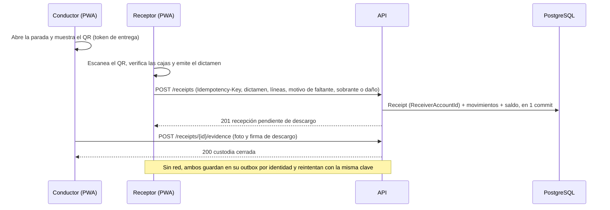

# Análisis del flujo de extremo a extremo: roles, n8n y datasets

> **Estado:** propuesta para revisión del equipo. No modifica specs ni ADR: las secciones 8 y 9 listan los cambios propuestos y quién los decide. Base analizada: `develop` en `4545f50` (15-oct-2026). Punto de partida: issue #55 (cerrado), que dejó una cuenta real por rol en Cognito y en `Account`.

## 0. Contexto y alcance

El issue #55 resolvió **quién entra y con qué rol**: seis cuentas humanas (Gerencia, Planificador, Auditor, Receptor, Conductor y Bodega), aprovisionadas con `--provision-accounts`, sin MFA durante la hackathon (PR #98) y con contraseña definitiva. Falta comprobar el paso siguiente: **qué hace cada rol después de entrar y cómo se encadenan sus acciones** con la API, n8n y los datos.

Fuentes revisadas: specs 001, 003, 004, 007 y 013; [[Usuarios y flujos]], [[n8n e IA]], [[Dataset y escenarios]], [[RBAC y configuracion del sistema]], [[Hechos canonicos]] y [[Credenciales y acceso del equipo]]; código en `src/Api/Controllers`, `src/Application/Field/FieldService.cs`, `src/Infrastructure/Persistence/LeanSchema.cs` y `automation/n8n/workflows/`.

## 1. Hallazgos verificados en el código

Cada hallazgo se comprobó leyendo el código de `develop`. Son la base de los escenarios (sección 6) y de los issues (sección 7).

| ID | Hallazgo | Evidencia | Impacto |
|---|---|---|---|
| HZ-01 | **El Receptor no tiene ningún endpoint de escritura.** La recepción la registra el Conductor (`POST /deliveries/{id}/receipts`, roles Conductor y Gerencia) y `Receipt` guarda un único `ActorAccountId`. | `DeliveriesController.cs:77-78`; `LogisticsEntities.cs:162-169`. `Receptor` solo aparece en `Roles.cs` y en el aprovisionamiento. | La custodia pasa al punto de servicio sin la identidad de quien recibe. El dictamen «Todo conforme / Pasó algo malo» de ADR-25 no queda atribuido al Receptor en el servidor. |
| HZ-02 | **Gerencia puede escribir en endpoints de campo** (empaque, despacho, recepción y evidencia), aunque ADR-24 la limita a la web. | `DeliveriesController.cs:30,53,78`; `EvidenceController.cs:28,51`. | Rompe la separación de funciones: el rol que aprueba planes también puede declarar una recepción. |
| HZ-03 | **El Auditor recibe 403 en las lecturas del simulador** (`GET /simulations`, `/{id}` y `/{id}/export` solo admiten `Planning`). | `SimulationsController.cs:51,61,76`. | Incumple FR-21 y CE-07 de 013 («todas las lecturas de la web responden 200 al Auditor»). |
| HZ-04 | **La conciliación de «stock en percha» puede romper la recepción completa.** Inserta un `Consumption` con `OccurredOn = hoy`, y la tabla tiene índice único `(ServicePointId, ProductId, OccurredOn)`. | `FieldService.cs:531-543`; `LeanSchema.cs:93`. | Falla toda la transacción si ya existe un consumo de ese punto, SKU y día: uno importado, una segunda recepción el mismo día o dos lotes del mismo SKU en la misma recepción. El elemento del outbox se reintenta y vuelve a fallar sin fin. |
| HZ-05 | **El saldo del punto se sobrescribe sin movimiento.** `QuantityOnHand = restante declarado + aceptado`. Si el restante declarado es mayor que el saldo previo, el saldo sube sin ningún `InventoryMovement`. `PeriodDays = 7` está fijo en el código. | `FieldService.cs:546-561`. | El saldo deja de poder reconstruirse a partir de sus movimientos (007 NFR-03; 001 FR-08). |
| HZ-06 | **El pedido de reposición en campo genera números repetidos.** Crea un `DeliveryOrder` por línea con `ORD-{código}-{MMddHHmm}`, y `OrderNumber` es único por organización. | `FieldService.cs:602-613`; `LeanSchema.cs:135`. | Si dos líneas de una recepción piden reposición, colisionan y falla la recepción completa. Además, se generan N pedidos donde se espera uno por recepción. |
| HZ-07 | **Los workflows de n8n no tienen workflow de error.** `settings` no declara `errorWorkflow`, y ningún nodo usa *Retry on Fail* (el plazo de 10 s es deliberado, 003 FR-08). | `automation/n8n/workflows/vigia.json` e `incidente.json`. | Un fallo dentro de n8n solo se ve en la API como `timeout`. Nadie recibe aviso, y la recuperación que describe [[n8n e IA]] no está exportada. |
| HZ-08 | **El webhook firmado cumple la práctica de la industria.** Usa HMAC-SHA256 sobre el cuerpo crudo, ventana de 60 s y comparación de tiempo constante (`timingSafeEqual`). | Nodo «Verify Signature» de `vigia.json`; `rawBody: true`. | No requiere issue. La protección ante una repetición dentro de los 60 s la da la idempotencia por `AgentRun`. |

## 2. Flujo de extremo a extremo por rol

### 2.1 Etapas

| Etapa | Actor | Plataforma | Acción | Datos que produce | Endpoint o disparador |
|---|---|---|---|---|---|
| E0 Acceso | Gerencia (y Jorge por CLI) | Web | Alta, cambio de rol y desactivación de cuentas | `Account` y usuario de Cognito | `--provision-accounts`, `/accounts/*` |
| E1 Ingesta | Planificador | Web | Carga del dataset con perfil de mapeo, primero en seco | `ImportBatch` (hash SHA-256 y reporte) y datos maestros | `POST /imports?dryRun=true` → `dryRun=false` |
| E2 Riesgo | API (determinista) | — | Cálculo de cobertura por punto y SKU | `RiskSnapshot` | `GET /risks` |
| E3 Agente | Planificador o n8n | Web / n8n | «Pedir al agente», o vigía programado (apagado por defecto) | `AgentRun` y `AgentDecision` | `POST /agent/runs` → webhook HMAC → herramientas M2M → `POST /agent/runs/{id}/result` |
| E4 Plan | Planificador | Web | Revisar, aprobar y publicar rutas; la política publica sola dentro de sus límites | `RoutePlan` con revisión y `Delivery` asignada | `/route-plans/*`, `/delivery-orders` |
| E5 Preparación | Bodega | PWA | Empacar unidades con QR y despachar | `HandlingUnit`, `CustodyEvent` y reserva → salida | `POST /deliveries/{id}/handling-units`, `/dispatch` |
| E6 Carga y tránsito | Conductor | PWA | Descargar la ruta (offline), escanear cajas y recibir avisos de revisión | Copia local en IndexedDB y outbox | `GET /mobile/assignments`, `GET /route-plans/{id}` |
| E6b Incidente | Planificador o Automatización | Web / n8n | Registrar un incidente; si `AutoOnIncident`, el agente replanifica | `Incident`, nueva revisión y `DriverMessage` | `POST /incidents` → workflow `incidente` |
| E7 Recepción | Conductor + **Receptor** | PWA (dos teléfonos) | El Receptor escanea el QR del Conductor; dictamen, cantidades, stock en percha y reposición; firma y foto | `Receipt`, `ReceiptLine`, `InventoryMovement` y `Evidence` | `POST /deliveries/{id}/receipts` (**hoy solo Conductor**, HZ-01) |
| E8 Sincronización | PWA | PWA | El outbox reintenta al recuperar red, con `Idempotency-Key` | `IdempotencyRecord` | Mismo endpoint, con clave estable |
| E9 Conciliación | API | — | Saldo, consumo derivado y pedido de reposición en campo | `StockBalance`, `Consumption` (`FieldReconciliation`) y `DeliveryOrder` (`FieldRequest`) | Dentro de la transacción de E7 (HZ-04 a HZ-06) |
| E10 Auditoría | Auditor y Gerencia | Web | Traza de custodia, decisiones del agente y KPI | Solo lectura | `GET` de entregas, unidades, decisiones y simulaciones (HZ-03) |

### 2.2 Secuencia propuesta para la recepción (E7)

La propuesta invierte el registro: **quien recibe asienta la recepción**, como en GS1 EPCIS/CBV 2.0, donde el evento de recepción identifica a la parte que toma la custodia. El Conductor aporta la evidencia de descargo. Hoy ocurre al revés (HZ-01).

### 2.3 Matriz de permisos por rol (actual → propuesta)

Leyenda: L = lectura, E = escritura y «—» = sin acceso. Las flechas marcan los cambios propuestos.

| Recurso | Gerencia | Planificador | Auditor | Bodega | Conductor | Receptor | Automatización |
|---|---|---|---|---|---|---|---|
| Cuentas | E | — | — | — | — | — | — |
| Importación y reset de demo | E | E | L (datos) | L (datos) | L (datos) | L (datos) | — |
| Riesgos y decisiones del agente | L/E (aprobar) | L/E | L | L | L | L | L (herramientas) |
| Planes de ruta y pedidos | E | E | L | L | L (su ruta) | — | E acotada (sin publicar ni aprobar) |
| Empaque y despacho | E → **—** | — | L | E | — | — | — |
| Recepción | E → **—** | — | L | — | E → **evidencia de descargo** | — → **E (su punto)** | — |
| Evidencia | E → **—** | — | — → **L** | — | E | — → **E** | — |
| Simulaciones | E | E | — → **L** | — | — | — | — |

## 3. Integración con n8n

### 3.1 Disparadores, procesamiento y respuesta

| Workflow | Disparador | Qué procesa n8n | Qué devuelve | Si falla |
|---|---|---|---|---|
| `vigia` | Webhook firmado desde `POST /agent/runs` (botón del Planificador); cron apagado por defecto (003 FR-13) | Nodo AI Agent con DeepSeek y 5 herramientas M2M, cada una con `X-Agent-Run-Id` | `POST /agent/runs/{id}/result`, con explicación, `DriverMessage`, modelo, versión de prompt y `executionId` | La API completa por el camino determinista en ≤ 11 s (`timeout`, `n8n_unreachable` o `invalid_result`) |
| `incidente` | Webhook al registrar un incidente con `AGENT_AUTO_ON_INCIDENT=true` (hoy `false`) | Impacto y replanificación de las rutas afectadas; la política publica o escala | El mismo contrato de resultado | Fallback sin replanificar dos veces (003 FR-08) |
| Workflow de error (**propuesto**, HZ-07) | *Error Trigger* de n8n, vinculado en `settings.errorWorkflow` de los dos anteriores | `executionId`, nodo que falló y mensaje (sin el payload completo) | `POST` a un endpoint técnico de la API, que lo registra en el `AgentRun` como causa y lo muestra en la traza | Si también falla, queda el registro de ejecuciones de n8n (`saveDataErrorExecution: all`) |

**Principios que se mantienen** (de [[n8n e IA]] y ADR-22): n8n nunca escribe en la base; el LLM no cambia stock, prioridades ni fechas; cada cifra se valida contra los `facts`; una caída de n8n o de DeepSeek no detiene ni el despacho ni la recepción.

**Decisión propuesta:** el pedido de reposición en campo (`FieldRequest`) **no** pasa por n8n en el camino crítico. La API lo registra en la misma transacción de la recepción. Que el vigía lo considere como entrada de `get_risks` queda como mejora P2, porque cambia el contrato de una herramienta y exige repetir la prueba de aceptación (NFR-02 de 003).

### 3.2 Contratos que deben mantenerse

- Cabeceras `X-IstpetDev-Timestamp` y `X-IstpetDev-Signature: sha256=<HMAC(secret, ts + "." + cuerpo crudo)>`, con ventana de 60 s.
- Token M2M `client_credentials` con scope `istpetdev-api/automation` y rol `Automatizacion`; publicar, aprobar, rechazar, deshacer y cambiar la autonomía responden 403.
- `executionTimeout` de 35 s en n8n frente al plazo de 10 s de la API: un resultado que llega después del fallback recibe 409 y no modifica decisiones.

## 4. Ciclo de vida de los datasets

| Etapa | Mecanismo actual | Validación | Brecha |
|---|---|---|---|
| Ingesta | `POST /imports` con CSV o XLSX y perfil de mapeo JSON (001) | Tipos, separador, unidad base y referencias; `dryRun` por defecto | — |
| Transformación | Normalización de códigos, escalas, `period_days` y decimales | Supuestos listados en el reporte | — |
| Validación | 422 sin aplicar nada si hay errores, salvo con `allowPartial` | `ImportBatch` con hash SHA-256 | Un archivo masivo solo tiene límite de tamaño y *rate limit*; no hay prueba de 10 000 filas registrada (001 NFR-01) |
| Consumo | Riesgo (002), rutas, simulador (005) y agente (003) | Las cifras del LLM se validan contra `facts` | — |
| Hechos operativos | Recepción, `FieldReconciliation` y `FieldRequest` | Idempotencia por `(org, cuenta, operationId)` | HZ-04, HZ-05 y HZ-06 |
| Reimportación | Inserta o actualiza por clave natural; el stock genera `ImportAdjustment` | — | 007 FR-10: una reimportación puede pisar movimientos operativos posteriores |

**Regla de proveniencia propuesta:** todo `Consumption` lleva `SourceKind` (`Import`, `FieldReconciliation` u `Operational`) y no comparte la clave única con otra fuente. El índice `(punto, SKU, día)` se reemplaza por `(punto, SKU, día, fuente)` o por la tabla de hechos operativos que 007 ya pide. **Requiere migración:** se decide junto con 007.

## 5. Contraste con estándares de la industria

| Práctica de referencia | Qué exige | Estado en IstpetDev |
|---|---|---|
| GS1 EPCIS/CBV 2.0 (custodia en salud) | El evento de recepción registra la parte de origen y la de destino de la custodia y la propiedad | Origen sí (vehículo); **destino sin identidad de persona** (HZ-01) |
| OS&D y ePOD en logística | Sobrante, faltante y daño se documentan **en el punto de entrega**, con foto y firma; una firma «limpia» debilita un reclamo posterior | El dictamen y la foto existen; `RejectionReason` es texto libre: **falta un catálogo de motivos** |
| NIST RBAC: separación estática de funciones | Quien registra una transacción sensible no la valida | Gerencia puede planificar y declarar la recepción (HZ-02); el Conductor declara la aceptación del Receptor (HZ-01) |
| Outbox *offline-first* con clave de idempotencia | Una cola durable sobrevive al reinicio; el servidor guarda la clave y devuelve el mismo resultado; los elementos que fallan siempre se aíslan | Clave e `IdempotencyRecord` sí; **falta aislar el elemento que falla siempre** (HZ-04) |
| Seguridad de webhooks | HMAC sobre el cuerpo crudo, comparación de tiempo constante y ventana de tiempo | Cumple (HZ-08) |
| n8n: manejo de errores | *Error Trigger* vinculado al workflow y *Retry on Fail* con espera | Sin workflow de error (HZ-07); sin reintentos por diseño (plazo de 10 s) |

**Conclusión:** la arquitectura es realista. Separa cálculo determinista, coordinación y explicación, usa idempotencia y firma los webhooks como se hace en la industria. Las brechas están en la **atribución de la custodia al receptor** y en la **conciliación del saldo**, no en la integración con n8n.

## 6. Matriz de escenarios

Estado: ✅ cubierto por código o spec · ⚠️ brecha (HZ-xx) · 🔲 sin prueba registrada.

### 6.1 Flujo normal (happy path)

| ID | Dado / Cuando / Entonces | Roles | Estado |
|---|---|---|---|
| ESC-01 | Dataset `demo-region` importado en seco y luego aplicado → reporte sin errores e `ImportBatch` `Applied` | Planificador | ✅ |
| ESC-02 | «Pedir al agente» con DeepSeek disponible → decisión por vehículo en ≤ 10 s, con traza de herramientas | Planificador, Automatización | ✅ (#39: 30/30) |
| ESC-03 | Bodega empaca y despacha → custodia en el vehículo; el Conductor ve la ruta offline | Bodega, Conductor | ✅ |
| ESC-04 | El Receptor escanea el QR del Conductor, «Todo conforme» → recepción con identidad del Receptor y saldo del punto actualizado una sola vez | Receptor, Conductor | ⚠️ HZ-01 |
| ESC-05 | El Auditor consulta custodia, decisiones y simulaciones → 200 en todo y ningún botón de acción | Auditor | ⚠️ HZ-03 |

### 6.2 Casos borde

| ID | Dado / Cuando / Entonces | Roles | Estado |
|---|---|---|---|
| ESC-06 | Entrega parcial: 10 enviadas, 6 aceptadas y 4 rechazadas por daño → motivo de catálogo, 4 en custodia pendiente o devolución y foto obligatoria | Receptor | ⚠️ motivo libre |
| ESC-07 | Dos lotes del mismo SKU en una recepción, ambos con stock en percha → una sola recepción aceptada, sin colisión de `Consumption` | Receptor | ⚠️ HZ-04 |
| ESC-08 | Segunda recepción el mismo día en el mismo punto y SKU → aceptada | Receptor | ⚠️ HZ-04 |
| ESC-09 | Stock en percha declarado mayor que el saldo del sistema → ajuste con movimiento y motivo, no una sobrescritura silenciosa | Receptor, Planificador | ⚠️ HZ-05 |
| ESC-10 | Dos líneas piden reposición en la misma recepción → un solo `DeliveryOrder` con dos líneas | Receptor | ⚠️ HZ-06 |
| ESC-11 | El Receptor de otro punto intenta recibir una entrega ajena → 403, sin revelar la entrega | Receptor | 🔲 (depende de HZ-01) |
| ESC-12 | Dataset sin ventanas horarias o con columnas en galones por mes → supuestos en el reporte y conversión a litros | Planificador | ✅ (001 CE-02) |
| ESC-13 | La misma fila repetida en un archivo de consumos → se suma con advertencia | Planificador | ✅ (001 FR-09) |
| ESC-14 | Gerencia intenta despachar o recibir desde la PWA → mensaje de plataforma; por API, 403 | Gerencia | ⚠️ HZ-02 (la API lo permite) |
| ESC-15 | Cuenta desactivada con capturas en su outbox → 403 al sincronizar; la captura se conserva y se marca «sesión requerida» | Conductor, Gerencia | ✅ (013 CE-04/05) |

### 6.3 Escenarios de caos

| ID | Dado / Cuando / Entonces | Roles | Estado |
|---|---|---|---|
| ESC-16 | n8n caído → `POST /agent/runs` responde `Fallback` (`n8n_unreachable`) en ≤ 11 s, sin bloquear el despacho | Planificador | ✅ (003 CE-02) |
| ESC-17 | DeepSeek tarda más de 10 s → fallback `timeout`; el resultado tardío recibe 409 y no cambia nada | Automatización | ✅ (003 FR-08) |
| ESC-18 | El LLM escribe una cifra que no está en los `facts` → plantilla y `explanation_mismatch` | Automatización | ✅ |
| ESC-19 | Un nodo de n8n lanza una excepción → el workflow de error registra la causa en el `AgentRun` y la traza muestra «falló el nodo X» | Automatización | ⚠️ HZ-07 |
| ESC-20 | Dato importado con texto de inyección → 10/10 ejecuciones sin acciones fuera de la política | Automatización | ✅ (10/10) |
| ESC-21 | CSV corrupto (codificación mixta o columnas desplazadas) → 422 con fila y campo; nada aplicado | Planificador | ✅ (001 FR-12) |
| ESC-22 | Archivo masivo (10 000 filas de consumo) → < 30 s; por encima del límite, 413 claro | Planificador | 🔲 (001 NFR-01 sin medición) |
| ESC-23 | Un elemento del outbox falla siempre (por ejemplo, ESC-07) → tras N intentos se aísla como «requiere revisión» y no bloquea el resto de la cola | Conductor, Receptor | ⚠️ HZ-04 |
| ESC-24 | Carrera entre el Receptor que recibe y el Planificador que replanifica la misma ruta → la recepción se acepta sobre la revisión ejecutada y la parada no se replanifica | Receptor, Planificador | 🔲 |
| ESC-25 | Carrera entre la desactivación de la cuenta y la sincronización del outbox → la sincronización es rechazada y nada queda aplicado a medias | Gerencia, Conductor | 🔲 |
| ESC-26 | Doble envío de la recepción desde dos teléfonos (Conductor y Receptor) → un solo efecto de inventario | Conductor, Receptor | 🔲 (depende del diseño de HZ-01) |
| ESC-27 | Cognito no disponible → la gestión de cuentas responde 503 y las sesiones válidas siguen operando | Gerencia | ✅ (013 NFR-05) |
| ESC-28 | Reimportar un corte de stock anterior a una recepción ya aceptada → rechazo con informe, sin restaurar el saldo previo | Planificador | ⚠️ (007 FR-10, sin implementar) |

## 7. Issues propuestos por área

> **Calendario:** el congelamiento de funcionalidades fue el 15-oct 14:00 (D8). ISS-02 e ISS-03 corrigen defectos que afectan el recorrido de la demo y se proponen **antes del evento** si el equipo lo aprueba. Los demás se proponen para **después del 17-oct** (piloto), porque requieren migración o cambian contratos. Las personas sugeridas siguen la asignación de 013 y #55; la asignación final la decide el equipo.

### ISS-01 (#110) — Backend: el Receptor asienta la recepción con su identidad

- **Área:** Backend · **Sugerido:** Alexander Martínez (dueño de 004) · **Revisa:** Joseph Baño · **Prioridad:** P1 del piloto (requiere migración)
- **Descripción:** mover el registro de la recepción al Receptor, de modo que `Receipt` guarde `ReceiverAccountId` y el estado «pendiente de descargo» → «cerrada». El Conductor aporta la evidencia de descargo. El Receptor solo puede recibir entregas destinadas a su punto, lo que exige una afiliación cuenta–punto (`AccountServicePoint` o un campo en `Account`).
- **Tareas:**
  - [ ] Migración: `Receipt.ReceiverAccountId`, `Receipt.Status` y afiliación Receptor–`ServicePoint`
  - [ ] `POST /deliveries/{id}/receipts` admite el rol Receptor y valida la afiliación al punto; 403 sin revelar la entrega ajena
  - [ ] `POST /receipts/{id}/discharge` (Conductor): foto y firma; cierra la custodia
  - [ ] Idempotencia compartida: un solo efecto aunque los dos teléfonos reintenten
  - [ ] `GET /mobile/assignments` para el Receptor: solo las entregas de su punto (sustituye el stash de `feature/pruebas-rol-receptor`)
- **Criterios de aceptación:** ESC-04, ESC-11 y ESC-26.
- **Colaboración:** acordar con ISS-06 (PWA) el payload de `POST /receipts` (dictamen, líneas, motivo de catálogo) y el QR (token de entrega, nunca IDs internos). Acordar con ISS-08 el catálogo de motivos. Acordar con Jorge cómo se carga la afiliación (columna del CSV de `--provision-accounts` o pantalla «Usuarios»).

### ISS-02 (#111) — Backend: conciliación de stock en percha y pedido en campo sin colisiones

- **Área:** Backend · **Sugerido:** Anthony Pilatasig · **Revisa:** Alexander Martínez · **Prioridad:** Alta (defecto que rompe la recepción)
- **Descripción:** corregir HZ-04, HZ-05 y HZ-06 en `FieldService`.
- **Tareas:**
  - [ ] Agregar `FieldReconciliation` por (punto, SKU) dentro de la recepción antes de insertar, y acumular sobre el consumo del día si ya existe, en lugar de insertar otro
  - [ ] Si el restante declarado difiere del saldo, registrar un `InventoryMovement` de tipo `FieldAdjustment` por la diferencia (positiva o negativa), con motivo
  - [ ] Sacar `PeriodDays = 7` del código y llevarlo a la configuración `Logistics` (G5)
  - [ ] Un solo `DeliveryOrder` `FieldRequest` por recepción, con N líneas, y número derivado de `OperationId` (estable ante reintentos)
  - [ ] Pruebas de integración para ESC-07, ESC-08, ESC-09 y ESC-10
- **Criterios de aceptación:** ESC-07 a ESC-10; el saldo del lote se reconstruye a partir de sus movimientos.
- **Colaboración:** confirmar con el dueño de 007 que `FieldAdjustment` y la acumulación no contradicen la regla de día cerrado de 007. Si 007 decide otra tabla de hechos, esta corrección es el puente hasta esa migración.

### ISS-03 (#112) — Backend: alinear la autorización con ADR-24 y ADR-26

- **Área:** Backend / Seguridad · **Sugerido:** Joseph Baño (Auditor y revisor de 013) · **Prioridad:** Alta
- **Tareas:**
  - [ ] Agregar `Roles.Auditor` a los `GET` de `SimulationsController` (HZ-03)
  - [ ] Decidir HZ-02: retirar `Gerencia` de empaque, despacho, recepción y evidencia, **o** registrar la excepción en ADR-24 con su motivo (por ejemplo, operar por contingencia)
  - [ ] Prueba automática que recorra los endpoints con un token por rol y compare el resultado con la matriz de la sección 2.3
- **Criterios de aceptación:** ESC-05 y ESC-14; 013 CE-07.
- **Colaboración:** la matriz de la sección 2.3 es el contrato: la aprueban Bryan y Joseph antes de cambiar el código.

### ISS-04 (#113) — Automatización/n8n: workflow de error y diagnóstico de fallos

- **Área:** n8n · **Sugerido:** Bryan (n8n en producción) con Anthony (API) · **Prioridad:** P2
- **Tareas:**
  - [ ] Exportar `error-agente.json` (*Error Trigger*) sin credenciales en `automation/n8n/workflows/`
  - [ ] Vincularlo en `settings.errorWorkflow` de `vigia` e `incidente`, y regenerarlos con `build-workflows.py`
  - [ ] Endpoint técnico `POST /agent/runs/{id}/failure` (rol `Automatizacion`, idempotente por `executionId`) que guarde el nodo y el mensaje en la traza
  - [ ] Ampliar la prueba de CI de credenciales al nuevo workflow
- **Criterios de aceptación:** ESC-19; ESC-16 y ESC-17 siguen igual.
- **Colaboración:** payload `{ runId, executionId, workflow, node, message }`, sin datos del escenario (G1). El `runId` llega en el cuerpo firmado del webhook original.

### ISS-05 (#114) — Backend: aislar los elementos del outbox que fallan siempre

- **Área:** Backend + PWA · **Sugerido:** Alexander Martínez · **Prioridad:** P1 del piloto
- **Tareas:**
  - [ ] Clasificar las respuestas: 409 o 422 de negocio = no reintentar; 5xx o red = reintentar con espera exponencial y variación aleatoria
  - [ ] En la PWA, estado «requiere revisión» con el motivo; el resto de la cola sigue
  - [ ] En la web, una bandeja para que el Planificador vea las capturas rechazadas por punto
- **Criterios de aceptación:** ESC-23 y ESC-25.
- **Colaboración:** códigos de error estables en Problem Details (`type`) acordados entre API y PWA.

### ISS-06 (#115) — Frontend PWA: flujo del Receptor sobre el contrato real

- **Área:** Frontend móvil · **Sugerido:** Alexander Martínez, con Anthony (autor de la rama `feature/pruebas-rol-receptor`) · **Depende de:** ISS-01
- **Tareas:**
  - [ ] Integrar el trabajo de `feature/pruebas-rol-receptor` (escáner offline, stock en percha y pedido) con el endpoint de ISS-01
  - [ ] Selector de motivo de catálogo para sobrante, faltante o daño; foto obligatoria cuando hay rechazo
  - [ ] Outbox separado por identidad (013 FR-09) también para el Receptor
- **Criterios de aceptación:** ESC-04, ESC-06 y ESC-15 en dos teléfonos distintos.

### ISS-07 (#116) — Frontend web: excepciones de recepción y pedidos de campo para el Planificador

- **Área:** Frontend web · **Sugerido:** a definir por el equipo · **Prioridad:** P2
- **Tareas:**
  - [ ] Lista de `DeliveryOrder` con `SourceType = FieldRequest` y su estado
  - [ ] Lista de recepciones con rechazo o ajuste (`FieldAdjustment`), con enlace a la evidencia
  - [ ] Vista de solo lectura para el Auditor
- **Criterios de aceptación:** ESC-06 y ESC-09 visibles en la web; el Auditor no ve botones.

### ISS-08 (#117) — Datos: catálogo de motivos y fixtures de caos

- **Área:** Data/QA · **Sugerido:** Jorge Doicela con Joseph Baño · **Prioridad:** P2
- **Tareas:**
  - [ ] Catálogo de motivos (faltante, sobrante, daño, precinto violado, lote no coincide, cadena de frío) como constantes versionadas, sin migración si el texto libre se conserva
  - [ ] Fixture `demo-region-caos`: dos lotes del mismo SKU, consumo importado del día de la demo y CSV corrupto
  - [ ] Generador de 10 000 filas de consumo para medir 001 NFR-01
- **Criterios de aceptación:** ESC-21, ESC-22 y ESC-28 reproducibles con un comando.

### ISS-09 (#118) — QA: ronda E2E por roles (continuación de #55)

- **Área:** QA · **Coordina:** Joseph Baño · **Participan:** las seis cuentas de #55
- **Tareas:**
  - [ ] Ejecutar ESC-01 a ESC-28 en HTTPS con las cuentas reales; la evidencia se registra sin correos ni contraseñas
  - [ ] Registrar los resultados en [[Seguimiento de implementacion y pruebas]]
- **Criterios de aceptación:** cada escenario en ✅ o con un issue abierto que lo cubra.

### 7.1 Resumen por persona

Los issues se crearon sin asignar; esta tabla es la asignación **sugerida**.

| Persona | Responsable de | Revisa o colabora en | Decisiones pendientes |
|---|---|---|---|
| Anthony Pilatasig | #111 (conciliación de stock en percha) | #113 (endpoint de fallo en la API); #115 (integrar su rama `feature/pruebas-rol-receptor` y el stash de `GetAssignments`) | — |
| Alexander Martínez | #110 (Receptor con identidad), #114 (outbox), #115 (PWA del Receptor) | Revisa #111 | Cambio en spec 004 y su relación con ADR-24 y ADR-25 |
| Joseph Baño | #112 (autorización), #118 (ronda E2E) | Revisa #110; co-responsable de #117 | Aprobar la matriz de la sección 2.3 junto con Bryan; nota en CE-07 de 013 |
| Bryan | #113 (workflow de error en n8n) | Aprueba la matriz de la sección 2.3 | Si Gerencia conserva la escritura de campo (HZ-02, ADR-24); si #111 y #112 entran antes del evento |
| Jorge Doicela | #117 (catálogo de motivos y fixtures de caos) | Columna de afiliación en el CSV de `--provision-accounts` (#110) | Documentar que `ISTPETDEV_WEBHOOK_SECRET` y `AGENT_N8N_WEBHOOK_SECRET` llevan el mismo valor |
| Equipo | Asignar #116 (web del Planificador) | — | Cambios de specs de la sección 8 |

## 8. Cambios propuestos en los specs

No se aplicaron. Cada cambio sigue el protocolo de contradicciones de [[Convenciones y estados]].

| Spec | Cambio propuesto | Origen | Decide |
|---|---|---|---|
| 004 | Nuevo FR: el Receptor asienta la recepción con su identidad y su afiliación al punto; el Conductor aporta el descargo. Catálogo de motivos. | HZ-01, ISS-01 | Alexander y Bryan (ADR-25/27) |
| 004 | Regla del outbox para los errores de negocio que fallan siempre | HZ-04, ISS-05 | Alexander |
| 007 | Incorporar `FieldReconciliation` y `FieldAdjustment` como fuentes de consumo y ajuste; revisar el índice único de `Consumption` | HZ-04, HZ-05, ISS-02 | Dueño de 007 y equipo |
| 013 | Nota en CE-07: hoy falla en `/simulations` (HZ-03) | ISS-03 | Joseph |
| 003 | Agregar el workflow de error a FR-12 y el endpoint de fallo a «Entidades y contratos» | HZ-07, ISS-04 | Bryan y Anthony |
| Decisiones de arquitectura (ADR-24) | Registrar si Gerencia conserva la escritura de campo como contingencia, o retirarla | HZ-02 | Bryan y Alexander |
| [[Usuarios y flujos]] | El paso 9 dice que el receptor escanea y emite el dictamen; agregar que el servidor lo registra con su identidad | HZ-01 | Equipo |

## 9. Bóveda, credenciales y variables de entorno

**No se leyó, modificó ni sobrescribió ningún valor sensible.** `.env` no se abrió; solo se listaron los **nombres** de `.env.example`.

| Cambio | Tipo | ¿Secreto? | Para qué issue | Acción |
|---|---|---|---|---|
| Ninguna credencial nueva para ISS-01, 02, 03, 05, 06, 07 y 08 | — | — | — | Usan Cognito, roles y base actuales |
| Afiliación Receptor–punto | Dato (`Account` o tabla nueva) | No | ISS-01 | Columna opcional `servicePointCode` en el CSV de `--provision-accounts`; el CSV sigue fuera del repositorio |
| `settings.errorWorkflow` en n8n | Configuración del servidor de Bryan | No (es un ID) | ISS-04 | Bryan lo fija al importar; no va en el repositorio |
| Endpoint de fallo del agente | Reutiliza el cliente M2M existente (`COGNITO_M2M_CLIENT_ID` / `_SECRET`) | Sí, pero **no cambia** | ISS-04 | Ninguna rotación |
| `ISTPETDEV_WEBHOOK_SECRET` (n8n) y `AGENT_N8N_WEBHOOK_SECRET` (API) | Secreto HMAC compartido | Sí | — | **Documentar** que deben tener el mismo valor; hoy son dos nombres para un solo secreto. Si se rota, cambian a la vez |
| `Logistics:FieldReconciliationPeriodDays` (nuevo) | Configuración | No | ISS-02 | Valor por defecto 7 en `appsettings.example.json` |

Notas de la bóveda que habría que actualizar al aprobar: [[n8n e IA]] (workflow de error), [[Usuarios y flujos]] (paso 9 y Gerencia), [[Movil offline y sincronizacion]] (elementos que fallan siempre) y [[RBAC y configuracion del sistema]] (matriz de la sección 2.3 como estado de la demo). [[Hechos canonicos]] solo cambia si se aprueba un ADR nuevo o la modificación de ADR-24.

**Contradicción abierta que no cambia este análisis:** [[Credenciales y acceso del equipo]] describe SSO, mientras [[Hechos canonicos]] da como vigente IAM con MFA temporal. Sigue a decisión de Bryan.

## Fuentes externas

- [GS1 EPCIS y CBV 2.0](https://www.gs1.org/epcis) · [EPCIS en salud (GS1)](https://www.gs1.org/sites/default/files/docs/healthcare/broch_a4_epcis_0.pdf)
- [OS&D: procedimientos para sobrante, faltante y daño](https://racklify.com/encyclopedia/managing-osd-standard-operating-procedures-for-over-short-and-damaged-freight/) · [Prueba de entrega](https://wiki.borderconnect.com/index.php/Proof_of_Delivery)
- [NIST: control de acceso basado en roles](https://www.nist.gov/system/files/documents/2018/06/27/no_10_role-based_access_control_2010.pdf)
- [n8n: manejo de errores](https://docs.n8n.io/flow-logic/error-handling/) · [n8n: Error Trigger](https://docs.n8n.io/integrations/builtin/core-nodes/n8n-nodes-base.errortrigger)
- [Seguridad de webhooks en n8n](https://lumadock.com/blog/tutorials/n8n-webhook-security/) · [Sincronización offline e idempotencia](https://archman.dev/docs/frontend-and-mobile-architecture/mobile-architecture/offline-sync-and-conflict-resolution)
