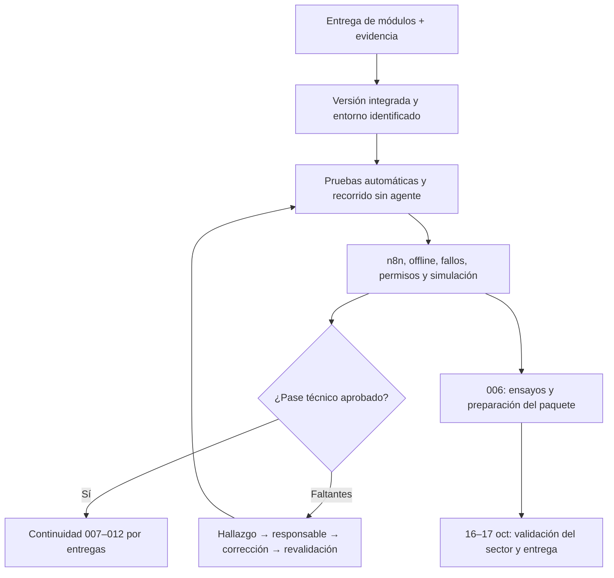

# Seguimiento de implementación y pruebas

> [!important] Empieza aquí el 13 de octubre
> Bryan solicita planificación exhaustiva para que el equipo complete 001–006 y después compruebe el sistema integrado. Primero asignar responsables en [[Registro de seguimiento y hallazgos]], identificar la versión común y seguir las etapas de esta nota. Si el pase técnico resulta aprobado, seguir [[Continuidad del piloto y specs 007 a 012]]. Todas las ejecuciones de este seguimiento empiezan pendientes.

## Objetivo y límites

**Meta de trabajo:** implementación de 001–005 y preparación de 006 durante el 13-oct-2026, hora de Ecuador. La fecha es el objetivo expresado por Bryan; este plan no acredita duración ni resultados. Las pruebas de cada módulo forman parte de su implementación y la campaña integrada comprueba después sus conexiones, errores y condiciones reales de uso.

El recorrido a comprobar es: importar datos → detectar riesgo → proponer/aprobar ruta → reservar lotes → preparar QR → despachar → capturar recepción offline → sincronizar una sola vez → consultar custodia → reaccionar a incidente → mostrar decisiones y resultados reproducibles. El [006](../../specs/006-validacion-pitch-entrega/spec.md) convierte únicamente las capacidades probadas en afirmaciones del pitch.

Esta guía organiza la ejecución; las fórmulas y criterios siguen perteneciendo a los specs, [[Plan de validacion]], [[Simulador y metricas]] y [[Verificacion de seguridad antes del lanzamiento]]. El trabajo de hoy es documental: no se ejecuta la aplicación, no se aplican migraciones ni se publica una versión.

## Aclaración sobre roles, RLS y documentación antigua

La demo conserva **seis roles fijos en `Account.Role` y autorización por asignación**. Se retiraron del núcleo la administración dinámica de permisos, plantillas/workflows/configuración desde DB y RLS de Schema95. Una cuenta Conductor debe seguir sin poder importar, despachar o recibir una entrega ajena; n8n debe seguir sin poder aprobar/publicar directamente.

| Tema | Para estas pruebas de demo | Cuándo se retoma |
|---|---|---|
| Cognito, cuenta activa y rol fijo resuelto en servidor | Obligatorio en los caminos implementados; probar permitido/denegado. | Ya en 001/003/004. |
| Entregas asignadas, acceso a evidencias y revocación al sincronizar | Obligatorio; conservar captura rechazada/conflictiva. | Ya en 004. |
| RBAC administrable, permisos granulares y ConfigurationAdmin | Diferido; no pedir editor de roles ni sus tablas para cerrar la demo. | 010, si se activa esa etapa. |
| RLS/FORCE y aislamiento multiempresa | Diferido para el núcleo acotado; no ejecutar la matriz de dos tenants como requisito de esta demo. | 010 y V-37. |
| Plantillas y workflows configurables | Diferidos; no confundirlos con los workflows operativos de n8n del 003. | 010 y V-35/36. |
| Seguridad de API, archivos, QR, dependencias y proxy | Sigue aplicando a los caminos existentes. | RNF-14/B-40; no se difiere por retirar RLS. |

[[RBAC y configuracion del sistema]] y [[Esquema completo de base de datos]] son referencias del diseño P2: sus complementos delimitan lo diferido. [[istpetdev-dbflow]] sigue siendo pertinente para migraciones, conexiones y conservación del historial; sus instrucciones anteriores de recreación de bases deben reconciliarse con el plan revisado de 001 antes de cualquier transición. No reconstruir Schema95 para superar pruebas de la demo.

La revisión del 12-oct comprobó que el código usa roles fijos y `LeanSchema` sin RLS. La copia local de prelaunch se regeneró desde [[istpetdev-prelaunch]] para incluir su aviso de alcance; la nota editable sigue siendo la única fuente. La autorización local de 001 ya está registrada; el estado colectivo de ADR-21 y las demás contradicciones se revisa en [[Hechos canonicos]].

## Ruta rápida del equipo

1. Completar tareas y pruebas propias de cada spec y entregar su evidencia.
2. Integrar los cambios en una versión común, coordinando las migraciones.
3. Ejecutar comprobaciones automáticas y el recorrido sin agente.
4. Añadir n8n, casos de fallo, teléfono real, permisos y simulación.
5. Registrar hallazgos, corregirlos en su spec dueño y repetir los casos afectados.
6. Decidir el pase técnico con evidencia y preparar la continuación 007–012; cerrar el 006 con sus resultados reales del evento.



## Responsabilidades y coordinación

Mantener el reparto flexible de [[Equipo y acuerdos]]. Al iniciar la jornada, cada entrega tiene una persona responsable y otra revisora; los nombres se completan en el registro, sin asignar especialidades por suposición.

| Función durante la campaña | Responsabilidad |
|---|---|
| Coordinación/integración | Identificar commit común, ordenar PR/migraciones, registrar bloqueos y decidir qué se puede ensayar. |
| Responsable del spec | Entregar contratos, pruebas, datos y correcciones; actualizar `task.md` y registros E2E con evidencia. |
| Revisor del recorrido | Ejecutar un caso que no construyó, cotejar API/DB/UI y clasificar hallazgos. |
| Operador de teléfono y campo | Instalar PWA, descargar asignaciones, probar cámara/offline/reinicio y conservar capturas. |
| Responsable de datos/negocio | Verificar manifiestos/KPI, preparar 006 y retirar afirmaciones sin soporte. |

Los cinco integrantes pueden asumir varias funciones. Un único responsable coordina migraciones/snapshot; asignar teléfonos y máquinas evita que dos ensayos cambien el mismo fixture. Las entrevistas del evento siguen teniendo sus dos responsables según D2.

**Ritmo recomendado:** revisión breve al comenzar, después de cada integración y al cerrar la jornada. Cada responsable comunica versión, último caso aprobado, fallo/bloqueo, siguiente acción y dependencias. Una falta de acceso se registra como pendiente de entorno, con responsable y alternativa local; no se confunde con un fallo del algoritmo.

## Etapa 0 — Preparar el seguimiento y revisar contratos

Antes de recibir el último módulo:

- [ ] Completar responsables, entorno, dispositivos y versión candidata en el registro.
- [ ] Leer los pendientes ya identificados en [[Analisis de cobertura de specs]]; resolverlos en las fuentes dueñas o mantenerlos como hallazgos abiertos.
- [ ] Confirmar los contratos entre importador, motor, campo, agente y panel mediante la tabla siguiente.
- [ ] Revisar el alcance de prelaunch, conexiones y datos sintéticos antes de iniciar hosts de prueba. Lo que requiera runtime se comprueba durante la campaña en el entorno autorizado.
- [ ] Separar claramente la base operativa de la de simulación; identificar fixtures y evitar resets simultáneos.
- [ ] Registrar lo que se reuse de `artifacts/spec001/` y lo que cambió desde aquella evidencia. Las 115 pruebas existentes no cubren automáticamente 002–005.

| Unión que debe funcionar | Dueños | Qué comprobar al integrar |
|---|---|---|
| Importador → motor | 001/002 | Ocho entidades al incorporar `road_segments`, unidades, períodos de consumo, reloj y supuestos coherentes. |
| Ruta publicada → despacho | 002/004 | `Delivery`/líneas FEFO y reservas por revisión/lote; despacho consume reserva y mueve stock una sola vez. |
| Recepción → parada y panel | 004/002/005 | Parada completada por recibo aceptado, cantidades conciliadas y lectura de revisión vigente. |
| Motor → n8n → decisión | 002/003 | Herramientas autenticadas, `AgentRun`, `facts` y plazo total; ninguna replanificación duplicada por fallback. |
| Revisión/aviso → conductor | 002/003/004 | Asignación autorizada, snapshot offline, `DriverMessage` y aviso sin duplicado. |
| API → panel | 001/002/003/004/005 | Login y lectura de cuenta/rol; listas paginadas de rutas/entregas y traza, sin IDs precargados. |
| Generador → simulador | 001/002/005 | Importador canónico, contexto aislado, reloj y matriz homogénea, políticas con mismos recursos y datos conocidos. |
| Reset → resultados archivados | 001/005 | La escena operativa reinicia y las simulaciones completadas conservan eventos, métricas y exportación. |
| Resultado probado → pitch | 001–006 | Cada afirmación enlaza un CE ejecutado y su evidencia; distinguir vivo, grabado, simulado y propuesto. |

**Salida:** contratos compatibles o hallazgos concretos asignados. No duplicar el importador, el login, el cálculo de rutas o el ledger para salvar una integración.

## Etapa 1 — Recibir e integrar cada spec

Cada responsable entrega: commit/PR, FR/NFR/CE cubiertos, migraciones y compatibilidad, configuración pública requerida, fixture, comandos reales de prueba, resultados, pendientes y cambios de contrato. Los secretos se cargan por el mecanismo existente del entorno.

| Spec | Documentos de cierre a usar | Punto de atención |
|---|---|---|
| 001 | [Tareas](../../specs/001-nucleo-delgado-importador/task.md), [E2E](../../specs/001-nucleo-delgado-importador/test-e2e.md), [evidencia previa](../../specs/001-nucleo-delgado-importador/verification.md) | Simulacro humano pendiente, autenticación real, conservación histórica y reset sin borrar resultados. |
| 002 | [Tareas](../../specs/002-motor-logistico/task.md), [E2E](../../specs/002-motor-logistico/test-e2e.md) | Factibilidad, reservas/reversión e incidente calibrado; detener el marcado provisional al integrar 004. |
| 003 | [Tareas](../../specs/003-agente-logistico/task.md), [E2E](../../specs/003-agente-logistico/test-e2e.md) | Workflows `vigia`/`incidente`, identidad M2M, firma, plazo, carreras y aceptación de DeepSeek real. |
| 004 | [Tareas](../../specs/004-campo-qr-custodia-offline/task.md), [E2E](../../specs/004-campo-qr-custodia-offline/test-e2e.md) | Bodega, devolución, login, evidencia y outbox; prueba obligatoria en teléfono real. |
| 005 | [Tareas](../../specs/005-panel-simulador/task.md), [E2E](../../specs/005-panel-simulador/test-e2e.md) | Retirar cifras fijas; aislamiento, reglas congeladas, ZIP y tiempo de corrida completa. |
| 006 | [Tareas](../../specs/006-validacion-pitch-entrega/task.md), [E2E](../../specs/006-validacion-pitch-entrega/test-e2e.md) | Preparación verificable ahora; entrevistas, evidencia sectorial y recepción de entrega cuando ocurran. |

Integrar en `develop` según los acuerdos del repositorio; preservar cambios ajenos y archivos históricos. Las migraciones se coordinan en serie sobre la versión integrada. 004 puede preceder a 003 y la simulación de 005 puede avanzar sobre 001/002, sin esperar al panel. Una promoción a `main` o una modificación de RDS sigue su tarea y runbook autorizados; el seguimiento no las ejecuta automáticamente.

**Salida:** una versión común con contratos y modelo compatibles. Un módulo probado en su rama se registra como tal hasta repetir sus casos afectados en esa versión.

## Etapa 2 — Comprobaciones automáticas de la versión común

Reutilizar CI/evidencia cuando corresponda al mismo commit, configuración y entorno. Al cambiar contratos, dependencias, migraciones o integración, ejecutar los casos afectados y una vez la suite de aceptación de la versión candidata. Guardar salidas y contadores; una suite con cero casos o pruebas omitidas no acredita el bloque.

Ejemplo de comandos para la futura campaña local aislada, basado en `package.json`, `ci.yml` y el verificador de TRX existentes. **No ejecutados por esta planificación.** Docker debe estar disponible para integración/E2E y prelaunch debe haber identificado el alcance descartable.

```bash
set -euo pipefail
seguimiento_sha=$(git rev-parse --short=12 HEAD)
seguimiento_dir="artifacts/seguimiento/$seguimiento_sha"
mkdir -p "$seguimiento_dir"
dotnet restore IstpetDev.sln
dotnet build IstpetDev.sln -c Release --no-restore
npm ci
npm run check
for seguimiento_categoria in Unit Integration E2E; do
  DOTNET_SYSTEM_GLOBALIZATION_INVARIANT=1 dotnet test tests/IstpetDev.Tests \
    -c Release --no-build --no-restore \
    --filter "Category=$seguimiento_categoria" \
    --logger "trx;LogFileName=$seguimiento_categoria.trx" \
    --results-directory "$seguimiento_dir"
done
python scripts/db/check-test-results.py "$seguimiento_dir"
python docs/boveda/.github/scripts/check_vault.py
```

Las pruebas de navegador de 004/005 requieren el runner que entreguen esos specs: registrar el comando efectivo en el registro; no inventar `npm test`. En el snapshot del 12-oct, `npm run check` compila web/móvil, pero no ejecuta pruebas de navegador y su lint principal apunta a web; el job frontend de CI tampoco acredita móvil offline. Pedir evidencia específica de PWA, navegador y workflows aunque el build esté verde. Los nuevos tests de cada spec deben aparecer en CI y sus filtros de rutas deben disparar los checks correspondientes.

**Salida:** compilación y suites pertinentes aprobadas, evidencia del mismo commit y lista explícita de verificaciones manuales/runtime pendientes. Un error de entorno se registra y se resuelve; no marcar como aprobada su prueba ausente.

## Etapa 3 — Recorrido integrado sin agente

Primero aislar el valor del motor y campo de la disponibilidad de n8n/DeepSeek. Seguir 002 E2E-01/02 y 004 E2E-01/02/09/10, con lecturas del panel de 005 E2E-01.

1. Iniciar sesiones de Planificación, Bodega y Conductor; comprobar cuenta/rol resueltos en API y PWA instalada por HTTPS en el teléfono real.
2. Restablecer `demo-region` por el importador canónico y guardar el reporte. Registrar stock, reservas, reloj y riesgos iniciales.
3. Proponer ruta de dos vehículos, revisar restricciones y publicar con aprobación humana. Comparar entregas y líneas FEFO con las reservas.
4. En la interfaz de Bodega, preparar una caja, imprimir QR y registrar despacho. Comprobar transferencia bodega→vehículo y consumo de reserva.
5. Descargar la asignación del conductor; activar modo avión, capturar cantidades/foto/firma sintética o voluntaria y reiniciar la PWA.
6. Recuperar red y sesión; confirmar un recibo, movimientos vehículo→punto y evidencia por archivo. Comparar panel/API/stock y custodia.
7. Abrir QR desde un teléfono externo con datos móviles; consultar solo los hitos públicos permitidos.
8. En una escena separada, ejecutar `advance` y comprobar operaciones reales; el endpoint provisional de completar parada no genera entregas recibidas.

**Salida:** una misma operación se puede seguir por sus IDs en API, DB, web, teléfono y QR. Guardar saldos/reservas antes y después, IDs de recibo/custodia y capturas anonimizadas; el mapa por sí solo no acredita el recorrido.

## Etapa 4 — n8n, incidentes y control humano

Usar el [E2E de 003](../../specs/003-agente-logistico/test-e2e.md), el de 002 y el de 005 para la vista del panel. n8n pertenece al 003; sus herramientas y política al 002, sus avisos móviles al 004 y su traza visible al 005.

- [ ] Ejecutar vigía y relacionar `AgentRun`, herramientas, decisiones, `facts` y explicación.
- [ ] Completar dos paradas mediante `advance` antes del incidente predefinido; conservar recibos y stock físico.
- [ ] Disparar el incidente calibrado y comprobar una decisión ejecutada por política y otra escalada con opciones calculadas; respetar completadas y revisar ambas rutas según el preset.
- [ ] Aprobar/rechazar en escenas independientes y deshacer solo cuando las reservas/entregas lo permitan; comprobar historial y 409 sin efectos cuando corresponda conciliación.
- [ ] Probar `ProposeOnly`; ningún cambio se publica automáticamente en ese modo.
- [ ] Detener n8n o forzar timeout, JSON inválido y explicación con cifra incorrecta. Comprobar fallback, plantilla y resultado tardío sin segundo efecto.
- [ ] Ejecutar aceptación DeepSeek real: tres escenarios × diez ejecuciones; llamadas válidas ≥95%, p95 ≤10 s, explicaciones coincidentes ≥90% e inyección 10/10. Fallback responde al panel en ≤11 s según el spec.
- [ ] Comprobar copia local de n8n y workflows exportados sin credenciales.

**Salida:** aceptación, permisos y correlación aprobados. Si solo pasa el fallback, registrar la capacidad determinista demostrable y mantener abierta la aceptación del agente; una contingencia no convierte en aprobado el requisito que falló.

## Etapa 5 — Fallos, permisos y experiencia de uso

Ejecutar los escenarios completos de cada `test-e2e.md`; la tabla sirve para ordenar los casos que atraviesan varios módulos. Las definiciones de V permanecen en [[Plan de validacion]].

| Caso prioritario | Comportamiento a observar | Referencias |
|---|---|---|
| Pérdida de respuesta/reintento | Una recepción y un movimiento; respuesta idempotente recuperable. | 004 E2E-03; V-09. |
| Misma clave/cuerpo distinto y nueva clave excesiva | 409 sin efectos ni pérdida de captura. | 004 E2E-03/08; V-10. |
| Dos dispositivos y dos despachos concurrentes | Cantidades aceptadas no exceden despacho/stock; reservas conciliables. | 002 publicación; 004 E2E-03; V-02/10. |
| Parcial/rechazo y devolución física | Aceptado en punto; rechazado en vehículo hasta transferencia explícita a bodega. | 004 E2E-04; V-07. |
| Sesión vencida/revocada, entrega reasignada y revisión offline | Reautenticación o conflicto; cola conservada; revisión sola no rechaza una entrega legítima. | 004 E2E-06/08; V-11/24. |
| IndexedDB sin cuota o archivo no persistido | Error visible; no afirmar «guardado» sin commit local. | 004 E2E-08; V-08. |
| Foto/firma/S3 fallan o checksum/tipo es incorrecto | Recibo y evidencia separados; reintento por archivo y datos privados protegidos. | 004 E2E-05; V-12/38. |
| Cuenta/rol falsificado o recurso ajeno | Denegar en servidor, también en lecturas, descarga y sincronización. | 001 autenticación; 003 E2E-04; 004 E2E-08; V-13/24. |
| Automatización intenta aprobar/publicar/despachar/recibir | Denegar; la política del backend sigue siendo la única autoridad de autonomía. | 003 E2E-04 y 004 permisos. |
| QR sin token, alterado, vencido o revocado; varios escaneos | Respuesta mínima uniforme y límites que permiten el uso legítimo del ensayo. | 004 E2E-07; V-13/39. |
| Sin consumos, stock antiguo, capacidad insuficiente y ventana imposible | Incertidumbre/pendientes con motivos; ninguna ruta o cobertura inventada. | 002 E2E-01/02/07; V-03/05. |
| Sin internet/OSRM/mosaicos y API vacía/error | Matriz precargada o aproximación etiquetada; lista disponible y estado vacío/error sin cifras fijas. | 002 E2E-05; 005 E2E-01/10. |
| Uso sin explicación técnica | Otra persona interpreta alerta, ruta y estados; controles legibles en móvil/proyector. | V-20/23, RNF-09 y 005 E2E-10. |

Completar prelaunch de la revisión/entorno efectivo usando [[istpetdev-prelaunch]] y sus referencias. Comprobar cabeceras detrás del proxy, TLS, límites de archivos/QR y reportes de dependencias cuando estén expuestos. RLS/plantillas dinámicas se registran como diferidos/no aplicables al núcleo, con motivo; los permisos por rol/asignación y campos del servidor sí se prueban.

**Salida:** casos obligatorios aplicables aprobados; defectos asignados y pendientes separados por entorno. No repetir hasta conseguir un verde accidental: un fallo intermitente se investiga y queda abierto.

## Etapa 6 — Simulación y evidencia de impacto

Seguir [005 E2E-04 a E2E-09](../../specs/005-panel-simulador/test-e2e.md), con los baselines ya definidos en su spec.

- [ ] Acordar antes de correr dataset, regiones/flota, obligaciones comunes, matriz homogénea, seeds, costos y versiones de política.
- [ ] Probar primero una comparación pequeña aislada y sus invariantes; su éxito no sustituye la corrida de aceptación completa.
- [ ] Ejecutar 90 días, tres seeds base y una adversa, cada una con tres políticas: doce runs y 1080 jornadas de política, multiplicadas por regiones cuando se planifica.
- [ ] Usar máquina dedicada para la corrida oficial; registrar hardware, llamadas reales y duración total frente al objetivo ≤60 min. No asumirlo por el límite de una propuesta individual.
- [ ] Comparar calendario/recursos, información revelada por hora, balance, quiebres evitados/nuevos, unidades, denominadores y N/A.
- [ ] Repetir el manifiesto y comprobar mismos eventos/métricas; importar ZIP verificado en la demo, y rechazar ZIP alterado sin escritura parcial.
- [ ] Probar fallar/reiniciar simulación sin tocar datos operativos y reset/advance de escena sin perder resultados completados.
- [ ] Cotejar panel, exportación, host/commit/fecha y supuestos; conservar rango base separado del adverso.

**Salida:** comparación reproducible, exportable y verificable. Sin corrida y manifiesto no se autoriza ninguna cifra de impacto en el guion; el resultado sigue etiquetado como sintético.

## Etapa 7 — Ensayos y cierre del 006

Preparar guion 3/5/7, kit de entrevistas, veinte preguntas, roles/suplentes, tarjetas de afirmación y siete entregables. Ejecutar los ensayos del [006](../../specs/006-validacion-pitch-entrega/test-e2e.md), con contingencias de [[Checklist y contingencias]].

La meta es diez recorridos consecutivos completos sin fallo, dos últimos sin wifi del recinto, con duración oficial menos 20 s. Un fallo reinicia la racha. Si O-04/O-06 siguen pendientes, guardar cronometraje/materiales como preparación y actualizar al recibir formato/tiempo oficiales. Un ensayo fuera del recinto documenta la conectividad realmente usada.

**Pendientes por fecha, aunque mañana esté construido el software:** entrevistas del 16 y 17, reacción de usuarios, ajustes del evento, tag del último commit previo al 16, video previsto del 15 y paquete/acuse de entrega del 17. El 006 no se marca cerrado antes de cumplir sus CE. La evidencia de un ensayo anterior se revalida en lo afectado si cambia código, fixture, dispositivo o material.

## Cómo encontrar, asignar y cerrar faltantes

Usar [[Registro de seguimiento y hallazgos]] como tablero compartido. Cada hallazgo tiene resultado esperado/observado, pasos, spec/criterio, commit/entorno, impacto, responsable, evidencia y siguiente acción.

1. Clasificarlo como defecto del alcance actual, contrato incompleto, pendiente de entorno/evidencia o mejora futura.
2. Si ya lo exige un spec, corregir allí; no enviarlo a 007 para declarar terminado 004/005.
3. Si cambia alcance/decisión, registrar en la fuente y [[Hechos canonicos]] según [[Convenciones y estados]]. Separar una nueva necesidad de un error de implementación.
4. Definir corrección y una comprobación que detecte la regresión; el revisor confirma resultado y efectos sobre consumidores.
5. Repetir los casos afectados y el tramo crítico de integración. Reabrir la aceptación correspondiente; actualizar la evidencia del nuevo commit.
6. Cerrar únicamente con resultado enlazado. Una limitación aceptada se conserva como tal y ajusta el guion; no se convierte en prueba aprobada.

No abrir más trabajo futuro mientras quedan defectos que impiden el recorrido o comprometen cantidades, acceso, persistencia o comparación. Mantener un único responsable por hallazgo y evitar correcciones simultáneas sobre snapshot/contratos compartidos.

## Dos pases de salida

| Pase | Condiciones | Permite |
|---|---|---|
| **Técnico del núcleo** | 001–005 integrados; suites/CE/E2E obligatorios aplicables aprobados, incluido teléfono, identidad real, agente y simulación; sin bloqueadores; prelaunch vigente del entorno; preparación técnica/documental de 006 comprobada. | Pasar a la planificación y entregas acotadas de 007–012 según su guía, conservando la versión ensayada y los pendientes del evento. |
| **Final de hackathon** | Pase técnico más todos los CE del 006: validación sectorial, ensayos efectivos, formato/tiempo confirmado, trazabilidad de trabajo previo y entrega registrada. | Cerrar el proyecto de demo y preparar el piloto con las condiciones acordadas con una contraparte. |

Si pasa solo el entorno local, registrar **«verificado localmente; entorno expuesto pendiente»**. Si se presenta con plan B, registrar **«demo con limitaciones»** y los CE abiertos. Ninguna de esas etiquetas sustituye el pase técnico completo. La planificación de necesidades futuras puede adelantarse, manteniendo esa distinción.

## Calendario de seguimiento

| Momento | Acción |
|---|---|
| Inicio del 13-oct | Completar registro, responsables, contratos y alcance del entorno; preparar los casos mientras terminan módulos. |
| Después de cada integración | Revalidar lo afectado y actualizar módulo/contrato/evidencia. |
| Tras el último módulo del 13-oct | Etapas 2–6 sobre una versión común; primera pasada de 006 y decisión de pase técnico según resultados. |
| Cierre de jornada | Comunicar casos aprobados, bloqueos abiertos, pendientes por entorno/evento y primera entrega siguiente. Si la campaña excede la jornada, continuar desde el último punto acreditado. |
| 14–15 oct | Resolver hallazgos y completar campaña/ensayos. Mantener el congelamiento funcional propuesto del 15-oct a las 14:00 y el video posterior al ensayo funcional. |
| 16–17 oct | Adaptar ficha/dataset, validar con sector y cerrar materiales/entrega según [[Definiciones de producto y plan hasta el pitch]]. |
| Tras el pase técnico | Iniciar continuidad planificada hacia el piloto, preservando la versión de demo. Entre congelamiento y entrega, las funciones posteriores se trabajan separadas de esa versión; el plan no cambia el congelamiento existente. |

Al cerrar cada jornada debe quedar visible: versión que se puede repetir, qué está verificado, qué impide avanzar, quién lo atiende y qué se prueba después. Los estados reales se mantienen en el registro, no en copias de esta guía.
