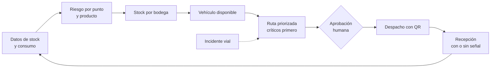
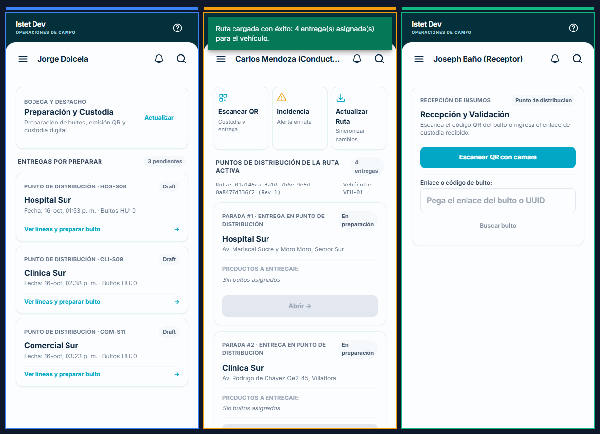

# Entregable Solucion y propuesta de valor

Entregable oficial n.º 2, **Solución** (manual §9: «descripción y funcionamiento»), con la propuesta de valor del Anexo 5.6. Se trabaja en el bloque «Diseño» del 16-oct (14:00–14:30), se revisa en el Checkpoint de avances (16-oct, 18:30–19:00) y se entrega el 17-oct de 16:00 a 16:15 ([[Cronograma oficial]]). Documento formal de 5 páginas (Word editable y PDF) en `docs/specs/006-validacion-pitch-entrega/materiales/entregable-2/`: portada, diagrama del recorrido, paso a paso, capturas del sistema, diferenciadores, propuesta de valor y alcance. Se regenera con `generar.py`; las capturas van en `img/captura-1..4.png`. Esta nota es la fuente del texto.

> [!warning] Borrador para revisión del equipo
> Redactado por Claude Code (Opus 5.5) a pedido de Joseph Baño el 16-oct. Cada componente lleva su estado real. Lo marcado «en construcción» (issues #193–#196) no se presenta como funcionando hasta que esté en `develop` con prueba.

## ¿Qué proponemos?

**IstpetDev** es una plataforma para que una empresa de limpieza **reabastezca sus puntos de servicio antes de que falte un insumo**, decida **desde qué bodega y en qué vehículo** sale cada entrega, **priorice** los puntos críticos (quirófanos, neonatos, emergencias) y **demuestre la custodia** de cada caja desde la bodega hasta la recepción, incluso sin señal.

## ¿Cómo funciona?

| # | Paso | Qué hace | Estado |
|---|---|---|---|
| 1 | Datos | Importa catálogo, puntos, bodegas, stock y consumo desde Excel/CSV con validación | Funciona (spec 001) |
| 2 | Riesgo | Calcula días de cobertura por punto y producto frente al lead time, y clasifica Crítico / Alto / Vigilar con la explicación del cálculo | Funciona (spec 002) |
| 3 | Stock por bodega | Busca en qué bodegas hay el producto y propone el origen, respetando stock de seguridad y vencimiento (FEFO) | Funciona en el asistente de pedidos; consulta para el agente en construcción (#194) |
| 4 | Vehículo | Elige vehículos por capacidad de peso y volumen, bodega base y costo | Funciona en el asistente; disponibilidad para el agente en construcción (#194) |
| 5 | Ruta priorizada | Reparte primero a los críticos y con menos holgura; arma rutas con ventanas horarias, jornada y distancias por calles reales; consolida puntos cercanos si el desvío es corto | Funciona (spec 002). Hora límite para críticos en construcción (#193, #196) |
| 6 | Agente con aprobación humana | El agente (n8n + DeepSeek) elige qué consultar y explica; el motor determinista calcula. Una persona aprueba antes de publicar | Funciona para riesgos, rutas e incidentes (spec 003). Herramientas de stock y vehículos en construcción (#195) |
| 7 | Imprevistos | Ante cierre vial, retraso o vehículo fuera de servicio, replanifica lo pendiente y conserva lo ya entregado; modo «priorizar críticos» | Funciona (spec 002) |
| 8 | Custodia con QR | Cada caja tiene QR; despacho, entrega y recepción quedan con cantidades, lote, responsable, foto y firma | Funciona (spec 004) |
| 9 | Sin señal | El conductor y el receptor registran offline en la PWA; se sincroniza sin duplicar | Funciona (specs 004 y 015) |
| 10 | Impacto | Simulación de 90 días que compara la política con calendario fijo y reacción tardía | Simulado con datos sintéticos (spec 005) |

### Evidencia de funcionamiento móvil de campo (3 roles concurrentes)

Demostración del recorrido completo de custodia y operación de campo entre los tres roles:

*Flujo animado del prototipo móvil PWA: despacho con escaneo de QR en bodega, navegación y entrega por el conductor, y recepción con firma táctil en pantalla sin conexión a internet.*

## ¿Qué la hace diferente?

1. **Cadena completa en una sola operación:** riesgo → bodega → vehículo → ruta → custodia → recepción. No es solo un ruteador ni solo un inventario.
2. **Prioridad explicable:** cada decisión muestra los datos que la causan (cobertura, lead time, criticidad del área). La IA explica y elige herramientas; no inventa cantidades.
3. **Sigue funcionando sin señal** en el punto de entrega, donde la conectividad suele fallar.
4. **Evidencia verificable:** cada entrega deja rastro auditable, consultable escaneando el QR de la caja.

## Propuesta de valor

**Para** gerencias de operaciones de empresas de limpieza que abastecen muchos puntos (hospitales, oficinas, comercios),
**que hoy** se enteran del faltante cuando el cliente llama, programan reposiciones semanales o quincenales fijas y no pueden comprobar qué se entregó,
**IstpetDev** anticipa el faltante, decide desde dónde y en qué vehículo atender primero lo crítico, y demuestra cada entrega,
**a diferencia de** hojas de cálculo, rutas fijas y listas de control en papel.

| Usuario | Hoy | Con IstpetDev |
|---|---|---|
| Planificador | Rutas fijas y urgencias por llamada | Prioridad y ruta justificadas con datos |
| Bodega | Despachos sin conciliación | Cantidad, lote y responsable por caja |
| Conductor | Sin señal, incidentes sin registro | Trabajo offline y replanificación |
| Receptor | Entrega difícil de verificar | Recepción con QR, foto y firma |
| Gerencia | Sobrecostos sin explicación | Indicadores con origen y comparación |

## Respaldo en el sector

La charla del 16-oct ([[Hallazgos de la charla para el Reto 1]]) describe programación semanal o quincenal, pedidos imprevistos que alteran rutas y entregas consolidadas por zona. Es testimonio, no validación de cifras. La necesidad de prioridad por área («no es lo mismo limpiar un quirófano que una habitación») motiva el paso 5. Dosificación, consumo por m² y promociones quedan como próximo paso ([[Ampliacion de alcance - ideas del evento]]).

## Límites que decimos en voz alta

- La escena en vivo usa `demo-region` (unos 15 puntos, 2 vehículos); la simulación de 90 días usa el escenario sintético de Quito (40 puntos) y no es una medición.
- No hay cifras de ahorro validadas con una empresa; los resultados del simulador se presentan con su escenario y semilla.
- La anticipación de «cinco días» solo se dice si la corrida del spec 005 la respalda ([[Guion del pitch]]).

Relacionadas: [[Historia y propuesta de valor]], [[Arquitectura del sistema]], [[Evaluacion y entregables]], [[Modelo de negocio y piloto]].
