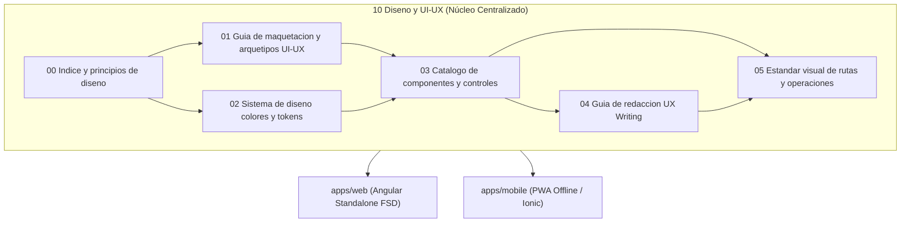
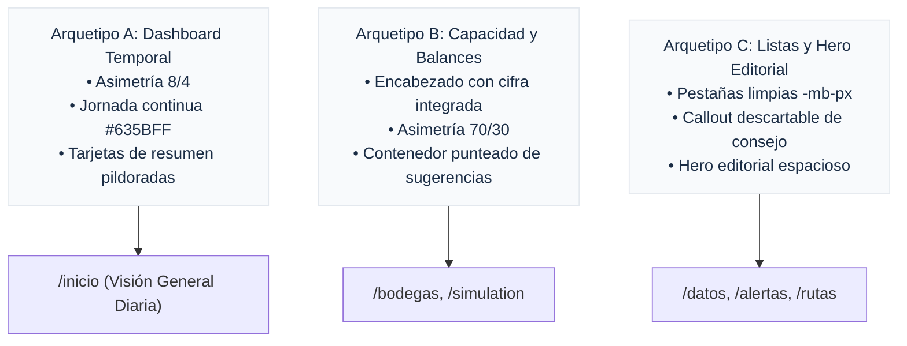

# Área de Diseño y Experiencia de Usuario (UI-UX)

Este directorio centraliza la normativa técnica, catálogo de tokens, arquetipos de maquetación, estándares de componentes y directrices de redacción para la plataforma web (`apps/web`) y la aplicación móvil de campo (`apps/mobile`) de IstpetDev.

---

## 1. Mapa de Documentación del Área

| Código | Documento | Propósito Técnico | Audiencia / Ámbito |
|---|---|---|---|
| **00** | [[00 Indice y principios de diseno]] | Manifiesto de diseño, reglas rectoras e índice de navegación. | Todo el equipo / Frontend |
| **01** | [[01 Guia de maquetacion y arquetipos UI-UX]] | Pila tipográfica nativa, Shell Global y Arquetipos A, B y C. | Desarrolladores Web / QA |
| **02** | [[02 Sistema de diseno colores y tokens]] | Paleta oficial Expo Clean 2026, escalas Tailwind y accesibilidad WCAG. | UI Designers / Frontend |
| **03** | [[03 Catalogo de componentes y controles]] | Especificación milimétrica de botones, inputs, modales, drawers y tablas. | Frontend / Component Library |
| **04** | [[04 Guia de redaccion UX Writing]] | Reglas de lenguaje humano, directo y accesible sin jerga de backend. | Producto / UX Writers / Frontend |
| **05** | [[05 Estandar visual de rutas y operaciones]] | Estandarización de `RutasPage`, bandeja de rechazos y asistente de 4 pasos. | Módulo de Ruteo / Planificador |

---

## 2. Principios Innegociables de Diseño

### 2.1 Estándar Ejecutivo Stripe Dashboard
* **Estructura y Limpieza:** Se toma como estándar visual de referencia la precisión geométrica, densidad equilibrada y jerarquía tipográfica de la consola ejecutiva de Stripe.
* **Aislamiento de Dominio:** Queda estrictamente prohibido introducir conceptos financieros, cobros o claves de pasarelas de pago (`sk_live_`, `pk_live_`). Toda la interfaz debe reflejar fielmente la operativa de abastecimiento de insumos de higiene hospitalaria (bodegas, centros de salud, SKUs, m³ de volumen, kg de carga, camiones y custodias).

### 2.2 Tono Sobrio y Erradicación de Emojis
* **Prohibición Total de Emojis:** Queda terminantemente prohibido el uso de emojis en etiquetas, botones, encabezados, tablas, alertas o badges. La iconografía debe implementarse mediante SVG vectoriales semánticos (ej. Lucide o iconos SVG directos).
* **Cero Cifras Simuladas:** Se prohíbe inventar métricas ficticias. Si un dato no está expuesto por la API o backend, se rotula explícitamente como «sin dato» o se muestra un estado atenuado con su debida justificación.

### 2.3 Tipografía Sans Nativa y Prohibición de Cero Punteado
* **Pila Nativa:** Se utiliza `-apple-system, BlinkMacSystemFont, "Segoe UI", Roboto, Helvetica, Arial, sans-serif`.
* **Desactivación de `"zero" 1`:** Se elimina cualquier regla CSS que fuerce ceros con punto central retro en la tipografía del sistema. Toda cifra debe ser legible y contemporánea.

### 2.4 Ergonomía y Accesibilidad (WCAG 2.2 AA)
* **Contraste Mínimo:** 4.5:1 en texto regular y 3:1 en texto grande o componentes interactivos.
* **Objetivos Táctiles:** Mínimo 36px (`h-9`) en escritorio y 44px a 48px en interfaces móviles táctiles.
* **Navegación por Teclado:** Foco visible en todos los controles (`focus:ring-2 focus:ring-[#635BFF] focus:outline-none`).

### 2.5 Inmutabilidad Funcional, Cero Datos Quemados y Cero Funciones Inventadas

> [!CAUTION] Principio Rector de Sujeción Estricta al Sistema Real
> La capa de diseño UI-UX tiene como único propósito elevar la calidad visual, jerarquía tipográfica, ergonomía y usabilidad de la plataforma. **Queda terminantemente prohibido:**
> 1. **Inventar funciones o botones fantasma:** No se permite agregar controles visuales que no correspondan a una función, endpoint o flujo existente en el sistema.
> 2. **Quemar datos o mocks artificiales (`hardcoding`):** Prohibido insertar datos estáticos simulados para aparentar funcionalidad. La UI debe alimentarse 100% de los contratos, DTOs y signals reales provenientes del backend (.NET 8) y `@shared/api`.
> 3. **Alterar la lógica de negocio o dañar suites de pruebas:** Ninguna mejora visual puede alterar cálculos logísticos, restricciones vehiculares, filtros o estados de pedidos. Todas las suites de pruebas unitarias (`*.spec.ts`) deben mantenerse al 100% en verde tras cualquier rediseño.
> 4. **Tratamiento de datos no disponibles:** Si un cálculo o métrica aún no está expuesto por el backend, se muestra explícitamente como «sin dato» en estado atenuado con su debida justificación técnica, sin inventar ceros ni cifras provisionales.

---

## 3. Matriz de Arquetipos de Pantalla

Para la especificación detallada de cada arquetipo, consultar [[01 Guia de maquetacion y arquetipos UI-UX]].
