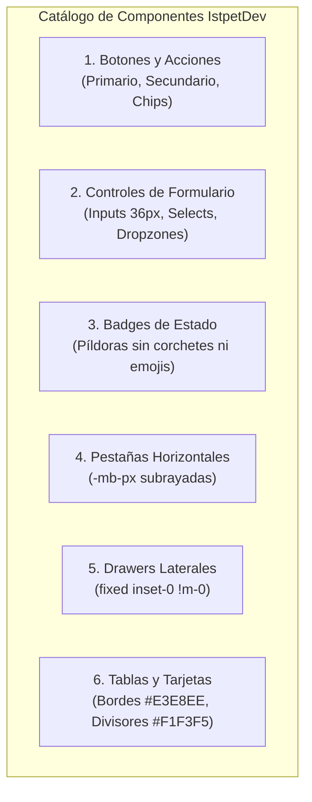

# Catálogo de componentes y controles UI

Especificación técnica de la biblioteca de componentes y controles para la plataforma web (`apps/web`) y PWA de campo (`apps/mobile`), estructurada bajo la estética ejecutiva de Stripe Dashboard y los principios de [[00 Indice y principios de diseno]].



> [!NOTE] Enfoque Puro de Presentación
> Los componentes y controles de este catálogo no contienen lógica de negocio aislada ni alteran contratos de API. Su función es 100% estructural: maquetar con precisión visual y ergonomía los datos reales provenientes de los servicios y signals del sistema, sin incrustar datos quemados ni simular acciones.

---

## 1. Botones y Acciones Interactivas

Todos los botones estándar tienen una altura fija de 36px (`h-9`), esquinas suavemente redondeadas de 6px (`rounded-md`), tipografía en 12px a 13px (`text-xs` o `text-[13px]`) y peso `font-medium`.

| Variante | Clase Tailwind Base | Rol en la Interfaz | Comportamiento Hover / Focus |
|---|---|---|---|
| **Primario (Acción Principal)** | `h-9 px-4 bg-[#635BFF] hover:bg-[#5248E0] text-white text-xs font-medium rounded-md shadow-2xs transition-colors inline-flex items-center justify-center gap-2 disabled:opacity-50` | Guardar, confirmar ruta, nuevo registro | Foco: `focus:ring-2 focus:ring-[#635BFF] focus:ring-offset-1` |
| **Secundario / Neutro** | `h-9 px-3.5 bg-white hover:bg-slate-50 text-[#30313D] border border-[#E3E8EE] text-xs font-medium rounded-md shadow-2xs transition-colors inline-flex items-center justify-center gap-2` | Cancelar, actualizar, exportar | Borde tenue, fondo sutil al pasar cursor |
| **Peligro / Destructivo** | `h-9 px-4 bg-[#DF1B41] hover:bg-[#C01033] text-white text-xs font-medium rounded-md shadow-2xs transition-colors inline-flex items-center justify-center gap-2` | Cancelar ruta publicada, revocar custodia | Foco con anillo rojo `#DF1B41` |
| **Botón Tipo Chip (Acción Rápida)** | `h-8 px-3 rounded-md border border-[#E3E8EE] bg-white text-xs font-medium text-[#30313D] hover:bg-slate-50 transition-colors inline-flex items-center gap-1.5 shadow-2xs` | Filtros horizontales, cambiar vista | Micro-elevación imperceptible |

### Código de Referencia (HTML / Angular)

```html
<!-- Botón Primario -->
<button
  type="button"
  (click)="onConfirm()"
  [disabled]="isLoading()"
  class="h-9 px-4 bg-[#635BFF] hover:bg-[#5248E0] text-white text-xs font-medium rounded-md shadow-2xs transition-colors inline-flex items-center justify-center gap-2 disabled:opacity-50 focus:outline-none focus:ring-2 focus:ring-[#635BFF] focus:ring-offset-1">
  @if (isLoading()) {
    <svg class="animate-spin h-3.5 w-3.5 text-white" viewBox="0 0 24 24" fill="none">
      <circle class="opacity-25" cx="12" cy="12" r="10" stroke="currentColor" stroke-width="4"></circle>
      <path class="opacity-75" fill="currentColor" d="M4 12a8 8 0 018-8v8H4z"></path>
    </svg>
  }
  <span>Publicar ruta planificada</span>
</button>
```

---

## 2. Controles de Formulario e Inputs

* **Altura Estandarizada:** 36px (`h-9`).
* **Borde y Superficie:** `border border-[#E3E8EE] bg-white text-[#30313D] rounded-md px-3 text-xs`.
* **Estado Focus Obligatorio:** `focus:border-[#635BFF] focus:ring-1 focus:ring-[#635BFF] focus:outline-none`.
* **Placeholder:** `placeholder:text-[#8792A2]`.
* **Estado de Error:** Borde rojo `#DF1B41` con microtexto inferior en `#DF1B41` de 11px.

```html
<div class="space-y-1.5">
  <label class="block text-xs font-medium text-[#30313D]">Capacidad máxima de carga (kg)</label>
  <input
    type="number"
    [(ngModel)]="maxLoadKg"
    placeholder="Ej. 3500"
    class="w-full h-9 px-3 text-xs bg-white border border-[#E3E8EE] rounded-md text-[#30313D] placeholder-[#8792A2] focus:border-[#635BFF] focus:ring-1 focus:ring-[#635BFF] focus:outline-none transition-colors" />
</div>
```

---

## 3. Badges e Indicadores de Estado

Queda estrictamente prohibido incluir corchetes como texto plano (ej. `[Éxito]` o `[Alerta]`) y emojis (ej. `⚠️`, `✅`, `❌`). Los estados se comunican mediante pastillas redondeadas (`rounded-full`), texto de 11px (`text-[11px]`) con seminegrita (`font-medium`) y borde sutil.

| Estado Semántico | Clases Tailwind del Badge | Ejemplo de Texto |
|---|---|---|
| **Conforme / Completado** | `bg-emerald-50 text-emerald-700 border border-emerald-200/80 px-2 py-0.5 rounded-full text-[11px] font-medium inline-flex items-center gap-1` | Entregado conforme |
| **En Tránsito / En Curso** | `bg-sky-50 text-sky-700 border border-sky-200/80 px-2 py-0.5 rounded-full text-[11px] font-medium inline-flex items-center gap-1` | En tránsito |
| **Alerta / En Observación** | `bg-amber-50 text-amber-700 border border-amber-200/80 px-2 py-0.5 rounded-full text-[11px] font-medium inline-flex items-center gap-1` | Stock crítico |
| **Rechazado / Daño** | `bg-rose-50 text-rose-700 border border-rose-200/80 px-2 py-0.5 rounded-full text-[11px] font-medium inline-flex items-center gap-1` | Recepción rechazada |
| **Planificado / Borrador** | `bg-slate-100 text-slate-600 border border-slate-200 px-2 py-0.5 rounded-full text-[11px] font-medium inline-flex items-center gap-1` | Plan borrador |

---

## 4. Pestañas Horizontales Subrayadas (Tabs)

Las pestañas no utilizan fondos oscuros ni cajas rectangulares toscas. Siguen el estándar en línea de Stripe Dashboard con borde inferior activo de 2px que se solapa a la línea divisoria de la página mediante margen negativo (`-mb-px`):

```html
<div class="flex items-center gap-6 sm:gap-8 border-b border-[#E3E8EE] -mb-px">
  <button
    type="button"
    (click)="activeTab.set('rutas')"
    class="pb-3 text-sm font-semibold transition-colors flex items-center gap-2 border-b-2"
    [ngClass]="activeTab() === 'rutas' 
      ? 'border-[#1A2C44] text-[#1A2C44]' 
      : 'border-transparent text-[#697386] hover:text-[#1A2C44]'">
    <span>Rutas Planificadas</span>
    <span class="text-xs px-2 py-0.2 rounded-full bg-[#F1F3F5] text-[#30313D] font-mono">
      {{ routePlans().length }}
    </span>
  </button>

  <button
    type="button"
    (click)="activeTab.set('novedades')"
    class="pb-3 text-sm font-semibold transition-colors flex items-center gap-2 border-b-2"
    [ngClass]="activeTab() === 'novedades' 
      ? 'border-[#1A2C44] text-[#1A2C44]' 
      : 'border-transparent text-[#697386] hover:text-[#1A2C44]'">
    <span>Novedades y Rechazos</span>
    @if (rejectionsCount() > 0) {
      <span class="text-xs px-2 py-0.2 rounded-full bg-rose-50 text-rose-700 border border-rose-200 font-mono">
        {{ rejectionsCount() }}
      </span>
    }
  </button>
</div>
```

---

## 5. Arquitectura de Drawers Laterales (Solución Definitiva a Margen Vertical)

> [!CAUTION] Regla Arquitectónica de Layout para Drawers
> Cuando un panel lateral `fixed` se ubica condicionalmente (`@if`) dentro de un contenedor padre con utilidades de espaciado vertical (`space-y-*`), el selector CSS inyecta `margin-top` al diálogo, desplazándolo verticalmente y rompiendo el alineamiento de pantalla completa.
> **Solución obligatoria:** Todo drawer o modal debe colocarse en un contenedor raíz desacoplado con `fixed inset-0 z-[100] overflow-hidden !m-0`.

```html
<!-- Estructura canónica del Drawer Lateral -->
@if (isDrawerOpen()) {
  <div class="fixed inset-0 z-[100] overflow-hidden !m-0" aria-labelledby="slide-over-title" role="dialog" aria-modal="true">
    <!-- Telón de fondo translúcido -->
    <div 
      class="absolute inset-0 bg-[#0A2540]/30 backdrop-blur-xs transition-opacity"
      (click)="closeDrawer()"></div>

    <div class="fixed inset-y-0 right-0 max-w-full flex pl-10">
      <div class="w-screen max-w-md sm:max-w-xl bg-white border-l border-[#E3E8EE] shadow-2xl flex flex-col">
        <!-- Cabecera del Drawer -->
        <div class="p-6 border-b border-[#E3E8EE] flex items-center justify-between bg-[#F8FAFC]">
          <div>
            <h3 class="text-base font-bold text-[#1A2C44]">{{ drawerTitle() }}</h3>
            <p class="text-xs text-[#697386] mt-0.5">{{ drawerSubtitle() }}</p>
          </div>
          <button 
            type="button" 
            (click)="closeDrawer()" 
            class="h-8 w-8 rounded-md border border-[#E3E8EE] bg-white text-[#697386] hover:text-[#1A2C44] flex items-center justify-center transition-colors">
            ✕
          </button>
        </div>

        <!-- Cuerpo Desplazable -->
        <div class="flex-1 overflow-y-auto p-6 space-y-6">
          <ng-content />
        </div>

        <!-- Pie de Acción -->
        <div class="p-4 border-t border-[#E3E8EE] bg-[#F8FAFC] flex items-center justify-between">
          <kbd class="text-[11px] text-[#8792A2] px-2 py-0.5 bg-white border border-[#E3E8EE] rounded">ESC para salir</kbd>
          <div class="flex items-center gap-2">
            <button (click)="closeDrawer()" class="h-9 px-3.5 border border-[#E3E8EE] rounded-md text-xs font-medium text-[#30313D] bg-white hover:bg-slate-50">Cerrar</button>
            <button (click)="saveChanges()" class="h-9 px-4 bg-[#635BFF] hover:bg-[#5248E0] text-white text-xs font-medium rounded-md">Guardar</button>
          </div>
        </div>
      </div>
    </div>
  </div>
}
```

---

## 6. Tarjetas y Tablas de Datos Maestras

* **Borde Exterior:** `border border-[#E3E8EE] rounded-xl overflow-hidden bg-white shadow-2xs`.
* **Cabecera de Tabla (`thead`):** `bg-[#F8FAFC] border-b border-[#E3E8EE] text-[11px] font-semibold text-[#4F566B] uppercase tracking-wider`.
* **Separador de Filas:** `divide-y divide-[#F1F3F5]`.
* **Fila Interactiva:** `hover:bg-slate-50/60 transition-colors text-xs text-[#30313D]`.
