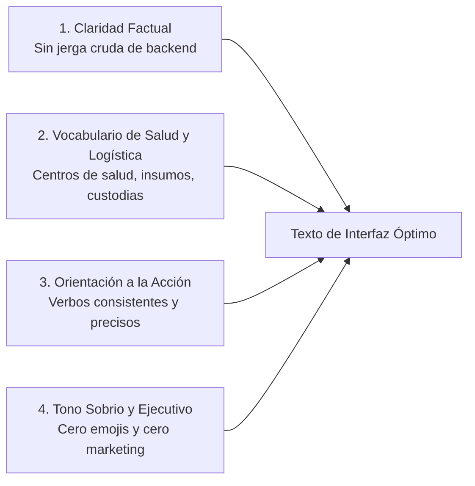

# Guía de redacción y lenguaje de interfaz (UX Writing)

Normativa de estilo lingüístico, terminología oficial y directrices de redacción para la plataforma web (`apps/web`) y aplicación móvil (`apps/mobile`) de IstpetDev. Parte integral de [[00 Indice y principios de diseno]].

---

## 1. Principios Fundamentales de Redacción

### 1.1 Tono Sobrio y Fáctico
* **Cero Emojis:** Queda terminantemente prohibido el uso de emojis en cualquier elemento textual de la interfaz (botones, modales, alertas, títulos, tablas o tooltips).
* **Cero Lenguaje Inflado:** Se prohíben términos marketeros como *"arquitectura definitiva"*, *"solución revolucionaria"* o *"algoritmo mágico"*. Toda descripción debe ser medible, técnica y verificable.

### 1.2 Transparencia y Cero Datos Inventados
* Si un indicador no cuenta con datos del backend o requiere cálculo pendiente, debe mostrarse explícitamente como **«sin dato»** en color atenuado (`text-[#8792A2]`), acompañado de un microtexto o tooltip explicativo.
* Queda prohibido mostrar un "0" artificial para simular que un servicio está funcionando si en realidad la API no expone el campo.

---

## 2. Glosario Canónico vs Términos Prohibidos

| Concepto Técnico de Base de Datos / Backend | Término Prohibido en Interfaz de Usuario | Término Oficial en Interfaz (UX Writing) | Contexto de Aplicación |
|---|---|---|---|
| `ServicePoint` con `Category = Hospital` | *"Punto de demanda"*, *"Nodo de red"* | **Centro de salud** o **Hospital** | Destino de entrega |
| `Warehouse` | *"Depósito"*, *"Stock pool"* | **Bodega central** o **Almacén de origen** | Origen de despacho |
| `HandlingUnit` / `UnitLogistics` | *"Objeto logístico"*, *"Record HU"* | **Bulto rotulado** o **Caja sellada** | Embalaje con código QR |
| `DeliveryOrder` | *"Solicitud cruda"*, *"Fila de demanda"* | **Pedido de insumos** | Requerimiento hospitalario |
| `RoutePlan` en estado `Draft` | *"Ruta tentativa"*, *"Pending plan"* | **Propuesta de ruta** o **Borrador** | Planificador de rutas |
| `RoutePlan` en estado `Published` | *"Ruta commiteada"*, *"Locked"* | **Ruta publicada** | Despacho activo a conductor |
| `Receipt` con discrepancias | *"Mismatch error"*, *"Throw exception"* | **Recepción con novedades** o **Entrega parcial** | Registro del receptor |
| Identificador `UUID v7` | *"UUID crudo"*, *"Hash interno"* | **Código de seguimiento** (mostrando primeros 8 caracteres) | Trazabilidad pública |

---

## 3. Estructura de Mensajes y Alertas

### 3.1 Mensajes de Acción Exitosa
El mensaje debe confirmar la operación realizada con precisión fáctica, sin exclamaciones infantiles ni palabras vacías.

* **Incorrecto:** `¡Genial! Tu ruta se ha creado con éxito :)`
* **Correcto:** `Ruta publicada. Se asignaron 4 centros de salud al vehículo T-01.`

### 3.2 Mensajes de Error y Contingencia
Todo mensaje de error debe responder a tres preguntas:
1. ¿Qué ocurrió?
2. ¿Por qué ocurrió?
3. ¿Cuál es la acción correctiva que debe tomar el operador?

* **Incorrecto:** `Error 500: Failed to fetch RouteStop entity.`
* **Correcto:** `No se pudo confirmar la parada. El centro de salud no tiene ventanas horarias habilitadas para este vehículo. Verifique las restricciones del transportista o asigne otro horario.`

---

## 4. Consistencia en Botones y Controles de Acción

1. **Nombrar la Acción:** El botón utiliza un verbo en infinitivo que describe la acción concreta:
   * `Publicar ruta`, `Asignar conductor`, `Descargar manifiesto CSV`, `Cerrar recepción`.
2. **Coherencia con el Resultado:** La retroalimentación debe utilizar la raíz léxica del botón:
   * Botón: `Publicar ruta` → Notificación: `Ruta publicada`.
   * Botón: `Registrar novedad` → Notificación: `Novedad registrada`.
3. **Cancelaciones y Retornos:**
   * Usar `Cancelar` para descartar una acción sin guardar.
   * Usar `Volver` o `Regresar` para retroceder en un asistente de varios pasos sin perder los datos previamente ingresados.
