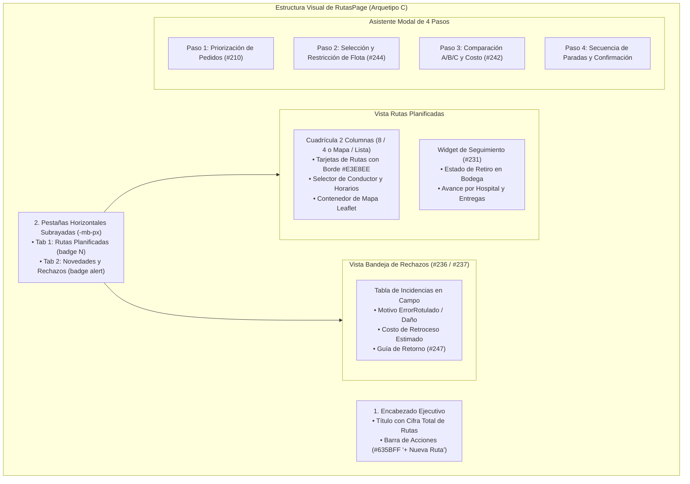
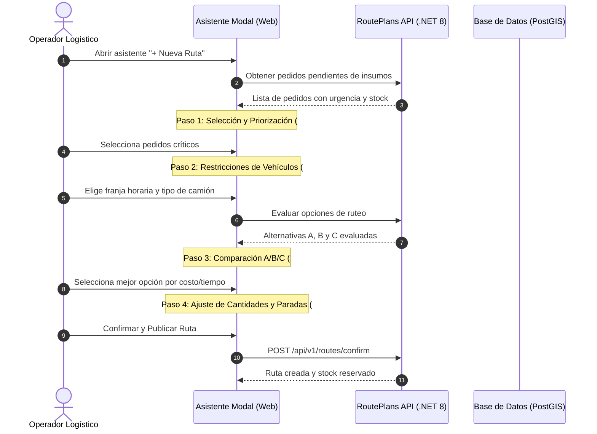

# Estándar visual de rutas y operaciones logísticas

Especificación de maquetación, arquitectura de componentes y diseño UI-UX para la pantalla de Planificación de Rutas (`/rutas`, implementada en `apps/web/src/pages/rutas/rutas.page.ts`), alineada al **Arquetipo C (Listas Maestras y Hero Editorial)** bajo la estética ejecutiva de Stripe Dashboard.

> [!CAUTION] Mandato de Preservación Funcional 100% en Rutas
> La modernización visual de `rutas.page.ts` se rige por una regla estricta de **cero alteración de lógica y cero datos quemados**:
> 1. **Preservación Total de Signals y Métodos:** Se mantienen intactos el 100% de los signals reactivos (`routePlans`, `activeTab`, `selectedRoute`, `rejectedCaptures`, `agentRun`, `comparisonData`, etc.) y las llamadas a la API (`ApiService`). Ningún método se elimina ni se modifica en su firma de negocio.
> 2. **Cero Funciones Inventadas:** Cada botón, selector o modal corresponde estrictamente a las capacidades reales implementadas (#210, #242, #231, #244, #245, #236, #237, #247).
> 3. **Cero Mocks Quemados:** Toda métrica de costo, kilometraje, tiempo en hora pico o bultos proviene del cómputo determinista del backend o de los servicios de ruteo (@shared/api).
> 4. **Garantía de Tests:** Todas las suites de pruebas unitarias (`rutas.page.spec.ts` y specs especializadas) deben pasar limpias (100% en verde) antes y después de cualquier intervención visual.

---

## 1. Encabezado y Pestañas de Navegación

### 1.1 Encabezado Superior
* **Título:** `text-[26px] font-bold text-[#1A2C44]` (`Planificación y Despacho de Rutas`).
* **Subtítulo:** `text-xs text-[#697386]` (`Consola de asignación de vehículos, trazabilidad de paradas y conciliación de entregas`).
* **Botones de Acción Primaria:**
  * Botón de Emergencia: `h-9 px-4 bg-white border border-[#E3E8EE] text-[#DF1B41] hover:bg-rose-50 text-xs font-medium rounded-md shadow-2xs`.
  * Botón Crear Ruta: `h-9 px-4 bg-[#635BFF] hover:bg-[#5248E0] text-white text-xs font-medium rounded-md shadow-2xs inline-flex items-center gap-1.5`.

### 1.2 Pestañas en Línea
* Eliminación definitiva de bordes toscos de caja o botones grises.
* Se utiliza la clase `-mb-px` solapada al borde `#E3E8EE`.
* La pestaña activa resalta con `border-b-2 border-[#1A2C44] text-[#1A2C44] pb-3 text-sm font-semibold`.

---

## 2. Tarjetas de Ruta y Asignación de Flota

Cada ruta planificada se presenta en una tarjeta estructurada en `bg-white border border-[#E3E8EE] rounded-xl p-5 hover:border-slate-300 transition-all shadow-2xs`:

1. **Cabecera de Tarjeta:**
   * Código de vehículo destacado (`font-bold text-[#1A2C44] text-sm`) junto a un indicador cromático del trazado en el mapa.
   * Badge de estado operativo limpio (`Plan borrador`, `Publicada`, `En curso`).
   * Horario límite y franja de hora pico si aplica (`text-xs text-[#697386]`).
2. **Métricas de Operación:**
   * Distancia en km, paradas totales, volumen en m³ y carga en kg con respecto a la capacidad nominal del camión.
   * Alerta sobria en caso de desvío extraurbano o restricción horaria ([[02 Sistema de diseno colores y tokens]]).
3. **Asignación de Conductor:**
   * Selector compacto (`h-8 text-xs bg-white border border-[#E3E8EE] rounded-md`) que permite asociar un conductor de la flota antes de la publicación.

---

## 3. Asistente Modal de 4 Pasos (Wizard)

El asistente de generación de rutas orquesta los requerimientos integrados recientemente en `develop`:

### 3.1 Paso 1: Selección y Priorización de Pedidos (#210)
* Tabla interactiva de pedidos pendientes con casillas de selección múltiple.
* Indicadores visuales de nivel de stock hospitalario: Crítico (`rose`), Observación (`amber`), Normal (`emerald`).
* Selector de orden de prioridad con arrastre o botones de ascenso/descenso.

### 3.2 Paso 2: Flota y Restricciones Horarias (#244, #241)
* Selector de vehículos con visualización de operador propio vs contratado.
* Advertencia de restricciones de circulación urbana según el horario de salida previsto.

### 3.3 Paso 3: Comparación de Opciones A/B/C (#242)
* 3 columnas comparativas limpias en tarjetas con borde `#E3E8EE`:
  * **Opción A (Balanceada / Recomendada):** Resaltada con borde `#635BFF` y badge sutil `Recomendada`.
  * **Opción B (Menor Costo):** Optimizada para combustible y peajes.
  * **Opción C (Mínimo Tiempo):** Optimizada para entrega urgente de insumos hospitalarios.
* Desglose claro de costos (combustible, operador, amortización y costo de retroceso estimado).

### 3.4 Paso 4: Edición de Cantidades y Confirmación (#199)
* Resumen final de paradas y posibilidad de ajustar la cantidad de bultos/cajas por centro de salud antes de la publicación definitiva.

---

## 4. Bandeja de Novedades y Rechazos (#236, #237, #247)

* Tabla de incidencias registradas en campo por los receptores hospitalarios.
* Detalle de líneas rechazadas por motivo (`ErrorRotulado`, `Daño`, `Incompleto`).
* Estimación automática del costo de retroceso logístico y botón para generar la **Guía de retorno de lo no entregado** con prioridad al día siguiente.
