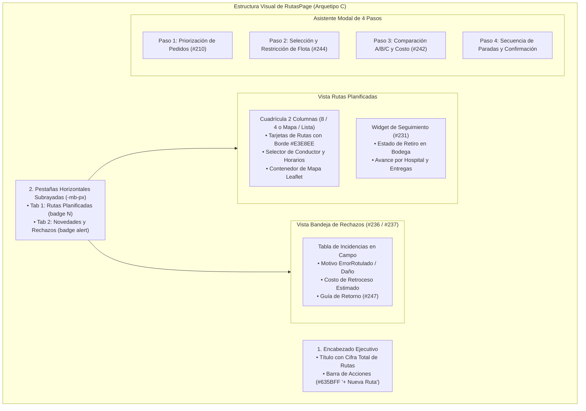
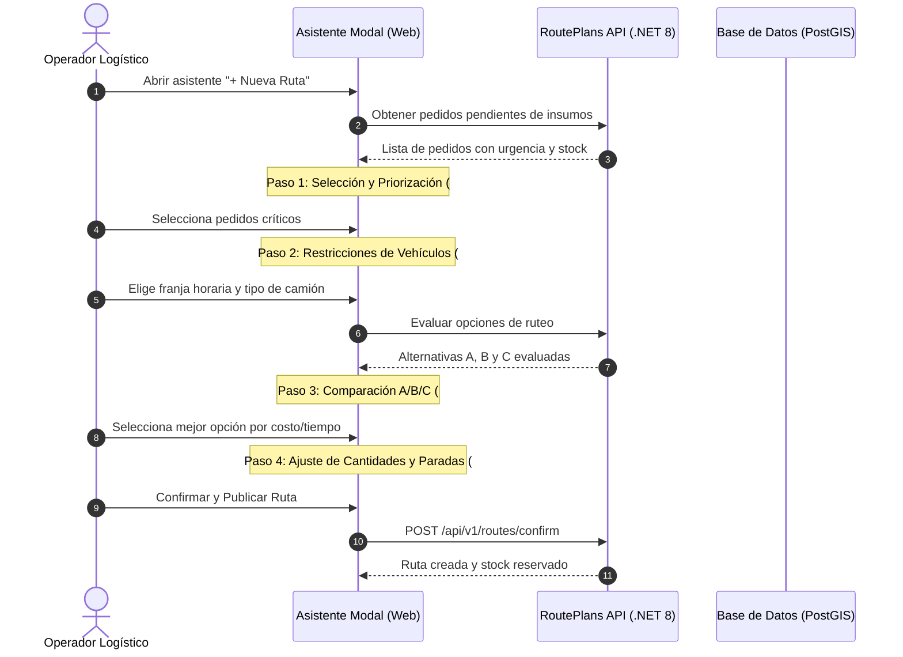

# Estándar visual de rutas y operaciones logísticas

Especificación de maquetación, arquitectura de componentes y diseño UI-UX para la pantalla de Planificación de Rutas (`/rutas`, implementada en `apps/web/src/pages/rutas/rutas.page.ts`), alineada al **Arquetipo C (Listas Maestras y Hero Editorial)** bajo la estética ejecutiva de Stripe Dashboard.

> **Evolución solicitada por Bryan — 17-oct-2026:** se preparó el [plan de renovación visual de rutas desde la landing](../../specs/002-motor-logistico/plan-renovacion-visual-rutas.md): mapa protagonista e iconos Lucide minimalistas. Bryan corrigió después la propuesta para usar **modo claro**, manteniendo la jerarquía editorial de la landing. La implementación local se registra abajo; esta guía también conserva la referencia anterior. Para el asistente, el código vigente usa **Pedidos → Abastecimiento → Comparación → Vehículo y confirmación**, y la opción recomendada depende de la API. El rediseño conservará ese flujo y las restricciones funcionales; no se debe implementar literalmente el orden ni las categorías fijas del diagrama histórico de esta nota.

> **Ampliación funcional del mismo día:** el [plan de alternativas excluyentes y varios vehículos](../../specs/002-motor-logistico/plan-flujo-seleccion-rutas.md) propone aceptar una solución completa y descartar únicamente sus alternativas hermanas, con mensajes comparativos verificables y mapa por vehículo. Requiere evolución explícita del contrato, persistencia y aceptación transaccional; no es un cambio de presentación cubierto por el mandato histórico de cero alteración de lógica. Estado: código implementado y migración aditiva generada; la evidencia distingue pruebas de aplicación local y despliegue.

> [!CAUTION] Mandato de Preservación Funcional 100% en Rutas
> La modernización visual de `rutas.page.ts` se rige por una regla estricta de **cero alteración de lógica y cero datos quemados**:
> 1. **Preservación Total de Signals y Métodos:** Se mantienen intactos el 100% de los signals reactivos (`routePlans`, `activeTab`, `selectedRoute`, `rejectedCaptures`, `agentRun`, `comparisonData`, etc.) y las llamadas a la API (`ApiService`). Ningún método se elimina ni se modifica en su firma de negocio.
> 2. **Cero Funciones Inventadas:** Cada botón, selector o modal corresponde estrictamente a las capacidades reales implementadas (#210, #242, #231, #244, #245, #236, #237, #247).
> 3. **Cero Mocks Quemados:** Toda métrica de costo, kilometraje, tiempo en hora pico o bultos proviene del cómputo determinista del backend o de los servicios de ruteo (@shared/api).
> 4. **Garantía de Tests:** Todas las suites de pruebas unitarias (`rutas.page.spec.ts` y specs especializadas) deben pasar limpias (100% en verde) antes y después de cualquier intervención visual.

---

## 1. Encabezado y Pestañas de Navegación

### 1.1 Encabezado Superior
* **Título:** `text-[26px] font-bold text-[#1A2C44]` (`Planificación y Despacho de Rutas`).
* **Subtítulo:** `text-xs text-[#697386]` (`Consola de asignación de vehículos, trazabilidad de paradas y conciliación de entregas`).
* **Botones de Acción Primaria:**
  * Botón de Emergencia: `h-9 px-4 bg-white border border-[#E3E8EE] text-[#DF1B41] hover:bg-rose-50 text-xs font-medium rounded-md shadow-2xs`.
  * Botón Crear Ruta: `h-9 px-4 bg-[#635BFF] hover:bg-[#5248E0] text-white text-xs font-medium rounded-md shadow-2xs inline-flex items-center gap-1.5`.

### 1.2 Pestañas en Línea
* Eliminación definitiva de bordes toscos de caja o botones grises.
* Se utiliza la clase `-mb-px` solapada al borde `#E3E8EE`.
* La pestaña activa resalta con `border-b-2 border-[#1A2C44] text-[#1A2C44] pb-3 text-sm font-semibold`.

---

## 2. Tarjetas de Ruta y Asignación de Flota

Cada ruta planificada se presenta en una tarjeta estructurada en `bg-white border border-[#E3E8EE] rounded-xl p-5 hover:border-slate-300 transition-all shadow-2xs`:

1. **Cabecera de Tarjeta:**
   * Código de vehículo destacado (`font-bold text-[#1A2C44] text-sm`) junto a un indicador cromático del trazado en el mapa.
   * Badge de estado operativo limpio (`Plan borrador`, `Publicada`, `En curso`).
   * Horario límite y franja de hora pico si aplica (`text-xs text-[#697386]`).
2. **Métricas de Operación:**
   * Distancia en km, paradas totales, volumen en m³ y carga en kg con respecto a la capacidad nominal del camión.
   * Alerta sobria en caso de desvío extraurbano o restricción horaria ([[02 Sistema de diseno colores y tokens]]).
3. **Asignación de Conductor:**
   * Selector compacto (`h-8 text-xs bg-white border border-[#E3E8EE] rounded-md`) que permite asociar un conductor de la flota antes de la publicación.

---

## 3. Asistente Modal de 4 Pasos (Wizard)

El asistente de generación de rutas orquesta los requerimientos integrados recientemente en `develop`:

### 3.1 Paso 1: Selección y Priorización de Pedidos (#210)
* Tabla interactiva de pedidos pendientes con casillas de selección múltiple.
* Indicadores visuales de nivel de stock hospitalario: Crítico (`rose`), Observación (`amber`), Normal (`emerald`).
* Selector de orden de prioridad con arrastre o botones de ascenso/descenso.

### 3.2 Paso 2: Flota y Restricciones Horarias (#244, #241)
* Selector de vehículos con visualización de operador propio vs contratado.
* Advertencia de restricciones de circulación urbana según el horario de salida previsto.

### 3.3 Paso 3: Comparación de Opciones A/B/C (#242)
* 3 columnas comparativas limpias en tarjetas con borde `#E3E8EE`:
  * **Opción A (Balanceada / Recomendada):** Resaltada con borde `#635BFF` y badge sutil `Recomendada`.
  * **Opción B (Menor Costo):** Optimizada para combustible y peajes.
  * **Opción C (Mínimo Tiempo):** Optimizada para entrega urgente de insumos hospitalarios.
* Desglose claro de costos (combustible, operador, amortización y costo de retroceso estimado).

### 3.4 Paso 4: Edición de Cantidades y Confirmación (#199)
* Resumen final de paradas y posibilidad de ajustar la cantidad de bultos/cajas por centro de salud antes de la publicación definitiva.

---

## 4. Bandeja de Novedades y Rechazos (#236, #237, #247)

* Tabla de incidencias registradas en campo por los receptores hospitalarios.
* Detalle de líneas rechazadas por motivo (`ErrorRotulado`, `Daño`, `Incompleto`).
* Estimación automática del costo de retroceso logístico y botón para generar la **Guía de retorno de lo no entregado** con prioridad al día siguiente.

## Implementación local y corrección de estilo — 17-oct-2026

La instrucción posterior de Bryan reemplaza el tema nocturno del plan inicial: fondo claro, paneles blancos, texto azul profundo, acentos azules/cian e iconos Lucide. El mapa es el área principal; la lista de rutas y los controles secundarios ocupan menos espacio. Al enfocar un vehículo se explica su secuencia desde la recogida hasta cada entrega, con reproducción, pausa, anterior/siguiente y reinicio. Se anima la geometría recibida del evaluador; el avance no representa GPS ni nodos de búsqueda Dijkstra. Si el servicio de calles no entrega geometría, se informa que el trazado punteado es aproximado.

Contrato implementado: `POST /api/v1/route-plans/decisions` prepara un cálculo persistente; `GET .../decisions/{id}` recupera el estado; `POST .../decisions/{id}/accept` acepta una alternativa; `POST .../decisions/{id}/publish` publica todas sus rutas con un conductor por vehículo. La aceptación exige versión e identificador de operación y reutiliza la transacción/idempotencia de #287. Las alternativas hermanas se derivan como descartadas después del commit; no se eliminan rutas de otro cálculo. Aceptar crea los planes; publicar crea entregas y reservas.

`RoutePlanningDecision` guarda el snapshot y la elección en DemoCore, con la migración aditiva `20261017143616_RoutePlanningDecisions`. Es un cambio de contrato autorizado por la ampliación funcional, no una propuesta de esquema equivalente a una migración aplicada. El flujo anterior de rutas independientes se conserva. La asignación agrupa entregas completas con el matcher existente; una entrega que exceda todos los vehículos se bloquea, no se divide artificialmente.

El trabajo está aislado en `feature/242-rutas-interactivas`, worktree hermano `ISTPETDEV-rutas`, sobre `8ca4e8b`. Las comprobaciones y el estado del entorno están en el [registro de evidencia](../../evidence/renovacion-visual-rutas-2026-10-17.md).

### Ajuste de interacción del mismo día

«Rutas registradas» usa una sola fila horizontal con flechas y desplazamiento táctil; el detalle y mapa ocupan todo el ancho debajo. Cada tarjeta propuesta muestra etiquetas calculadas (menor/mayor costo, menor distancia, más rápida, empates o dato ausente). El comparador muestra varias razones simultáneas y no compara coberturas diferentes como si fueran equivalentes. Una etiqueta de menor costo describe una métrica, no una aprobación automática.

El selector de vehículos se sitúa encima del mapa en ambas vistas. La selección identifica el vehículo al asignar conductor y conserva las asignaciones al alternar vehículos. El botón grande identifica la opción a aprobar; aceptar y publicar mantienen sus efectos separados. Sin un identificador guardado no se ofrece «Continuar última propuesta»: la navegación lleva a seleccionar pedidos, y las referencias caducadas permiten iniciar un nuevo cálculo.

Seleccionar un plan o un vehículo inicia el recorrido completo; volver a seleccionarlo reinicia desde la recogida. Se espera la geometría antes de iniciar y se incluye la revisión explícitamente seleccionada aunque exista una posterior del mismo vehículo. En rutas registradas, el contrato de geometría incluye el regreso a bodega y se representa como tramo visual final, sin crear una entrega adicional. El trazado completo permanece visible mientras avanza el indicador. Se respeta movimiento reducido.

Después de una aceptación/publicación confirmada, el servidor descarta las propuestas competidoras y el listado normal excluye `Discarded`; no existe un filtro local ni «Ver todas las rutas» que las restaure. Se conservan todos los vehículos del cálculo elegido y el historial publicado. Los cálculos nuevos guardan `proposalBatchId`; en registros anteriores la respuesta persistida de `CreateRoutePlans` identifica las rutas del lote. La compatibilidad retira borradores deterministas iniciales de la misma familia de revisiones (mismo código canónico, sin `SupersedesRoutePlanId`), extendiendo el descarte a su lote completo, sin inferir lotes por fecha. La operación participa en la transacción de aceptación/publicación: un fallo no descarta rutas y se rechazan competidoras ya aceptadas o con reservas/entregas. Una consulta explícita por estado permite auditoría, sin devolver descartadas a la bandeja normal. Esta corrección sustituye la ocultación visual documentada anteriormente.

Las revisiones operativas de incidentes y reversión conservan su ciclo y quedan fuera de la aceptación/descarte de propuestas iniciales, aunque hereden metadatos del cálculo original.

El paso 2 de abastecimiento usa el mismo reproductor de recorrido: mapa dominante, productos con recogida/destino, cambio de propuesta y acción «Comparar y aprobar». La opción inicial es una recomendación viable del motor, no una garantía de óptimo global. El comparador conserva la elección de ese paso y realiza allí la asignación efectiva de varios vehículos; la vista previa no presenta como asignados todos los vehículos compatibles.
