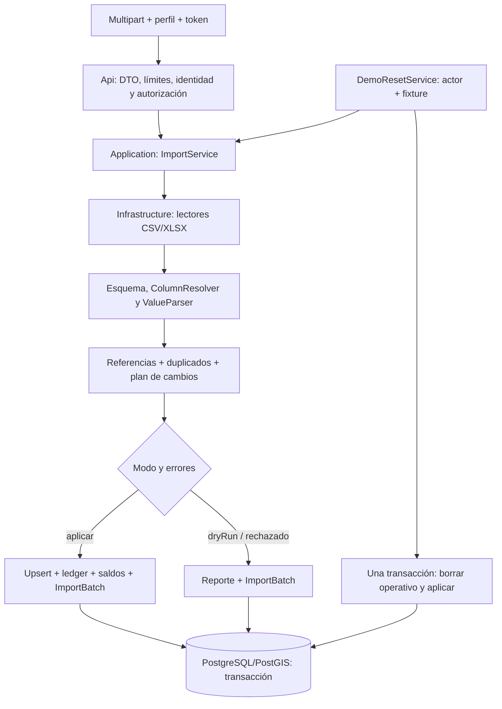
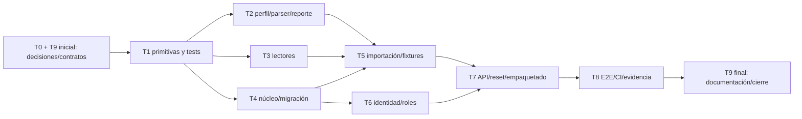

# 001 — Núcleo delgado e importador genérico: plan de implementación

> **For agentic workers:** REQUIRED SUB-SKILL: Use superpowers:subagent-driven-development (recommended) or superpowers:executing-plans to implement this plan task-by-task. Steps use checkbox (`- [ ]`) syntax for tracking. Las tareas están en [`task.md`](task.md).
>
> **Estado: propuesta revisada el 12-oct-2026.** El spec continúa en `borrador`, con `aprobado_por: PENDIENTE`. Este plan no acepta ADR-21 ni acredita software, pruebas, migraciones o despliegue. El encabezado de superpowers procede de la plantilla y se refiere a la futura ejecución; verificar disponibilidad de esas skills antes de invocarlas.

**Goal:** Construir un importador CSV/XLSX reutilizable, con perfiles, validación completa, reporte y reset transaccional, sobre el núcleo de 27 tablas propuesto en el spec, conservando el historial de migraciones y los contratos compartidos.

**Architecture:** Reutilizar Clean Architecture y EF Core del repositorio. `Application/Imports` contiene esquema, mapeo, validación y orquestación; `Infrastructure` lee archivos y proporciona persistencia/transacciones; `Api` valida el multipart y aplica identidad y autorización. Importación pública y reset comparten las reglas y la escritura, con un único propietario de la transacción en cada recorrido.

**Tech Stack:** .NET 8, SDK declarado `8.0.424`, EF Core/Npgsql `8.0.11`, NetTopologySuite, PostgreSQL 16 + PostGIS 3.4; Angular 22/Ionic 8 y `@istpetdev/shared-core` conservan sus contratos. Las nuevas dependencias y sus versiones candidatas figuran más abajo.

**Spec:** [`spec.md`](spec.md) · **Plantilla:** [`../_plantilla/plan.md`](../_plantilla/plan.md) · **Recorridos:** [`test-e2e.md`](test-e2e.md)

## Global Constraints

- La bóveda gobierna decisiones; un spec no las sustituye. Seguir [Convenciones y estados](../../boveda/00%20Inicio/Convenciones%20y%20estados.md) y [Hechos canónicos](../../boveda/00%20Inicio/Hechos%20canonicos.md).
- Resolver ADR-21/PA-01 antes de retirar RLS, concesiones o configuración. Identificar Deciders, fecha, origen y alcance; Bryan debe participar por ADR-16.
- Conservar `InitialSchema`, `CompleteSystemSchema95` y su SQL sin editar ni eliminar. Generar cambios posteriores mediante EF; una base compartida requiere un procedimiento revisado y autorización específica para efectos destructivos.
- Esquema objetivo: las 27 entidades del spec; `OrganizationId` fijado por servidor, UUID v7 mediante `BaseEntity.NewId()`, sin generador nuevo ni UUID v7 nativo de PostgreSQL 16.
- .NET 8/EF/Npgsql existentes; no actualizar el stack para esta tarea. Registrar versiones efectivas y digest de PostGIS en la evidencia.
- API `/api/v1`, JSON camelCase, enums textuales y DTO explícito. Problem Details para entrada inválida; 422 del importador devuelve su reporte conforme al contrato del spec.
- Roles propuestos: `Gerencia`, `Planificador`, `Bodega`, `Conductor`, `Receptor`, `Automatizacion`; solo una cuenta activa resuelta por identidad validada concede rol.
- Conservar validación Cognito: firma, issuer, expiración, `token_use=access`, cliente permitido y scopes adecuados al endpoint. No aceptar grupos/roles del token como autorización funcional.
- `dryRun=true` y `allowPartial=false` por defecto; validar referencias sin cambios operativos. El registro de `ImportBatch` sí se persiste en seco, por FR-13.
- Cantidades de importación `decimal`/`numeric(18,3)`, saldo no negativo; `geometry(Point,4326)`, X longitud/Y latitud: propuestas que requieren conciliar las convenciones físicas de Schema95 antes de generar la migración.
- Ejecutar lectores y reglas con `DOTNET_SYSTEM_GLOBALIZATION_INVARIANT=1`; no depender de culturas instaladas ni de ICU. Conservar los nombres originales para mostrar errores.
- Valores del escenario en `data/fixtures/`; cuentas de demo en configuración; solo organización demo como seed de migración. Datos sintéticos identificados.
- RNF-14/B-40 y revisión prelaunch siguen aplicando a los caminos expuestos. Diferir RBAC configurable no difiere autenticación, protección de campos, límites de archivos o revisión de dependencias.
- El plan cubre 001 y sus dependencias documentales. No cierra el flujo P0 completo ni las capacidades de 002–006 por crear sus tablas.

## Review Focus

1. Un reset rechazado hace rollback de los datos, pero conserva el lote rechazado, el reporte y el actor; el historial previo sigue accesible → T5/T7.
2. `dryRun` encuentra referencias válidas dentro del mismo envío e identifica dependencias rechazadas; `allowPartial` nunca deja filas huérfanas → T2/T5.
3. Duplicados de stock se agregan antes del upsert; reimportar no acumula existencias ni movimientos. Consumos con distintos `period_days` no se suman sin validar compatibilidad → T5.
4. XLSX mixto distingue celdas numéricas nativas de texto con coma decimal; CSV con encabezados ambiguos exige perfil → T1–T3.
5. Importaciones simultáneas y reset/importación conservan ledger, saldo y unicidad; ningún claim de rol ajeno otorga privilegios → T5–T7.

## Lectura realizada y estado observable

Se revisaron las cuatro plantillas, el spec 001, su plan previo, estructura y bloques pertinentes de `task.md`, sus E2E, README, convenciones, requisitos, alcance, contratos, modelo/dataset, identidad, RBAC, esquema, coordinación, backlog y criterios de validación/prelaunch. Se contrastaron `Program`, JWT, filtro de organización, DbContext/DI, servicios de puntos, consulta pública, proyectos, Dockerfile y CI/CD.

| Hallazgo local | Consecuencia para el plan |
|---|---|
| Hay migraciones InitialSchema y CompleteSystemSchema95, SQL de políticas y herramientas `tools/Schema95*` | Conservar la historia aplicada; reemplazar verificaciones activas solo después de construir sus sucesoras |
| No hay proyecto `.csproj` de pruebas ni directorio `data/fixtures/` | T1 y T5 deben crearlos; los ejemplos de pruebas de `task.md` todavía no son pruebas ejecutadas |
| `ServicePointsService` obtiene `type` de `CatalogOption`; el contrato TS ya admite coordenadas nulas | Cambiar la proyección a categoría importada sin alterar el JSON de FR-20 |
| JWT exige actualmente el scope humano `istpetdev-api/access` a todo token | Separar políticas humanas/M2M antes de habilitar Automatizacion; conservar rechazo de ID token |
| `/health/ready` comprueba conexión y migraciones pendientes | Reutilizarlo; añadir comprobación de esquema compatible si cambia la línea de migración |
| El CD acepta salud por `/health/live` como alternativa a readiness | El cambio de esquema debe fallar si readiness falla; proceso vivo no prueba DB compatible |
| `ci.yml` ejecuta `dotnet test`, pero sus filtros de rutas omiten pruebas y fixtures | Incluir `tests/**`, `data/fixtures/**`, solución/configuración SDK/herramientas y workflow en CI y filtro backend del CD |
| La consulta pública contiene un identificador y relato de demo fijos | Registrar deuda G1 y revisar ese camino antes de exposición; no acreditarlo como trazabilidad real de 004 |

[Coordinación Schema95](../../boveda/06%20Equipo/Coordinacion%20migracion%20schema95.md) registra evidencia personal y propagación pendiente; [Perfil A Reforzado](../../boveda/03%20Arquitectura/Perfil%20A%20Reforzado%20-%20Despliegue%20Stateless%20y%20Amazon%20RDS.md) y README registran posteriormente Schema95 en integración. Este plan no consultó RDS ni el host: antes de cambiar un entorno se debe inspeccionar su catálogo e historial efectivos y enlazar la evidencia correspondiente.

## Decisiones que deben preceder a la implementación

Cumplir toda la documentación significa resolver y registrar sus diferencias, además de implementar los requisitos aplicables. Actualmente no es posible afirmar a la vez cumplimiento íntegro de ADR-16/RNF-13 y una demo de 27 tablas sin RLS.

| ID | Diferencia entre propuesta y bóveda | Resolución necesaria |
|---|---|---|
| D1 | Roles fijos/configuración fuera de alcance frente a RF-17/18/19 P0 y ADR-16 | ADR-21 delimita excepción de demo y actualiza alcance, requisitos, backlog y contratos; o se conserva Schema95 y se adapta el spec |
| D2 | Sin RLS frente a RNF-13/V-37 | Decisión expresa sobre una demo de una organización. Conservar el requisito del producto multiempresa; no presentar una columna como aislamiento comprobado |
| D3 | Eliminar migraciones frente a prohibición explícita en esquema/dbflow | Este plan propone conservar archivos aplicados y una migración posterior `DemoCore`; reemplazar el paso destructivo de Task 4 |
| D4 | `numeric(18,3)`/`geometry` frente a `numeric(18,4)`/`geography` del catálogo vigente | Registrar precisión, redondeo, conversión espacial y pérdida aceptable; revisar datos existentes antes de cambiar tipos |
| D5 | Cuenta/rol fijo frente a permisos por acción/ámbito y humano/técnico | Registrar simplificación de autorización; mantener scopes técnicos y denegación por defecto. Asignaciones de entrega corresponden a 004 |
| D6 | Importar Consumption por SKU/período frente a consumo operativo por lote que produce movimiento | Separar semántica: serie histórica importada para demanda, sin descontar otra vez el saldo absoluto importado; registrar esta propuesta en modelo/contratos |
| D7 | Ventanas únicas, ausencia de Reservation/Outbox y QR público fuera del núcleo frente al modelo amplio | Documentar límites de 001 y contratos que 002/004 deberán resolver; no prometer conciliación de reservas, eventos durables ni QR seguro por tener tablas |
| D8 | Task 9 propone diferir B-40 y cerrar B-29 con roles fijos | Conservar RNF-14/B-40. B-29 requiere ajustar criterio por decisión registrada y probar lo retenido; 001 no cierra login web/PWA, SignalR o revocación offline |
| D9 | Trabajo previo informado sin fuente oficial frente a O-01 pendiente | PA-02 continúa pendiente hasta identificar fuente y fecha en la consulta; no inventar permiso del organizador |

D1–D8 se resuelven en T0/T9 antes de ejecutar cambios afectados. PA-02 no impide escribir o probar localmente el importador, pero impide declarar confirmadas las reglas del evento. Si no se acepta D1/D2, continuar el análisis/lectores independientes y revisar el spec para importar sobre Schema95; no aplicar el núcleo de 27 tablas.

## Arquitectura



**Responsabilidades:** Domain mantiene entidades e invariantes; Application interpreta los datos y decide cambios; Infrastructure contiene lectores y el límite transaccional; Api traduce HTTP y nunca recibe actor/organización desde una fila. Reutilizar `IApplicationDbContext`, DI, health checks y UUID existentes. No añadir MediatR, repositorio genérico, bus o editor de perfiles.

**Flujo común, en orden:** autenticar/autorizar → validar perfil/archivos → leer y calcular hashes → asociar columnas → convertir y validar filas → resolver dependencias → agregar duplicados → decidir rechazo/seco/parcial → persistir lo permitido → devolver reporte. Toda importación válida como solicitud queda identificada por un batch; los errores de autenticación o del transporte no se convierten en lotes operativos.

### Contrato de mapeo

Conservar el formato ya propuesto por `task.md`: `name`, `delimiter`, `decimalSeparator`, `dateFormats`, `files`; cada entidad declara `file`, `sheet`, `columns`, `constants` y `scale`. `columns` asocia **campo canónico → encabezado origen**; `scale` contiene factores decimales por campo numérico. El perfil no admite URL, ruta arbitraria, script, expresión o SQL.

Ejemplo de perfil propuesto, sin afirmar ejecución:

```json
{
  "name": "externo-galones-mes",
  "delimiter": ";",
  "decimalSeparator": ",",
  "files": {
    "consumptions": {
      "file": "consumo.csv",
      "columns": { "point_code": "Cliente", "sku": "Producto", "date": "Mes", "quantity": "Galones" },
      "constants": { "period_days": "30" },
      "scale": { "quantity": 3.78541 }
    }
  }
}
```

Resolver entidad primero por nombre canónico/alias del formulario o archivo declarado. Si ambos identifican entidades distintas, rechazar. Proponer un archivo por entidad para esta versión; fijarlo en spec/contrato con mensaje 400 ante multiplicidad. Un `.xlsx` usa primera hoja o `sheet` explícita, nunca todas silenciosamente.

Precedencia propuesta: constante explícita del perfil → columna explícita → sinónimo inequívoco → defecto canónico. Registrar toda sustitución y conversión. Rechazar perfil con entidad/campo desconocido, mapeo a encabezado inexistente, factores no positivos, escalas en texto, JSON nulo o propiedades no admitidas. No usar una coincidencia arbitraria cuando varios encabezados normalizados podrían aportar el mismo campo.

### Esquema canónico y valores ausentes

Los campos obligatorios son los de `spec.md`; no inventar valores para `base_unit`, `quantity`, claves o referencias requeridas. La tabla completa de sinónimos ya propuesta está en `CanonicalSchema` de Task 1; revisar colisiones antes de convertirla en contrato. Alias frecuentes: código/cod, nombre/descripción, latitud/latitude/y, longitud/longitude/lng/x, cantidad/stock/saldo, fecha/mes/período.

| Entidad/campo opcional | Propuesta de tratamiento | Qué debe mostrar el reporte |
|---|---|---|
| Punto `lat/lon` | Ambos nulos: punto no ruteable; solo uno informado: error | Ausencia de coordenadas, sin ubicación inventada |
| Punto `region/category` | Conservar ausencia como valor vacío/nulo acordado; `type` sigue siendo string en API | Campo ausente; no inferir hospital o región |
| Punto `criticality` | `normal` | Número de filas con defecto aplicado |
| Ventana, servicio y lead time | Nulo: 002 resolverá valor global de `Logistics:*` | Se usará configuración global; no inventar aquí valores numéricos |
| Producto peso/volumen | `0` como marcador propuesto de dato desconocido | Capacidad por esa dimensión no evaluable; 002 no lo trata como peso físico cero |
| Vehículo volumen/costo | Nulo: volumen sin límite declarado, costo global | Límite ausente o configuración global aplicada |
| Lote vencimiento/origen | Nulo | Ausencia de información; no certificar vigencia/origen |
| Stock `location_kind` | Inferir solo si la clave identifica una ubicación única | Tipo inferido o error de ambigüedad |
| Stock `lot_code` | Lote sintético `GENERICO-{sku}` cuando está ausente | Lote supuesto y sus filas afectadas |
| Consumo `period_days` | `1`, entero positivo | Granularidad diaria supuesta |

Lote explícito inexistente: propuesta de error de referencia; la autocreación se limita al lote genérico y se registra. Confirmar esta regla y la precedencia en T0/T2. Para maestros, definir también si un campo ausente conserva el valor existente o lo elimina: propuesta conservadora de preservar el dato previo e indicar el supuesto, sin llamar a ese resultado reemplazo completo.

### Upsert, duplicados y cantidades

Claves siempre normalizadas con trim y mayúsculas: bodega/punto/vehículo/SKU; lote por `(ProductId, lot_code)`; saldo por `(LocationId, LotId)`; consumo por `(ServicePointId, ProductId, date)`. Unicidad incluye `OrganizationId`. Para `Location`, acordar unicidad por `(OrganizationId, Kind, Code)` porque el stock permite resolver por tipo; esto modifica la convención anterior de código único global por organización.

Dentro del archivo, maestros conservan última fila válida con advertencia y referencias consistentes. Stock/consumo suman duplicados válidos **antes** de escribir; errores no aportan cantidades. En consumo exigir mismo `period_days`: un total semanal y uno mensual no se agregan como si fueran el mismo período. La última fila inválida genera error; con parcial conserva la última válida y explica la omisión.

Entre ejecuciones, stock y consumo se reemplazan por el total agregado del nuevo archivo, no se suman al dato persistido. Stock representa saldo absoluto: `delta = objetivo - saldoAnterior`. Delta positivo produce ajuste con destino; negativo con origen; `Quantity = abs(delta)`. Delta cero no crea movimiento. Movimiento, saldo y batch aplicado se guardan en el mismo commit, con actor, motivo y batch.

Propuesta de precisión: convertir/validar en decimal, agregar sin redondeos intermedios y redondear una vez a tres decimales con regla explícita `MidpointRounding.AwayFromZero`; comprobar overflow y límites de `numeric(18,3)`. Registrar redondeo si altera el dato. CE-02 usa 95 × 3.78541 = 359.61395 → 359.614 L. La regla debe aceptarse junto a D4.

### Dry run, parcial, historial y transacciones

Construir un conjunto validado de cambios en memoria antes de persistir. Resolver referencias contra datos existentes de la organización y filas **válidas** del envío, en orden bodega → puntos → productos → vehículos → lotes → stock → consumos. Una fila rechazada no crea padres auxiliares que luego queden persistidos. `ChangeTracker.Clear()` puede descartar cambios de un contexto dedicado; por sí solo no revierte `ExecuteDelete` ni escrituras previas.

| Caso | HTTP propuesto | Efecto operativo | Batch |
|---|---:|---|---|
| Perfil/archivo/formulario estructuralmente inválido | 400 Problem Details | Ninguno | Registrar rechazo cuando la solicitud permita formar un batch seguro; acordar frontera de FR-13 |
| Seco sin errores | 200 reporte | Ninguno | `DryRun` |
| Seco con errores de filas/referencias | 422 reporte | Ninguno | `Rejected`, conservando `dryRun=true` |
| Aplicar con errores sin parcial | 422 reporte | Ninguno | `Rejected` |
| Aplicar parcial con alguna fila válida | 200 reporte | Solo cambios válidos y sus dependencias válidas | `Applied` |
| Aplicar parcial sin filas válidas | 422 reporte | Ninguno | `Rejected`; nunca `applied=true` |
| Aplicar sin errores | 200 reporte | Upsert completo | `Applied` |
| Conflicto concurrente | 409 Problem Details | Rollback | Intento rechazado si DB permite registrarlo |

La precedencia de estado/HTTP para seco con errores y solicitudes 400 requiere precisarse en spec/contrato antes de T5. `created/updated` en seco describen cambios previstos, claramente etiquetados; en aplicado, cambios confirmados. Contabilizar filas fuente, filas válidas, duplicadas y omitidas sin fingir que una fila duplicada equivale a otra entidad creada.

El reporte guarda como máximo **500 incidencias**, pero cuenta todos los errores/advertencias y los omitidos. Incluye archivo, entidad, fila real, campo, severidad, código y acción correctiva en español. Conservar referencia al archivo en cada incidencia; no copiar datos sensibles ni excepciones técnicas completas.

Calcular SHA-256 por archivo y un hash del conjunto sobre un manifiesto ordenado con entidad/nombre/tamaño/hash; guardar además perfil efectivo y su hash. Concatenar bytes sin separadores no identifica de forma inequívoca una colección de archivos. El hash aporta trazabilidad; no sustituye claves de negocio ni elimina el registro de una reimportación.

**Concurrencia propuesta:** serializar importación aplicada/reset por la organización demo mediante bloqueo transaccional de su fila `Organization`, adquirido antes de leer saldos/diccionarios. Añadir unicidad y versión de saldo para detectar escrituras ajenas al importador. Todo futuro escritor de 004 debe coordinarse con reset/importación. Probar bloqueo/espera o 409 explícito, sin reintentar ciegamente una operación incompleta. Un seco es una previsión sobre un snapshot, no una reserva de datos hasta la aplicación.

Usar un límite transaccional en Infrastructure expuesto con el mínimo contrato necesario; no abrir transacciones anidadas. La aplicación normal incluye escrituras y batch `Applied` en un commit. El reset posee la transacción que engloba borrado más importación; ante fallo hace rollback, desecha el contexto de escritura y registra el batch `Rejected` en un contexto/transacción independiente, conservando el mismo batchId y actor. Si la DB está caída, declarar imposibilidad de persistir, sin inventar historial exitoso. Este uso de un límite explícito corresponde al [comportamiento transaccional de EF Core](https://learn.microsoft.com/en-us/ef/core/saving/transactions).

## Estructura de archivos

Reutilizar los archivos del plan previo y de `task.md`; nombres indicados como directorio agrupan las piezas allí enumeradas. Crear únicamente lo necesario para las responsabilidades anteriores.

| Acción | Ruta | Responsabilidad |
| Crear | `tests/IstpetDev.Tests/IstpetDev.Tests.csproj` | Pruebas unitarias, integración y E2E con categorías |
| Crear | `tests/IstpetDev.Tests/Support/` | PostGIS efímero, rol migrador limitado, base aislada, ApiFactory/JWT de prueba, fixtures |
| Crear | `src/Application/Imports/` | Esquema, normalizador, perfil, lector abstracto, filas, reporte, resolver, parser, contexto, escritor y servicio de importación |
| Crear | `src/Infrastructure/Imports/` | Lectores CSV/XLSX y transacción/persistencia de importación |
| Crear | `src/Application/Demo/DemoOptions.cs` | Configuración validada y contrato de reset con actor autenticado |
| Crear | `src/Infrastructure/Demo/DemoResetService.cs` | Reset por organización; borrado ordenado y misma importación; conservar historial completado de simulación para 005 |
| Crear | `src/Infrastructure/Persistence/LeanSchema.cs` | Mapeo final de las 27 entidades, índices y restricciones |
| Crear | `src/Infrastructure/Persistence/AccountSeeder.cs` | Bootstrap de cuentas de demo configuradas, idempotente |
| Crear | `src/Infrastructure/Persistence/Migrations/*_DemoCore.cs` | Migración posterior generada; conserva historia aplicada |
| Crear | `src/Api/Authentication/AccountRoleClaimsTransformation.cs` | Solo roles de la DB; eliminar claims funcionales ajenos antes de añadir el rol resuelto |
| Crear | `src/Api/Controllers/ImportsController.cs`, `DemoController.cs` | Multipart, DTO, autorización, códigos HTTP |
| Crear | `data/fixtures/demo-base/`, `data/fixtures/ejemplo-externo/` | Siete archivos canónicos y perfil; formato externo reproducible |
| Modificar | `src/Domain/Entities/`, `src/Domain/Common/` | Núcleo acordado, constantes mínimas, historial de importación y agente |
| Modificar | `ApplicationDbContext.cs`, `IApplicationDbContext.cs` | Modelo final, versiones y timestamps; contrato mínimo de persistencia |
| Modificar | `src/Application/DependencyInjection.cs`, `src/Infrastructure/DependencyInjection.cs` | Servicios; conexión obtenida al resolver contexto para soportar ApiFactory |
| Modificar | `src/Api/Program.cs`, `CognitoJwtExtensions.cs`, `appsettings*.json` | Políticas, scopes, seed controlado, JSON, modo migración y test host |
| Modificar | `ServicePointsController.cs`, `ServicePointsService.cs` | Cuenta activa autorizada y proyección FR-20 |
| Modificar | `src/Infrastructure/HealthChecks/DatabaseHealthCheck.cs` | Salud del esquema efectivo, además de conectividad |
| Modificar | `IstpetDev.sln`, `.github/workflows/ci.yml`, `deploy.yml` | Proyecto de pruebas, filtros y pruebas obligatorias antes de publicar |
| Modificar | `scripts/db/migrate-personal.sh` | Validación del esquema activo y restauración de usuario API; sin borrar bases |
| Modificar | `infra/docker/backend/Dockerfile`, Compose y configuración de ejemplo | Fixtures legibles por usuario de aplicación; demo desactivada por defecto |
| Revisar/conservar | `tools/Schema95*`, migraciones y SQL Schema95, `docs/schema95*` | Historia y evidencia; retirar herramientas del build activo solo si dejan de compilar, sin borrar todo `tools/` |
| Actualizar | `spec.md`, `task.md`, `test-e2e.md` y notas fuente pertinentes | Resoluciones, contratos, tareas consistentes y resultados reales |

## Decisiones técnicas

| Decisión propuesta | Alternativa | Motivo y condición |
|---|---|---|
| `DemoCore` posterior a las migraciones aplicadas | Borrar toda la carpeta de migraciones y recrear RDS | Respeta esquema/dbflow; el estado final puede tener 27 tablas aunque el historial conserve tres migraciones |
| Validación y agregación antes de mutar EF | Escribir cada fila y limpiar tracking al final | Reduce efectos laterales de filas inválidas y mantiene equivalencia de seco/aplicado |
| Diccionarios por claves necesarias, filtrados por organización | Consultar por cada fila o cargar toda la DB | Volumen objetivo 10 000 filas; evitar N+1 y carga de historiales no usados |
| Bloqueo de organización durante importación/reset | Lock en memoria de un proceso | Una coordinación en PostgreSQL cubre varias instancias; probar convivencia con futuros escritores |
| Lectores CSV/XLSX mantenidos en Infrastructure | Separar por comas manualmente o escribir un lector ZIP/XML | Soportar comillas, saltos de línea y tipos de Excel sin parser propio |
| Tipos de celda y origen preservados por lector | Marcar todo XLSX como texto invariante | Un mismo libro puede mezclar número nativo `0.45` y texto `"0,45"` |
| Rol de cuenta en claim propio del servidor | Confiar en `cognito:groups` o rol del payload | FR-17 y dirección de identidad; revisar cuenta activa por petición |
| `Subject=client_id` solo para identidad técnica verificada | Identificar M2M por el `sub` de un usuario | AWS documenta igualdad sub/client_id en M2M; conservar diferenciación de cliente técnico y scope. [Fuente AWS](https://docs.aws.amazon.com/cognito/latest/developerguide/amazon-cognito-user-pools-using-the-access-token.html) |
| Bootstrap de cuentas explícito en modo demo | Reasignar privilegios desde configuración en todo arranque | Evitar reactivar una cuenta revocada por reiniciar; acordar política de actualización/desactivación |

## Dependencias nuevas

Versiones **candidatas heredadas del plan previo**, no nuevas versiones canónicas ni paquetes ya instalados. T0/T1 comprueban disponibilidad, compatibilidad con net8.0/globalización invariante, licencias y advisories antes de fijarlas. Registrar el resultado y no actualizar por rutina a latest.

| Paquete | Candidata | Proyecto | Motivo |
|---|---|---|---|
| CsvHelper | 33.0.1 | Infrastructure | CSV con comillas/separadores |
| ClosedXML | 0.104.1 | Infrastructure | XLSX sin Office; verificar fórmulas, fechas y modo invariante |
| Microsoft.NET.Test.Sdk | 17.11.1 | Tests | Runner |
| xunit | 2.9.2 | Tests | Pruebas requeridas por NFR-05 |
| xunit.runner.visualstudio | 2.8.2 | Tests | Adaptador |
| Microsoft.AspNetCore.Mvc.Testing | 8.0.11 | Tests | HTTP real dentro del host de pruebas |
| Testcontainers.PostgreSql | 3.10.0 | Tests | PostgreSQL/PostGIS efímero |

No añadir una dependencia de codificación si la plataforma ya permite la lectura requerida. Para CSV proponer UTF-8 estricto y fallback Windows-1252 declarado; evitar que bytes inválidos se conviertan silenciosamente en caracteres de reemplazo.

## Prerrequisitos de entorno

Desde la raíz, comandos de inspección para la futura ejecución:

```bash
git status --short
git branch --show-current
git rev-parse HEAD
dotnet --version
dotnet --list-sdks
dotnet tool restore
dotnet ef --version
docker info --format '{{.ServerVersion}}'
node --version
npm --version
```

Comprobar SDK declarado `8.0.424`, EF tools `8.0.11` y Docker disponible para integración. `global.json` permite rollForward: registrar el SDK efectivo. No instalar herramientas automáticamente por fallar una comprobación. RDS/Cognito reales no son requisito de las unitarias; sus pruebas manuales sí requieren acceso autorizado. El túnel local solo corresponde a RDS; Testcontainers suministra su propia conexión.

Antes de iniciar cualquier host de pruebas o app, aplicar la skill local `docs/boveda/.local-skills/istpetdev-prelaunch/SKILL.md` y sus [criterios fuente](../../boveda/03%20Arquitectura/Verificacion%20de%20seguridad%20antes%20del%20lanzamiento.md). Registrar alcance local aislado con datos sintéticos y pendientes. La copia local es generada: mantener instrucciones en [la fuente editable](../../boveda/08%20Skills/istpetdev-prelaunch.md).

## Plan paso a paso

Se conserva T0–T9 para localizar el detalle existente. **Antes de ejecutarlo, revisar los cambios obligatorios de `task.md` al final de este plan:** sus bloques actuales son propuestas y algunos contradicen esta revisión. Los checks siguientes son pendientes de ejecución.

### T0 — Acordar alcance y preparar una base reproducible

**Entrada:** spec en borrador y documentación actual. **Salida:** decisiones registradas, contratos precisos y entorno identificado.

- [ ] Registrar D1–D9 y resolver los cambios de decisión con nombres/fecha/origen en ADR-21; actualizar notas fuente antes de Hechos canónicos. T9 tiene una parte inicial obligatoria aquí.
- [ ] Precisar precedencia de mapeo, multiplicidad de archivos, valores ausentes, lotes explícitos, redondeo, estados 400/422 y semántica de consumo histórico. No trasladar ambigüedad al código.
- [ ] Revisar `spec.md`, plan, tareas y E2E juntos. Solo `aprobado` con aprobación identificada; solo `planificado` después de revisar los tres documentos de implementación/prueba.
- [ ] Inspeccionar baseline local, preservar cambios ajenos y preparar en la futura ejecución la rama `feature/001-nucleo-delgado-importador` desde `develop` actualizado según CONTRIBUTING. Una actualización solo documental usa `docs/…`.
- [ ] Identificar el SHA que contiene realmente Schema95 antes de proponer `schema95-archivo`; no suponer que `develop` incluye trabajo todavía en PR. Comprobar si el tag existe y nunca reemplazarlo a la fuerza.
- [ ] Conservar hashes de migraciones/SQL y evidencia histórica. El tag facilita recuperación; no sustituye respaldo de DB.
- [ ] Comprobar herramientas/dependencias y preparar PostGIS descartable. No tocar bases personales ajenas, integración ni host público.

**Aceptación:** ningún cambio de alcance presentado como confirmado sin decisión; ningún paso de retirada de Schema95 ejecutado con PA-01 pendiente. Sin acuerdo, revisar el camino de importador sobre Schema95.

### T1 — Crear pruebas y primitivas del formato canónico

**Archivos:** proyecto de pruebas, `HeaderNormalizer`, `ImportEntity`, `CanonicalSchema`, `ValueParser`; reutilizar UUID existente.

- [ ] Crear proyecto net8.0 y añadirlo a la solución; fijar categorías `Unit`, `Integration`, `E2E` y la localización de fixtures.
- [ ] Escribir casos que fallen para tildes/BOM/espacios/mayúsculas, alias de entidad y claves con variaciones entre archivos.
- [ ] Implementar normalización de encabezados y códigos separadamente. Encabezados reconocen tildes; códigos no cambian identificadores legítimos por quitar signos o caracteres sin contrato.
- [ ] Declarar campos/tipos/sinónimos/defectos del esquema único. Validar que no haya alias ambiguos en una misma entidad.
- [ ] Probar decimales con coma/punto/miles, signo, cero, overflow, enteros fraccionarios, fechas `yyyy-MM-dd`, `dd/MM/yyyy`, `yyyy-MM`, serial Excel y horas `HH:mm`.
- [ ] Resolver números ambiguos con perfil o supuesto visible; nunca convertir `0.45` en `45`. Validar escala, suma, redondeo y límites.
- [ ] Ejecutar unitarias bajo globalización invariante; commit pequeño únicamente después de revisión del diff.

**Aceptación:** reglas puras pasan sin Docker ni acceso externo; campos requeridos nunca reciben valores inventados.

### T2 — Validar perfiles, resolver columnas y producir reportes

**Archivos:** `MappingProfile`, `TabularData`, `ColumnResolver`, `RowParser`, `ImportReport`.

- [ ] Escribir pruebas para perfil nulo/malformado, entidades/campos desconocidos, tipos incorrectos, escala inválida, propiedades adicionales y mapeo a columna ausente.
- [ ] Implementar la precedencia acordada y reportar columnas asociadas/ignoradas; detectar encabezados duplicados tras normalización.
- [ ] Preservar archivo, hoja, número de fila y tipo de celda en el contrato del lector; utilizar celdas tipadas o metadatos suficientes para distinguir número y texto.
- [ ] Convertir a filas tipadas y validar coordenadas en rango, par lat/lon completo, cantidades no negativas, capacidades positivas, período positivo y ventana coherente. Ventanas nocturnas requieren regla explícita; no invertir horarios silenciosamente.
- [ ] Registrar supuestos por campo y filas afectadas, conversiones de unidad, redondeo y ubicación no ruteable.
- [ ] Probar 501 y varios miles de incidencias: lista de 500, contadores completos y tamaño acotado también para mensajes/supuestos/perfil.
- [ ] Acordar el JSON del reporte con spec/contratos y probar sus nombres/estados sin exponer entidades EF.

**Aceptación:** una columna ambigua o dato inválido produce error accionable en español con ubicación; los contadores y la limitación del reporte no ocultan la existencia de errores.

### T3 — Leer CSV y XLSX de forma acotada

**Archivos:** lectores de `Infrastructure/Imports`, pruebas unitarias de lectores.

- [ ] Confirmar y fijar las dependencias candidatas; escribir pruebas con archivos sintéticos reales, sin mock del parser.
- [ ] CSV: probar delimitadores coma/semicolon/tab, comillas escapadas, campos multilínea, BOM, filas vacías y ancho incorrecto. Respetar delimitador explícito; inferir con advertencia cuando corresponde.
- [ ] Probar UTF-8 y Windows-1252 con `Código;Descripción`; registrar codificación/fallback utilizado.
- [ ] XLSX: leer primera hoja o hoja declarada; distinguir fechas/números nativos de strings con cultura propia; probar libros de fechas 1900/1904 y seriales soportados.
- [ ] Rechazar libro dañado, hoja inexistente y formato `.xls`; definir comportamiento ante fórmulas. Propuesta: no evaluar ni seguir vínculos externos; rechazar celda de fórmula requerida sin valor utilizable con acción de exportar valores.
- [ ] Validar contenido de XLSX, no solo extensión/MIME; limitar filas, columnas, tamaño comprimido/descomprimido y cancelar con `CancellationToken`.
- [ ] Probar globalización invariante también en ClosedXML y dependencias; liberar streams y temporales en éxito/error.

**Aceptación:** CSV/XLSX equivalentes producen los mismos valores canónicos; ninguna celda numérica nativa se reinterpretará con el separador de texto del perfil.

### T4 — Preparar el núcleo y su migración conservando historia

**Archivos:** entidades, `LeanSchema`, DbContext, migración posterior, infraestructura de tests, validación de DB.

- [ ] Congelar las 27 entidades listadas en spec y acordar con 002–005 las relaciones/columnas mínimas. Una tabla futura no acredita funcionalidad del módulo.
- [ ] Retener timestamps/versiones, claves naturales por organización, FK consistentes, cantidades/capacidades válidas y restricciones del ledger. Resolver el ciclo Vehicle/Location con referencias y orden de insert/borrado explícitos.
- [ ] Ajustar identidad/categorías y DTO FR-20. El modelo final no debe arrastrar entidades de configuración por navegación accidental.
- [ ] Generar **una migración nueva** `DemoCore` desde el snapshot vigente; conservar archivos/SQL de ambas migraciones anteriores. Revisar drops, conversiones, backfills y grants uno por uno. EF recomienda conservar migraciones compartidas y añadir correcciones posteriores. [Fuente Microsoft](https://learn.microsoft.com/en-us/ef/core/managing-schemas/migrations/managing).
- [ ] Añadir precondiciones que detengan conversión con datos incompatibles o sin reconciliación. No ejecutar un borrado genérico de `public`, del historial EF o de objetos PostGIS.
- [ ] Probar dos recorridos descartables: base vacía → historial completo → DemoCore y base Schema95 sintética → DemoCore. Replicar nombres/roles limitados exigidos por el preflight histórico, sin editarlo ni correrlo como superusuario.
- [ ] Comprobar catálogo final real de **27 tablas de dominio**, FKs/unicidad/precisión/SRID y historial EF conservado. No medir éxito por contar 27 llamadas `CreateTable` en una migración de transición.
- [ ] Probar carga espacial tras crear extensión, sin reiniciar; recargar tipos Npgsql solo cuando la prueba demuestre necesidad y en la fuente de datos efectiva.
- [ ] Restaurar rol de ejecución después de migrar. Mantener separación DDL/DML existente; coordinar cualquier excepción de runtime con el administrador y prelaunch, sin tratar ausencia de RLS como ausencia de riesgo de privilegios.
- [ ] Reemplazar checks activos por pruebas del núcleo; conservar herramientas históricas fuera del build si ya no son compatibles. No exigir una búsqueda sin ninguna aparición de Schema95 en los archivos históricos.

**Aceptación:** modelo final y ambas rutas pasan en PostGIS descartable; hashes históricos iguales; cambio aplicado a RDS y reconciliación de datos reales continúan pendientes hasta su tarea autorizada. Si no hay transición segura, mantener esa parte pendiente, no sustituirla por borrar la DB.

### T5 — Implementar importación, upsert y fixtures

**Archivos:** `ImportContext`, `CanonicalWriter`, `ImportService`, transacción de infraestructura y fixtures.

- [ ] Crear `demo-base`: 1 bodega, 6 puntos, 2 productos, 1 vehículo, 2 lotes, 9 saldos y 7 consumos. Incluir 60 L/12 L por día, lead time 2 días; el margen de 3 días corresponde a configuración de 002, no a un literal del importador.
- [ ] Crear `ejemplo-externo` con encabezados acentuados, `;`, coma decimal y 95 galones/30 días para `C-100`; añadir perfil y procedencia sintética.
- [ ] Validar referencias existentes y del envío; probar cadena de dependencia con padre inválido. Cargar diccionarios acotados, sin N+1.
- [ ] Agregar duplicados y elaborar cambios previstos, sin mutar EF para filas que después se descarten. Probar misma clave con cantidad/período incompatible.
- [ ] Implementar upsert de maestros/lotes, saldo absoluto y consumo histórico; añadir ajuste por delta con actor/motivo/batch.
- [ ] Implementar seco/rechazo/parcial y persistencia de batch/reporte/hash. Probar lotes rechazados y cero filas válidas, no solo fixtures correctos.
- [ ] Probar reimportación: IDs y conteos estables, consumo no duplicado, sin movimiento nuevo si saldo no cambia. Probar luego corrección de saldo positiva y negativa y conciliar sumatoria del ledger.
- [ ] Probar dos importaciones aplicadas simultáneas sobre el mismo saldo y violación provocada al guardar: ninguna escritura parcial ni duplicado de clave.
- [ ] Medir fixture (<5 s) y 10 000 filas de consumo (<30 s) en portátil identificado; separar arranque/descarga de contenedor de la operación medida.

**Aceptación:** FR-06–13 y CE-01/02 pasan; unidad y procedencia preservadas; los objetivos de tiempo quedan etiquetados como objetivo hasta tener medición.

### T6 — Resolver cuentas, roles y autorización de servidor

**Archivos:** transformación de claims, opciones/seed, JWT/Program y pruebas de acceso.

- [ ] Reutilizar validación JWT; probar access token permitido, expirado, ID token, firma/issuer/client ajeno y scope faltante.
- [ ] Resolver humano por issuer/sub y técnico por issuer/client_id registrado; verificar cliente técnico y scopes específicos. No permitir que un cliente humano se convierta en Automatizacion cambiando claims.
- [ ] Eliminar claims funcionales de rol procedentes del token antes de añadir el rol desde DB, o usar un tipo de claim exclusivamente interno. Probar token que declara Gerencia para una cuenta Conductor.
- [ ] Validar cuenta/organización activa por petición y catálogo cerrado de roles. Identidad válida sin cuenta activa: 403 en endpoints privados.
- [ ] Seed `Demo:Accounts` solo en modo acordado, con identidad real configurada y sin secretos en Git. Sembrar idempotentemente sin reactivar revocaciones de forma implícita.
- [ ] Aplicar Gerencia/Planificador a imports/reset; todos los roles reconocidos pueden leer puntos. Automatizacion no importa ni resetea.
- [ ] Probar cambio de rol/desactivación con el mismo JWT sin reiniciar API; aplicar denegación en siguiente petición. No acreditar offline/SignalR de futuros specs con esta prueba.

**Aceptación:** identidad, rol real y scope deciden en servidor; matriz de permitidos/denegados y actor del batch probados; sin bypass de prueba en configuración productiva.

### T7 — Exponer endpoints y reset, empaquetar sin activar despliegue

**Archivos:** controllers, `DemoResetService`, Dockerfile/Compose, config y pruebas HTTP.

- [ ] Implementar multipart con archivos por entidad/alias o nombre declarado, campo `profile` de texto y parámetros booleanos con defaults exactos. Probar `profile=<archivo` y rechazar archivo enviado como profile.
- [ ] Definir límites explícitos de tamaño total, tamaño por archivo, siete archivos operativos, filas/columnas y profundidad del perfil. Los valores de bytes/cuotas son propuestas a fijar con el fixture de 10 000 filas y V-39, no cifras canónicas inventadas.
- [ ] Probar HTTP 200/400/401/403/409/422 y rechazo por límites (413/429 según capa); documentar esos códigos complementarios.
- [ ] Crear reset solo con `Demo:Enabled=true`; desactivado retorna 404. Mantener `false` por defecto; habilitar únicamente en configuración de un entorno demo identificado.
- [ ] Validar fixture/rutas antes del borrado; reset filtra organización demo, conserva cuentas, organización e historial de batches. Resolver FKs y orden de borrado mediante pruebas reales.
- [ ] En una transacción borrar operativo y usar el mismo escritor/importador; conservar actor y registrar fallo fuera del rollback. Probar fixture corrupto, cancelación y segundo reset simultáneo.
- [ ] Empaquetar siete archivos más perfil, con permisos de lectura del usuario no privilegiado del contenedor. Comprobar que cambia la imagen cuando cambia solo un fixture.
- [ ] Adaptar `Program` para modo migración que termina con error ante fallo y para ApiFactory. No habilitar migraciones destructivas automáticamente al arrancar la API pública.
- [ ] Reutilizar liveness/readiness y exigir readiness para cerrar verificación de versión. Revisar la consulta pública existente dentro de prelaunch; su relato fijo no sirve como evidencia de datos importados.

**Aceptación:** FR-14/15/18/20 y reset fallido/repetido/concurrente pasan vía HTTP; imagen contiene fixture; empaquetado no constituye autorización de publicación ni activación de demo en el host.

### T8 — Ejecutar recorridos y recoger evidencia

**Archivos:** pruebas de integración/E2E, workflows y registro de ejecución.

- [ ] Actualizar E2E-01/02 para comprobar conteos, saldos, consumo externo, reimportación y segundo reset mediante HTTP real de ApiFactory.
- [ ] Añadir recorridos de reset fallido, lote rechazado conservado, dryRun con referencias inválidas, parcial con dependientes inválidos y rol falsificado.
- [ ] Incluir pruebas/fixtures/configuración en filtros CI; ejecutar suite completa en `ci.yml` y reemplazar Schema95Check en QA de `deploy.yml`, con Docker disponible para integración/E2E.
- [ ] Guardar TRX/logs y conteo de pruebas por categoría; job sin tests o pruebas de integración omitidas no es PASS de NFR-05.
- [ ] Ejecutar E2E-03 con alguien ajeno al importador: ≤60 minutos modificando solo perfil. Anotar tiempo, dataset/hash, errores y fricciones; el fixture externo propio no sustituye este simulacro.
- [ ] E2E-04 usa Cognito real disponible; sin acceso queda pendiente y tokens sintéticos solo acreditan host de pruebas.
- [ ] E2E-05 separa empaquetado local de ensayo desplegado. Su parte expuesta exige prelaunch y tarea de despliegue autorizada; no recrear integración como paso implícito.
- [ ] Registrar evidencia mediante Plantilla evidencia: fecha real, SHA, entorno, dataset/perfil/hash, comandos, esperado/observado, tiempos y límites, sin tokens ni datos personales.

**Aceptación:** CE-01–05 y NFR-01–05 tienen evidencia o un pendiente explícito. El cierre no se obtiene por crear archivos de tests ni por que compile el backend.

### T9 — Actualizar bóveda, revisar integración y cerrar lo demostrado

**Parte inicial:** decisiones/contratos antes de T4/T6. **Parte final:** resultados después de T8.

- [ ] Actualizar ADR/nota fuente y luego Hechos canónicos; reflejar decisión en requisitos, alcance, modelo, contratos, esquema, coordinación, backlog y plan de validación. Conservar acuerdos históricos con referencias a lo que los sustituye.
- [ ] Mantener separados estado objetivo, migración aplicada y comportamiento validado; registrar `ImportBatch`/`AgentDecision` solo con su condición de propuesta o decisión efectiva.
- [ ] Mantener B-40/RNF-14 y casos de seguridad aplicables. No marcar V-34–37 aprobados por diferir funcionalidades; registrar diferidos por decisión identificada si corresponde.
- [ ] Actualizar `Registro de trabajo previo y del evento` y `Fuente y control documental` con fechas/resultados reales. El tag `pre-evento` se prepara sobre el SHA real antes del evento, sin simular que ya existe.
- [ ] Verificar bóveda, diff, contratos y búsquedas G1/G7. Registrar deuda del relato fijo de PublicTrace si sigue presente; no afirmar que todos los guardarraíles pasan.
- [ ] Revisar cambios de software con checks del repositorio y revisión correspondiente. PR hacia `develop`; no cerrar alcance de otros specs ni fusionar una release por concluir documentación.
- [ ] Cambiar estado solo con evidencia: `en curso` si falta E2E obligatorio; `cerrado` cuando se satisfaga el contrato de cierre acordado y estén enlazados resultados. La aprobación del equipo se registra separadamente.

**Aceptación:** notas fuente/canónicos/spec/tasks/E2E coinciden; pendientes visibles, historial preservado y ningún resultado inventado. Declarar versión expuesta lista requiere su revisión prelaunch, adicional al cierre documental.

## Estrategia de pruebas

Comandos previstos después de crear el proyecto; no fueron ejecutados como pruebas de implementación durante la elaboración de este plan:

```bash
dotnet restore IstpetDev.sln
dotnet build IstpetDev.sln -c Release --no-restore
DOTNET_SYSTEM_GLOBALIZATION_INVARIANT=1 dotnet test tests/IstpetDev.Tests -c Release --no-build --filter 'Category=Unit'
dotnet test tests/IstpetDev.Tests -c Release --no-build --filter 'Category=Integration'
dotnet test tests/IstpetDev.Tests -c Release --no-build --filter 'Category=E2E'
dotnet test IstpetDev.sln -c Release --no-build --logger trx
npm run check
python docs/boveda/.github/scripts/check_vault.py
```

Integration/E2E también deben cubrir el modo invariante efectivo. Unitarias sin Docker; integración y HTTP contra PostgreSQL 16/PostGIS 3.4 real, no EF InMemory. Cada prueba tiene DB aislada; los casos concurrentes comparten deliberadamente la misma DB. La infraestructura prepara privilegios/nombre compatibles con las migraciones históricas, que no se alteran para acomodar tests.

| Requisito de 001 | Tarea/evidencia | Traza a bóveda |
|---|---|---|
| FR-01–05: formato, perfil, parseo | T1–T3; CSV/XLSX mixto y perfil externo | RF-01, G2/G3/G4 |
| FR-06/07/09: claves y duplicados | T1/T5; reimportación y períodos incompatibles | RNF-02 y claves del modelo |
| FR-08: ajuste conciliable | T4/T5; delta positivo/negativo/cero y concurrencia | RF-02, RNF-03, V-01; no sustituye los despachos de V-02 |
| FR-10–13: reporte/seco/parcial/batch | T2/T5/T7; límite 500, referencias y rollback | Trazabilidad de dataset; RNF-02/03 |
| FR-14: endpoint | T6/T7; contrato y matriz HTTP | Contratos API, V-24 |
| FR-15/16: reset y fixtures | T5/T7/T8; E2E-01/02/03 | B-02, Dataset y escenarios, G1/G2/G6/G7 |
| FR-17/18: rol y cuentas | T6; acceso/revocación, E2E-04 | RNF-01, ADR-10/21; B-29 parcial según decisión |
| FR-19: núcleo | T0/T4; catálogo real y hashes históricos | ADR-21 propuesto; B-37 no se declara completo por el conteo |
| FR-20: puntos | T4/T7; contrato shared-core y coordenadas nulas | RF-16/V-23, sin cambiar estructura FSD |
| NFR-01 y CE-01/03 | T5/T8; portátil, duración y simulacro ≤60 min | RNF-10, V-21 solo en alcance medido |
| NFR-02/03 | T1–T3/T7; invariant, textos/acciones | RNF-09 |
| NFR-04/05 y CE-04/05 | T4/T8; constraints, CI y suite real | Modelo, RNF-03 y plan de validación |
| G8 | T9; SHA/tag real y registro | Registro de trabajo previo; O-01 pendiente |
| RNF-14 retenido | T7–T9; prelaunch para camino efectivo | B-40, V-38/39 y controles delegados |

## Revisión previa a exposición y registro de pendientes

Aplicar la skill prelaunch con evidencia de la misma revisión/entorno; reutilizar resultados de backend/dbflow/revisión/frontend cuando sigan vigentes. Probar permisos, campos de servidor, tipos/límites de archivos, SQL parametrizado, abuso por identidad, dependencias y cabeceras detrás del proxy cuando ese camino esté expuesto. Formularios dinámicos/cifrado de sus campos pueden ser no aplica solo si no existen ni se exponen; justificarlo.

RLS solo puede documentarse como diferido para la demo si D2 está aceptada y las notas fuente actualizadas; no etiquetar V-37 como aprobado. Si sigue vigente RNF-13 sin excepción, el núcleo sin RLS no pasa esa puerta de salida. El rol migrador usado como runtime conserva riesgo de privilegios aunque haya una sola organización.

| Control/evidencia | Estado durante esta planificación | Acción futura |
|---|---|---|
| Lectura y revisión de documentos/código local | Realizada | Repetir solo lo afectado por cambios |
| ADR-21/PA-01 y ajustes de contrato | PENDIENTE de decisión identificada | T0/T9 inicial |
| Conservación actual de migraciones | Inspeccionada; este cambio es documental | Comprobar hashes tras T4 |
| Esquema/RLS/roles efectivos en RDS | No consultados | Inspección autorizada antes de transición/exposición |
| Parser/importador/roles/reset del nuevo núcleo | No implementados ni ejecutados en esta revisión | T1–T8 |
| Cognito real, concurrencia y tiempos | No verificados | T5/T6/T8 |
| Cabeceras proxy, cuotas y vulnerabilidades de imagen | No verificados | Prelaunch de versión efectiva |
| E2E-03/04/05 y PA-02 | Pendientes | Registrar evidencia/disponibilidad y fuente oficial |

## Orden y paralelización



T1 crea primero el proyecto/contratos compartidos. Después T2 y T3 pueden repartirse entre personas; T4 tiene un único responsable de migraciones/snapshot y T6 necesita coordinar cambios de `Program` con T4/T7. Fixture, perfil y preparación del simulacro pueden adelantarse después de fijar el esquema. Coordinar `IstpetDev.sln`, `.csproj`, DI, `Program` y workflows: no declarar tareas paralelas si editan esas mismas rutas sin integrar cambios.

Calendario del README: 13-oct para 001 y 15-oct para integración/simulacro. Es una propuesta, no estimación comprobada. La migración conservando historia y los casos de error/concurrencia son parte del trabajo; si no caben, reducir alcance por decisión registrada en lugar de omitir controles o declarar resultados anticipadamente.

## Reversión

1. Antes de cualquier transición externa, identificar imagen/SHA anterior, backup verificable y catálogo/historial/roles, usando el runbook existente. Un tag de código no contiene datos de DB.
2. Probar `DemoCore` y su recuperación sobre una copia descartable; si elimina configuración/datos, documentar migración irreversible y restauración desde backup. `Down` no reconstruye datos borrados.
3. Preferir ensayar en DB aislada antes de cambiar integración; no recrear bases de compañeros. Si se requiere corte/mapeo, redactar procedimiento concreto con inventario y resultados de restauración antes de solicitar autorización.
4. Revertir código solo cuando la imagen anterior sea compatible con el esquema restaurado. El rollback de contenedores no revierte por sí mismo 27 tablas a Schema95.
5. Reset fallido dentro del esquema vigente usa rollback transaccional y conserva batch rechazado; no requiere volver a Schema95 ni borrar cuentas.

## Cambios obligatorios en `task.md` y `test-e2e.md` antes de ejecutarlos

| Documento/paso existente | Ajuste requerido por esta revisión |
|---|---|
| Task 0 y Task 9 | Registrar decisión/contrato al inicio y evidencia al final; no archivar primero y decidir después |
| Task 4, Step 1 y Step 12 | Sustituir `git rm` de migraciones y borrado genérico por migración posterior revisada; conservar SQL/historial |
| Task 4, comprobación de 27 `CreateTable` | Verificar catálogo final real, historial, integridad y hashes de archivos previos |
| Task 2/3, `InvariantNumbers` para toda tabla | Conservar tipo/origen por celda y probar libro mixto |
| Task 5, escritura durante validación | Evitar entidades auxiliares de filas inválidas; agregar antes de aplicar y coordinar concurrencia |
| Task 5, hash y estado | Hash por archivo/manifiesto; fijar seco con errores y caso parcial sin filas válidas |
| Task 6, roles y seed | Probar claims falsos, cuenta revocada y M2M/scopes; no elevar roles por configuración en todo arranque |
| Task 7, actor nulo y batch dentro de rollback | Pasar actor; registrar rechazo después del rollback; filtrar organización y comprobar FKs |
| Task 7, activar demo en Compose público | Mantener default desactivado y configuración explícita solo de demo autorizada |
| Task 9, diferir B-40/cerrar B-29 | Conservar RNF-14/B-40 y declarar únicamente capacidades probadas de identidad/autorización |
| E2E-03/04/05 | Invocar prelaunch antes de arranque/ensayo; separar evidencia local, Cognito y entorno expuesto; retirar recreación implícita de integración |
| CI y filtro backend CD | Disparar por tests/fixtures/configuración, exigir suite y readiness, preservar histórico |

Esta revisión completa el plan de implementación. La ejecución comienza cuando el spec, las resoluciones y las tareas ajustadas estén revisados conforme al flujo de `docs/specs/README.md`.
