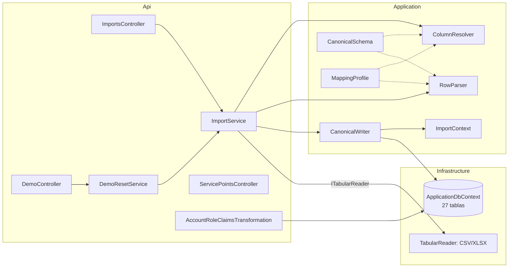
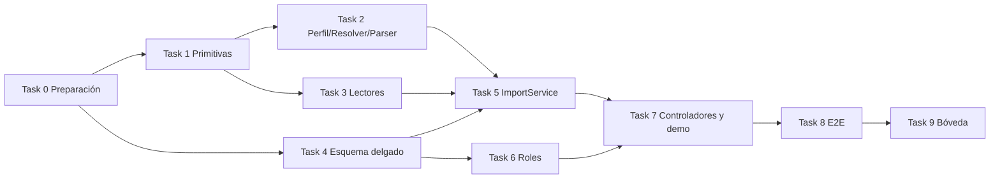

# 001 — Núcleo delgado e importador genérico: plan de implementación

> **For agentic workers:** REQUIRED SUB-SKILL: Use superpowers:subagent-driven-development (recommended) or superpowers:executing-plans to implement this plan task-by-task. Steps use checkbox (`- [ ]`) syntax for tracking. Las tareas están en [`task.md`](task.md).

**Goal:** Reemplazar el esquema de 95 tablas con RLS por un núcleo de 27 tablas con roles fijos, y añadir un importador canónico (CSV/XLSX + perfil de mapeo) que es la única puerta de entrada de datos, incluido el reset de demo.

**Architecture:** Clean Architecture existente (`Domain` → `Application` → `Infrastructure` → `Api`). El importador vive en `Application/Imports` (esquema canónico, mapeo, parseo, escritura) y usa `ITabularReader`, implementado en `Infrastructure/Imports` con CsvHelper y ClosedXML. La autorización pasa de `OrganizationContextFilter` + RLS a `[Authorize(Roles = ...)]` con el rol leído de `Account` por una `IClaimsTransformation`.

**Tech Stack:** .NET 8 (SDK 8.0.424), ASP.NET Core 8, EF Core 8.0.11 + Npgsql 8.0.11 + NetTopologySuite, PostgreSQL 16 + PostGIS 3.4, CsvHelper 33.0.1, ClosedXML 0.104.1, xUnit 2.9.2, Testcontainers.PostgreSql 3.10.0, Microsoft.AspNetCore.Mvc.Testing 8.0.11.

**Spec:** [`spec.md`](spec.md)

## Global Constraints

- SDK .NET `8.0.424` (fijado en `global.json`); EF Core y Npgsql `8.0.11`; PostgreSQL 16 + PostGIS 3.4 (`postgis/postgis:16-3.4-alpine`).
- Nombres de entidades exactamente como en [Hechos canonicos](../../boveda/00%20Inicio/Hechos%20canonicos.md); nombres nuevos solo `ImportBatch` y `AgentDecision`.
- Rutas bajo `/api/v1`; JSON camelCase; enums como texto; errores de entrada con Problem Details.
- Roles fijos, escritos así en código: `Gerencia`, `Planificador`, `Bodega`, `Conductor`, `Receptor`, `Automatizacion`.
- Nada de `string.Normalize`, `CultureInfo("es-EC")` ni otra API que dependa de ICU: el contenedor corre con `DOTNET_SYSTEM_GLOBALIZATION_INVARIANT=1`.
- Ningún dato del escenario (puntos, SKUs, cantidades) en código C# ni en migraciones; solo en `data/fixtures/`. Única excepción: la organización demo sembrada.
- Cantidades `decimal` → `numeric(18,3)`; geometrías `geometry(Point,4326)` con `X = longitud`, `Y = latitud`.
- Mensajes al usuario en español; identificadores de código y campos canónicos en inglés `snake_case` para archivos y `camelCase` en JSON.
- `dryRun` es `true` por defecto en la API de importación.

## Review Focus

1. Un `.xlsx` con números (`0.45`) importado con un perfil que declara `decimalSeparator: ","` no debe convertirse en `45`: los números de Excel se leen siempre en formato invariante → prueba en Task 5.
2. Un CSV exportado por Excel en Windows-1252/Latin-1 con encabezados `Código;Descripción` debe asociar columnas igual que en UTF-8 → prueba en Task 3.
3. Un archivo con miles de filas inválidas debe devolver un reporte acotado a 500 incidencias, con contador de omitidas y `applied = false` → prueba en Task 2.
4. La primera vez que la API crea la extensión PostGIS en una base vacía debe poder insertar puntos sin reiniciar (recarga de tipos de Npgsql) → prueba en Task 7 (reset sobre base nueva a través de `Program`).
5. Códigos con distinto uso de mayúsculas o espacios entre archivos (`hos-001 ` en consumos y `HOS-001` en puntos) deben referirse a la misma entidad → prueba en Task 5.

---

## Arquitectura



Flujo de una importación:

1. El controlador arma un `ImportRequest` (archivos asociados a `ImportEntity`, perfil, `dryRun`, `allowPartial`, cuenta).
2. `ImportService` lee cada archivo con `ITabularReader`, calcula el hash, resuelve columnas (`ColumnResolver`) y convierte filas a valores tipados (`RowParser`), registrando errores, advertencias y supuestos en `ImportReport`.
3. `CanonicalWriter` aplica las filas válidas en el orden de `ImportEntity` (cada entidad solo referencia entidades anteriores) sobre diccionarios cargados por `ImportContext`.
4. Si `dryRun` o hay errores sin `allowPartial`, se descartan los cambios (`ChangeTracker.Clear()`). Siempre se guarda un `ImportBatch` con el reporte.

## Estructura de archivos

| Acción | Ruta | Responsabilidad |
|---|---|---|
| Crear | `tests/IstpetDev.Tests/IstpetDev.Tests.csproj` | Proyecto de pruebas (unitarias, integración, E2E) |
| Crear | `tests/IstpetDev.Tests/Support/*.cs` | Contenedor PostGIS, base migrada, tokens JWT, `ApiFactory`, rutas de fixtures |
| Crear | `src/Application/Imports/HeaderNormalizer.cs` | Normalizar encabezados y alias sin ICU |
| Crear | `src/Application/Imports/ImportEntity.cs` | Entidades importables, claves y alias |
| Crear | `src/Application/Imports/CanonicalSchema.cs` | Campos, tipos, obligatoriedad, sinónimos y valores por defecto |
| Crear | `src/Application/Imports/ValueParser.cs` | Decimales, enteros, fechas y horas tolerantes |
| Crear | `src/Application/Imports/MappingProfile.cs` | Perfil JSON, validación y opciones JSON comunes |
| Crear | `src/Application/Imports/TabularData.cs` | Tabla leída + contrato `ITabularReader` |
| Crear | `src/Application/Imports/ColumnResolver.cs` | Asociar encabezados a campos canónicos |
| Crear | `src/Application/Imports/ImportReport.cs` | Reporte, incidencias y supuestos |
| Crear | `src/Application/Imports/RowParser.cs` | Filas crudas → `ParsedRow` tipadas + reglas por fila |
| Crear | `src/Application/Imports/ImportContext.cs` | Diccionarios por clave natural cargados de la base |
| Crear | `src/Application/Imports/CanonicalWriter.cs` | Upsert por entidad |
| Crear | `src/Application/Imports/ImportService.cs` | Orquestación, hash, `ImportBatch` |
| Crear | `src/Application/Demo/DemoOptions.cs` | Opciones `Demo:*` y contrato `IDemoResetService` |
| Crear | `src/Infrastructure/Imports/*.cs` | Lectores CSV, XLSX y compuesto |
| Crear | `src/Infrastructure/Demo/DemoResetService.cs` | Borrado operativo + importación del fixture; conservar historial completado de simulación para 005 |
| Crear | `src/Infrastructure/Persistence/LeanSchema.cs` | Configuración EF del núcleo |
| Crear | `src/Infrastructure/Persistence/AccountSeeder.cs` | Cuentas de demo desde configuración |
| Crear | `src/Infrastructure/Persistence/Migrations/*_DemoCore.cs` | Migración generada |
| Crear | `src/Domain/Common/{DemoOrganization,Roles,LocationKinds,MovementKinds}.cs` | Constantes de dominio |
| Crear | `src/Domain/Entities/OperationsEntities.cs` | `IdempotencyRecord`, `ImportBatch`, `AgentDecision` |
| Crear | `src/Api/Authentication/AccountRoleClaimsTransformation.cs` | Rol desde `Account` |
| Crear | `src/Api/Authentication/ClaimsPrincipalExtensions.cs` | `AccountId()` para registrar quién importa |
| Crear | `src/Infrastructure/Persistence/DemoGrants.cs` | Permisos de los roles de aplicación de RDS tras cada migración |
| Crear | `scripts/db/reset-to-demo-core.sql` | Borrar Schema95 de una base existente antes de aplicar `DemoCore` (destructivo, con confirmación) |
| Crear | `src/Api/Controllers/{ImportsController,DemoController}.cs` | Endpoints nuevos |
| Crear | `data/fixtures/demo-base/*`, `data/fixtures/ejemplo-externo/*` | Datasets y perfiles |
| Modificar | `src/Domain/Entities/{Catalog,Identity,Inventory,Logistics,Risk,Simulation}Entities.cs` | Entidades del núcleo sin FKs de configuración |
| Modificar | `src/Infrastructure/Persistence/ApplicationDbContext.cs`, `src/Application/Common/Interfaces/IApplicationDbContext.cs` | 27 `DbSet`, auditoría en `SaveChangesAsync` |
| Modificar | `src/Infrastructure/DependencyInjection.cs`, `src/Application/DependencyInjection.cs` | Registro de servicios; cadena de conexión leída en tiempo de resolución |
| Modificar | `src/Api/Program.cs` | Quitar filtro RLS, recarga de tipos, siembra de cuentas, JSON enums, `public partial class Program` |
| Modificar | `src/Api/Controllers/ServicePointsController.cs`, `src/Application/ServicePoints/Services/ServicePointsService.cs` | Roles y nuevo modelo |
| Modificar | `src/Api/appsettings*.json` | `Demo:*`; quitar `HumanApiScope` sin uso |
| Modificar | `src/Infrastructure/IstpetDev.Infrastructure.csproj` | Paquetes nuevos; quitar SQL embebido |
| Modificar | `IstpetDev.sln` | Añadir proyecto de pruebas; quitar herramientas Schema95 |
| Modificar | `.github/workflows/deploy.yml`, `scripts/db/migrate-personal.sh` | Reemplazar Schema95Check por `dotnet test` |
| Modificar | `infra/docker/backend/Dockerfile`, `infra/compose/docker-compose.prod.yml` | Copiar fixtures y activar demo |
| Eliminar | `src/Domain/Entities/{ConfigurationEntities,MessagingEntities}.cs` | Fuera del núcleo |
| Eliminar | `src/Infrastructure/Persistence/CompleteSchema.cs`, `src/Infrastructure/Persistence/Migrations/**` | Reemplazados por `LeanSchema` y `DemoCore` |
| Eliminar | `src/Api/Authentication/OrganizationContextFilter.cs` | Contexto RLS ya no existe |
| Eliminar | `tools/Schema95Check`, `tools/Schema95HttpCheck`, `tools/Schema95RuntimeCheck`, `scripts/db/schema95-*.sql`, `scripts/db/check-schema95-runtime.py` | Verificaciones de Schema95 |

Los documentos `docs/schema95*.md` y `docs/schema95.json` se conservan como referencia histórica (el tag `schema95-archivo` guarda el código).

## Decisiones técnicas

| Decisión | Alternativas descartadas | Motivo |
|---|---|---|
| Esquema nuevo de 27 tablas con una migración `DemoCore` desde cero | Mantener Schema95 y usar 22 tablas | Elimina el contexto RLS por petición y las FKs a configuración; spec PA-01 |
| Definir ya las tablas de 002–005 (rutas, agente, simulación) | Que cada spec cree sus tablas | Evita migraciones EF en conflicto entre equipos paralelos (`ModelSnapshot`) |
| Rol en `Account.Role`, resuelto por `IClaimsTransformation` | Grupos de Cognito como roles | La bóveda prohíbe confiar en roles del token; un solo lugar para cambiar el rol |
| Cuentas técnicas (n8n) con `Subject` = `client_id` | Columna `ClientId` y `Kind` | Cognito emite `sub = client_id` en `client_credentials`; una sola clave única |
| Importador en `Application`, lectores en `Infrastructure` | Todo en `Infrastructure` | El parseo y las reglas son lógica de negocio probable sin Docker |
| Upsert con diccionarios en memoria por clave natural | `ON CONFLICT` en SQL | Volumen de demo pequeño (≤ decenas de miles de filas); valida referencias del mismo lote antes de guardar y permite `dryRun` sin escribir |
| Sinónimos de encabezado en el esquema canónico | Solo perfil explícito | Hace que la mayoría de datasets en español carguen sin perfil |
| Mapa de tildes propio en `HeaderNormalizer` | `string.Normalize(FormD)` | Globalización invariante en el contenedor |
| Números de XLSX en formato invariante (`TabularData.InvariantNumbers`) | Formatear con la cultura | Evita que el separador decimal del perfil corrompa números nativos de Excel |
| Recargar tipos de Npgsql tras migrar | Reiniciar la API tras el primer despliegue | La migración crea `postgis`; sin recarga, Npgsql no conoce `geometry` en esa fuente de datos |
| Cadena de conexión leída al resolver el `DbContext` | Leerla al registrar servicios | Permite que `WebApplicationFactory` la sobrescriba en pruebas |

## Dependencias nuevas

| Paquete | Versión | Proyecto | Motivo |
|---|---|---|---|
| CsvHelper | 33.0.1 | Infrastructure | Parser CSV con comillas y separadores |
| ClosedXML | 0.104.1 | Infrastructure | Lectura XLSX sin Office |
| Microsoft.NET.Test.Sdk | 17.11.1 | Tests | Runner |
| xunit | 2.9.2 | Tests | Framework de pruebas |
| xunit.runner.visualstudio | 2.8.2 | Tests | Adaptador `dotnet test` |
| Microsoft.AspNetCore.Mvc.Testing | 8.0.11 | Tests | `WebApplicationFactory` |
| Testcontainers.PostgreSql | 3.10.0 | Tests | PostgreSQL + PostGIS efímero |

## Prerrequisitos de entorno

```bash
dotnet --list-sdks | grep 8.0.424 || curl -sSL https://dot.net/v1/dotnet-install.sh | bash -s -- --version 8.0.424
dotnet tool restore            # dotnet-ef 8.0.11 desde .config/dotnet-tools.json
docker info --format '{{.ServerVersion}}'   # Docker activo para pruebas de integración
```

## Estrategia de pruebas

| Nivel | Qué cubre | Filtro |
|---|---|---|
| Unitarias | Normalizador, claves, esquema canónico, parser de valores, perfil, resolver, `RowParser`, reporte, lectores CSV/XLSX | `dotnet test --filter "Category!=Integration&Category!=E2E"` |
| Integración | Migración y restricciones, `ImportService` contra PostGIS, autorización por rol, controladores | `--filter Category=Integration` |
| E2E | Recorridos de `test-e2e.md` vía HTTP sobre `ApiFactory` | `--filter Category=E2E` |

Cada prueba de integración usa una base nueva dentro de un único contenedor compartido (`PostgisCollection`).

## Orden y paralelización



Tasks 1–3 (importador, sin base de datos) y Task 4 (esquema) pueden ir en paralelo con dos personas o agentes, porque no comparten archivos. Task 6 puede empezar en cuanto termine Task 4.

## Reversión

- Código: el tag `schema95-archivo` apunta al último commit con Schema95; revertir el merge del PR restaura el estado anterior.
- Bases de datos: la migración `DemoCore` requiere bases recreadas. Para volver a Schema95, recrear la base y aplicar las migraciones del tag con `scripts/db/migrate-personal.sh` en ese commit.
