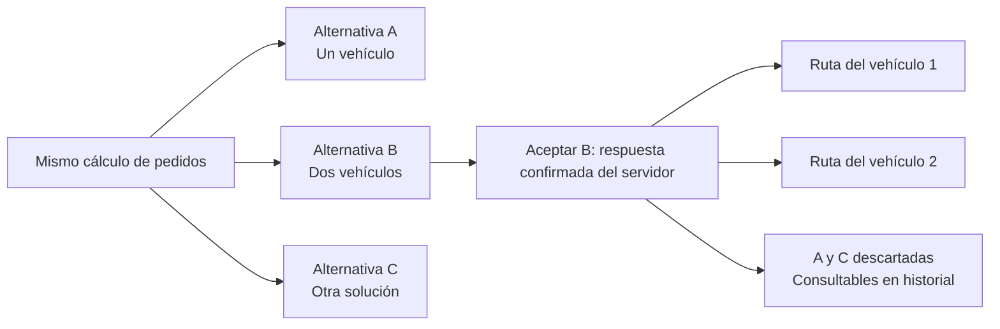
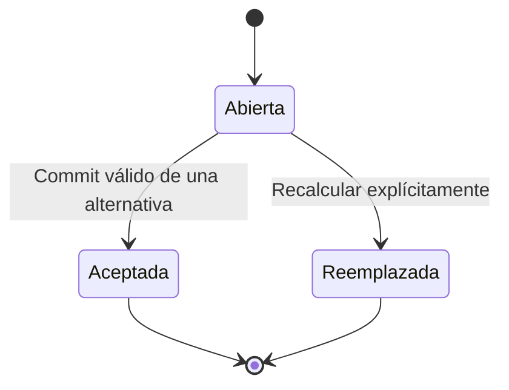

# Plan del flujo de Rutas: alternativas excluyentes y varios vehículos

Fecha: 17-oct-2026. Base inspeccionada: `develop`, `9e1d6d4`. Estado actualizado: **implementación local en worktree propio**, rama `feature/242-rutas-interactivas` sobre `8ca4e8b`. Modo claro y recorrido secuencial por vehículo según la corrección posterior de Bryan. Pruebas, migración y runtime se distinguen en el [registro de evidencia](../../evidence/renovacion-visual-rutas-2026-10-17.md); los ensayos autenticados manuales aún no se acreditan.

Complementa el [plan visual desde la landing](plan-renovacion-visual-rutas.md). Este nuevo alcance incorpora comportamiento de negocio solicitado por Bryan: aceptar una alternativa descarta sus competidoras, cada tarjeta explica su diferencia y el mapa representa todos los vehículos necesarios. Se aplica la skill `emil-design-eng` para composición, interacción, accesibilidad y movimiento; `ponytail` para reutilizar contratos y servicios existentes donde corresponda.

## 1. Regla central

Una **alternativa** es una solución completa para una selección de pedidos y una fecha operativa. Puede necesitar **una o varias rutas**, cada una con su vehículo. Las alternativas del mismo cálculo compiten entre sí; las rutas dentro de la alternativa elegida trabajan juntas.

**Al aceptar una alternativa se aceptan todas sus rutas y se descartan únicamente las otras alternativas de ese cálculo.** Las rutas ajenas al cálculo, publicadas o en ejecución se conservan. Descartar significa cerrar una propuesta para esa decisión, sin borrar su historial ni ejecutar una cancelación logística sobre rutas independientes.

Ejemplo conceptual, sin métricas de producción:

La aceptación y la publicación tienen efectos diferentes: **aceptar** compromete la elección y crea las rutas propuestas; **publicar** valida recursos, crea entregas/reservas y las hace disponibles a los conductores. El botón «Aceptar alternativa» no afirmará que los vehículos ya están despachados.

## 2. Hallazgos en el código actual

| Before | After | Why |
| --- | --- | --- |
| `selectComparisonOption()` cambia la selección; `confirmAndSavePlan()` guarda un único vehículo | Selección reversible y aceptación explícita del conjunto de rutas | Separar explorar una propuesta de comprometerla |
| `/suggest` devuelve `proposalId` por opción; `/confirm` lo registra en `InputJson`, sin resolver una elección entre alternativas hermanas | Identidad persistente del cálculo, sus alternativas y la elegida | Descartar solo las competidoras correctas y recuperar la elección tras recargar |
| `vehicleMatches` enumera vehículos candidatos y el asistente elige uno | Lista explícita de rutas y vehículos realmente asignados por alternativa | Tres vehículos compatibles no significan tres vehículos involucrados |
| El planificador general puede devolver varias rutas, pero el asistente confirma una | Propuesta y aceptación conjuntas de varias rutas | Mostrar y guardar exactamente la solución presentada |
| La API del listado ya expone `totalCost`, pero `RoutePlanSummaryDto` no lo declara | Tipar costo, estado de estimación y agrupación necesarios | Sustentar mensajes comparativos sin rellenar datos |
| `currentPlans()` agrupa por vehículo y limita a 20; el mapa usa colores por índice | Cargar el conjunto completo y usar identidad estable de ruta/vehículo | Evitar perder rutas de un conjunto o cambiarles el color al ordenar |
| Mapa del asistente con una única línea `wizard-road-route` | Varias líneas identificadas por alternativa y ruta | Representar la operación de todos los vehículos |

Fuentes inspeccionadas: `rutas.page.ts`, `route-comparison.model.ts`, `api.service.ts`, `RoutePlansController.cs`, `RoutePublisher.cs`, `Planning/PlanModels.cs` y `RetryableOperationAttribute.cs`. La idempotencia y las transacciones por organización de #287 ya existen y deben reutilizarse. Este análisis no sustituye una prueba del flujo autenticado.

## 3. Tarjetas que expliquen la decisión

Cada tarjeta de **alternativa** tendrá esta jerarquía:

1. **Mensaje principal:** «Menor costo», «Menor distancia», «Mayor costo» o «Alternativa equilibrada», calculado entre opciones comparables. «Recomendada» será una insignia separada basada en la recomendación real del servidor.
2. **Consecuencia breve:** por ejemplo «Menor recorrido total; requiere {N} vehículos». Las variables proceden de los datos recibidos.
3. **Costo total estimado** y diferencia frente a la alternativa seleccionada o una referencia claramente identificada. Cambiar selección no altera los valores ni la referencia silenciosamente.
4. **Distancia total, duración definida, vehículos asignados y entregas cubiertas/pendientes**. Las métricas principales comparten posición y unidad entre tarjetas.
5. **Restricciones importantes:** faltantes, capacidad, ventanas, origen aproximado o datos incompletos. Disponibles sin depender de hover.
6. Botón «Seleccionar» y acción «Ver rutas». Solo la seleccionada habilita «Continuar» hacia revisión; «Aceptar alternativa» aparece en la revisión final.

Dentro del detalle, cada **tarjeta de ruta** presenta vehículo, conductor, recorrido, costo y paradas propios. Comparar costos de rutas con distintas cargas solo permite afirmar «Mayor costo de este conjunto», sin presentarla como menos eficiente. La decisión excluyente pertenece a la tarjeta de alternativa, no a cada camión que la compone.

### Reglas de los mensajes

| Mensaje | Regla verificable |
| --- | --- |
| Menor costo | Mínimo de costo estimado válido entre alternativas del mismo cálculo, moneda, alcance y cobertura comparable |
| Mayor costo | Máximo de ese mismo conjunto; se presenta como información de costo, sin implicar que sea inválida |
| Menor distancia | Mínimo de la suma de kilómetros de sus rutas, no del recorrido de un solo vehículo |
| Menor tiempo para completar | Mínimo de la hora final del conjunto respecto al inicio común; requiere horarios comparables |
| {N} vehículos involucrados | Número de `vehicleId` distintos realmente asignados en `routes[]`; no contar `vehicleMatches` |
| Cobertura parcial | Pedidos/líneas/cantidades pendientes explicados, sin etiquetar como «más barata» frente a otra que atiende más demanda |
| Sin dato | Campo ausente, no finito, inválido o no comparable; no reemplazarlo por cero |

Si una opción obtiene varios extremos, mostrar un mensaje principal con orden estable: menor costo → menor distancia → mayor costo → equilibrada; los otros hechos quedan en hasta dos insignias secundarias. Una ruta corta y costosa conserva ambos hechos. La advertencia bloqueante va antes del mensaje comercial.

Empates se reconocen como «Costo mínimo compartido» o «Distancia mínima compartida». Comparar con la precisión y redondeo definidos por el contrato; no mostrar diferencias que desaparezcan en los valores visibles. Con una única opción usar «Única alternativa disponible». Si todas cuestan lo mismo, usar «Mismo costo»; no clasificar simultáneamente como más barata y más cara. Los textos explicativos serán deterministas, sin depender del LLM.

El costo estimado y el costo conciliado no se mezclan en una clasificación. Tampoco se compara una corrida guardada con un cálculo operativo actual. Un operador contratado sin vehículos identificados muestra «Vehículos por confirmar», conservando el bloqueo de aceptación que existe actualmente.

## 4. Flujo de principio a fin

| Momento | Interfaz | Efecto y salida |
| --- | --- | --- |
| Pedidos | Selección, cantidades, urgencia y remanentes | Preparar una demanda explícita y una fecha; conservar validaciones de #199 y prioridad |
| Abastecimiento | Orígenes y faltantes reales | Construir alternativas con presupuesto de stock compartido entre todas sus rutas |
| Comparación | Tarjetas explicativas y mapa de la seleccionada | Seleccionar es reversible; ninguna otra alternativa se descarta todavía |
| Vehículos y revisión | Rutas por vehículo, capacidad, conductor y totales | Validar todos los vehículos, cantidades y horarios; editar obliga a reevaluar y renovar la revisión de la propuesta |
| Aceptación | «Aceptar alternativa» y resumen de lo que se guardará | Una operación atómica acepta la elegida, crea sus rutas y descarta las hermanas |
| Resultado | Resumen «Alternativa aceptada · {N} vehículos · {R} rutas» | Ver rutas aceptadas; las descartadas pasan a historial de solo lectura |
| Publicación | Conductores asignados a cada ruta y «Publicar conjunto» | Revalidación y publicación atómicas del conjunto; no anunciar éxito parcial |
| Seguimiento | Mapa de todos los vehículos y detalle seleccionable | Progreso por ruta y agregado; refresco actual de 25s sin perder selección ni foco |
| Incidente/replanificación | Conservar ejecución completada y mostrar propuesta nueva | Nuevo cálculo asociado al origen; no revivir alternativas descartadas |
| Cancelación/retornos | Reglas actuales por ruta, reservas y cantidades explicadas | Cancelar solo lo permitido antes del despacho; rechazos y guías mantienen su flujo actual |

Cerrar el asistente antes de aceptar no descarta opciones del servidor. Tras aceptar, cambiar de solución requiere un nuevo cálculo; no se reabre silenciosamente la decisión anterior. Cancelar una ruta tampoco reactiva las descartadas. Los remanentes siguen pendientes y pueden originar otro cálculo.

## 5. Estados, atomicidad y recuperación

Estados propuestos para la **decisión**, separados del estado operativo de `RoutePlan`:

En una decisión abierta, las alternativas son disponibles o bloqueadas según su evaluación. Al aceptar, exactamente una queda `Accepted` y sus hermanas `Discarded`, con motivo `another_alternative_accepted`, fecha y actor. Un cálculo reemplazado es de solo lectura. Una recarga o un corte de red recupera estos estados desde el servidor.

- Bloquear nuevas pulsaciones durante la petición, sin retirar alternativas antes de confirmar el servidor. Si falla la transacción, no hay elección aceptada, rutas creadas ni descartes parciales.
- Enviar `operationId` estable para reintentos de la misma intención, mediante la infraestructura de #287. La decisión persistente protege también frente a dos usuarios que usen claves diferentes.
- Dos aceptaciones concurrentes de alternativas distintas del mismo cálculo: una gana; la otra obtiene 409 y recarga la decisión vigente. Repetir la misma aceptación devuelve la decisión ya guardada sin duplicar rutas ni cantidades.
- Si cambia stock, disponibilidad, cantidades o versión, devolver conflicto explicable y solicitar recálculo; ninguna hermana se descarta por una validación fallida.
- Si la respuesta se pierde, consultar el cálculo y recuperar el resultado antes de crear una operación nueva. Cerrar, recargar o volver atrás no puede duplicar la aceptación.
- Conservar la política actual de reservas: aceptar no afirma reservar stock físico; la publicación hace las reservas y debe revalidar los recursos. Las cantidades planificadas se contabilizan una sola vez en el commit de aceptación.

## 6. Contrato y persistencia que faltan

**Propuesta de implementación, no API existente ni migraciones aplicadas.** El plan visual previo mantiene intactos los cálculos actuales; este complemento introduce cambios deliberados de contrato para cumplir la nueva solicitud.

Extender el flujo de propuesta con una identidad de cálculo `planningRunId`, revisión, fecha operativa y demanda inmutable. Cada alternativa requiere `alternativeId` propio, estado/factibilidad, métricas agregadas, cobertura/faltantes y `routes[]`. Cada ruta necesita identidad estable, vehículo realmente asignado, paradas, geometría/origen, costo, horarios y cantidades por línea vinculadas a identificadores reales.

Reutilizar `RoutePlanner` para la distribución de varias rutas cuando corresponda y `RouteEvaluator`, `VehicleMatcher`, `SourcingService` y el calculador de costos para validar cada resultado. La asignación debe mantener FEFO, stock de seguridad, capacidad por tramo, ventanas, restricciones horarias y prioridad. No dividir una polilínea en el navegador para simular varios vehículos. El mismo vehículo no puede tener rutas simultáneas; viajes sucesivos requieren tiempos y capacidad factibles.

Las sumas agregadas deben reconciliarse con las rutas. Los cargos fijos o compartidos se contabilizan una vez y su reparto se explica. Mostrar por separado duración acumulada de trabajo y tiempo para completar la operación: si dos vehículos operan en paralelo, el tiempo para completar no es la suma de sus duraciones.

Unificar además la procedencia de las métricas: hoy las tarjetas consumen `comparison` y la confirmación usa `evaluation`. La alternativa mostrada, sus rutas y el snapshot aceptado deben compartir la misma evaluación canónica. Si la revalidación cambia precio, cobertura o vehículos, devolver la propuesta actualizada para revisión explícita; no aceptar silenciosamente condiciones distintas de las que se mostraron.

Diseño mínimo de persistencia: cálculo y alternativas con snapshot evaluado, estado, revisión, elección, actor y timestamps; vínculo explícito de las rutas creadas con su alternativa. Aprovechar las entidades e infraestructura existentes antes de añadir tablas. Si no hay una estructura equivalente, añadir las tablas/vínculos mínimos mediante migración aditiva y `DemoGrants.Sql`, con una restricción de una única elección por cálculo. No deducir pertenencia por A/B/C, fecha, vehículo o prefijo de código. Los registros antiguos sin vínculo siguen siendo rutas independientes.

Operaciones propuestas:

- Preparar/recalcular: ampliar `/route-plans/suggest` o una operación coordinadora reutilizando sus servicios; conservar los consumidores actuales y evitar escrituras logísticas de rutas antes de la aceptación.
- Recuperar cálculo y alternativas: consulta por `planningRunId`, con la elección y todas sus rutas; no reconstruirla a partir de un listado limitado a 20.
- Aceptar: operación por `planningRunId`, `alternativeId`, revisión esperada y `operationId`; servidor carga el snapshot, revalida, crea todas las rutas y contabiliza cantidades en la misma transacción que el descarte. El cliente no determina los totales confiables.
- Publicar conjunto: coordinador transaccional que reutiliza la publicación de cada ruta con sus conductores. La publicación existente por ruta permanece compatible; las rutas agrupadas deben pasar por la compuerta del conjunto para impedir publicaciones parciales o de alternativas descartadas.

Reutilizar autorización por rol y ámbito en todas las operaciones. Mantener al Auditor en lectura, las corridas guardadas como solo consulta y las alternativas contratadas sin confirmación hasta disponer de su flujo real. Descartadas no significa `Cancelled` ni `Superseded`: esos estados operativos mantienen su semántica actual.

La compuerta debe cubrir también `/confirm` y la creación general cuando reciban una propuesta agrupada: no permitir aceptar otra hermana mediante un endpoint anterior. Las operaciones heredadas sin vínculo explícito mantienen compatibilidad y no se atribuyen retroactivamente a un cálculo.

Actualizar los DTOs compartidos y de web, pruebas de contratos, documentación de API y notas pertinentes de la bóveda durante la implementación. El guardado singular del asistente y el cálculo general deben converger en el mismo modelo de decisión; no mantener botones que creen rutas al margen de la exclusividad solicitada.

## 7. Visualización dinámica de uno o varios vehículos

- **Un vehículo:** mapa amplio con recorrido y secuencia completa, detalle visible y encabezado «1 vehículo». Sin espacio reservado para columnas vacías.
- **Varios vehículos:** vista inicial de todas las rutas de la alternativa seleccionada. Lista de vehículos con costo, distancia, carga, conductor y progreso; seleccionarlos resalta su recorrido y abre su itinerario. Control «Ver todos» restablece el conjunto.
- Diferenciar `selectedAlternativeId` y `focusedRouteId`: inspeccionar un camión no cambia qué alternativa se aceptará. Explorar otra alternativa cambia todo el conjunto de geometrías y el resumen de aceptación.
- Color estable por vehículo dentro del cálculo, más código de vehículo y número de parada. Las bodegas compartidas no se duplican; un destino atendido por varios vehículos informa esa relación y distingue sus secuencias.
- Mapa y tarjetas reaccionan al mismo estado. Al cambiar alternativa, ajustar el encuadre al conjunto una vez; al refrescar, conservar paneo/zoom y selección. «Ver todos» permite reenfocar explícitamente.
- Cargar las geometrías por identidad/revisión con caché y peticiones agrupadas. Ignorar respuestas tardías de una alternativa anterior; una petición en hover no debe desencadenar cálculos.
- Si falta geometría de un vehículo, mantener su tarjeta y mostrar «Recorrido no disponible»; no omitirlo del conteo. Si el backend entrega aproximación, usar línea punteada y aviso. Mantener atribución y controles accesibles.
- Tras aceptar, retirar de la vista operativa las geometrías competidoras y conservar todas las de la elegida. Las descartadas se consultan en historial separado, sin controles de aceptación.
- Escritorio: tarjetas comparativas arriba y zona mapa/lista debajo; móvil: tarjetas apiladas, vista mapa/lista y detalle expandible. Con muchas rutas, lista desplazable contenida y mapa estable; no generar un mapa Leaflet por tarjeta.

### Aplicación concreta de Emil Kowalski

La jerarquía responde primero «qué distingue esta alternativa», después «cuánto cuesta y qué vehículos usa» y al final «qué detalles necesito revisar». Mantener orden de tarjetas y posición de acciones al seleccionar, sin reordenarlas por hover o hacerlas saltar de tamaño.

Feedback de presión de 100–160ms, cambios de borde/fondo de 120–160ms y apertura de detalle de 180–220ms con `cubic-bezier(0.23, 1, 0.32, 1)`. Solo `opacity`/`transform` donde ayuden a entender el cambio. El éxito confirmado puede recoger las descartadas en historial con un fundido breve; el estado del servidor y el foco se actualizan sin esperar la animación.

Selección repetida, navegación por teclado y refresco periódico son inmediatos. Respetar movimiento reducido. No animar camiones como si fueran posiciones GPS ni decorar el mapa con una falsa búsqueda del algoritmo. Usar Lucide (`Route`, `Truck`, `Coins`, `Clock`, `MapPin`, `CircleCheck`, `TriangleAlert`) y etiquetas visibles; cero emojis. Tarjetas seleccionables con controles nativos de elección, foco visible y sin botones anidados. Anunciar aceptación/error con región viva y devolver foco a un destino estable cuando desaparece una tarjeta.

## 8. Orden de implementación y pruebas que deciden el cierre

| Fase | Entrega | Verificación necesaria |
| --- | --- | --- |
| 1. Modelo de decisión | Identidad de cálculo/alternativa, estados, vínculos y contrato agregado | Una alternativa puede contener varias rutas; candidaturas no se cuentan como vehículos asignados |
| 2. Motor y aceptación | Distribución factible y operación transaccional exclusiva, recuperación e idempotencia | Concurrencia entre usuarios, reintento, rollback, cantidades y recursos compartidos |
| 3. Tarjetas explicativas | Métricas tipadas, mensajes deterministas, empates y comparabilidad | Extremos correctos, nulos, ceros válidos, única opción y cobertura parcial |
| 4. Mapa y detalle | Todas las rutas por alternativa, selección de vehículo y responsive | Colores estables, geometrías tardías, datos incompletos, teclado y movimiento reducido |
| 5. Publicación y continuidad | Publicación del conjunto, conductores, tracking y replanificación | Todo el conjunto o ninguna ruta publicada; ejecución previa preservada |
| 6. Validación integrada | Regresión backend/web, recorrido autenticado y capturas | Evidencia separada de código, pruebas locales, ejecución real y despliegue |

Casos de aceptación mínimos:

- [ ] Aceptar B con dos vehículos crea todas sus rutas, descarta A/C y conserva rutas ajenas al cálculo.
- [ ] Seleccionar B, cambiar a A o cerrar el asistente antes de aceptar no descarta ninguna alternativa.
- [ ] Doble clic, replay y aceptación simultánea de opciones distintas no duplican rutas ni cantidades; solo hay una elección.
- [ ] Error de validación o fallo al crear la segunda ruta revierte todo. Pérdida de respuesta se resuelve consultando la elección persistida.
- [ ] Cantidades repartidas entre vehículos no exceden el pendiente; la evaluación usa el mismo stock compartido y las restricciones actuales.
- [ ] «Más corta» y «Mayor costo» pueden coexistir; empates, datos ausentes y propuestas parciales no producen mensajes engañosos.
- [ ] Conteo de vehículos usa asignaciones efectivas; recorridos secuenciales del mismo vehículo no duplican ese conteo.
- [ ] Cambiar de alternativa actualiza todas las líneas; seleccionar vehículo solo cambia foco. El refresco y una respuesta tardía no restauran otra alternativa.
- [ ] Recargar conserva la elección; descartadas solo se consultan y no pueden confirmarse/publicarse por API.
- [ ] Falta de conductor, stock cambiado o conflicto de vehículo impide publicar el conjunto sin dejar rutas hermanas publicadas parcialmente.
- [ ] Auditor solo lee; contratado y corrida guardada conservan sus bloqueos actuales. Cantidades por línea, FEFO, prioridad, cancelación y retornos mantienen sus pruebas.
- [ ] Recorrido real: pedidos → comparación → aceptación con varios vehículos → publicación → visualización por conductor → seguimiento; las pruebas del agente se registran aparte si interviene.

Para implementar, ampliar las suites existentes de rutas/comparación/mapa y las pruebas PostgreSQL de planificación/publicación/idempotencia; añadir pruebas específicas del nuevo contrato y de la decisión exclusiva. Ejecutar lint, builds afectados y la verificación de bóveda. No atribuir las 173 pruebas de la revisión anterior a funcionalidades que aún no existen. Usar prelaunch antes de arrancar una versión modificada; este plan no aplica migraciones ni despliega software.

## Compatibilidad implementada para borradores anteriores — 17-oct-2026

La ocultación local y «Ver todas las rutas» quedan sustituidas por estado `Discarded` persistido y exclusión en `GET /route-plans` sin filtro de estado. Para el motor determinista anterior, las revisiones del mismo código canónico son propuestas competidoras; `proposalBatchId` identifica los cálculos nuevos y los recibos de `CreateRoutePlans` permiten conservar todos los vehículos de los ya guardados. No inferir lotes por proximidad temporal ni descartar publicados. El servicio participa en la transacción de aceptación/publicación; protege propuestas aceptadas y operaciones con reservas/entregas. Se mantienen las alternativas del snapshot para auditoría. La reparación local retiró ocho revisiones competidoras y conservó las dos rutas elegidas; evidencia enlazada en el registro de revisión local.
