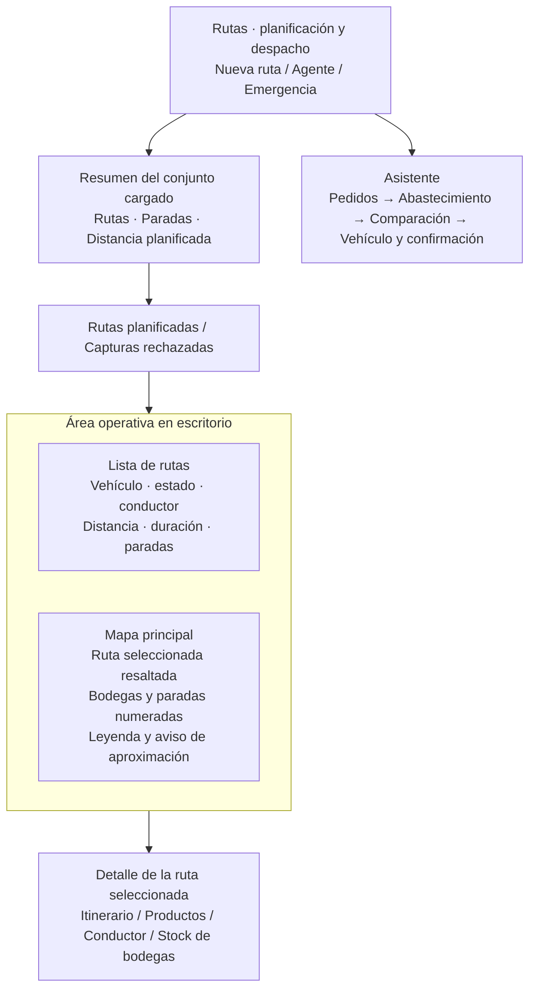

# Plan de renovación visual de Rutas desde la landing

Fecha: 17 de octubre de 2026. Base analizada: `develop`, `9e1d6d4`.

**Resultado buscado:** transformar `/rutas` en una consola logística visual, con la jerarquía editorial de la landing adaptada a **modo claro**, mapa protagonista, itinerarios legibles y controles conectados entre sí. Usar iconos Lucide minimalistas en toda la pantalla.

**Estado actualizado:** implementación local en `feature/242-rutas-interactivas` sobre `8ca4e8b`; frontend/backend arrancados desde el worktree propio. Bryan sustituyó explícitamente la propuesta nocturna por modo claro y añadió recorrido progresivo por vehículo según su vídeo de referencia. Evidencia de pruebas y límites en el [registro de revisión](../../evidence/renovacion-visual-rutas-2026-10-17.md); la sesión autenticada real sigue pendiente.

**Ampliación de flujo solicitada el 17-oct:** el [plan de selección excluyente y varios vehículos](plan-flujo-seleccion-rutas.md) define la aceptación de una alternativa, el descarte de sus competidoras, los mensajes principales de las tarjetas y el mapa de varias rutas. Ese complemento incorpora cambios de contrato/backend explícitos; las restricciones de «solo presentación» de este documento corresponden al alcance visual original.

## 1. Qué conservar de la landing

Se revisaron `apps/web/src/pages/landing/landing.page.ts`, `apps/web/src/styles.css` y `apps/web/tailwind.config.js`, además de una captura real de la landing en Chromium a 1440 × 1000.

La landing combina fondo azul nocturno `#060D1A`, texto `#F0F4F8`, azul eléctrico `#0066FF`, cian `#00C2FF` y menta `#00E5A3`. Destacan el encabezado flotante con borde fino, las píldoras, la tipografía Hina Mincho para titulares y Zen Kaku Gothic New para lectura, la composición amplia y una progresión visual por estaciones.

La traducción operativa será concreta: el mapa ocupará el lugar de la escena principal; el itinerario representará las estaciones; una barra compacta reunirá los controles. Los títulos tendrán carácter editorial y las tablas conservarán una sans legible. El scroll de 500vh, los vídeos y las escenas fotográficas pertenecen a la landing y no aportan a la planificación diaria.

### Diagnóstico del componente actual

| Before | After | Why |
| --- | --- | --- |
| Contenedor `max-w-6xl`, muchas tarjetas blancas y acciones con colores distintos | Superficie clara amplia, jerarquía común y una acción principal azul | Hacer reconocible la identidad de la landing y ordenar la atención |
| Mapa dentro del detalle, con envoltorio `h-72` y componente interior de mínimo 400px | Mapa principal con altura coherente y panel de rutas adyacente | Dar espacio a la operación geográfica y evitar recortes |
| Lista seleccionable mediante un `div` con clic | Tarjetas con botón de selección y foco visible | Ofrecer la misma interacción con ratón y teclado |
| Emojis en agente, seguimiento, pestañas, bultos y alertas | SVG de Lucide con trazo uniforme y texto accesible | Mantener una interfaz sobria y consistente |
| Seguimiento horizontal con ancho mínimo de 640px | Itinerario vertical en el detalle y versión compacta junto al mapa | Leer la secuencia sin desplazamiento horizontal en móvil |
| Asistente extenso y progreso expresado principalmente como «Paso N de 4» | Cuatro estaciones identificadas, resumen persistente y mapa contextual | Mostrar dónde está el usuario y qué falta para confirmar |
| Tema claro del shell alrededor de rutas | Superficie clara coherente con el shell y navegación existentes | Respetar el modo claro solicitado |

La revisión de rutas es de código y pruebas locales. La captura autenticada de `/rutas` está pendiente; una respuesta HTTP 200 del servidor Angular no verifica que el guard permita acceder a la pantalla.

## 2. Composición propuesta



- Encabezado compacto: título de 32–40px, subtítulo breve y botón principal «Nueva ruta». Agente como acción secundaria; emergencia con tratamiento de advertencia.
- Resumen de hasta tres indicadores calculados del conjunto disponible, rotulado «Rutas cargadas». No presentarlo como total de toda la operación: el listado y `currentPlans()` tienen límites y criterios distintos.
- Escritorio: lista de aproximadamente 320–360px y mapa flexible con `min-width: 0`; mapa de al menos 480px de alto cuando el viewport lo permita. Mantener controles y atribución cartográfica visibles.
- Detalle debajo del área principal, con resumen de ruta, estado, conductor y acciones existentes. La información extensa se despliega por parada o sección.
- Agente y comparación de prioridad en paneles plegables con resultado, fuente y acciones reales. Conservar visibles errores y advertencias que exijan atención.
- Rechazos conserva su pestaña, filtro por punto, unidades y motivos. La navegación no descarta la ruta seleccionada.

## 3. Sistema visual e iconografía

Reutilizar los tokens existentes `--color-midu-bg`, `--color-midu-crema`, `--color-midu-cyan`, `--color-midu-mint`, `--font-display`, `--font-zen` y `expo.blue`. Definir únicamente los alias semánticos locales que falten para paneles, borde, texto secundario y foco. Validar contraste en los fondos efectivos antes de fijarlos; evitar colores literales repetidos en el template.

- Superficies: fondo claro `#f7f9fc`, paneles blancos, bordes finos y radios de 16–20px; píldoras para navegación y estados. Transparencia contenida en las barras, sin desenfocar todo el mapa.
- Tipografía: Hina Mincho solo en el título editorial; Zen/sans para controles y tablas de al menos 14px. Cifras alineadas con `tabular-nums`, sin forzar cero punteado.
- Color: azul para acción principal, cian para selección y menta para estados completados. Ámbar/rojo para advertencias y errores. Los colores de vehículos mantienen su asociación y se acompañan de código y secuencia.
- Cartografía: conservar Leaflet, OpenStreetMap y su atribución. No aplicar filtros de inversión a las teselas. Adaptar primero marco, controles y leyenda; cualquier nuevo proveedor de teselas requeriría revisar licencia, red y CSP y queda fuera de esta entrega.

`@lucide/angular` ya está instalado y la landing muestra cómo importar sus componentes individuales. No incorporar otra librería de iconos ni cargar el catálogo completo.

| Uso | Icono Lucide previsto | Etiqueta visible |
| --- | --- | --- |
| Nueva ruta | `Plus` | Nueva ruta |
| Ruta y paradas | `Route`, `MapPin` | Itinerario y paradas |
| Vehículo/conductor | `Truck`, `UserRound` | Vehículo / Conductor |
| Productos/bodega | `Package`, `Warehouse` | Productos / Stock de bodegas |
| Consulta al agente | `Bot` | Consultar agente |
| Advertencia | `TriangleAlert` | Explicación concreta del problema |
| Refresco | `RefreshCw` | Actualizar |
| Estado/tiempo | `CircleCheck`, `Clock` | Completada / Duración |
| Comparación | `Scale` | Comparar opciones |
| Cierre/expansión | `X`, `ChevronDown` | Cerrar / Ver detalle |

Comprobar los nombres exportados por la versión instalada al implementar. Iconos de 16–20px, trazo de 1.5–1.75; `aria-hidden` junto a texto y nombre accesible en los botones de solo icono. Sustituir también símbolos Unicode usados como iconos de éxito, alerta o cálculo.

## 4. Interacciones y correspondencia con el sistema real

| Interacción propuesta | Base existente | Trabajo de presentación |
| --- | --- | --- |
| Seleccionar tarjeta o leyenda y resaltar el recorrido | `selectPlan()`, `selectedPlanId`, `renderAllRoutes()`, `routeLegend` | Unificar selección, foco y resumen sin otra petición adicional por hover |
| Seleccionar parada en el mapa y abrir su detalle | `MapViewComponent.markerClick`, `expandedStopSeqs`, `toggleStopExpansion()` | Conectar el evento con la parada de la ruta seleccionada; no confundir marcadores de otras rutas |
| Enfocar en mapa una parada desde el itinerario | Coordenadas de geometría; API de enfoque aún no expuesta por `MapViewComponent` | Añadir solo si hace falta un método visual genérico de enfoque; no inventar coordenadas ni telemetría |
| Expandir productos o bultos de una parada | `expandedStopSeqs`, `expandAllStops()`, `collapseAllStops()` | Filas expandibles accesibles, estado anunciado y foco estable |
| Leer avance y actualizarlo | `trackingSummary`, `stopProgressList`, `manualRefreshTracking()` | Progreso visual y fecha de última actualización; conservar intervalo actual de 25s |
| Comparar alternativas y verlas en mapa | `comparisonOptions`, `selectComparisonOption()`, `viewOnMap()` | Tarjetas comparativas, desglose y selección persistente |
| Reordenar paradas dentro del asistente | `moveStop()`, `restoreOptimalOrder()`, evaluación existente | Botones subir/bajar visibles; conservar reevaluación y errores |
| Publicar, reasignar o cancelar | `publishPlan()`, `reassignDriver()`, `cancelPlan()` | Botones con estado pendiente y confirmaciones actuales |
| Consultar agente y revisar fallback | `triggerAgentWatch()`, `agentRun` | Panel de resultados que distinga LLM, plantilla, fallo y ejecución |

Las nuevas conexiones son estado y comportamiento de presentación. No cambian contratos de negocio. No añadir controles de descarga, rastreo GPS, transporte contratado o filtros que no tengan implementación real. La comparación contratada y la guardada conservan sus restricciones actuales de confirmación.

### Asistente visual

Mantener el orden real del componente, que difiere de la guía visual del 16-oct:

1. **Pedidos:** selección múltiple, prioridad/stock y cantidades por línea; controles existentes de selección y creación manual.
2. **Abastecimiento:** bodegas de origen, líneas disponibles y faltantes, con la misma propuesta real de la API.
3. **Comparación:** A/B/C según los datos recibidos, coste, distancia, duración, riesgos y justificación. La recomendación sigue `isRecommended`; no fijar por diseño que A siempre sea la mejor. Conservar modo proyector y comparación guardada.
4. **Vehículo y confirmación:** capacidad de peso/volumen, descartes, conductor cuando corresponda y resumen final. Conservar edición de secuencia y cantidades donde actualmente se habilita, así como la distinción entre guardar propuesta y publicar ruta.

El modal tendrá stepper, título del paso, resumen de selección y pie de acciones persistente. En móvil ocupará el viewport con altura dinámica; cada región desplazable debe tener un propósito claro. El diálogo retiene foco, admite Escape según el estado de la operación, bloquea scroll de fondo y devuelve foco al disparador.

### Movimiento, accesibilidad y honestidad del estado

- Feedback de presión de 100–160ms y expansión de 150–220ms con `opacity`/`transform`. Evitar `transition: all` y cambios animados de layout del mapa.
- Teclado, selección frecuente y refresco de 25s no reproducen animaciones de entrada. No recentrar el mapa cada vez que llega un refresco si el usuario lo está explorando.
- Respetar `prefers-reduced-motion`. Las ramas decorativas existentes de `route-animation.ts` no representan red vial ni exploración real: mantenerlas desactivadas en la vista operativa; la geometría y su origen siguen visibles.
- No representar un camión moviéndose como posición real: no se ha acreditado una fuente GPS en este flujo. Mostrar «Actualización cada 25s» y el instante confirmado, sin prometer seguimiento continuo.
- Contraste WCAG AA, foco visible, selección distinguible sin color, controles de al menos 36px en escritorio y 44–48px en móvil. Pestañas, tarjetas y diálogos operables con teclado.
- Estados: skeleton estable al cargar; vacío con acción autorizada; error con reintento explícito; falta de permisos; ausencia de geometría o coordenadas sin ocultar el detalle textual. Diferenciar `0` real de «Sin dato».

## 5. Secuencia de implementación

| Fase | Cambios concretos | Archivos principales | Criterio de cierre |
| --- | --- | --- | --- |
| 0. Línea base | Registrar capturas autenticadas, roles, responsive y resultados de pruebas; contrastar guía y código | `rutas/*.spec.ts`, `map-view/*.spec.ts`, evidencia | Estado actual reproducible; diferencias documentadas |
| 1. Identidad y shell | Tema claro acotado a rutas, tokens semánticos, título editorial, acciones e iconos SVG | `rutas.page.ts` y componentes de decisión/recorrido; estilos locales | Sin emojis ni cambios visuales accidentales en otras páginas |
| 2. Mapa y lista | Ampliar área de trabajo, corregir alturas, tarjetas accesibles y leyenda; conectar selección de parada | `rutas.page.ts`, `shared/ui/map-view/map-view.component.ts` | Lista/mapa/detalle sincronizados, atribución visible, geometría aproximada identificada |
| 3. Detalle operativo | Itinerario vertical, productos, conductor, stock, progreso, rechazos y panel del agente | `rutas.page.ts`, modelos existentes de tracking/comparación | Todos los datos y acciones actuales accesibles por rol y teclado |
| 4. Asistente | Stepper, panel de resumen, comparación visual, capacidad y confirmación | `rutas.page.ts`; template/estilos de página si facilitan la edición | Cuatro pasos reales preservados, advertencias y bloqueos intactos |
| 5. Verificación y documentación | Regresión funcional, revisión visual, accesibilidad y prelaunch local | Tests existentes, evidencia y notas UI-UX | Criterios de aceptación satisfechos con pruebas locales y runtime separados |

Implementar en ese orden. Mantener signals y llamadas de negocio en `RutasPage`; separar HTML/estilos si reduce la complejidad del archivo. Extraer componentes únicamente ante una sección claramente autónoma o reutilizable. No agregar stores, frameworks de animación, librerías de gráficos ni nuevas dependencias.

Las guías `00`, `01`, `02` y `05` de `docs/boveda/10 Diseno y UI-UX/` describen el estándar claro. Registrar la variante de rutas solicitada por Bryan y ajustar sus referencias afectadas al implementarla, sin presentar una nueva decisión global para todas las pantallas. La guía `05` registra la corrección a modo claro y el contrato implementado.

## 6. Validación y criterios de aceptación

- [ ] Con 1440 × 900, el primer viewport muestra título, acciones, lista y área sustancial del mapa. La jerarquía editorial, cian y azul conserva la referencia de la landing sobre fondo claro.
- [ ] A 1024px y con el sidebar visible, lista y mapa se apilan si falta ancho útil. No comprimirlos hasta volverlos ilegibles.
- [ ] A 390 × 844 y a 320px de ancho no hay desbordamiento horizontal general. Lista/mapa se alternan o apilan; comparaciones se leen en tarjetas y las tablas extensas tienen scroll contenido identificado.
- [ ] Selección de ruta y parada funciona con ratón, táctil y teclado. Cambiar el layout del mapa llama a `invalidateSize()` cuando corresponde.
- [ ] Sin emojis, cifras inventadas, controles sin acción ni métricas globales calculadas de un listado parcial.
- [ ] Estados cargando, vacío, error, sin permiso y sin geometría comprobados; foco y modo de movimiento reducido revisados.
- [ ] Auditor conserva lectura; Planificador y Gerencia conservan sus permisos actuales. Navegación protegida y API mantienen autorización real.
- [ ] Publicar/cancelar/reasignar, prioridad de stock, cantidades por línea, restricciones vehiculares, comparación A/B/C/guardada y consultas del agente conservan su comportamiento.
- [ ] Seleccionar una opción contratada o una comparación guardada no habilita confirmaciones que hoy están bloqueadas.
- [ ] Refresco no pierde ruta, parada, foco ni edición en curso; temporizadores se limpian al abandonar la vista.
- [ ] Lint, build web y suites de rutas/mapa pasan. Ejecutar también la suite web completa si se modifica shell, navegación o UI compartida.
- [ ] Capturas del antes/después con datos de prueba autorizados: escritorio, móvil, asistente, rechazos y Auditor. Registrar separado código, pruebas locales, ejecución real y despliegue.

Comandos para implementación, desde la raíz:

```bash
npm run lint:web
npm run build:web
npm run test --workspace=apps/web -- --watch=false --include='src/pages/rutas/**/*.spec.ts' --include='src/shared/ui/map-view/*.spec.ts'
# Si cambia shell o UI compartida:
npm run test --workspace=apps/web -- --watch=false
python docs/boveda/.github/scripts/check_vault.py
```

Usar la skill local de prelaunch antes de arrancar una versión modificada y registrar límites de verificación. El acceso real a `/rutas` necesita sesión Cognito y cuenta local habilitada; el entorno levantado no sustituye esa prueba.

## 7. Evidencia de esta preparación

El alcance de esta entrega es planificación y comprobación del entorno existente. Resultados de salud, auditoría, pruebas y límites de acceso: [registro local de revisión](../../evidence/renovacion-visual-rutas-2026-10-17.md).

- [x] Landing revisada en código y captura de Chromium.
- [x] Rutas, contratos de datos, mapa, shell e iconografía existente analizados.
- [x] Fases, interacciones, responsive, accesibilidad y criterios de aceptación definidos.
- [ ] Implementar el rediseño.
- [ ] Validar visualmente rutas con sesión y datos autorizados.
- [ ] Ejecutar las pruebas de aceptación del rediseño implementado.

## Ajuste solicitado: tarjetas horizontales y aprobación clara — 17-oct-2026

Plan antes de implementar:

1. Convertir «Rutas registradas» en una fila horizontal desplazable por ratón, teclado y táctil; usar una sola columna de página y mapa de ancho completo debajo. Mantener selección, foco y modo claro.
2. Mostrar etiquetas comparativas calculadas en las tarjetas de rutas propuestas y en alternativas: menor/mayor costo, menor distancia y menor tiempo operativo cuando hay métricas suficientes. Mostrar empates y datos ausentes sin inventar ventajas. Las rutas registradas se comparan con propuestas de la misma fecha; estas etiquetas describen métricas, no prueban igualdad de destinos/cobertura ni autorizan descartar rutas independientes.
3. Hacer prominente la acción de aprobación: barra encima del mapa con conductor y botón grande para rutas independientes; en el comparador, botón persistente con opción y vehículos. Mantener aceptación y publicación como pasos diferentes y los bloqueos/idempotencia existentes.
4. Corregir «Abrir último cálculo»: solo ofrecerlo si existe un identificador guardado o vinculado a una ruta. Sin cálculo, abrir selección de pedidos. Estado vacío del componente con explicación y acción para elegir pedidos, sin «Consultar estado» inoperante. Recuperación de un cálculo fallido debe conservar su identificador para reintentar.
5. Verificar clasificación, navegación de entrada/recuperación/aprobación y regresión web; compilar y revisar escritorio/móvil con siete tarjetas sintéticas. Reutilizar evidencia backend vigente porque no cambian endpoints, persistencia ni autorizaciones.

Ampliación durante la implementación: selector de vehículos encima del mapa, conductor vinculado al vehículo activo, reproducción automática de todos los tramos al seleccionar propuesta/plan y vista centrada en la propuesta aprobada tras el éxito del servidor. En cálculos nuevos se conserva el descarte persistente existente; para registros históricos sin vínculo de cálculo se ocultan las otras propuestas de la vista de trabajo, sin inferir ni cancelar operaciones ajenas. El historial general sigue consultable. Se verificará selección repetida, geometría tardía, cambio de vehículo y conservación de todas las rutas aceptadas.


Corrección posterior solicitada: retirar «Ver todas las rutas» y la persistencia local del filtro de aprobación. El descarte debe persistirse en servidor y excluirse del listado normal incluso tras recargar. Para los cálculos anteriores se recupera la pertenencia al lote desde `CreateRoutePlans`; los borradores de la misma familia de revisiones son competidores. Mantener todos los vehículos elegidos y el historial publicado, con rollback ante fallo y protección frente a efectos operativos. Esta regla reemplaza la ocultación visual de la ampliación anterior.


## Ampliación del paso 2 de abastecimiento — 17-oct-2026

Plan autorizado durante la integración: simplificar el resumen a productos, recogida y destino de la propuesta activa; elegir inicialmente una recomendación viable del servidor, sin denominarla óptimo global. Mostrar el mismo reproductor de recorrido por paradas desde este paso, con geometría real o aproximación explícita, pausa y reinicio. Dar más espacio al mapa, encabezado claro y una acción «Comparar y aprobar». Permitir cambiar de propuesta y conservar esa elección al entrar al comparador persistente. Reutilizar componentes/contratos existentes, sin dependencias nuevas ni sustituir la asignación real de varios vehículos del comparador por los vehículos meramente compatibles del paso de abastecimiento.
