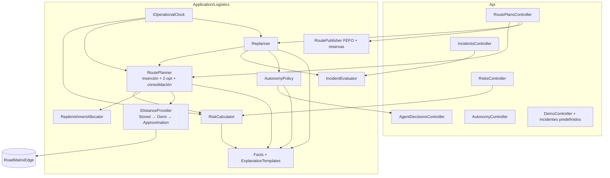

# 002 — Motor logístico determinista: plan de implementación

> **For agentic workers:** REQUIRED SUB-SKILL: Use superpowers:subagent-driven-development (recommended) or superpowers:executing-plans to implement this plan task-by-task. Steps use checkbox (`- [ ]`) syntax for tracking. Las tareas van en `task.md`, que redacta el equipo a partir de la sección «Descomposición sugerida» de este plan.

**Goal:** Calcular riesgo de reabastecimiento, proponer rutas factibles para dos vehículos, replanificar ante incidentes conservando lo ejecutado y clasificar cada cambio con una política de autonomía determinista, todo expuesto como herramientas HTTP para el panel y el agente.

**Architecture:** Servicios deterministas en `src/Application/Logistics/` sobre el esquema de 001, sin estado propio salvo la caché de tramos. Una cadena de proveedores de distancia (guardado → OSRM → aproximación) aísla la red. Cada respuesta lleva `facts` estructurados que alimentan explicaciones por plantilla y la validación del agente (003).

**Tech Stack:** .NET 8, ASP.NET Core 8, EF Core 8.0.11 + Npgsql + NetTopologySuite, PostgreSQL 16 + PostGIS 3.4, OSRM (HTTP, opcional), xUnit + Testcontainers (proyecto de pruebas de 001). Sin paquetes nuevos.

**Spec:** [`spec.md`](spec.md)

## Global Constraints

- Todo lo de [001 — Global Constraints](../001-nucleo-delgado-importador/plan.md#global-constraints) sigue vigente (SDK 8.0.424, nombres canónicos, `/api/v1`, roles fijos, sin ICU, sin datos del escenario en código, `numeric(18,3)`, mensajes en español).
- Una sola migración nueva en este spec (`RoadMatrixEdge` y `RouteStockReservation`), creada sobre `develop` actualizado y terminada con `migrationBuilder.Sql(DemoGrants.Sql)`.
- Determinismo: ninguna función del motor usa `DateTime.UtcNow`, `Guid.NewGuid` para ordenar, `Random` sin semilla ni el orden de enumeración de un `HashSet`/`Dictionary`. El tiempo sale de `IOperationalClock`; los empates se rompen por código.
- El motor no lee texto libre del LLM: la política recibe solo objetos calculados.
- Toda cifra mostrada o explicada sale de `facts`.
- Tiempos internos en UTC; ventanas y jornada en hora local de `Organization.TimeZone` (America/Guayaquil, UTC−5 sin horario de verano).
- Presupuestos: propuesta 15 puntos/2 vehículos ≤ 1 s; 80 puntos ≤ 5 s.

## Review Focus

1. **Dataset con fechas históricas** (consumos de 2025, por ejemplo): con el reloj en `Real`, la ventana de demanda queda vacía y todo sale `SIN_DATOS`. El modo por defecto es `Dataset` y una prueba importa consumos de un año anterior y espera riesgos calculados → prueba en la tarea de riesgo.
2. **Punto sin coordenadas** (001 lo permite con un supuesto): no puede romper el planificador; debe aparecer como no atendido con motivo `unreachable` → prueba en la tarea de planificador.
3. **Producto con peso o volumen 0** (valor por defecto de 001): la capacidad en esa dimensión no se puede evaluar; no debe dividir por cero ni rechazar la carga, y debe emitir el fact `capacity_dimension_not_evaluated` → prueba en la tarea de planificador.
4. **Stock de bodega insuficiente para todos los obligatorios:** la asignación debe seguir el orden de prioridad, marcar el resto `warehouse_stock` y nunca reservar por encima del stock de seguridad → prueba en la tarea de cantidades.
5. **Reset de demo entre ensayos:** cambia todos los identificadores; la caché de tramos debe seguir sirviendo porque está indexada por coordenadas, y el incidente predefinido debe referirse a vehículos y puntos por código → prueba E2E de reset → incidente.

---

## Arquitectura



**Flujo de la demo:** reset (`demo-region`) → `GET /risks` → `POST /route-plans` → `POST …/publish` → completar 2 paradas → `POST /demo/incidents {preset}` → `POST …/replan` por cada ruta afectada → la política publica la del vehículo 2 y escala la del vehículo 1 → `POST /agent-decisions/{id}/approve {option}` → opcional `POST …/revert`.

## Componentes e interfaces

Las firmas son el contrato entre tareas; los nombres de tipos son definitivos.

```csharp
namespace IstpetDev.Application.Logistics;

public enum ClockMode { Dataset, Real, Fixed }
public interface IOperationalClock
{
    Task<DateOnly> TodayAsync(CancellationToken ct);              // fecha operativa
    Task<DateTime> WorkdayStartUtcAsync(CancellationToken ct);    // Today + Logistics:WorkdayStart en hora local → UTC
}

public enum RiskLevel { Critico, Alto, Vigilar, Normal, SinDatos }
public sealed record RiskItem(
    Guid ServicePointId, string PointCode, Guid ProductId, string Sku, string BaseUnit,
    decimal Available, decimal? DailyDemand, decimal? CoverageDays,
    decimal LeadTimeDays, decimal SafetyMarginDays, RiskLevel Level,
    decimal SuggestedQuantity, decimal InTransit, IReadOnlyList<Fact> Facts);
public interface IRiskCalculator
{
    Task<IReadOnlyList<RiskItem>> CalculateAsync(bool persistSnapshots, CancellationToken ct);
}

public sealed record Fact(string Code, string Subject, decimal Value, string Unit);

public enum DistanceSource { Road, Approximation }
public sealed record Leg(GeoPoint From, GeoPoint To, decimal Km, decimal Minutes, DistanceSource Source, string? EncodedPolyline);
public readonly record struct GeoPoint(decimal Lat, decimal Lon);   // redondeado a 5 decimales (~1 m)
public interface IDistanceProvider
{
    Task<IReadOnlyDictionary<(GeoPoint From, GeoPoint To), Leg>> MatrixAsync(IReadOnlyList<GeoPoint> points, CancellationToken ct);
}

public sealed record PlanRequest(DateOnly? Date, IReadOnlyList<string>? VehicleCodes, bool IncludeConsolidation = true,
    string? CriticalDeadlineLocal = null); // FR-25, #193
public sealed record PlannedStop(int Sequence, string PointCode, Guid ServicePointId, DateTime ArrivalUtc, DateTime DepartureUtc,
    TimeSpan Wait, IReadOnlyList<StopLoad> Loads, bool IsConsolidation, int? LateMinutes);
public sealed record StopLoad(Guid ProductId, string Sku, decimal Quantity, string BaseUnit);
public sealed record VehicleRoute(string VehicleCode, Guid VehicleId, IReadOnlyList<PlannedStop> Stops,
    decimal Km, decimal Minutes, decimal Cost, decimal LoadWeight, decimal LoadVolume, bool HasApproximations,
    IReadOnlyList<Leg> Legs);
public sealed record Unserved(string PointCode, string Reason, IReadOnlyList<Fact> Facts);
public sealed record PlanResult(IReadOnlyList<VehicleRoute> Routes, IReadOnlyList<Unserved> Unserved, IReadOnlyList<Fact> Facts);
public interface IRoutePlanner
{
    Task<PlanResult> PlanAsync(PlanRequest request, CancellationToken ct);
    // Replanificación: rutas parciales con prefijos fijos, legs bloqueados/ralentizados y modo de opción.
    Task<PlanResult> ReplanAsync(ReplanInput input, CancellationToken ct);
}

public enum ReplanMode { Strict, LateService, PrioritizeCritical }
public sealed record ReplanInput(IReadOnlyList<FixedPrefix> Prefixes, IncidentEffect Effect, ReplanMode Mode);
public sealed record FixedPrefix(string VehicleCode, IReadOnlyList<string> CompletedPointCodes, GeoPoint Position, DateTime ReadyAtUtc,
    IReadOnlyList<string> PendingPointCodes, bool VehicleAvailable);
public sealed record IncidentEffect(IReadOnlySet<(GeoPoint, GeoPoint)> BlockedLegs, IReadOnlyDictionary<(GeoPoint, GeoPoint), decimal> SlowFactors,
    IReadOnlySet<string> UnavailableVehicles);

public interface IIncidentEvaluator
{
    Task<IncidentImpact> EvaluateAsync(Guid incidentId, CancellationToken ct);  // rutas publicadas afectadas + IncidentEffect
}

public enum PolicyOutcome { AutoExecuted, Escalated }
public sealed record PolicyDecision(PolicyOutcome Outcome, IReadOnlyList<string> Reasons, IReadOnlyList<Fact> Facts);
public interface IAutonomyPolicy
{
    PolicyDecision Classify(VehicleRoute previous, VehicleRoute proposed, IReadOnlyList<Unserved> unservedMandatory, AutonomyMode mode);
}
public enum AutonomyMode { AutoWithLimits, ProposeOnly }

public interface IExplanationTemplates
{
    string Explain(string kind, IReadOnlyList<Fact> facts);   // kind: risk | plan | replan | escalation
}
```

`AutonomyMode` en tiempo de ejecución vive en un singleton `AutonomyState` inicializado desde `Agent:Policy:Mode`; un reinicio vuelve al valor configurado (documentado en la interfaz).

## Algoritmos

### Reloj operativo

- `Dataset`: `Today = max(Consumption.OccurredOn + PeriodDays)`; sin consumos, cae a `Fixed` si está configurado o a `Real`.
- `Real`: fecha local actual. `Fixed`: `Logistics:Clock:FixedDate`.
- `WorkdayStartUtc = Today + Logistics:WorkdayStart` (hora local) convertido con `TimeZoneInfo` de `Organization.TimeZone`; si la zona no existe en el sistema, se usa `Logistics:FallbackUtcOffsetHours` (−5) y se emite el fact `timezone_fallback`.

### Riesgo y cantidades

Para cada par punto–SKU con saldo o consumo en el punto:

1. `window = [Today − DemandWindowDays, Today)`. Un consumo de periodo `[d, d + p)` aporta la fracción de cantidad que cae dentro de la ventana (prorrateo lineal por días).
2. `DailyDemand = Σ cantidad prorrateada ÷ días de la ventana cubiertos por datos`; si no hay días cubiertos o la suma es 0 → `SinDatos`.
3. `Available = Σ (QuantityOnHand − QuantityReserved)` de las ubicaciones del punto, solo lotes no bloqueados ni vencidos a `Today`.
4. `InTransit = Σ DeliveryLine.DispatchedQuantity − AcceptedQuantity` de entregas despachadas no recibidas hacia el punto.
5. `Coverage = Available ÷ DailyDemand`. `LeadTime = ServicePoint.LeadTimeDays ?? Logistics:DefaultLeadTimeDays`.
6. Nivel: `≤ LeadTime` → `Critico`; `≤ LeadTime + SafetyMarginDays` → `Alto`; `≤ … + ConsolidationExtraDays` → `Vigilar`; si no, `Normal`.
7. `Suggested = max(0, DailyDemand × TargetCoverageDays + SafetyStockUnits − (Available + InTransit))`, redondeado hacia arriba a la unidad base (3 decimales).

**Asignación de stock de bodega (`ReplenishmentAllocator`):** se recorren los obligatorios por prioridad (nivel, días hasta faltante = `Coverage − LeadTime`, criticidad del punto `alta > media > normal`, código) y se asigna `min(Suggested, StockBodega − WarehouseSafetyStock)` por SKU con lotes FEFO; un obligatorio sin cantidad asignable va a no atendidos `warehouse_stock`. Los de consolidación solo reciben stock sobrante.

### Distancias

1. Puntos redondeados a 5 decimales (`GeoPoint`).
2. `StoredDistanceProvider`: lee `RoadMatrixEdge` para todos los pares; si faltan pares y `Logistics:Osrm:BaseUrl` está configurado, `OsrmDistanceProvider` llama una vez a `/table/v1/driving/{coords}?annotations=distance,duration` (timeout `Logistics:Osrm:TimeoutSeconds`, 3 s) y, para los pares que usa una ruta publicada, a `/route/v1/driving/{a};{b}?overview=full&geometries=polyline` para el trazado; guarda lo obtenido.
3. Lo que siga faltando: `ApproximationProvider` = haversine × `ApproxDetourFactor` (1,3) a `ApproxSpeedKmh` (40), `Source = Approximation`, sin guardar.
4. Matrices dirigidas: A→B y B→A son pares distintos (Rutas y sobrecostos).

Decodificador de polilíneas propio (algoritmo de Google, precisión 5) en `Application/Logistics/Polyline.cs`; no se añade paquete.

### Planificador

Entrada: riesgos, asignaciones, vehículos activos con depósito, matriz para depósito + puntos candidatos, reloj.

1. **Candidatos:** obligatorios = `Critico`/`Alto` con cantidad asignada > 0; consolidación = `Vigilar` con stock sobrante. Puntos sin coordenadas → no atendidos `unreachable`.
2. **Carga** por parada: Σ cantidad × peso/volumen por unidad del SKU. Dimensión con factor 0 → no se evalúa y se emite `capacity_dimension_not_evaluated`.
3. **Inserción más barata y factible** (obligatorios en orden de prioridad): para cada punto, probar cada posición de cada ruta; factible si (a) carga ≤ capacidad en cada dimensión evaluada, (b) llegada ≤ fin de ventana (espera si llega antes del inicio), (c) regreso al depósito ≤ inicio de jornada + `WorkdayHours`, (d) ningún tramo bloqueado. Costo de inserción = Δ(km × costo/km + horas × `CostPerHour`). Se elige el mínimo; empate → ruta del vehículo de código menor → posición menor. Sin posición factible → no atendido con el motivo de la restricción que falló primero en la mejor posición (`capacity`, `time_window`, `workday`, `unreachable`).
4. **2-opt intrarruta** sobre los obligatorios mientras mejore el costo y mantenga la factibilidad.
5. **Consolidación:** candidatos `Vigilar` ordenados por desvío mínimo; se insertan si el desvío ≤ `MaxDetourMinutes` y la ruta sigue factible; luego un último 2-opt.
6. **Salida:** rutas con horarios, carga, km, minutos, costo, `HasApproximations`, legs con trazado y `facts` (`stop_arrival`, `stop_window`, `route_km`, `route_cost`, `consolidation_detour`, `unserved_reason`, …).

**Complejidad:** inserción O(n²·v) por punto, adecuada para n ≤ 80, v ≤ 2. Prueba de calidad: en instancias aleatorias de ≤ 8 puntos con semilla fija, el costo de la heurística ≤ 110% del óptimo por fuerza bruta.

### Incidentes y replanificación

- `ROAD_CLOSURE` y `DELAY`: un tramo está afectado si alguno de los segmentos de su trazado (o la recta, si es aproximado) pasa a ≤ `RadiusKm` del centro (distancia punto–segmento en proyección equirectangular local). Cierre → bloqueado; demora → minutos × `factor`.
- `VEHICLE_BREAKDOWN`: el vehículo queda no disponible desde la hora del incidente; sus paradas pendientes pasan como candidatas al otro vehículo después de una visita de recarga al depósito al terminar sus propias paradas pendientes.
- `Replanner`, por cada ruta publicada afectada:
  1. Construye `FixedPrefix` con las paradas `Completed` (posición y hora de la última).
  2. Ejecuta `ReplanAsync(Strict)` → revisión propuesta.
  3. Llama a la política. Si escala, calcula también `LateService` (ventanas blandas solo para obligatorios, objetivo de menor costo; `LateMinutes` por parada) y `PrioritizeCritical` (sin consolidación, obligatorios repartibles entre vehículos, ventanas duras).
  4. Guarda la revisión (`Revision + 1`, `SupersedesRoutePlanId`) y la `AgentDecision` con el resultado.

### Política de autonomía

| Regla (todas deben cumplirse para `AutoExecuted`) | Parámetro | Valor inicial |
|---|---|---|
| Ninguna parada obligatoria pasa a no atendida | — | — |
| Ninguna ventana incumplida (`LateMinutes` nulo en todas) | — | — |
| Aumento de costo ≤ umbral | `Agent:Policy:MaxCostIncreasePct` | 15 |
| Retraso de llegada por parada ≤ umbral | `Agent:Policy:MaxDelayMinutes` | 60 |
| Modo `AutoWithLimits` | `Agent:Policy:Mode` | `AutoWithLimits` |

Cada regla incumplida aporta un motivo con su fact (`cost_increase_pct`, `max_delay_minutes`, `missed_window`, `dropped_mandatory`, `mode_propose_only`). Una propuesta inicial (`POST /route-plans`) también pasa por la política: con `AutoWithLimits` y sin incumplimientos se publica sola solo si `Agent:Policy:AutoPublishInitialPlans` es `true` (por defecto `false`: la primera ruta del día la aprueba una persona).

### Explicaciones por plantilla

Plantillas en español con marcadores que solo aceptan facts (`{fact:coverage_days:HOS-N01/DES-01}`). Una prueba recorre todas las plantillas y comprueba que cada número del texto renderizado existe en `facts` con la misma unidad.

## Cambios de datos

### Migración `RoadMatrixCache`

Tabla `RoadMatrixEdge` (nombre del diseño de la bóveda):

| Columna | Tipo | Nota |
|---|---|---|
| `Id`, `OrganizationId`, auditoría | — | `OrganizationEntity` |
| `FromLat`, `FromLon`, `ToLat`, `ToLon` | `numeric(9,5)` | clave por coordenadas redondeadas |
| `DistanceKm` | `numeric(18,3)` | |
| `DurationMinutes` | `numeric(18,3)` | |
| `EncodedPolyline` | `text` nullable | trazado (precisión 5) |
| `Source` | `varchar` | `osrm`, `imported` |
| `RetrievedAtUtc` | `timestamptz` | |

Índice único `(OrganizationId, FromLat, FromLon, ToLat, ToLon)`. No se borra en el reset de demo (la tabla no está en la lista de `DemoResetService`).

La misma migración crea `RouteStockReservation` con `OrganizationId`, `RoutePlanId`, `DeliveryId`, `DeliveryLineId`, `LotId`, `StockBalanceId`, `Quantity numeric(18,3)`, `Status` (`Active`, `Released`, `Consumed`), `CreatedAtUtc` y `ClosedAtUtc` nullable. Índice único por `(OrganizationId, RoutePlanId, DeliveryLineId, LotId)` e índice para reservas activas por saldo. El saldo `StockBalance.QuantityReserved` equivale a la suma activa: publicar inserta registros y aumenta el agregado en una transacción; repetir no duplica. Al despachar en 004, la reserva correspondiente pasa a `Consumed` mientras se mueve stock físico. El reset borra estas reservas con las entregas, pero conserva `RoadMatrixEdge`.

**Reversión de una revisión publicada:** bloquear reservas y saldos de la revisión saliente. Las entregas pendientes aún no despachadas se cancelan, sus reservas `Active` pasan a `Released` y se resta exactamente su cantidad del agregado. Las reservas `Consumed` y paradas completadas permanecen históricas; nunca se liberan ni se deshace un movimiento físico. Revalidar stock y seguridad de bodega, crear entregas/reservas para la nueva revisión restaurada y publicarla en el **mismo commit**. Si una entrega pendiente está despachada o el stock ya no permite restaurar, responder 409 con motivo de conciliación sin cambiar revisión ni reservas. Una clave de idempotencia evita repetir la compensación.

### Extensión del importador de 001

| Cambio | Archivo de 001 |
|---|---|
| `ImportEntity.RoadSegments` **al final del enum** (escribe después de las demás) | `src/Application/Imports/ImportEntity.cs` |
| Clave `road_segments`, alias `tramos`, `matriz`, `distancias` | ídem |
| Campos: `from_code`*, `to_code`*, `distance_km`*, `duration_min`*, `geometry` (polilínea codificada), `from_kind`, `to_kind` | `src/Application/Imports/CanonicalSchema.cs` |
| Escritura: resolver códigos a ubicaciones con coordenadas (bodega o punto; ambigüedad → error que pide `*_kind`), upsert en `RoadMatrixEdge` por coordenadas | `src/Application/Imports/CanonicalWriter.cs` |
| `ImportContext` carga las aristas existentes | `src/Application/Imports/ImportContext.cs` |

## Contratos HTTP

Respuestas en camelCase; errores con Problem Details. Las cifras de los ejemplos corresponden al fixture `demo-region` (HOS-N01: 12 L/día × 10 días − 60 L disponibles = 60 L sugeridos); horas, km y costos son ilustrativos hasta implementar.

**`GET /api/v1/risks?level=Alto&persist=false`**

```json
{
  "today": "2026-10-12",
  "clockMode": "Dataset",
  "items": [
    {
      "pointCode": "HOS-N01", "sku": "DES-01", "baseUnit": "L",
      "available": 60.0, "dailyDemand": 12.0, "coverageDays": 5.0,
      "leadTimeDays": 2, "safetyMarginDays": 3, "level": "Alto",
      "suggestedQuantity": 60.0, "inTransit": 0,
      "facts": [ { "code": "coverage_days", "subject": "HOS-N01/DES-01", "value": 5.0, "unit": "días" } ],
      "explanation": "HOS-N01 tiene 5,0 días de desinfectante…"
    }
  ]
}
```

**`POST /api/v1/route-plans`** — cuerpo `{ "date": null, "vehicleCodes": null, "includeConsolidation": true, "criticalDeadlineLocal": null }` → `201` (`criticalDeadlineLocal` opcional, `"HH:mm"`; mal formado → `400 invalid_critical_deadline`; FR-25):

```json
{
  "routes": [
    {
      "routePlanId": "…", "code": "R-2026-10-12-VEH-01", "revision": 1, "status": "Proposed",
      "vehicleCode": "VEH-01", "km": 41.2, "minutes": 214, "cost": 52.6, "hasApproximations": false,
      "stops": [ { "sequence": 1, "pointCode": "HOS-N01", "arrival": "2026-10-12T12:35:00Z", "isConsolidation": false, "loads": [ { "sku": "DES-01", "quantity": 60, "requiredQuantity": 60, "pendingQuantity": 0, "baseUnit": "L" } ] } ],
      "legs": [ { "from": [-0.2850, -78.5400], "to": [-0.1180, -78.4880], "km": 21.3, "minutes": 38, "source": "Road", "polyline": "…" } ]
    }
  ],
  "unserved": [
    { "pointCode": "HOS-S02", "reason": "capacity", "facts": [ … ],
      "lines": [ { "sku": "DES-01", "baseUnit": "L", "requiredQuantity": 150, "plannedQuantity": 100, "pendingQuantity": 50 } ] }
  ],
  "decision": { "agentDecisionId": "…", "outcome": "Escalated", "reasons": ["initial_plan_requires_approval"] },
  "facts": [ … ],
  "explanation": "…"
}
```

Atención parcial (FR-24, #199): `quantity` de cada carga es lo planificado y lo que se publica y reserva; `requiredQuantity` es lo sugerido o pedido y `pendingQuantity` el remanente. Cada ruta de la respuesta trae también `vehicleCode`, `loadWeight`, `loadVolume`, `maxWeight`, `maxVolume` y sus `stops` con `loads`. Un no atendido con `reason: "capacity"` y `plannedQuantity > 0` es una entrega parcial; el remanente queda pendiente para otra planificación.

**`POST /api/v1/route-plans/confirm`** (asistente por pedidos; validación de #201 con los ajustes de #199) — exige `vehicleId`: responde 409 si falta, no existe o está inactivo. Recalcula la carga desde los pedidos y rechaza con 409 si no cabe en peso, volumen o jornada. La cantidad de cada línea sale de `lines[]` (`deliveryOrderId`, `productId`, `plannedQuantity`) o de `stops[].loads`; si no viene, es todo lo pendiente (`RequestedQuantity − PlannedQuantity − DeliveredQuantity`). Una cantidad mayor que lo pendiente, o pedidos sin nada pendiente en las paradas, responden 409. Responde `201` con `lines` (`orderId`, `orderNumber`, `pointCode`, `sku`, `baseUnit`, `requiredQuantity`, `plannedQuantity`, `pendingQuantity`), `loadWeight`, `loadVolume`, `maxWeight`, `maxVolume` y `partial`. Lo planificado se suma a `DeliveryOrderLine.PlannedQuantity`; el pedido con remanente sigue `Pending` y `suggest` le ofrece solo lo que falta.

**`POST /api/v1/route-plans/{id}/publish`** — cuerpo `{ "assignments": { "VEH-01": "<sub del conductor>" } }` (opcional) → `200` con las entregas creadas; repetir devuelve las mismas.

**`GET /api/v1/route-plans?date=YYYY-MM-DD&status=Published&limit=50&cursor=`** — devuelve `{items:[{routePlanId,code,revision,status,vehicleCode,km,minutes,cost,hasApproximations}],nextCursor}`. Orden estable por fecha, código y revisión; `GET /route-plans/{id}` aporta paradas, `legs` y `facts`. Este contrato de lectura es productor para el panel 005 y no ejecuta el planificador.

**`POST /api/v1/route-plans/{id}/stops/{sequence}/complete`** — **provisional**: al integrar 004 deja de ser un camino operativo (FR-15 de 004); para demo y pruebas se usa `POST /api/v1/demo/route-plans/{id}/advance` (FR-16 de 004). → `200`; fija `ActualArrivalUtc`/`ActualDepartureUtc` a los planificados (modo demo) o a los recibidos en el cuerpo.

**`POST /api/v1/incidents`** — `{ "kind": "ROAD_CLOSURE", "lat": -0.2000, "lon": -78.5000, "radiusKm": 0.8, "factor": null, "vehicleCode": null, "description": "…", "isSynthetic": true }` → `201` con `{ incidentId, affectedRoutes: [ { routePlanId, vehicleCode, affectedLegs, affectedStops } ] }`.

**`POST /api/v1/route-plans/{id}/replan`** — `{ "incidentId": "…" }` → `201`:

```json
{
  "previous": { "routePlanId": "…", "revision": 1 },
  "proposed": { "routePlanId": "…", "revision": 2, "status": "Published" },
  "diff": { "movedStops": ["OFI-S12"], "droppedStops": [], "etaChangesMinutes": { "OFI-S12": 18 }, "costDeltaPct": 6.1 },
  "decision": { "agentDecisionId": "…", "outcome": "AutoExecuted", "reasons": [] },
  "options": null,
  "facts": [ … ], "explanation": "…"
}
```

Si `outcome = Escalated`: `proposed.status = "Proposed"` y `options` = `[ { "key": "late_service", "feasible": true, "routes": […], "lateStops": { "HOS-N01": 25 }, "cost": … }, { "key": "prioritize_critical", "feasible": true, "routes": […], "droppedConsolidation": ["COM-N05"], "cost": … } ]`.

**`POST /api/v1/agent-decisions/{id}/approve`** — `{ "option": "late_service" }` → publica esa revisión. **`/reject`** → mantiene la vigente. **`GET /api/v1/agent-decisions?status=Escalated`**. **`GET|PUT /api/v1/autonomy/mode`** — `{ "mode": "ProposeOnly" }`. **`POST /api/v1/demo/incidents`** — `{ "preset": "cierre-norte" }`.

## Configuración

| Clave | Valor inicial | Uso |
|---|---|---|
| `Logistics:Clock:Mode` | `Dataset` | Reloj operativo |
| `Logistics:Clock:FixedDate` | — | Modo `Fixed` |
| `Logistics:WorkdayStart` | `07:00` | Inicio de jornada local |
| `Logistics:WorkdayHours` | `10` | Duración máxima de la jornada |
| `Logistics:FallbackUtcOffsetHours` | `-5` | Si falta la zona horaria |
| `Logistics:DemandWindowDays` | `14` | Ventana de demanda |
| `Logistics:DefaultLeadTimeDays` | `2` | Lead time global |
| `Logistics:SafetyMarginDays` | `3` | Margen |
| `Logistics:ConsolidationExtraDays` | `3` | Umbral de `Vigilar` |
| `Logistics:TargetCoverageDays` | `10` | Horizonte de reposición |
| `Logistics:SafetyStockUnits` | `0` | Seguridad en unidades |
| `Logistics:WarehouseSafetyStockPct` | `10` | Stock de bodega que no se asigna |
| `Logistics:StaleStockDays` | `7` | Antigüedad para `SinDatos` |
| `Logistics:DefaultWindowStart` / `DefaultWindowEnd` | `08:00` / `17:00` | Ventana por defecto |
| `Logistics:DefaultServiceMinutes` | `15` | Servicio por parada |
| `Logistics:DefaultCostPerKm` | `0.45` | Si el vehículo no lo trae |
| `Logistics:CostPerHour` | `6.00` | Costo de tiempo |
| `Logistics:MaxDetourMinutes` | `20` | Consolidación |
| `Logistics:ApproxDetourFactor` / `ApproxSpeedKmh` | `1.3` / `40` | Aproximación declarada |
| `Logistics:Osrm:BaseUrl` | vacío (sin red) | `https://router.project-osrm.org` solo en desarrollo |
| `Logistics:Osrm:TimeoutSeconds` | `3` | |
| `Agent:Policy:Mode` | `AutoWithLimits` | |
| `Agent:Policy:MaxCostIncreasePct` | `15` | |
| `Agent:Policy:MaxDelayMinutes` | `60` | |
| `Agent:Policy:AutoPublishInitialPlans` | `false` | |

Los valores monetarios son **supuestos de demostración** (no costos verificados de una empresa) y se etiquetan así en el panel y el pitch.

## Fixture `demo-region`

Puntos **sintéticos** en Quito (coordenadas plausibles, no clientes reales). Cada punto evalúa un SKU; el diseño fija los niveles esperados (lead time 2, margen 3, consolidación +3 → umbrales 2 / 5 / 8 días).

| Código | Nombre (sintético) | Lat, Lon | Ventana | SKU | Stock | Consumo 7 días | Cobertura | Nivel esperado |
|---|---|---|---|---|---:|---:|---:|---|
| BOD-SUR | Bodega sur | −0.2850, −78.5400 | — | todos | DES 900 L, PAP 1500 UN, GUA 300 UN | — | — | — |
| HOS-N01 | Hospital Norte | −0.1180, −78.4880 | 07:00–10:30 | DES-01 | 60 | 84 | 5,0 | ALTO (caso del pitch) |
| CLI-N02 | Clínica Norte | −0.1450, −78.4800 | 08:00–17:00 | PAP-01 | 200 | 70 | 20,0 | NORMAL |
| OFI-N03 | Oficinas Norte | −0.1650, −78.4850 | 08:00–17:00 | PAP-01 | 30 | 70 | 3,0 | ALTO |
| EDU-N04 | Colegio Norte | −0.1300, −78.4700 | 07:00–13:00 | PAP-01 | 180 | 84 | 15,0 | NORMAL |
| COM-N05 | Comercial Norte | −0.1750, −78.4780 | 09:00–20:00 | DES-01 | 70 | 70 | 7,0 | VIGILAR |
| HOT-N06 | Hotel Centro-Norte | −0.1900, −78.4900 | 08:00–17:00 | PAP-01 | 120 | 112 | 7,5 | VIGILAR |
| OFI-N07 | Oficinas La Carolina | −0.1550, −78.4950 | 08:00–17:00 | GUA-01 | 90 | 35 | 18,0 | NORMAL |
| HOS-S08 | Hospital Sur | −0.2900, −78.5500 | 07:00–11:00 | DES-01 | 80 | 140 | 4,0 | ALTO |
| CLI-S09 | Clínica Sur | −0.2500, −78.5200 | 07:00–12:00 | DES-01 | 15 | 70 | 1,5 | CRITICO |
| EDU-S10 | Colegio Sur | −0.2700, −78.5300 | 07:00–13:00 | PAP-01 | 40 | 98 | 2,9 | ALTO |
| COM-S11 | Comercial Sur | −0.2300, −78.5150 | 09:00–20:00 | GUA-01 | 30 | 35 | 6,0 | VIGILAR |
| OFI-S12 | Oficinas Centro | −0.2100, −78.5000 | 08:00–17:00 | PAP-01 | 250 | 70 | 25,0 | NORMAL |
| IND-S13 | Planta Industrial Sur | −0.3100, −78.5450 | 08:00–17:00 | GUA-01 | 50 | — | — | SIN_DATOS |
| GER-S14 | Geriátrico Sur | −0.2400, −78.5350 | 08:00–16:00 | DES-01 | 150 | 70 | 15,0 | NORMAL |
| HOS-C15 | Hospital Centro | −0.2050, −78.5050 | 07:00–11:00 | DES-01 | 200 | 98 | 14,3 | NORMAL |

SKUs: `DES-01` desinfectante (L, 1,05 kg/L, 0,001 m³/L), `PAP-01` papel higiénico industrial (UN, 0,8 kg, 0,004 m³), `GUA-01` guantes de nitrilo, caja (UN, 0,5 kg, 0,003 m³). Vehículos en `BOD-SUR`: `VEH-01`, 1200 kg, 8 m³, 0,25 USD/km; `VEH-02`, 180 kg, 8 m³, 0,15 USD/km (calibración #39 del 14-oct). Consumos: una fila por punto con `period_days = 7` y fecha `2026-10-05` (reloj `Dataset` → 2026-10-12). Lotes con vencimientos distintos para que FEFO se note.

**Archivos:** los 7 CSV canónicos de 001 + `tramos.csv` (`road_segments`) + `incidentes.json` (incidentes predefinidos por nombre, con vehículos y zonas por **código y coordenadas**, nunca por Id) + `mapping.json`.

**Incidente predefinido `cierre-norte`:** se conserva la clave del preset por compatibilidad. La calibración #39 sitúa el cierre en el corredor de salida hacia el norte, zona Clínica Sur: centro (-0,24973; -78,51721), radio 1,5 km. Tras publicar ambas rutas y completar dos paradas reales de la primera con `advance`, VEH-01 conserva sus obligatorios, cambia orden dentro de límites (+14,01% costo completo y 52,15 min de demora máxima local) y se autoejecuta; VEH-02 escala por CLI-S09 bloqueada. Ambas opciones se calculan y declaran su factibilidad real: una ventana blanda no habilita un tramo cerrado. Bryan autorizó escoger este mapeo medido, manteniendo los límites de política. `DemoRegionTests` fija los dos resultados. La prueba local no sustituye CE-03 productivo de #39.

**Generación de tramos:** `scripts/data/build-road-segments.py` lee bodegas y puntos del fixture, consulta OSRM (`--base-url`, por defecto el público) a ≤ 1 petición/s y escribe `tramos.csv` con km, minutos y polilínea para todos los pares dirigidos (16 × 15 = 240). Se ejecuta con `python3 -I` y solo la biblioteca estándar.

## Estructura de archivos

| Acción | Ruta | Responsabilidad |
|---|---|---|
| Crear | `src/Application/Logistics/OperationalClock.cs` | `IOperationalClock`, `ClockMode` |
| Crear | `src/Application/Logistics/Facts.cs` | `Fact`, constructores de facts |
| Crear | `src/Application/Logistics/RiskCalculator.cs` | Riesgo, niveles, cantidades sugeridas |
| Crear | `src/Application/Logistics/ReplenishmentAllocator.cs` | Prioridad y stock de bodega FEFO |
| Crear | `src/Application/Logistics/Distances/*.cs` | `GeoPoint`, `Leg`, `IDistanceProvider`, cadena, aproximación, `Polyline` |
| Crear | `src/Application/Logistics/Planning/*.cs` | Modelos de plan, inserción, 2-opt, consolidación, `RoutePlanner` |
| Crear | `src/Application/Logistics/Incidents/*.cs` | `IncidentEvaluator`, intersección tramo–zona, `Replanner` |
| Crear | `src/Application/Logistics/Policy/*.cs` | `AutonomyPolicy`, `AutonomyState`, opciones |
| Crear | `src/Application/Logistics/RoutePublisher.cs` | Entregas, líneas FEFO, reservas, idempotencia |
| Crear | `src/Application/Logistics/ExplanationTemplates.cs` | Plantillas en español |
| Crear | `src/Application/Logistics/LogisticsOptions.cs` | `Logistics:*` y `Agent:Policy:*` |
| Crear | `src/Infrastructure/Logistics/OsrmDistanceProvider.cs` | Cliente HTTP con timeout |
| Crear | `src/Infrastructure/Persistence/Migrations/*_RoadMatrixCache.cs` | Migración de caché y reservas por revisión |
| Crear | `src/Api/Controllers/{Risks,RoutePlans,Incidents,AgentDecisions,Autonomy}Controller.cs` | Endpoints |
| Modificar | `src/Api/Controllers/DemoController.cs` | `POST /demo/incidents` |
| Modificar | `src/Domain/Entities/LogisticsEntities.cs` | Entidades `RoadMatrixEdge` y `RouteStockReservation` |
| Modificar | `src/Infrastructure/Persistence/{LeanSchema,ApplicationDbContext}.cs`, `IApplicationDbContext.cs` | Tabla y `DbSet` |
| Modificar | `src/Application/Imports/{ImportEntity,CanonicalSchema,CanonicalWriter,ImportContext}.cs` | `road_segments` |
| Modificar | `src/Api/appsettings*.json` | Secciones `Logistics` y `Agent` |
| Crear | `data/fixtures/demo-region/*` | Fixture |
| Crear | `scripts/data/build-road-segments.py`, `scripts/data/calibrate-incident.sh` | Tramos y calibración |
| Crear | `tests/IstpetDev.Tests/Unit/Logistics/*`, `tests/IstpetDev.Tests/Integration/Logistics/*`, `tests/IstpetDev.Tests/E2E/LogisticsJourneyTests.cs` | Pruebas |

## Decisiones técnicas

| Decisión | Alternativas descartadas | Motivo |
|---|---|---|
| Heurística propia en .NET | OR-Tools (Python o .NET) | Un despliegue, sin binarios nativos en Alpine, determinista y explicable; la bóveda reserva el solver para P2 |
| Caché de tramos por coordenadas | Por `LocationId` | El reset de demo regenera identificadores |
| Tramos como entidad canónica `road_segments` | Archivo leído aparte | Una sola puerta de datos (G2); permite importar la matriz que entregue la organización |
| Opciones de escalado calculadas por el planificador | Que el LLM proponga alternativas | D4: el LLM no calcula |
| Una ruta (`RoutePlan`) por vehículo | Un plan con varios vehículos | La política decide por vehículo: permite «uno solo, uno escalado» |
| Modo de autonomía en memoria | Tabla de configuración | Se recortó la configuración en base (001); suficiente para la demo y documentado |
| Reloj `Dataset` por defecto | Hora real | Evita riesgos vacíos con datasets históricos |
| Polilínea propia | Paquete externo | 30 líneas; sin dependencia nueva |

## Dependencias nuevas

Ninguna. OSRM se consume por HTTP con `HttpClient` (`IHttpClientFactory`, ya disponible en ASP.NET Core).

## Prerrequisitos de entorno

Los de 001, más (solo para regenerar tramos):

```bash
python3 --version     # 3.10+
curl -s "https://router.project-osrm.org/route/v1/driving/-78.54,-0.285;-78.488,-0.118?overview=false" | head -c 120
```

Plan B el día del evento (opcional, en un portátil con ≥ 4 GB libres): OSRM en Docker con el extracto de Ecuador de Geofabrik; `Logistics:Osrm:BaseUrl=http://<ip-del-portátil>:5000`.

## Estrategia de pruebas

| Nivel | Qué cubre |
|---|---|
| Unitarias | Reloj (`Dataset` con históricos), prorrateo de demanda, niveles en sus límites exactos (5,0 → `Alto`), `SinDatos`, cantidades y tope de bodega, polilínea, haversine, intersección tramo–zona, inserción con ventanas/espera/capacidad/jornada, dimensión de capacidad no evaluada, 2-opt, determinismo, fuerza bruta ≤ 8 puntos (≤ 110%), política (tabla completa), plantillas sin cifras fuera de `facts` |
| Integración | Importación de `road_segments`; cadena de distancias con OSRM simulado (servidor HTTP falso) y sin red; publicación idempotente con FEFO y reservas atribuidas; reversión que compensa solo reservas activas; replan que conserva completadas; endpoints con roles |
| E2E | `LogisticsJourneyTests`: reset `demo-region` → riesgos (CE-01) → propuesta (CE-02, CE-03) → publicación → completar 2 paradas → `cierre-norte` → replan → `AutoExecuted` + `Escalated` con 2 opciones (CE-04) → revisar factibilidad de opciones; aprobación de opción viable y reversión en escenario separado |
| Rendimiento | Generador sintético de 80 puntos con semilla; propuesta ≤ 5 s (CE-06), en CI |

## Descomposición sugerida (para redactar `task.md`)

| Orden | Tarea | Depende de | Paralelizable |
|---|---|---|---|
| 1 | Opciones de configuración, reloj operativo y facts | 001 | — |
| 2 | Calculador de riesgo y cantidades + asignación de bodega | 1 | [P] con 3 |
| 3 | Entidad, migración e importación de `road_segments`; cadena de distancias, aproximación, polilínea y cliente OSRM | 1 | [P] con 2 |
| 4 | Planificador: inserción, 2-opt, consolidación, no atendidos, determinismo, fuerza bruta | 2, 3 | — |
| 5 | Publicación FEFO con reservas e idempotencia; completar parada | 4 | [P] con 6 |
| 6 | Política de autonomía, estado de modo y plantillas de explicación | 4 | [P] con 5 |
| 7 | Incidentes, replanificación y opciones de escalado; `AgentDecision` | 5, 6 | — |
| 8 | Controladores y roles, incluida la lista paginada `GET /route-plans` que consume 005 (FR-23), con prueba de revisión vigente y permisos antes de H4 | 7 | — |
| 9 | Fixture `demo-region`, script de tramos, incidentes predefinidos y calibración | 8 | — |
| 10 | E2E, rendimiento y registro en la bóveda | 9 | — |

Las tareas 2 y 3, y luego 5 y 6, permiten trabajar de a dos personas sin tocar los mismos archivos. La 9 necesita el planificador real para calibrar el incidente.

## Reversión

- Código: revertir el merge del PR; 001 sigue funcionando (el importador ignora `road_segments` si se revierte su extensión junto con la migración).
- Base: antes de usar 002, `dotnet ef database update <migración anterior>` elimina `RoadMatrixEdge` y `RouteStockReservation`; con entregas o reservas reales, no hacer `down` destructivo: aplicar migración compensatoria que conserve el historial operativo.
- Demo: si el motor falla el día del evento, rige el plan B de D8 (lista ordenada de paradas sin replanificación automática).
