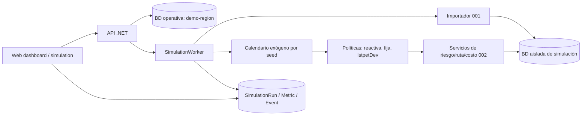

# 005 — Panel web y simulador comparativo de 90 días con KPIs: plan de implementación

> **For agentic workers:** REQUIRED SUB-SKILL: Use superpowers:subagent-driven-development (recommended) or superpowers:executing-plans to implement this plan task-by-task. Steps use checkbox (`- [ ]`) syntax for tracking. El equipo redacta `task.md` y `test-e2e.md` a partir de este plan; no están incluidos en este PR documental.

**Goal:** Sustituir el panel de maqueta por el recorrido operativo real y comparar 90 días de la política IstpetDev con dos baselines congelados, con resultados y exportación reproducibles.

**Architecture:** La web Angular/FSD consume los contratos de 001–004. Un trabajo asíncrono en la API .NET coordina calendarios exógenos y tres políticas; cada política reutiliza el motor determinista, la distancia y el costo de 002 contra una base PostgreSQL de simulación aislada que recibe los archivos por el importador de 001. `SimulationRun`/`SimulationMetric` y un ledger de eventos guardan progreso y resultados en la base principal, sin tocar `demo-region`.

**Tech Stack:** .NET 8 (SDK 8.0.424 de `global.json`), EF Core/Npgsql 8.0.11 (proyectos actuales), Angular 22.2.1 y Leaflet 1.9.4 (`apps/web/package.json`), PostgreSQL 16 según [Hechos canónicos](../../boveda/00%20Inicio/Hechos%20canonicos.md). No se solicitan paquetes nuevos; las versiones citadas describen el repositorio, no compatibilidad futura inferida.

**Spec:** [`spec.md`](spec.md)

## Global Constraints

- El estado es `borrador`: Deciders y aprobación del equipo pendientes; `task.md`/`test-e2e.md` son del equipo. Ninguna cifra de impacto se afirma medida antes de la primera corrida exportada.
- G1–G8 y D1–D8 del [README](../README.md); reloj `America/Guayaquil`, mensajes en español, unidades base por SKU, tiempos internos UTC, hashes SHA-256, `numeric(18,3)` para cantidades.
- Una migración de 005 sobre `develop` actualizado tras 001/002, coordinada secuencialmente con las migraciones de 003/004; termina en `migrationBuilder.Sql(DemoGrants.Sql)` y no altera la prueba de núcleo sin Schema95 de 001. El simulador puede avanzar antes de que 003/004 se integren.
- H4, 15-oct 11:00, exige resultados reales de tres seeds y un escenario adverso. H5, 15-oct 14:00, congela funcionalidad. Sin simulador no se inventan cifras ni hay plan B honesto.
- La corrida completa tiene 3 seeds base × 3 políticas × 90 días + 1 seed adversa × 3 políticas × 90 días = **1080 jornadas de política**. Cada jornada puede planificar hasta una vez por región. Con 6 regiones de ≤15 puntos son hasta 6480 oportunidades; a 1 s/call (límite de 002 para 15 puntos) serían 108 min solo en planificación. Objetivo medido total ≤60 min con matriz local y resultados persistidos antes de H4.
- La web reutiliza auth PKCE/interceptor de 004 (FR-17/T1b); ruta de ensayo usa `advance` de 004. No llama el endpoint provisional de 002 de completar parada.
- Cada corrida usa 100 % tramos viales precargados o 100 % aproximación declarada. No se oculta un tramo faltante ni se mezclan fuentes.

## Review Focus

1. Calendario exógeno revelado demasiado pronto o consumo de RNG por una política → el equipo debe probar igualdad byte a byte del calendario por seed y ausencia de acceso a días futuros en la tarea de calendario.
2. Simulación modifica stock o entregas de `demo-region` → prueba con snapshot/hash antes y después, incluso con cancelación y error, en la tarea de aislamiento.
3. Denominador cero o unidades incompatibles producen porcentajes plausibles falsos → pruebas de cálculo por SKU, N/A y nuevos quiebres en la tarea de métricas.
4. El peor caso del planificador excede H4 → benchmark de 1080 jornadas × regiones y perfil por etapa; optimización medida en la tarea de rendimiento, antes de pulir UI.
5. Widget antiguo muestra ahorros/rutas falsas cuando la API está vacía o sin conexión → prueba de componentes/inspección de literales y estado vacío en la tarea del panel.

---

## Arquitectura

El worker reclama un `comparisonId` pendiente en la BD principal y escribe avance por unidad seed/escenario/política. Una sola comparación activa por instancia evita que las corridas contiendan con la demo. Si la API reinicia, marca `Interrupted` la unidad en curso y permite reencolarla desde el inicio con el mismo manifiesto; nunca combina métricas parciales de intentos distintos. La respuesta HTTP `202` no espera las 1080 jornadas ni sus planificaciones regionales.

**Aislamiento:** configurar `ConnectionStrings:Simulation` a una base distinta de la operativa y ejecutar allí las mismas migraciones necesarias de 001/002/005. Antes de cada política se recrea el estado inicial en esa base **mediante el importador de 001**; la demanda futura permanece en calendario/ledger, no como `Consumption` visible desde el día 0. El modo de simulación inyecta reloj y repositorios de esa conexión en los servicios de 002. En despliegue, comprobar que la cadena no apunta a la misma base; si coincide, `POST /simulations/comparisons` responde error y no inicia. Datos de corrida completada y exportación quedan en la BD principal hasta limpieza explícita de demo.

**Ciclo horario propuesto:** comienzo de jornada 06:00 local: revelar observaciones conocidas y avisos; 06:05 calcular riesgo/pedido; salida y entregas en ETA factible según rutas; cada solicitud de consumo tiene hora exógena; faltante se registra en esa hora si el stock local no basta. Conciliar al final del día. Los incidentes tienen hora de ocurrencia y de conocimiento; las políticas reaccionan solo tras conocerlos. Las tres comparten la misma secuencia de eventos ajenos a sus decisiones. Una obligación común no cambia de fecha límite por política.

**Escala nacional:** el generador declara grupos regionales, cada uno con una bodega y flota local, y distribuye los ≈80 puntos entre ellos. El worker llama al planificador de 002 por región/día, agrega km/costo/servicio al total nacional y no dibuja una ruta única que atraviesa el país en una jornada. La región y vehículo que pierde disponibilidad en el escenario adverso se fijan en el manifiesto antes de correr.

## Estructura de archivos

Rutas objetivo, sujetas al árbol implementado por 001–004; si su PR materializa otro nombre, adaptar la ruta manteniendo responsable y contrato, y registrarlo en `task.md`.

| Acción | Ruta | Responsabilidad |
|---|---|---|
| Crear | `src/Application/Simulation/ScenarioGenerator.cs` | Generar archivos canónicos deterministas y manifiesto; parámetros del escenario fuera del código de producto. |
| Crear | `src/Application/Simulation/ExogenousCalendar.cs` | Calendario común por seed, revelación por hora, hash y semántica de incidente/demanda. |
| Crear | `src/Application/Simulation/PolicyRunner.cs` | Interfaz de política, estado y ciclo diario; misma matriz, stock, flota y costo. |
| Crear | `src/Application/Simulation/ReactivePolicy.cs` | `reactive-v1`: aviso por cobertura de lead time y reposición hasta 14 días. |
| Crear | `src/Application/Simulation/FixedCalendarPolicy.cs` | `fixed7-v1`: fecha y cantidad histórica fijas por punto/SKU. |
| Crear | `src/Application/Simulation/IstpetDevPolicy.cs` | Adaptador a riesgo, cantidad, planificador y costo de 002; sin HTTP ni agente. |
| Crear | `src/Application/Simulation/MetricCalculator.cs` | Fórmulas de la bóveda, numerador/denominador, N/A y agregación de rango/mediana. |
| Crear | `src/Application/Simulation/ExportBuilder.cs` | ZIP reproducible con manifest, calendario, métricas, resumen y eventos; hashes de datos en manifest y hash del manifest en ETag. |
| Crear | `src/Infrastructure/Simulation/SimulationWorker.cs` | Claim, progreso, interrupción/reintento y conexión aislada. |
| Crear | `src/Api/Controllers/SimulationsController.cs` | Los cuatro endpoints `comparisons` del spec y permisos. |
| Modificar | `src/Infrastructure/Persistence/ApplicationDbContext.cs` y `src/Infrastructure/Persistence/Migrations/` | Una migración 005 para metadatos de `SimulationRun` y `SimulationEvent`, grants al final. |
| Crear | `data/fixtures/simulation-national/` | Parámetros versionados, CSV canónicos, procedencia de matriz y seeds de ensayo; generado, sin resultados precargados de ahorro. |
| Crear | `apps/web/src/pages/simulation/simulation.page.ts` | Comparador, estados, rango, detalle, exportación y etiqueta «simulado». |
| Modificar | `apps/web/src/pages/operations-dashboard/operations-dashboard.page.ts` | Riesgos, tarjetas de decisiones/entregas desde API, disparo de `watch`/incidente y control de `advance`; quitar hechos fijos. |
| Modificar | `apps/web/src/widgets/route-map/route-map.widget.ts` | Dibujar `legs` reales y retirar defaultPoints, deliveryStops, km, porcentajes, telemetría y narración fijos. |
| Modificar | `apps/web/src/shared/ui/map-view/map-view.component.ts` | Leyenda dinámica vial/aproximado, geometría, `fitBounds` sin centro fijo, iconos locales y fallback de lista sin mosaicos. |
| Crear | `apps/web/src/entities/simulation/` y `apps/web/src/shared/api/simulations.api.ts` | DTOs de comparación y cliente HTTP; APIs públicas FSD. |
| Modificar | `apps/web/src/app/app.routes.ts` | Ruta `/simulation` protegida por guard de 004; dashboard usa el mismo guard. |
| Modificar | `libs/shared-core/src/` | Tipos HTTP compartidos solo cuando web/móvil realmente los comparten. |
| Modificar | `docs/specs/002-motor-logistico/{spec,plan}.md` y `docs/specs/004-campo-qr-custodia-offline/{spec,plan}.md` | Contratos de listas que sus equipos implementan: rutas antes de H4, entregas antes de H4. |

## Decisiones técnicas

| Decisión | Alternativas consideradas | Motivo |
|---|---|---|
| Trabajo asíncrono en API con progreso en `SimulationRun` | HTTP síncrono; proceso separado | Evita timeout y otro despliegue; seleccionado por el usuario en brainstorming. |
| Base de simulación separada, mismo importador y motor | Esquema compartido con filtros; mutar `demo-region` y restaurar | Fallos/cancelación no alteran la demo; comprueba G2 con una entrada única. |
| Calendario exógeno antes de políticas y RNG independiente por seed | Muestrear al ejecutar cada política | Evita que decisiones cambien la demanda aleatoria. |
| Baselines `reactive-v1` y `fixed7-v1` con reglas del spec | Baseline ajustable tras ver resultados | Hace reproducible y defendible la comparación. |
| Consulta cada 5 s, pausada cuando está oculta | SignalR simple; actualización manual | Menos superficie para H4 y coherencia con PWA de 004; indicador de frescura. |
| Cuatro tarjetas: quiebres evitados/nuevos, demanda no atendida, costo, puntualidad | Km como titular; trazabilidad como titular | Jerarquía elegida por usuario para jurado no técnico; km y trazabilidad en detalle. |
| `GET /route-plans` en 002 y `GET /deliveries` en 004 | IDs fijos en cliente; agregador duplicado en 005 | Los dueños de datos publican contratos de lectura estables. |
| Geometría de API, línea punteada para aproximación | Reconstruir carreteras en cliente | Fuente y precisión quedan visibles. |

## Dependencias nuevas

Ningún paquete nuevo. Confirmar al implementar las versiones exactas del lockfile, SDK, NuGet y compatibilidad antes de cambiar dependencias; este PR documental solo reutiliza paquetes declarados en el repositorio. La red nacional necesita una matriz homogénea de procedencia permitida; si no existe, el equipo ejecuta un escenario completo de aproximación etiquetado, sin mezclarlo con vial ni llamarlo carretera.

## Prerrequisitos de entorno

1. `dotnet --version` y `dotnet restore` en el repositorio; comparar SDK con `global.json`.
2. `npm ci` y `npm --workspace apps/web run lint` usando el lockfile del repositorio.
3. PostgreSQL 16 de ensayo con dos bases o dos conexiones distintas: operativa y simulación; comprobar nombres de base diferentes antes del primer POST.
4. Para el simulador: 001 integrado en `develop` (H2) y 002 disponible con `road_segments`/planificador. Para el panel: 002 con lista de rutas, 004 con PKCE/`advance`/lista de entregas y 003 con consulta de runs para la traza. Si un PR aún no está integrado, usar contrato aprobado y un stub de lectura solo en pruebas, nunca en la demo.
5. Matriz vial o aproximación homogénea, sin llamadas de red durante benchmark ni pitch. El equipo debe revisar la licencia/procedencia de la matriz antes de incluirla en `data/fixtures`.

## Estrategia de pruebas

| Nivel | Casos que fijan el diseño | Comando objetivo una vez implementado |
|---|---|---|
| Unidad | Baselines en límites de aviso/día 7, RNG/calendario, orden horario, costo sin doble personal, quiebres evitados/nuevos, N/A y mediana/rango | `dotnet test --filter FullyQualifiedName~Simulation` |
| Integración | Generador → importador 001 en base aislada, matriz homogénea, worker/reinicio, permisos, migración/grants, igualdad de stock operativo antes/después | `dotnet test --filter FullyQualifiedName~SimulationIntegration` |
| Rendimiento | 1080 jornadas × regiones con matriz local; registrar número de llamadas, p50/p95 por llamada y total; si >60 min, perfilar planificación/copia de base/IO y resolver antes de H4 | Script `scripts/simulation/benchmark.sh` que deberá crear el equipo en `task.md` |
| Web | API vacía/401/error, actualización cada 5 s, estados de decisiones, leyenda sólida/punteada, 1280/390 px y ausencia de literales del escenario | `npm --workspace apps/web run lint` y prueba web que defina el equipo |
| E2E | Reset `demo-region` → riesgo/ruta → `advance` → incidente → columnas/aprobación → corrida/importación/exportación → repetición de métricas | Lo redacta el equipo en `test-e2e.md`; conservar exportación e IDs como evidencia |

La aceptación de impacto requiere comparar un resultado repetido, no solo comprobar que un archivo se descargó. Una segunda seed debe cambiar el calendario; la misma seed/versión debe mantener métricas y eventos. Los cuatro KPI de portada incluyen numerador/denominador en el detalle y N/A cuando procede.

## Orden y paralelización

| Fase | Entrega revisable | Dependencia / fecha |
|---|---|---|
| 1 | Esquema/importador 001, contrato del planificador 002 y entorno de simulación aislado; en paralelo, contratos de listas en 002/004 y auth 004 | 001 H2; auth/`advance` 004 H3; el simulador no espera 003/004 |
| 2 | Calendario exógeno, generador canónico, baselines congelados y cálculo de métricas en fixture de 6 puntos/2 SKU | Iniciar tan pronto esté 001; no esperar al panel ni al LLM |
| 3 | Adaptador de 002, worker, persistencia/exportación y benchmark de 1080 jornadas por regiones | Requiere 002; resultados aceptados antes de H4 |
| 4 | Panel en vivo y vista de comparación | Lecturas 002/004 y API 005; se pueden construir en paralelo con fase 2 usando contratos reales |
| 5 | Ensayo sin wifi, comparación de hashes, presentación y registro de evidencia | H4 15-oct 11:00; congelamiento H5 14:00 |

**Prioridad si hay retraso:** corregir el simulador y obtener exportaciones válidas antes de niveles adicionales del agente. El mapa puede pasar a lista de paradas según D8; el simulador no tiene sustituto honesto. La UI puede mostrar una corrida ya **calculada y verificable** durante el pitch, con fecha/seed/versiones, sin afirmar que se acaba de ejecutar.

## Reversión

Revertir el PR de implementación del 005 retira endpoints/pantallas/worker, pero no borra resultados ni la migración aplicada sin revisar datos. Detener el worker, conservar ZIP y `SimulationRun`, y crear una migración correctiva si la estructura falla; no usar `Down` destructivo en la base de ensayo compartida. Las lecturas de 002/004 son aditivas y pueden permanecer. La operación `demo-region` sigue en la conexión principal.

## Descomposición para el `task.md` del equipo

El equipo debe convertir cada fase en pasos pequeños TDD, con nombres de pruebas, código/firmas y comandos exactos, sin dejar huecos: (1) contratos de lectura; (2) base aislada e importador; (3) calendario; (4) baselines; (5) adaptador 002; (6) ledger/métricas; (7) worker/endpoints/export; (8) benchmark; (9) dashboard y mapa; (10) simulación web; (11) E2E y evidencia. Cada tarea que cambie esquema espera a la migración anterior integrada en `develop`; no generar dos migraciones para 005.
