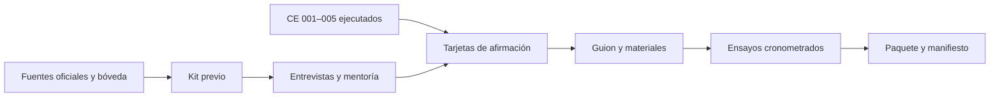

# 006 — Validación, pitch y paquete de entrega: plan documental y operativo

**Goal:** Llegar al turno del 17-oct con relato verificable, validación consentida, cinco integrantes visibles y siete entregables listos.

**Enfoque:** Un guion maestro de 5 minutos genera cortes de 3 y 7; un manifiesto separa lo funcional, grabado, simulado y propuesto. Cada escena pasa por una tarjeta de afirmación antes de entrar en la presentación. [Spec](spec.md) · [Tareas](task.md) · [Ensayos](test-e2e.md).

**Herramientas:** bóveda Markdown, presentación editable y PDF local. Antes de crear diapositivas, usar el flujo Artifacts/Slides disponible entonces; en esta sesión no apareció una sesión de PowerPoint conectada y no se crea archivo de slides. Confirmar O-06 antes de elegir formato editable o subir materiales.

## Restricciones globales

- El manual oficial ordena: problema, solución, demo, impacto, viabilidad, negocio, próximo paso. La ventana de entrega es 17-oct 16:00–16:15; pitch desde 16:15.
- Cifras operativas y de impacto solo con ejecución enlazada (commit, fixture, seed, hashes, run, fecha). Los huecos no verificados usan `[PENDIENTE: …]` y se eliminan del discurso.
- El guion de 3, 5 o 7 minutos se activa según O-04; objetivo interno 160, 280 o 400 segundos respectivamente. Si el tiempo oficial es otro, ajustar objetivo a duración oficial −20 s.
- Los cinco papeles están definidos sin nombres hasta que el equipo los confirme. Dos hacen entrevistas; tres siguen integrando. Ningún entrevistado de JIMCORPSERVI/FEDELIMP o LACIF.
- Se etiquetan fixture sintético y simulación; un video se anuncia como grabado. Sin testimonio, precio, costos o penalidad inventados.
- El 15-oct tras un ensayo funcional se graba video. El 17-oct 15:45 se congelan materiales; cualquier cambio posterior requiere registrar motivo, nueva versión y repetir ensayo afectado.

## Foco de revisión

1. QR escaneable solo con wifi del recinto → Task 4 y E2E-04/E2E-06.
2. Número de simulación sin ZIP importado o con hash distinto → Task 3 y E2E-05.
3. Tres minutos convertidos en 180 s por error → Task 2 y E2E-03.
4. Cita de feria sin consentimiento separado → Task 1 y E2E-02.
5. Material posterior a 15:45 distinto del ensayado → Task 6 y E2E-07.

## Flujo de preparación y uso

El kit previo queda revisable en [Guion del pitch](../../boveda/07%20Demo/Guion%20del%20pitch.md), [Registro de mentorias](../../boveda/06%20Equipo/Registro%20de%20mentorias.md) y [Modelo de negocio y piloto](../../boveda/02%20Producto/Modelo%20de%20negocio%20y%20piloto.md). Las ejecuciones futuras van a `99 Fuentes/Evidencias/` según la plantilla; el índice de validación de la bóveda apunta a ellas. Los archivos de slides se elaboran al confirmar O-04/O-06 y revisar el flujo Artifacts/Slides, con copia editable y PDF de la misma versión.

## Reloj del guion (propuesta, segundos desde inicio)

Los tiempos de cierre incluyen margen de 20 s respecto a cada duración nominal. El bloque de demo contiene movimientos y plan B. El orden del Anexo 5.7 se conserva aun si se pierde una escena.

| Bloque | 3 min (160 s) | 5 min (280 s) | 7 min (400 s) | Dueño visible |
|---|---|---|---|---|
| Problema | 0–18 | 0–30 | 0–45 | Narración |
| Solución | 18–38 | 30–65 | 45–95 | Narración + web |
| Demo | 38–112 | 65–210 | 95–300 | Web + móvil; técnica explica incidente |
| Impacto | 112–130 | 210–235 | 300–335 | Web + narración |
| Viabilidad | 130–142 | 235–250 | 335–360 | Técnica |
| Modelo de negocio | 142–152 | 250–267 | 360–382 | Negocio |
| Próximo paso | 152–160 | 267–280 | 382–400 | Negocio + cierre de narración |

**Cinco minutos, hitos de demo propuestos:** 01:05 riesgo y causa → 01:35 ruta y aprobación humana → 02:05 cierre de vía con revisión pendiente/automática solo si CE de 002/003 lo prueban → 02:30 preparación/despacho y captura móvil → 03:10 invitación a escanear QR → 03:30 impacto. La secuencia del QR queda sujeta a confirmación del equipo. En 3 min se usa una sola acción por sistema; en 7 min se añade explicación de supuestos y objeción de feria, sin otra historia.

## Plan B en escena

| Momento | Condición de activación | Línea y acción ensayadas |
|---|---|---|
| Riesgo/agente | 003 sin E2E o timeout | «El riesgo lo calcula la regla verificable; aquí la decisión manual y sus datos». Mostrar 002, no atribuir acción a IA. |
| Ruta/incidente | 002/003 sin resultado final | Mostrar ruta determinista o lista de paradas; omitir «replanifica sola». Si tampoco existe, pasar a caja sin fingir incidente. |
| Offline móvil | 004 CE-02 sin ejecución en teléfono | Mostrar recepción en línea si CE la respalda; video solo si grabó ese recorrido y anunciar que es grabado. |
| QR del jurado | 004 CE-07 o HTTPS no pasa en teléfono externo | Escanear con teléfono del equipo si está probado; de otro modo mostrar URL/estado en pantalla como material grabado/pendiente. No pedir escaneo inútil. |
| Simulación | 005 CE-04/06/09 o FR-21 sin ZIP verificado | Retirar cifras/rango; explicar diseño comparativo como propuesta. No declarar ahorro. |
| Nube/conectividad | demo externa no disponible | Stack local/hotspot probado o video del 15-oct, indicando que se ve una grabación. |
| Testimonio/precio | sin consentimiento o validación | Quitar cita/importe; decir «hipótesis por validar en el piloto». |

Una caída no detiene el cronómetro: cada operador pasa al siguiente hito dentro de su bloque. Los fallos se registran y rompen la racha de diez ensayos.

## Ficha de piloto propuesta

| Semana | Actividad | Evidencia de salida |
|---|---|---|
| 1 | Acordar una bodega, puntos, SKUs, consentimiento de datos, costo del proceso actual y baseline sin cambiar operación | alcance, datos/frescura, rutas y gastos observados |
| 2 | Recomendaciones en paralelo con aprobación humana | decisiones aceptadas/rechazadas y motivos |
| 3 | Operar grupo pequeño con caja/QR y registro diario de incidencias | entregas, custodia, conexión y esfuerzo de usuarios |
| 4 | Comparar contra baseline y decidir continuidad | cuatro KPI con denominadores, costos medidos, riesgos y decisión |

**Criterio de avance:** la contraparte acuerda umbrales de quiebres, demanda no atendida, costo de transporte y puntualidad antes de iniciar; se registran datos faltantes y carga de trabajo. No se propone precio numérico sin costo real de soporte y disposición de pago. La simulación de 005 ayuda a plantear hipótesis, no prueba ROI comercial.

## Orden de trabajo

1. Kit y auditoría de afirmaciones en paralelo con ejecución de 001–005. La revisión de 15 min la hacen integrantes identificados en el registro.
2. En 16-oct pausas, entrevistas. Tras la ficha final, actualizar guion y registrar diferencias frente a `pre-evento`.
3. El 17-oct 11:00–12:30, prototipo con expositores y corrida final verificada en máquina dedicada; enlazar evidencia.
4. Antes de 15:00, cerrar o retirar todos los huecos del discurso. Entre 15:00 y 15:45, terminar racha de ensayos y congelar. La planificación inicial de tres ensayos antes del evento, uno de día 1, dos de noche, tres de día 2 y dos finales suma once oportunidades; solo cuentan diez **consecutivas completas sin fallo**. Si no alcanza el tiempo, reportar CE-04 pendiente y priorizar ensayo del corte oficial.

### Bloque de ensayos del 15-oct (revisión del 12-oct)

La meta de diez ensayos completos consecutivos no es alcanzable con once oportunidades repartidas en tres días: dos fallos la vuelven imposible. Tras el congelamiento de funcionalidades (15-oct 14:00) y la grabación del video, el 15-oct de 15:00 a 20:00 es el **bloque principal de ensayos**: con unos 12 minutos por ensayo del corte de 5 min (incluido el reset de la demo con `POST /demo/reset` y `advance`), caben hasta 25 intentos. Meta: completar allí la racha de diez, los dos últimos sin la wifi del lugar de ensayo. En el evento, los ensayos del 16 y 17 confirman la racha con los cambios de la ficha final; si un cambio del evento toca una escena, se repite al menos un ensayo completo de esa versión antes de congelar materiales a las 15:45.

## Revisión, entrega y reversión

Cada cambio de guion actualiza tarjeta, slides y PDF desde la misma revisión. Dos integrantes revisan números y enlaces. En el paquete, el índice identifica un único archivo «entregar» y sus hashes; se prueba apertura sin red. Si una afirmación pierde soporte o falla en ensayo, se vuelve a la última versión ensayada, se retira la frase y se vuelve a exportar, con registro de la excepción al congelamiento.
