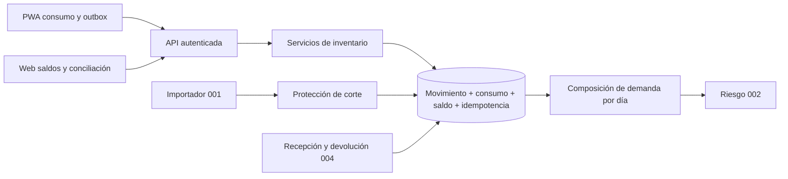

# 007 — Inventario cotidiano y conciliación: plan de implementación

> **For agentic workers:** ejecutar las tareas de [task.md](task.md) en orden, con prueba roja, implementación y prueba verde. La ejecución puede seguir `superpowers:executing-plans` si está disponible; este documento no exige delegación. Todos los pasos empiezan pendientes.

**Goal:** Capturar consumo por lote, conciliar movimientos y alimentar el riesgo con datos operativos sin duplicar historia; añadir después entradas, faltantes y resolución humana de diferencias.

**Architecture:** Extender el núcleo existente de inventario en Domain/Application/Infrastructure/Api. PostgreSQL conserva operación, movimiento, saldo e idempotencia en una transacción. La PWA registra hechos físicos y mantiene una cola durable por identidad; Web consulta y supervisa. El cálculo de demanda agrega días completos y mantiene procedencia.

**Tech Stack:** .NET 8 (SDK del `global.json`), EF Core/Npgsql existentes, PostgreSQL 16/PostGIS, xUnit/Testcontainers, Angular 22, Ionic 8, TypeScript y `idb` existentes. npm y Tailwind 3.4.19; 007 no depende de migrar a pnpm.

**Spec:** [spec.md](spec.md). **Ejecución:** [task.md](task.md). **Aceptación:** [test-e2e.md](test-e2e.md).

## Estado y alcance de la planificación

Documentos preparados el 13-oct-2026; ninguna prueba de 007 fue ejecutada al escribirlos. Las decisiones del piloto siguen propuestas y el spec sigue `borrador`. T0 registra qué contraparte acepta las reglas; mientras tanto se pueden desarrollar/pruebar componentes sobre datos sintéticos sin declarar piloto aprobado.

- **MVP:** T0–T9 y sus escenarios obligatorios: consumo, reversión, consulta, riesgo, cierre diario, protección de importaciones y captura offline.
- **Ampliación:** T10–T11, entradas/faltantes/reposición y conciliación de diferencias/merma. T12 cierra el alcance realmente ejecutado; no marcar todo 007 cerrado cuando solo pasó el MVP.
- La integración física exige backend real de 004. Su `task.md` todavía declara endpoints C# pendientes; el mock PWA no acredita recepción ni saldos PostgreSQL. T8/E2E-08 quedan pendientes de esa dependencia si no se integra a tiempo.

## Global Constraints

- Una organización de piloto provisionada con el contexto existente; no introducir multiempresa administrable, RLS o cambios a Schema95. El código actual resuelve `DemoOrganization.Id`: T0 identifica expresamente la organización y desactiva reset/demo al operar datos reales. No tratar ese ID como aislamiento multiempresa.
- Identidad y rol provienen de `AccountRoleClaimsTransformation`; validar `Account.IsActive`, organización y asignación en servidor, también al repetir una clave. Nunca autorizar con roles del payload o con los nombres del mock móvil.
- Registrar cantidades `numeric(18,3)` positivas, unidad base del SKU y lote explícito; rechazar más de tres decimales en entrada en vez de redondear un consumo sin avisar. En HTTP usar cadenas decimales invariantes para 007; no cambiar los contratos numéricos antiguos de 004.
- UTC para aceptación; día de negocio en `Organization.TimeZone`. Usar el reloj operativo de 002 para fixtures; configurar modo Real y zona de organización para piloto. No permitir que el máximo de una fecha enviada por un dispositivo adelante el reloj de piloto.
- Operaciones aceptadas inmutables, correcciones compensatorias, no expiración de claves mientras vivan sus movimientos. Consultas paginadas: límite predeterminado 50, máximo 100; movimientos por intervalo máximo 90 días.
- Una transacción corta por escritura; sin HTTP, carga de archivos, cálculo completo de rutas ni importación de archivos dentro del bloqueo. Preservar reserva: `0 <= QuantityReserved <= QuantityOnHand`.
- PWA para Receptor/Bodega; Web FSD para Planificador/Gerencia. Guardado local, aceptación de servidor y dato cerrado son estados diferentes.
- No copiar la base de producción ni resetear integración para preparar pruebas. Migraciones aditivas, historia conservada y ensayos sobre bases descartables.

## Review Focus

1. Una reimportación sobre una ubicación que ya tuvo consumos restablece saldo antiguo → T5, `InventoryImportGuardTests` y E2E-07.
2. Dos dispositivos o una publicación de ruta compiten con una salida física → T3/T8, `InventoryConcurrencyTests`, E2E-02/08.
3. Agregar dos consumos del mismo día duplica el denominador o suma también la historia → T4, `DemandComposerTests`, E2E-03/04.
4. Cuenta B sincroniza una cola creada por cuenta A, o replay ignora revocación → T2/T9, `InventoryAuthorizationTests`, E2E-06/09.
5. Corregir una cantidad edita una clave ya enviada o borra el consumo original → T3/T9, `ConsumptionReversalTests`, E2E-05/09.

## Línea base inspeccionada

| Pieza | Estado al redactar | Trabajo necesario |
|---|---|---|
| `InventoryEntities.cs` | Saldo, movimiento y consumo histórico sin vínculo operativo/lote en `Consumption` | Extender conservando nombres canónicos. |
| `LeanSchema.cs` | `Consumption` único por punto/producto/día; `Version` ya es token de concurrencia; saldo solo comprueba no negativos | Índice parcial para historia, índices de operación/reversión y check de reservas. |
| `CanonicalWriter.cs` / `ImportContext.cs` | Importa consumo por clave diaria y reemplaza saldo objetivo | Filtrar consumos importados; proteger cortes con operaciones posteriores. |
| `RiskCalculator.cs` | Suma cantidad y días de cada fila de consumo | Composición diaria por fuente para no multiplicar días. |
| `IApplicationDbContext.LockOrganizationAsync` | Bloqueo de organización ya usado por importación/reset | Conservar como exclusión común inicial; integrar escritores de reservas/campo. |
| Autenticación | Seis roles reales en español; no tabla de asignación permanente punto–Receptor | Asociación mínima `AccountLocationAssignment` validada en servidor. |
| PWA | `FIELD_API` apunta a mock; outbox actual orientado a recibos, no consumos | Adaptador HTTP de inventario y cola propia del módulo; sesión real obligatoria para E2E. |
| Tests | `PostgisContainer`, `TestDb`, `ApiFactory`, `TestTokens`, `Fixtures` | Reusar infraestructura, añadir casos `Spec=007` y fixture autocontenido. |

`CompleteSchema.cs` y entidades excluidas por `.csproj` son material histórico; el modelo efectivo usa `LeanSchema.Configure`. Inspeccionar el head integrado de 004 antes de generar una migración nueva.

## Arquitectura y archivos



| Acción | Ruta | Responsabilidad |
|---|---|---|
| Modificar | `src/Domain/Entities/InventoryEntities.cs`, `src/Domain/Common/MovementKinds.cs` | Campos de operación/reversión; tipos de movimientos. |
| Crear | `src/Domain/Entities/InventoryControlEntities.cs` | Asignación, día cerrado y corte de saldo del MVP. |
| Modificar | `src/Infrastructure/Persistence/LeanSchema.cs`, `ApplicationDbContext.cs`, `DemoGrants.cs`; `src/Application/Common/Interfaces/IApplicationDbContext.cs` | Mapeo, DbSets, restricciones y permisos de runtime. |
| Crear | `src/Infrastructure/Persistence/Migrations/*_OperationalInventory.cs` | Migración del MVP; timestamp generado por EF, no inventado aquí. |
| Crear | `src/Application/Inventory/InventoryContracts.cs`, `InventoryOptions.cs`, `InventoryAccess.cs`, `InventoryOperationRunner.cs` | Contratos, autorización y ejecución transaccional común. |
| Crear | `src/Application/Inventory/ConsumptionService.cs`, `ConsumptionDayService.cs`, `InventoryQueries.cs`, `DemandComposer.cs`, `InventoryImportGuard.cs` | Consumo, cierre, consultas y composición de demanda. |
| Modificar | `src/Application/DependencyInjection.cs`, `src/Api/Program.cs`, `src/Api/appsettings.json` | DI y `Inventory:PilotEnabled`, desactivado por defecto. |
| Crear | `src/Api/Controllers/InventoryController.cs`, `ConsumptionsController.cs` | Rutas del MVP, errores y límites de petición. |
| Modificar | `src/Application/Imports/MappingProfile.cs`, `ImportContext.cs`, `CanonicalWriter.cs`, `ImportService.cs` | Fecha de corte y exclusión del consumo operativo al importar historia. |
| Modificar | `src/Application/Logistics/RiskCalculator.cs`, `OperationalClock.cs`; `src/Api/Controllers/RisksController.cs` | Demanda/frescura y filtros por autorización en respuesta/facts. |
| Modificar | `src/Application/Logistics/RoutePublisher.cs`, `Replanner.cs`; escritores efectivos de 004; `src/Infrastructure/Demo/DemoResetService.cs` | Una política de concurrencia y protección de datos del piloto. |
| Crear | `libs/shared-core/src/contracts/inventory.contract.ts` | DTO 007 con decimales textuales; exportar por `contracts/index.ts`. |
| Crear | `apps/mobile/src/app/inventory/inventory-api.service.ts`, `inventory-outbox.service.ts`, `pages/consumption/consumption.page.ts`, `pages/inventory/inventory.page.ts` | Consulta, consumo, cierre y sincronización por identidad. |
| Modificar | `apps/mobile/src/app/app.routes.ts`, `app.config.ts`, `home/home.page.ts` y adaptador de sesión de `auth/` | Rutas y API reales sin habilitar roles por datos de demo. |
| Crear | `apps/web/src/entities/inventory/{api/inventory.api.ts,model/inventory.model.ts,index.ts}`, `apps/web/src/pages/inventory/{inventory.page.ts,index.ts}` | Consulta, filtros y conciliación con imports descendentes FSD. |
| Modificar | `apps/web/src/app/app.routes.ts`, `apps/web/src/pages/index.ts` | Registrar página Web y API pública del slice. |
| Crear | `tests/IstpetDev.Tests/Support/InventoryScenario.cs`; carpetas `Unit/Inventory/`, `Integration/Inventory/`; `E2E/InventoryJourneyTests.cs` | Soporte y tests descritos en tareas. |
| Crear | `data/fixtures/spec007/` | Datos sintéticos, perfil y manifiesto numérico del piloto de prueba. |
| Crear en ampliación | `src/Domain/Entities/InventoryExtensionEntities.cs`; `src/Application/Inventory/{WarehouseEntryService.cs,DemandObservationService.cs,ReplenishmentRequestService.cs,InventoryCaseService.cs}` | Entradas, demanda no atendida, solicitudes y resolución de diferencias. |
| Crear en ampliación | `src/Api/Controllers/InventoryExceptionsController.cs`; `apps/mobile/src/app/inventory/pages/warehouse-entry/warehouse-entry.page.ts`; `apps/web/src/pages/inventory-cases/{inventory-cases.page.ts,index.ts}` | Captura física, solicitudes y resolución humana. |

## Modelo del MVP

| Entidad | Campos o restricciones nuevas |
|---|---|
| `Consumption` | `OperationId?`, `ActorAccountId?`, `LocationId?`, `LotId?`, `ReversesConsumptionId?`, `OccurredAtDeviceUtc?`; `SourceKind` = `import`, `operation`, `reversal`. Operaciones físicas con `PeriodDays=1` y cantidad positiva; importación conserva cero y períodos. |
| `InventoryMovement` | `ConsumptionId?`, `ReversesMovementId?`, `RecordedSequence` por organización y `OccurredAtDeviceUtc?`. `OccurredAtUtc` es aceptación de servidor para nuevas operaciones; no reescribir fechas históricas. `Kind` nuevos `Consumption`, `ConsumptionReversal`. |
| `StockBalance` | Check `QuantityReserved <= QuantityOnHand`; el disponible utilizable excluye bloqueados/vencidos. No cambiar `QuantityReserved` al registrar consumo. |
| `AccountLocationAssignment` | Organización, cuenta, ubicación, `IsActive`; único cuenta/ubicación. Receptor solo ubicaciones de punto; Bodega solo almacén. Provisionar administrativamente y probar revocación; no construir un editor RBAC. |
| `ConsumptionDay` | Punto/SKU/fecha únicos, `ClosedAtUtc?`, `ClosedByAccountId?`, `Version`. Los movimientos aceptados del día invalidan cierre; el historial de cierres se guarda como respuestas idempotentes con `ActionCode=inventory.day-close`. |
| `InventoryStockCut` | Ubicación/lote, `QuantityOnHand`, `ThroughSequence`, `ObservedAtUtc?`, `RecordedAtUtc`, `ImportBatchId?`, origen `migration`/`import`. Inmutable; corte explícito para conciliación. El corte de migración no inventa una fecha de observación física. |
| `IdempotencyRecord` | Reusar clave única organización/cuenta/operación. `ActionCode` y hash canónico incluyen método/ruta/cuerpo normalizados. Respuesta original guarda IDs, cantidades y versión. |

Índice histórico único `(OrganizationId,ServicePointId,ProductId,OccurredOn)` **solo** `SourceKind='import'`; operaciones únicas por `(OrganizationId,ActorAccountId,OperationId)` con ID no nulo; reversión única por `(OrganizationId,ReversesConsumptionId)` cuando no nulo. Todas las referencias nuevas llevan FK de organización. El campo secuencia del movimiento tiene índice único `(OrganizationId,RecordedSequence)`; asignar bajo el bloqueo común, no por reloj de dispositivo. Índices de lectura por organización/ubicación/lote/secuencia y consumo por punto/SKU/día.

Migración: validar saldos y reservas, abortar ante incoherencias sin ajustar cantidades; numerar movimientos anteriores con orden estable `(OccurredAtUtc,Id)` sin pretender reconstruir su orden real de commit. Crear un corte inicial por saldo actual al último número migrado, guardar informe de diferencias previas y mantener historial anterior visible. El saldo de corte más movimientos posteriores debe reconciliarse exactamente; ningún movimiento pre-corte se vuelve a sumar. La migración y el corte se realizan con escrituras suspendidas, conservando la cadena anterior.

Mantener inmutables los nuevos movimientos y consumos operativos: no exponer UPDATE/DELETE; restringirlos con permisos/trigger de filas operativas, sin bloquear las actualizaciones históricas que necesita 001. `DemoGrants` concede las tablas nuevas y secuencias necesarias. Probar también con rol runtime, no solo con migrador. En piloto, `Demo:Enabled=false`; un guard adicional rechaza reset si existe operación de piloto. La limpieza de datos sintéticos se hace en bases descartables, no dando permisos de borrado al cliente.

## Transacción, autorización e idempotencia

`InventoryOperationRunner` es dueño de la transacción de API 007 y recibe callbacks sin transacciones anidadas. Secuencia obligatoria:

1. Leer cuenta actual/rol y validar forma de petición; dentro de la transacción tomar `LockOrganizationAsync` antes de leer saldo mutable. El piloto es pequeño: reusar este bloqueo es más simple que coordinar estrategias distintas entre importación y campo.
2. Revalidar asignación activa y organización de todas las referencias. Buscar la clave de idempotencia; misma huella devuelve respuesta anterior **después** de autorizar; huella distinta da 409. No guardar tokens en hash ni logs.
3. Leer saldo fresco y comprobar `expectedBalanceVersion`, lote y disponible. Adquirir bloqueos adicionales siempre en orden organización → agregado/ubicación/lote → filas de saldo, igual en reserva, recepción y devolución.
4. Escribir consumo/movimiento/saldo, abrir día afectado y persistir respuesta idempotente en el mismo commit. Número de secuencia se asigna después de adquirir el bloqueo. Error/cancelación antes del commit revierte todo; pérdida de respuesta después del commit se resuelve por replay.
5. Después del commit consultar riesgo o notificar invalidación. Un fallo al recalcular no revierte un consumo ya aceptado ni vuelve a enviarlo. REST devuelve estado durable; no exigir SignalR para el MVP.

`RoutePublisher`/`Replanner` y servicios 004 deben adoptar el mismo protocolo o demostrar una exclusión equivalente con prueba cruzada; el token `Version` existente por sí solo no prueba atomicidad de varios `SaveChanges`. No incluir el costo de planificar rutas dentro de la sección bloqueada; volver a validar reservas antes del commit.

## Contratos HTTP propuestos

Los DTO son nuevos y se publican en `InventoryContracts.cs`/`inventory.contract.ts`. En TypeScript `DecimalString = string` con validación decimal; no calcular saldos monetarios o cantidades del servidor con `parseFloat`. Errores Problem Details contienen `code`, `correlationId`, `retryable` y campos permitidos.

| Método/ruta | Petición o filtros | Respuesta y autorización |
|---|---|---|
| `GET /api/v1/inventory` | `locationId`, `productId`, `lotId`, `cursor`, `limit` | `{items,nextCursor,asOfSequence,serverTimeUtc}`; cada fila `locationId,lotId,productId,unit,onHand,reserved,available,usable,version,observedAtUtc,lastOperationAtUtc`. Planificación ve su organización; Receptor/Bodega solo asignaciones. |
| `GET /api/v1/inventory/movements` | `locationId`, `lotId`, `fromUtc`, `toUtc`, `cursor`, `limit` | Corte base, saldo al inicio del intervalo, movimientos firmados y saldo al cierre; `asOfSequence` fijada en primera página. Cursor incorpora filtros y secuencia. |
| `POST /api/v1/consumptions` | `{operationId,servicePointId,locationId,lotId,quantity,unit,occurredAtDeviceUtc,expectedBalanceVersion}` | 201 `{consumptionId,movementId,operationId,acceptedAtUtc,businessDate,onHand,balanceVersion,sequence}`; Receptor asignado. Replay conserva código/cuerpo original. |
| `POST /api/v1/consumptions/{id}/reversals` | `{operationId,reason,expectedBalanceVersion}` | 201 con nuevo consumo/movimiento compensatorio. Receptor propietario aún asignado; motivo 1–500 caracteres. Segunda reversión con otra clave: 409 `ALREADY_REVERSED`. |
| `GET /api/v1/consumption-days` | `servicePointId,productId,fromDate,toDate` (≤90 días) | Días con neto, estado `Open/Closed`, `version`, hora/actor de cierre autorizados. |
| `POST /api/v1/consumption-days/close` | `{operationId,servicePointId,productId,date,expectedVersion}`; 0 cuando no existe día | 200 `{date,netQuantity,version,closedAtUtc}`; Receptor asignado, solo día ya terminado según reloj de organización. Reintentos con misma clave no cierran una versión nueva. |
| `GET /api/v1/risks` | Mantener contrato 002; añadir datos de calidad y filtro autorizado | Receptor solo sus puntos, Planificación su organización; filtrar también `facts`. La llamada interna del planificador sigue autorizada como servicio. |

400 forma/unidad/decimal inválido; 401 sesión; 403 rol o cuenta no habilitada; 404 referencia inexistente o ajena; 409 `IDEMPOTENCY_CONFLICT`, `STALE_VERSION`, `ALREADY_REVERSED`, `DAY_CHANGED`; 422 `INSUFFICIENT_STOCK`, `LOT_UNUSABLE`, `FUTURE_DATE`, `STOCK_IMPORT_CONFLICT`; 429/503 reintentables. Primero replay autorizado, después versión: repetir una aceptación no falla porque el saldo cambió posteriormente. Error de versión no invita a modificar el payload de una clave aceptada.

Valores de políticas técnicas de partida: `Inventory:PilotEnabled=false`, cuerpo de escritura ≤16 KiB, fecha futura no admitida respecto al reloj de servidor y zona; la ventana máxima de captura pasada se acuerda en T0 y no se inventa silenciosamente. Hasta decidirla, los ensayos usan fechas del fixture, el despliegue piloto no se declara listo.

`Inventory:MaxPastCaptureDays` es un entero positivo obligatorio al habilitar piloto; el host rechaza configuración habilitada sin ese valor. El soporte de tests fija 14 únicamente como dato sintético. `Inventory:PilotEnabled` controla nuevas escrituras 007; desactivarlo no desactiva composición de demanda ni protección de importaciones para operaciones ya existentes. Revalidar bloqueo/vencimiento y pertenencia del lote al aceptar en servidor, no confiar solo en la fecha del dispositivo.

## Demanda, cierre diario y riesgo

Contrato puro `DemandComposer.Compose(DateOnly from, DateOnly toExclusive, IReadOnlyList<HistoricalPeriod> history, IReadOnlyList<OperationalDay> days) -> DemandSummary`. `HistoricalPeriod(Start,PeriodDays,Quantity)` conserva la semántica `[Start,Start+PeriodDays)` de 002. `OperationalDay(Date,NetQuantity,IsClosed)` ya agrupa eventos de todos los lotes del punto/SKU. `DemandSummary(TotalQuantity,ObservedDays,DailyDemand,Assumptions)` usa `decimal?` para demanda.

Para cada día dentro de la ventana: usar día operativo cerrado; en otro caso usar la aportación proporcional de un único período histórico si existe, declarando prorrateo y que cualquier captura operativa abierta es parcial. Sin fuente completa, no incrementar denominador. Día cerrado con cero sí incrementa el denominador; cero observado no es dato ausente y la cobertura continúa no calculable cuando demanda=0. Más de un período histórico que cubra el mismo día es ambiguo: excluir ese día y emitir supuesto, no sumar ni elegir uno arbitrariamente. No mutar la historia al reemplazar su aportación. No redondear cada porción diaria; redondear solo la demanda expuesta a tres decimales.

El neto operativo suma `operation` menos `reversal`; validar que una reversión coincide en punto/SKU/lote/cantidad con su original. Un cierre guarda versión y respuesta durable; cualquier nueva captura o reversión del día lo reabre y hace visible la parcialidad. Receptor comprueba que sincronizó sus capturas antes de cerrar; otro dispositivo puede reabrirlo después, lo cual es un cambio de versión y no una pérdida de historia.

La reversión se imputa al día de negocio del consumo original para componer demanda; su movimiento físico se asienta a la hora actual de aceptación. No restar la reversión del consumo de hoy ni mover retroactivamente el saldo. Si un punto tiene varias ubicaciones, cerrar o consultar el agregado diario exige autorización sobre todas ellas; una asignación parcial no acredita el día completo del punto.

Ejemplo reproducible: historia 84 L/7 días = 12 L/día; un día reemplazado por 4+6 L cerrados produce `(72+10)/7 = 11.714` L/día. Con el mismo día abierto la historia sigue aportando 12 y la UI advierte parcialidad. Dos consumos no convierten un día en dos días. El saldo disminuye al aceptar cada consumo aunque el día siga abierto.

## Importación y conciliación

Añadir `stockObservedAtUtc` opcional a `MappingProfile`; requerido para nuevas importaciones de stock cuando el modo piloto está activo. Guardarlo en perfil/hash/manifiesto y corte. `ImportContext` carga para el diccionario histórico solo `SourceKind=import`, conservando la clave existente; `CanonicalWriter` nunca actualiza una operación física por coincidir día/SKU.

En el MVP, cualquier fila de stock con actividad de piloto en ese par ubicación/lote se rechaza, aunque el saldo enviado sea igual o la fecha aparente reciente. No deducir que un snapshot externo ya incluye las operaciones. El reporte señala fila/código `STOCK_IMPORT_CONFLICT`, incluso en dry-run. Con `allowPartial=true` puede aplicar otras filas válidas, pero ninguna parte del par protegido; comprobar `reserved <= target` también para filas no protegidas. Una corrección de conteo requiere la ampliación, no un bypass de importación.

Ese guard se aplica incluso si `PilotEnabled=false` o si `ImportService` se crea directamente en una prueba existente. La opción no convierte datos operativos en datos de demo. En reset sintético permitido, limpiar primero cortes/asignaciones/días que referencien entidades del fixture y conservar las reglas de historia existentes; después de cualquier operación de piloto el reset se rechaza. No ejecutar limpieza para habilitar un reset prohibido.

Lectura histórica: fijar `asOfSequence` al inicio y tomar corte válido más movimientos hasta esa secuencia. Movimiento hacia ubicación suma, desde ubicación resta. Al paginar, mantener saldo de apertura y filtros; no sumar otra vez el ajuste que creó el corte. Filtrar por hora de aceptación y mostrar fecha del dispositivo por separado. `lastOperationAtUtc` no reemplaza `observedAtUtc`.

Si el intervalo empieza antes del primer corte reconstruible, devolver `HISTORY_BEFORE_BASELINE` (422) con la fecha disponible, sin inventar una apertura cero. Los movimientos anteriores siguen consultables como antecedentes, identificados sin saldo reconstruido.

## UI, sesión y offline

La sesión del piloto obtiene cuenta/rol/asignaciones del servidor; si 004 ya entrega `/api/v1/me`, reutilizarlo. Si no, T2 crea ese endpoint mínimo `{accountId,organizationId,role,locationIds}` sin credenciales. Alias de demo como `HospitalReceiver` no otorgan permisos: mapear presentación desde el rol canónico `Receptor`.

Cola de inventario en `istpetdev-inventory-outbox-v1`, clave compuesta identidad/organización/operación. Reusar `idb` y patrones de 004, no copiar su payload de recibo ni importar UUID desde un módulo mock: `crypto.randomUUID()` para las nuevas claves. Estados `Pending`, `Sending`, `Accepted`, `Conflict`, `SessionRequired`, `Rejected`; persistir antes de anunciar guardado. Sobre cambio de cuenta ocultar la cola ajena y nunca sincronizarla. Sin tokens, firmas o URLs de evidencia en esta cola.

Red/429/503 reintentan misma clave/cuerpo con espera; 401 pausa para sesión, 403/404/409/422 conservan captura y solicitan resolución. Cambiar cantidad o versión tras rechazo genera una nueva operación vinculada localmente, manteniendo la anterior; si no se conoce el resultado por pérdida de respuesta, resolver primero el replay original. El formulario distingue stock del último snapshot de stock confirmado; nunca promete aceptación offline. Cierre/reversión requieren conexión en el MVP. Una PWA que solo abre bajo `ng serve` no satisface la prueba instalada offline.

Sincronizar secuencialmente por ubicación/lote. Dos capturas offline que comparten versión pueden producir aceptación de la primera y `STALE_VERSION` de la segunda: conservar ambas, mostrar el conflicto y permitir reenviar la rechazada con nueva clave tras revisar saldo. No cambiar automáticamente el contenido de una operación cuyo resultado aún es incierto.

Web `/inventory`: saldos, movimientos y filtros por lote; muestra fuente y frescura, correcciones referenciadas y acceso al riesgo. Receptor registra desde PWA, no desde la página Web de Planificador. Consulta pública QR no se amplía con consumos o identidades.

## Ampliación planificada (T10–T11)

Todas las rutas usan autorización e idempotencia del MVP y feature `Inventory:ExtensionsEnabled=false` hasta activación explícita de la entrega. Crear migración `InventoryExceptions` después del MVP; no crear tablas de módulos no usados por anticipado.

| Capacidad/contrato | Reglas y persistencia |
|---|---|
| `POST /api/v1/inventory/warehouse-entries` → 201 | Bodega asignada; `{operationId,locationId,lotId,quantity,unit,externalReference,occurredAtDeviceUtc}`. `WarehouseEntry` vincula movimiento `WarehouseInbound`; clave de negocio única organización/ubicación/referencia/lote. Nueva clave HTTP no duplica el mismo recibo externo. Solo lote ya registrado; conservar alta de lotes canónica de 001/004. |
| `POST /api/v1/demand-observations` → 201 | Receptor asignado; `{operationId,servicePointId,productId,requestedQuantity,consumptionIds,occurredAtDeviceUtc}`. `DemandObservation` enlaza consumos netos de la petición; suma atendida ≤ solicitada; consumo vinculado una sola vez a observación activa. No descuenta stock. Corrección/reversión de un consumo reabre revisión de la observación; no cambia una demanda declarada sin huella. |
| `POST /api/v1/replenishment-requests` → 201 | Receptor para su punto; `{operationId,servicePointId,productId,quantity,unit,neededOn,reason}`. `ReplenishmentRequest` estado `Requested`; solicitud no es reserva ni entrada confirmada para 002. Planificador consulta `GET /api/v1/replenishment-requests`; deduplicar replay, no fusionar automáticamente dos necesidades parecidas. |
| `POST /api/v1/inventory/cases` → 201 | Bodega/Receptor asignado registra diferencia con conteo actual, referencia y `expectedBalanceVersion`; `InventoryCase` estado `Open` y ningún movimiento. Evidencia estructurada `{sourceKind,reference,observedAtUtc,note}`; fotografías opcionales reutilizan contrato privado de 004, sin aceptar URL arbitraria. |
| `POST /api/v1/inventory/cases/{id}/start` → 200 | Planificador/Gerencia, versión esperada, pasa `Open → Investigating`. Guardar `InventoryCaseEvent` con actor y fecha. |
| `POST /api/v1/inventory/cases/{id}/close` → 200 | Planificador/Gerencia, versión del caso **y saldo**, `{operationId,outcome,reason,evidenceReferences,expectedVersion,expectedBalanceVersion}`. `Dismissed` no mueve stock; `ConfirmedLoss` exige diferencia negativa de conteo, evidencia y cantidad disponible; `CorrectedCount` permite diferencia firmada justificada, sin llamarla merma. Caso/movimiento/saldo/cierre idempotente en mismo commit; diferencia cero no genera movimiento. |
| `GET /api/v1/inventory/cases`, `GET /api/v1/inventory/cases/{id}` | Lista paginada por ubicación/estado y detalle con eventos/evidencias autorizadas. Planificador/Gerencia consultan organización; Receptor/Bodega solo ubicaciones asignadas. |
| `GET /api/v1/demand-observations`, `GET /api/v1/replenishment-requests` | Listas paginadas por punto/SKU/estado, con fuente y referencias; Planificador/Gerencia consultan organización, Receptor solo su alcance. Mismos límites de página del MVP. |

Una operación de inventario posterior al conteo invalida la versión de saldo: repetir el conteo/investigación, no aplicar una diferencia obsoleta. Bloqueo/vencimiento de lote existente no desaparece por un ajuste; consultas lo señalan. Administración nueva de bloqueo/reapertura o un detector estadístico automático requiere decisión específica; esta entrega abre casos desde discrepancias constatadas. **RF-15/V-19 sigue parcialmente pendiente mientras no se acuerden regla, mínimo de muestras y evaluación del detector**; no presentar el cierre humano como precisión de detección probada.

Demanda no atendida vigente añade un motivo explícito de atención al riesgo 002 con ID de observación; no altera por sí sola el promedio de consumo ni aumenta stock en tránsito. Una observación cuya operación fue revertida pasa a revisión y deja de acreditar cantidad atendida hasta resolución. No llamar «resuelta» una falta por existir una solicitud de reposición.

## Dependencias y prerrequisitos

No añadir paquetes para backend/MVP; reutilizar xUnit, Testcontainers, Angular e `idb`. Las pruebas móviles se realizan en navegador/teléfono real según E2E; el proyecto actual no declara runner de pruebas Angular/Playwright y no se inventa `npm test`. Automatizar navegador después requiere registrar runner/versión y scripts en una tarea revisada.

```bash
dotnet --version
dotnet tool restore
dotnet ef --version
docker info --format '{{.ServerVersion}}'
node --version
npm --version
git status --short
```

T0 registra salidas y verifica Node compatible con los manifiestos y workflows; no cambiar versión desde 007 por anticipado. Antes de levantar host/ensayo aplicar `docs/boveda/.local-skills/istpetdev-prelaunch/SKILL.md` al alcance local sintético o al entorno real. No cargar secretos o ejecutar despliegues para redactar los documentos.

## Pruebas, orden y cierre

Unitarias: composición diaria, unidades/fechas, reglas de reversión/estado; integración: migración real PostgreSQL, permisos, idempotencia, importador, competencia de escrituras. E2E: HTTP contra `ApiFactory` más backend 004 real y PWA instalada. Todas las clases nuevas llevan `[Trait("Spec", "007")]` y categoría `Unit`, `Integration` o `E2E`; rendimiento se mide aparte cuando se pacte volumen. Cero tests encontrados es fallo de verificación.

Secuencia T0 → T1 → T2 → T3 → T4/T5/T6 → T7 → T8/T9 → MVP. T10 → T11 → T12 amplía y cierra. T4/T5/T6 tienen contratos compartidos: coordinar cambios al contexto, DI y fixture antes de repartir trabajo; no asumir edición paralela segura de los mismos archivos. Este plan no inicia agentes.

T12 conserva resultados en `artifacts/spec007/` y registro en [test-e2e.md](test-e2e.md); no guarda tokens ni datos de empresas. Actualizar cobertura 007, requisitos y notas de continuidad solo con decisiones y evidencia reales.

## Reversión

Desactivar `Inventory:PilotEnabled` detiene rutas de escritura nuevas; las consultas de historial deben seguir disponibles para conciliación. No desplegar binario viejo que desconozca las fuentes operativas de `Consumption`: podría calcular mal demanda o sobrescribir datos. Ante fallo, pausar escrituras y mantener una versión compatible de lectura, corregir hacia adelante o restaurar copia completa en entorno separado con conciliación de operaciones posteriores. Nunca bajar migración ni borrar filas aceptadas para hacer coincidir el modelo antiguo.

## Referencias técnicas verificadas

- [Bloqueos PostgreSQL 16](https://www.postgresql.org/docs/16/explicit-locking.html): alcance transaccional y orden de adquisición.
- [Concurrencia EF Core](https://learn.microsoft.com/en-us/ef/core/saving/concurrency): tratamiento de conflictos con tokens de versión.
- [Transacciones EF Core](https://learn.microsoft.com/en-us/ef/core/saving/transactions): unidad atómica de varios cambios persistidos.
