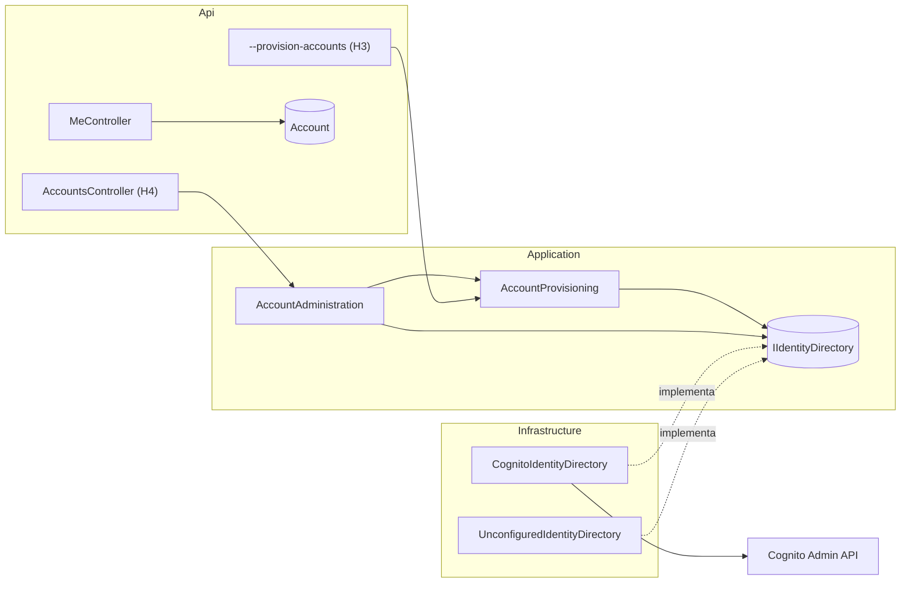
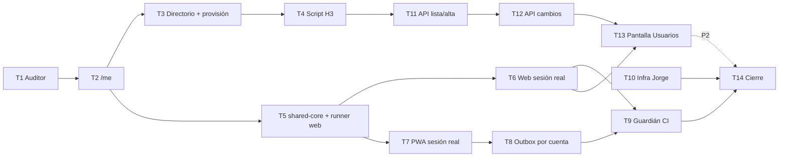

# 013 — Login real y gestión de cuentas por Gerencia: plan de implementación

> **For agentic workers:** REQUIRED SUB-SKILL: Use superpowers:subagent-driven-development (recommended) or superpowers:executing-plans to implement this plan task-by-task. Steps use checkbox (`- [ ]`) syntax for tracking. Las tareas están en [`task.md`](task.md).

**Goal:** Que web y PWA inicien sesión con Cognito (Authorization Code + PKCE), que la API reciba tokens reales y decida acceso por `GET /api/v1/me`, que exista un script para crear las cuentas de demo y, en P2, una pantalla de Gerencia para gestionarlas.

**Architecture:** La API añade el rol `Auditor`, `GET /api/v1/me` y un puerto `IIdentityDirectory` (Application) con un adaptador Cognito (Infrastructure, AWS SDK con la cadena de credenciales del entorno). `AccountProvisioning` crea usuario en Cognito y `Account` en una sola operación serializada; lo usan el comando `--provision-accounts` (H3) y `AccountsController` (H4). Web y PWA usan `angular-auth-oidc-client` 22.0.1 con un almacenamiento propio que deja los tokens solo en memoria; un inicializador llama a `checkAuth()` y a `/me`, y guards e interceptor dependen de ese estado. El outbox de la PWA se filtra por `accountId`.

**Tech Stack:** .NET 8, EF Core/Npgsql 8.0.11, xUnit + Testcontainers PostGIS, `AWSSDK.CognitoIdentityProvider` 4.x, Angular 22.2.1, Ionic 8.8.19, `angular-auth-oidc-client` 22.0.1, `idb` 8.0.4, Vitest 4 con `@angular/build:unit-test`, `fake-indexeddb` 6, Terraform (Cognito, IAM) y AWS CLI para el host de la app.

**Spec:** [`spec.md`](spec.md)

## Global Constraints

- Flujo humano: Authorization Code + PKCE S256 con `angular-auth-oidc-client` **22.0.1**; la página administrada de Cognito es la única que recibe contraseñas (FR-01).
- Scope exacto de web y PWA: `openid email profile istpetdev-api/access` (FR-02). `authority` = `issuer` del output `cognito` de Terraform; `clientId` = `client_ids.web` o `client_ids.mobile`.
- URL de retorno: `<origen>/auth/callback` (web) y `<origen>/campo/auth/callback` (PWA publicada); cierre: `http://localhost:4200`, `http://localhost:8100`, `https://istpetdev.doicela.dev` y `https://istpetdev.doicela.dev/campo/`. Deben coincidir carácter por carácter con Terraform.
- Tokens solo en memoria: nunca en `localStorage`, IndexedDB, el outbox, URLs ni logs. En `sessionStorage` solo pueden quedar `codeVerifier`, `authStateControl` y `authNonce` (FR-03).
- El header `Authorization: Bearer` solo se añade a `<apiUrl>/api/…`, nunca a `<apiUrl>/api/v1/public/…` ni a otro origen (FR-04).
- Acceso y navegación se deciden con `GET /api/v1/me` (`accountId`, `displayName`, `role`, `platform`); nunca con claims del token ni datos locales (FR-06).
- Roles fijos: `Gerencia`, `Planificador`, `Auditor`, `Bodega`, `Conductor`, `Receptor` (humanos) y `Automatizacion` (técnico). Web: Gerencia, Planificador, Auditor. PWA: Bodega, Conductor, Receptor (ADR-24, ADR-26).
- Textos exactos: «Tu cuenta opera en la app de campo», «Tu cuenta opera en la plataforma web», «Tu cuenta no está habilitada; contacta a Gerencia», «Invitación pendiente», «Activa».
- Errores de gestión en Problem Details con `code`: 409 `account_exists`, `self_change_forbidden`, `last_manager`, `invitation_not_pending`; 422 `invalid_role`, `invalid_email`, `invalid_display_name`, `technical_account`; 404 `not_found`; 503 `identity_unavailable`.
- **Sin migraciones** (NFR-03). `LeanSchemaTests` sigue exigiendo las 29 tablas actuales.
- **FR-18 queda pospuesto** (decisión de Joseph Baño, 13-oct): la tabla `AuditEvent` no existe en el esquema lean (la elimina `20261012223838_DemoCore`) y crearla exige migración. Ninguna tarea escribe `AuditEvent`; el escenario H4-6 no se ejecuta.
- AWS: la API usa la cadena de credenciales por defecto (perfil de instancia en EC2, `AWS_PROFILE` personal en local). Permisos: `cognito-idp:AdminCreateUser`, `AdminDisableUser`, `AdminEnableUser`, `AdminUserGlobalSignOut`, `AdminGetUser`, `ListUsers` sobre el ARN del pool (NFR-02).
- G1: ningún correo, nombre o rol de persona en el código ni en el repositorio; el archivo de entrada del script vive fuera del repo.
- Rama `feature/013-login-y-cuentas` desde `develop` actualizado. H1–H3 (T1–T10) antes de la integración #33; H4 (T11–T13) solo después y antes del congelamiento del 15-oct 14:00, o se presenta como propuesta.

## Review Focus

1. **`returnUrl` hacia otro sitio:** `/login?returnUrl=//evil.example` o `https://evil.example` tras volver de Cognito debe terminar en `/dashboard`, nunca fuera del origen → prueba `safeReturnUrl` en Task 5.
2. **Dos altas simultáneas del mismo correo** (doble clic o script y pantalla a la vez): un solo usuario de Cognito, una sola `Account`, una respuesta `account_exists`; nunca se deshabilita el usuario que sí quedó registrado → prueba de concurrencia en Task 3.
3. **Correo con mayúsculas, espacios o comillas:** ` Ana@Ejemplo.TEST ` reconcilia con `ana@ejemplo.test`; un correo con `"` se rechaza antes de llegar al filtro de `ListUsers` → pruebas en Task 3.
4. **Token filtrado por el formato de almacenamiento de la librería:** la librería guarda un objeto JSON por configuración con `authnResult`, `authzData` y refresh token; nada de eso puede llegar a `sessionStorage` → pruebas de `TokenFreeStorage` en Task 5 y comprobación en navegador en E2E-02.
5. **Cognito cae a mitad de una desactivación:** la cuenta queda bloqueada en la API (403 inmediato) y la lista marca el desfase para reintentar; repetir la desactivación vuelve a sincronizar → prueba en Task 12.

---

## Arquitectura

```mermaid
sequenceDiagram
  participant U as Persona
  participant App as Web / PWA (Angular)
  participant C as Cognito (página administrada)
  participant API as API .NET
  participant DB as PostgreSQL (Account)
  U->>App: Abre /dashboard (o /home)
  App->>App: authGuard: sin sesión → /login?returnUrl
  App->>C: authorize (PKCE S256; verifier en sessionStorage)
  C->>U: Contraseña + TOTP (o sesión vigente de Cognito)
  C-->>App: /auth/callback?code&state
  App->>C: token (code + verifier)
  C-->>App: access/id/refresh (solo memoria)
  App->>API: GET /api/v1/me + Bearer
  API->>DB: (issuer, sub) activa → rol
  API-->>App: accountId, displayName, role, platform
  App->>App: platform ≠ app → mensaje; = app → returnUrl
```



### Límites de componentes

| Componente | Capa | Responsabilidad | Depende de |
|---|---|---|---|
| `Roles` | Domain | Siete roles, listas `Human`/`Any`, `PlatformOf(role)` | — |
| `MeController` | Api | `GET /api/v1/me` para cualquier cuenta humana activa | `AccountRoleClaimsTransformation` (001) |
| `IIdentityDirectory` | Application | Puerto hacia el directorio: buscar, crear, listar, deshabilitar, habilitar, cerrar sesiones, reenviar | — |
| `CognitoIdentityDirectory` | Infrastructure | Adaptador AWS SDK; traduce fallos a `IdentityDirectoryUnavailableException` | `IAmazonCognitoIdentityProvider`, `CognitoPool` |
| `AccountProvisioning` | Application | Alta idempotente usuario + `Account` bajo bloqueo de organización; compensa deshabilitando | `IApplicationDbContext`, `IIdentityDirectory` |
| `ProvisionAccountsCommand` | Api | Lee CSV fuera del repo, provisiona fila a fila, informa sin contraseñas ni correos | `AccountProvisioning`, `ProvisioningInput` |
| `AccountAdministration` | Application | Lista con estado de Cognito, alta, edición, desactivación, reactivación, reenvío y reglas FR-14–FR-17 | `AccountProvisioning`, `IIdentityDirectory` |
| `AccountsController` | Api | HTTP de H4, Problem Details | `AccountAdministration` |
| `TokenFreeStorage`, `isPrivateApiRequest`, `safeReturnUrl`, `cognitoLogoutUrl` | `libs/shared-core/src/auth` | Lógica sin Angular compartida por web y PWA | — |
| `AuthSession` (web) / `MobileAuthService` (PWA) | Angular | `checkAuth()` + `/me`, estado de sesión, login, logout | `OidcSecurityService`, `HttpClient` |
| `authGuard`, `roleGuard`, `apiAuthInterceptor` | Angular | Rutas privadas por estado y rol; Bearer solo a la API | `AuthSession` / `MobileAuthService` |
| `FieldOutboxService` | PWA | Outbox y asignación filtrados por `ownerAccountId` | `MobileAuthService` fija el dueño |
| `UsersPage` + `AccountsApi` | Web | Pantalla «Usuarios» de Gerencia | `AccountsController` |

## Estructura de archivos

| Acción | Ruta | Responsabilidad |
|---|---|---|
| Modificar | `src/Domain/Common/Roles.cs` | `Auditor`, `Human`, `HumanRoles`, `IsHuman`, `PlatformOf` |
| Crear | `src/Api/Controllers/MeController.cs` | `GET /api/v1/me` |
| Crear | `src/Application/Accounts/IIdentityDirectory.cs` | Puerto, `DirectoryUser`, `DirectoryUserStatus`, excepciones |
| Crear | `src/Application/Accounts/AccountRuleException.cs` | Regla de negocio con `Code` estable |
| Crear | `src/Application/Accounts/AccountProvisioning.cs` | Alta idempotente y compensación |
| Crear | `src/Application/Accounts/ProvisioningInput.cs` | Parser del CSV `email,displayName,role` |
| Crear | `src/Application/Accounts/AccountAdministration.cs` | Casos de uso de H4 y `AccountItem` |
| Modificar | `src/Application/DependencyInjection.cs` | Registrar `AccountProvisioning`, `AccountAdministration` |
| Crear | `src/Infrastructure/Identity/CognitoPool.cs` | Región, pool e issuer desde `Authentication:Authority` |
| Crear | `src/Infrastructure/Identity/CognitoIdentityDirectory.cs` | Adaptador AWS SDK |
| Crear | `src/Infrastructure/Identity/UnconfiguredIdentityDirectory.cs` | Responde «no disponible» sin authority |
| Modificar | `src/Infrastructure/DependencyInjection.cs` | Registro perezoso de `IIdentityDirectory` |
| Modificar | `src/Infrastructure/IstpetDev.Infrastructure.csproj` | `AWSSDK.CognitoIdentityProvider` |
| Crear | `src/Api/Accounts/ProvisionAccountsCommand.cs` | Comando `--provision-accounts` |
| Modificar | `src/Api/Program.cs` | Despachar el comando |
| Crear | `src/Api/Controllers/AccountsController.cs` | Endpoints de H4 |
| Crear | `tests/IstpetDev.Tests/Support/FakeIdentityDirectory.cs` | Directorio en memoria para pruebas |
| Modificar | `tests/IstpetDev.Tests/Support/ApiFactory.cs` | Inyectar el directorio falso; `SetRoleAsync` |
| Crear | `tests/IstpetDev.Tests/Integration/Api/AuditorRoleTests.cs` | CE-07 |
| Crear | `tests/IstpetDev.Tests/Integration/Api/MeEndpointTests.cs` | FR-05 |
| Crear | `tests/IstpetDev.Tests/Unit/Identity/RolesTests.cs` | `PlatformOf`, `IsHuman` |
| Crear | `tests/IstpetDev.Tests/Unit/Identity/CognitoPoolTests.cs` | Parseo del authority |
| Crear | `tests/IstpetDev.Tests/Unit/Identity/ProvisioningInputTests.cs` | Parser CSV |
| Crear | `tests/IstpetDev.Tests/Integration/Accounts/AccountProvisioningTests.cs` | Idempotencia, compensación, concurrencia |
| Crear | `tests/IstpetDev.Tests/Integration/Accounts/ProvisionAccountsCommandTests.cs` | H3 |
| Crear | `tests/IstpetDev.Tests/Integration/Accounts/AccountsApiTests.cs` | H4 |
| Crear | `libs/shared-core/src/contracts/account.contract.ts` | `MeResponse`, `HumanRole`, `AccountItem`, entradas |
| Crear | `libs/shared-core/src/auth/{token-free-storage,api-request,return-url,cognito-logout,index}.ts` (+ `.spec.ts`) | Lógica de sesión sin Angular |
| Modificar | `libs/shared-core/{package.json,tsconfig.json}`, `src/index.ts`, `src/contracts/index.ts` | Vitest, exportaciones, excluir specs del build |
| Modificar | `apps/web/{package.json,angular.json,tsconfig.app.json}`; crear `apps/web/tsconfig.spec.json` | Runner de pruebas y reemplazo de entorno |
| Modificar | `apps/web/src/shared/config/{environment.ts,auth.config.ts}`; crear `environment.production.ts`, `environment.spec.ts` | Configuración pública por entorno |
| Crear | `apps/web/src/shared/api/api-auth.interceptor.ts` (+ spec) | FR-04 |
| Crear | `apps/web/src/entities/session/model/auth-session.ts` (+ spec), `apps/web/src/entities/session/lib/{auth.guard.ts,role.guard.ts,navigate-external.ts}` (+ spec) | Sesión real y guards |
| Eliminar | `apps/web/src/entities/session/model/{session.store.ts,session.model.ts}`, `apps/web/src/features/login-form/`, `apps/web/src/pages/warehouse/` | FR-10, ADR-24 |
| Modificar | `apps/web/src/app/{app.config.ts,app.routes.ts}`, `apps/web/src/pages/login/login.page.ts`, `apps/web/src/widgets/header/header.widget.ts`, `apps/web/src/pages/operations-dashboard/operations-dashboard.page.ts` | Login real, rutas, cabecera |
| Crear | `apps/web/src/pages/auth-callback/{auth-callback.page.ts,index.ts}` | Vuelta de Cognito |
| Crear | `apps/web/src/entities/account/{api/accounts.api.ts,api/accounts.api.spec.ts,model/account-messages.ts,index.ts}`, `apps/web/src/pages/users/{users.page.ts,users.page.spec.ts,index.ts}` | H4 web |
| Modificar | `apps/mobile/{package.json,angular.json,tsconfig.app.json}`; crear `apps/mobile/tsconfig.spec.json`, `apps/mobile/src/test-setup.ts` | Runner con IndexedDB falso |
| Crear | `apps/mobile/src/app/config/{environment.ts,environment.production.ts}` | Configuración pública por entorno |
| Modificar | `apps/mobile/src/app/auth/{auth.config.ts,auth.models.ts,auth.service.ts,auth.interceptor.ts,role.guard.ts,pages/login/login.page.ts}` (+ specs) | Sesión real PWA |
| Crear | `apps/mobile/src/app/auth/pages/callback/callback.page.ts` | Vuelta de Cognito |
| Modificar | `apps/mobile/src/app/{app.config.ts,app.routes.ts,home/home.page.ts}` | Roles reales, logout con aviso |
| Modificar | `apps/mobile/src/app/field/outbox/field-outbox.service.ts` (+ spec) | Outbox por cuenta |
| Crear | `scripts/ci/check-no-mock-login.mjs` | NFR-04 |
| Modificar | `package.json`, `.github/workflows/ci.yml` | Pruebas frontend y guardián en CI |
| Modificar | `infra/terraform/environments/dev/{identity.tf,variables.tf}` | Callbacks HTTPS y marca |
| Crear | `infra/terraform/environments/dev/app_host_iam.tf` | Rol, perfil y permiso Cognito del host de la app (solo recursos nuevos; **no** toca `module.ec2_access`, que es el nodo del túnel) |
| CLI (fuera de Terraform) | Host de la app `i-0e0a979f8c0885a4f` | Asociar el perfil y hop limit 2; registrado en el Runbook §6 |
| Crear | `infra/terraform/environments/dev/cognito/hosted-ui.css` | FR-20 |

## Decisiones técnicas

| Decisión | Alternativas descartadas | Motivo |
|---|---|---|
| Almacenamiento propio `TokenFreeStorage` (memoria + `sessionStorage` solo para el verifier/state/nonce) | `DefaultSessionStorage` de la librería; memoria pura | La librería por defecto deja tokens en `sessionStorage` (contradice FR-03 y la bóveda). Con memoria pura el `codeVerifier` se pierde en la redirección y el callback falla. El verifier no es un token y caduca con el intercambio |
| Inicializador de app (`provideAppInitializer`) que llama `checkAuth()` y `/me` antes de la primera navegación | Comprobar en cada guard | Un único estado de sesión; los guards son síncronos y testeables |
| Recarga de una ruta privada → `/login?returnUrl=…`, que relanza `authorize()` solo si trae `returnUrl` | Redirigir siempre a Cognito desde el guard | Cumple FR-08 («redirige a /login») y H1-2 (vuelve a Cognito sin contraseña). Un error de Cognito vuelve a `/login` sin `returnUrl`: sin bucle |
| Logout: `logoffLocal()` + redirección manual a `<dominio Cognito>/logout?client_id&logout_uri` | `logoff()` de la librería | El documento de descubrimiento de Cognito no publica `end_session_endpoint`; la librería no puede construir la URL |
| Interceptor propio con `isPrivateApiRequest` | `secureRoutes` + interceptor de la librería | Regla explícita y probada: excluye `/api/v1/public/` y orígenes parecidos (`localhost:5000.evil`) |
| Puerto `IIdentityDirectory` + directorio falso en pruebas | Llamar al SDK desde el controlador; LocalStack | Pruebas sin AWS ni red; el adaptador queda pequeño y se valida en E2E |
| Registro perezoso del directorio (fábrica singleton que lee `IConfiguration` al resolver) | Leer `Authentication:Authority` al registrar | `WebApplicationFactory` aplica la configuración de pruebas después del registro; `CognitoJwtExtensions` ya usa el mismo patrón diferido |
| Alta y cambios dentro de una transacción con `LockOrganizationAsync()` | Confiar en el índice único `(Issuer, Subject)` | Serializa altas del mismo correo y la regla de última Gerencia; sin el bloqueo, la compensación podía deshabilitar al usuario que otra petición sí registró |
| `Username` de las llamadas Admin = `sub` | Guardar el `Username` de Cognito | En pools con `username_attributes = ["email"]` el `Username` interno es el `sub`; `Account` ya guarda `Subject` sin migración. E2E-06 lo comprueba contra el pool real |
| H3 como argumento `--provision-accounts` de la propia API | Script Python con boto3 | Reutiliza DI, conexión, validación de roles y la misma lógica de H4; corre igual en local y con `docker compose run` |
| CSV `email,displayName,role` fuera del repositorio | JSON; variables de entorno | Editable por cualquier integrante; G1 |
| Desactivar: primero `Account.IsActive = false` y commit, después Cognito; un fallo de Cognito no revierte | Todo o nada con 503 | Así lo exige FR-15: la revocación en la API es lo que importa (NFR-01); la lista muestra `outOfSync` para reintentar |
| Vitest con `@angular/build:unit-test` | Karma/Jasmine; Jest | Runner por defecto de Angular 22; no hay runner previo en el repo |
| Branding con `aws_cognito_user_pool_ui_customization` (UI clásica) | Managed login branding v2 | El dominio actual usa la UI clásica; solo CSS y logo, sin recrear el dominio |

## Dependencias nuevas

| Paquete | Versión | Proyecto | Motivo |
|---|---|---|---|
| `AWSSDK.CognitoIdentityProvider` | 4.0.106.2 | `src/Infrastructure` | API Admin de Cognito |
| `vitest` | 4.x exacta (`npm i -D -E`) | `libs/shared-core`, `apps/web`, `apps/mobile` | Pruebas unitarias |
| `jsdom` | 27.x exacta | `apps/web`, `apps/mobile` | DOM para pruebas de Angular |
| `fake-indexeddb` | 6.x exacta | `apps/mobile` | IndexedDB en pruebas del outbox |

Toda versión nueva pasa la revisión de 000 (`npm audit`, `dotnet list package --vulnerable`) antes del PR.

## Prerrequisitos de entorno

```bash
dotnet --version                       # 8.0.x
docker info >/dev/null && echo docker-ok   # Testcontainers PostGIS
node --version                         # 22.x
npm ci
terraform -chdir=infra/terraform/environments/dev output -json cognito   # issuer, domain, client_ids, scope
aws sts get-caller-identity --profile "$AWS_PROFILE"
aws cognito-idp list-users --user-pool-id "<pool del issuer>" --limit 1 --profile "$AWS_PROFILE"   # NFR-02 en local
```

Si `list-users` responde `AccessDenied`, pedir a Jorge el permiso de NFR-02 para el usuario IAM personal antes de T3 en E2E (las pruebas automáticas no lo necesitan).

## Estrategia de pruebas

| Nivel | Qué cubre | Cómo se ejecuta |
|---|---|---|
| Unit .NET (`Category=Unit`) | `Roles`, `CognitoPool`, `ProvisioningInput` | `dotnet test tests/IstpetDev.Tests --filter "Category=Unit&FullyQualifiedName~Identity"` |
| Integración .NET (`Category=Integration`) | `/me`, matriz Auditor, provisión, comando, endpoints de cuentas, revocación inmediata; PostGIS real + `FakeIdentityDirectory` | `dotnet test tests/IstpetDev.Tests --filter "Category=Integration&FullyQualifiedName~Accounts"` y `~Api` |
| Unit TS shared-core | Almacenamiento sin tokens, interceptor, `returnUrl`, URL de logout | `npm run test --workspace=libs/shared-core` |
| Unit Angular web | `AuthSession`, guards, interceptor, configuración, `AccountsApi`, `UsersPage` | `npm run test --workspace=apps/web` |
| Unit Angular PWA | `MobileAuthService`, guard, outbox por cuenta | `npm run test --workspace=apps/mobile` |
| Guardián | Restos de login simulado | `npm run check:no-mock-login` |
| E2E manual | Cognito real, MFA, recarga, logout con capturas, desactivación, branding | [`test-e2e.md`](test-e2e.md) |

## Orden y paralelización



- **Backend (Joseph Baño):** T1 → T2 → T3 → T4; luego T11 → T12.
- **Frontend (Alexander Martínez, que en #33 ya toca los mismos archivos de la PWA):** T5 tras T2; T6 y T7 en paralelo (archivos separados); T8 tras T7; T9 cuando T6 y T8 estén verdes. Revisión cruzada: cada uno revisa los PR del otro.
- **Infra (Jorge):** T10 en paralelo desde el inicio; bloquea solo E2E en el dominio HTTPS y el branding.
- **Corte de H3 (14-oct 20:00):** T1–T10. **H4:** T11–T13 solo si T1–T10 están en `develop`.
- **Dependencia parcial de 004 y 005:** solo su frontend conectado a la API espera a T5–T8 (y a T1–T2 para `/me`); la API de campo, el simulador, los KPI y la exportación no esperan a 013, y H4 (T11–T13) no bloquea a nadie.

## Contradicciones detectadas al planificar

> **⚠️ FR-18 frente a NFR-03 — decidido: posponer FR-18.** · Hecho nuevo: la tabla `AuditEvent` no existe en el esquema de la demo; `20261012223838_DemoCore` la elimina y `LeanSchemaTests` exige exactamente 29 tablas. · Hecho establecido: FR-18 y H4-6 piden un `AuditEvent` por cambio; NFR-03 prohíbe migraciones. · Decisión (Joseph Baño, 13-oct): FR-18 pasa a fuera de alcance hasta después del 17-oct. · Reflejado en `spec.md` el 13-oct (FR-18, H4-6, «Entidades» y «Fuera de alcance»); ADR-26 ya no promete leer `AuditEvent`.

> **⚠️ Reinicio de la PWA sin señal frente a FR-06.** · Hecho nuevo: con tokens solo en memoria (FR-03) y acceso decidido por `/me` (FR-06), una PWA recargada en modo avión no puede saber de qué cuenta es el outbox, así que no muestra capturas hasta volver a iniciar sesión con señal. Las capturas **no se pierden** (siguen en IndexedDB con su `ownerAccountId`). · Hecho establecido: el diagrama de 004 incluye «Modo avión, foto, firma y reinicio». · Impacto: si el recorrido de 004 reinicia la app sin señal, la bandeja aparece vacía hasta reconectar. · Propuesta: en la demo no se reinicia la PWA sin señal; si 004 lo necesita, una decisión aparte puede permitir mostrar (no sincronizar) el outbox de la última cuenta guardando solo `accountId` y `displayName`, nunca tokens. Decide: Joseph Baño con Alexander. Este plan implementa FR-06 tal como está.

> **⚠️ ADR-25 y el «Supervisor» en la PWA.** T7 retira el perfil `LogisticsManager` de `apps/mobile` siguiendo ADR-24 (Gerencia y Planificador en la web). ADR-25 punto 5 describe módulos de supervisión en la PWA. Registrada en el spec con propuesta (a); decide Joseph Baño con Alexander antes de ejecutar T7. Si se elige (b), T1 cambia `PlatformOf` y T7 admite esos roles.

> **ℹ️ Informe de 004 y `sessionStorage`.** Ya declarada en el spec. T7 elimina `istpetdev_volatile_mobile_session` de `sessionStorage`; la corrección del informe queda en el issue de 013.

## Reversión

- **Backend:** cada tarea es un commit; `git revert <sha>` de T11–T12 retira H4 sin tocar H1–H3. `MeController` y el rol Auditor son aditivos. No hay migración que deshacer.
- **Frontend:** si Cognito falla en el ensayo, el plan B de D3 sigue vigente: sesiones ya iniciadas en los dispositivos. **No** se reintroduce el login simulado (el guardián de T9 lo impide); se revierte el PR completo de 013 solo con decisión del equipo.
- **Cuentas creadas por error:** se desactivan (H4 o `aws cognito-idp admin-disable-user` + `UPDATE "Account" SET "IsActive" = false`); nunca se borran.
- **Terraform:** `terraform plan -target=…` revisado antes de cada `apply`; revertir el commit y aplicar con el mismo `-target` restaura callbacks, branding y política.
- **Host de la app (CLI):** `aws ec2 disassociate-iam-instance-profile` (solo rama A) y `aws ec2 modify-instance-metadata-options --http-put-response-hop-limit <valor anotado en T10 Step 1>`. El nodo del túnel (`module.ec2_access`) nunca se modifica.
