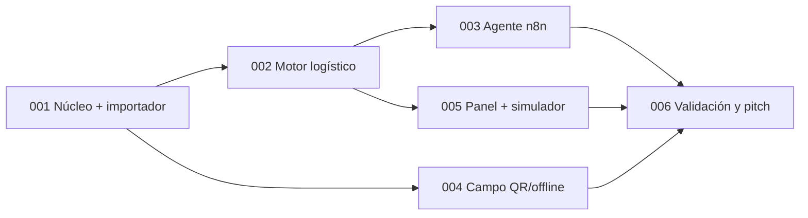

# Specs de IstpetDev

Especificaciones implementables del sistema para la Hackathon Expo Clean Ecuador 2026 (Reto 1). Formato reducido de [spec-kit](https://github.com/github/spec-kit) y el flujo de la skill **superpowers**: brainstorming → `spec.md` → `plan.md` + `task.md` → ejecución por tareas → `test-e2e.md`.

La **bóveda** (`docs/boveda/`) sigue siendo la fuente de verdad del producto, el reto y las decisiones. Un spec no cambia una decisión de la bóveda por sí mismo: cuando la contradice, lo declara en la sección «Contradicciones con la bóveda» y deja una tarea para registrarlo con el protocolo de [Convenciones y estados](../boveda/00%20Inicio/Convenciones%20y%20estados.md).

## Formato

Cada spec es una carpeta `NNN-nombre-corto/` con cuatro archivos. La plantilla está en [`_plantilla/`](_plantilla/).

| Archivo | Responde a | Lo usa |
|---|---|---|
| `spec.md` | **Qué** y **por qué**: historias, requisitos, criterio de nota, guardarraíles, fuera de alcance | Equipo y jurado interno; se aprueba antes de planificar |
| `plan.md` | **Cómo**: arquitectura, archivos, decisiones técnicas, restricciones globales y foco de revisión | Quien implementa; encabezado de superpowers |
| `task.md` | **Pasos**: tareas pequeñas con TDD, código y comandos exactos | Agente o persona que ejecuta tarea por tarea |
| `test-e2e.md` | **Prueba de punta a punta**: escenarios del recorrido real, evidencia y registro de ejecución | Cierre del spec y ensayo de la demo |

Estados de un spec: `borrador` → `aprobado` (spec revisado) → `planificado` (plan y tareas revisados) → `en curso` → `cerrado` (test-e2e aprobado con evidencia).

## Índice

| ID | Spec | Criterio de nota que sostiene | Depende de | Estado |
|---|---|---|---|---|
| 001 | [Núcleo delgado e importador genérico](001-nucleo-delgado-importador/spec.md) | Viabilidad, demo (base de todo) | — | borrador |
| 002 | Motor logístico determinista: riesgo, ruteo y replanificación | Demo, impacto, innovación | 001 | por escribir |
| 003 | Agente logístico con n8n (herramientas sobre 002, aprobación humana) | Innovación, demo | 002 | por escribir |
| 004 | Campo: QR, custodia, despacho/recepción y PWA offline | Demo (momento físico), viabilidad | 001 | por escribir |
| 005 | Panel web y simulador comparativo de 90 días con KPIs | Impacto, presentación | 002 | por escribir |
| 006 | Validación, pitch y paquete de entrega (no es código) | Comprensión, presentación, equipo | 002–005 | por escribir |

### Alcance previsto de los specs por escribir

Se detallan con brainstorming en su propia sesión. Estas líneas fijan la intención para que 001 no tome decisiones que los contradigan.

- **002 Motor logístico.** Cobertura y riesgo según [Inventario y prediccion](../boveda/04%20Datos%20y%20algoritmos/Inventario%20y%20prediccion.md) (RF-03); ruta por inserción factible + 2-opt con capacidad y ventanas según [Rutas y sobrecostos](../boveda/04%20Datos%20y%20algoritmos/Rutas%20y%20sobrecostos.md) (RF-04); replanificación por incidente que conserva lo ejecutado (RF-11). Todo parametrizado en `Logistics:*` con valores por fila desde los datos importados. Cada operación se expone como endpoint de `/api/v1` que el agente usa como herramienta. Decidir la fuente de distancias (matriz vial o aproximación declarada).
- **003 Agente logístico.** Agente de n8n (nodo AI Agent) cuyas herramientas son los endpoints de 002 y 004: leer riesgos, proponer plan de ruta, asignar unidades QR a entregas, evaluar un incidente y replanificar. **El LLM no calcula rutas ni cantidades**: elige herramientas, compone la propuesta y la explica. Toda acción con efecto queda como `AgentDecision` en estado `Proposed` hasta que un humano la aprueba en el panel. Si el LLM falla, se aplica la regla determinista (RF-12).
- **004 Campo.** Etiquetas QR por `HandlingUnit`, despacho y recepción por líneas, custodia, PWA Ionic con IndexedDB y reintento idempotente (RF-05, RF-06, RNF-02, RNF-04); foto y firma como evidencia (RF-09 simplificado).
- **005 Panel y simulador.** Panel Angular (FSD) con riesgos, rutas, decisiones del agente y entregas (RF-07); simulador de 90 días con baseline y política propuesta sobre el mismo calendario (RF-08, RF-14); KPIs con numerador, denominador, seed y exportación según [Simulador y metricas](../boveda/04%20Datos%20y%20algoritmos/Simulador%20y%20metricas.md). Generador sintético de N puntos y D días que produce archivos canónicos y los importa con 001.
- **006 Validación y pitch.** Entrevista con el sector, guion, ensayo cronometrado, registro de trabajo previo y paquete de entregables según [Evaluacion y entregables](../boveda/01%20Oficial/Evaluacion%20y%20entregables.md).

## Guardarraíles comunes (aplican a todos los specs)

El riesgo es llegar el 16 de octubre y recibir un dataset o un planteamiento que invalide el trabajo. Estas reglas lo acotan. Cada spec declara cuáles aplica y cómo se prueban.

| ID | Regla | Cómo se comprueba |
|---|---|---|
| G1 | **Nada del escenario en el código.** Cantidades, nombres, regiones, SKUs, «hospital», «80 puntos» o «90 días» vienen de datos o parámetros. | Revisión de código y búsqueda de literales del escenario antes de cerrar cada spec |
| G2 | **Una sola puerta de entrada de datos.** Todo dato operativo entra por el importador canónico de 001, incluido nuestro propio dataset de demo y el generador sintético. | El reset de demo y el simulador usan el importador |
| G3 | **Lo que falta se declara.** Un campo ausente usa un valor por defecto documentado y aparece como «supuesto» en el reporte y en la interfaz. Nunca falla en silencio ni inventa precisión. | Reporte de importación con supuestos; pruebas con columnas faltantes |
| G4 | **Unidades explícitas.** Cada cantidad lleva unidad base del SKU; las conversiones (galón→L, caja→unidad) se declaran en el perfil de mapeo. | Prueba con escala de unidades en 001 |
| G5 | **Algoritmos parametrizados.** Lead time, margen, costo por km, ventanas y capacidades tienen valor global en configuración y se sobrescriben por fila desde los datos. | Pruebas de 002 con parámetros distintos |
| G6 | **Simulacro de «dataset sorpresa».** Antes del 16, alguien prepara un dataset con otro formato y el equipo lo integra en ≤ 60 minutos escribiendo solo un perfil de mapeo. | `test-e2e.md` de 001, escenario E2E-03 |
| G7 | **Modelo de dominio genérico.** Punto de servicio, producto, lote, unidad logística, ruta y entrega sirven para cualquier red de abastecimiento; el relato del hospital es un caso dentro de los datos, no una entidad. | Revisión de nombres en specs y código |
| G8 | **Trabajo previo trazable.** Se etiqueta `pre-evento` el último commit antes del 16 y se registra en [Registro de trabajo previo y del evento](../boveda/06%20Equipo/Registro%20de%20trabajo%20previo%20y%20del%20evento.md) qué estaba hecho y qué se adaptó en el evento. | Tag y nota de registro |

**Límite honesto de los guardarraíles.** Cubren cambios de datos y de formato dentro del Reto 1 (puntos, productos, inventario, consumo, flota). No cubren un cambio de problema: si la ficha final del reto pide otra cosa (por ejemplo, cotización del Reto 2), ningún importador lo resuelve; lo que se reutiliza es la plataforma (importador, mapa, agente, móvil) y se replanifica el alcance el mismo día.

## Calendario propuesto

| Fecha | Trabajo |
|---|---|
| 13-oct mañana | Implementar 001 (bloquea el resto). En paralelo, escribir y aprobar los specs 002–005 con brainstorming |
| 13-oct tarde – 14-oct | 002 y 004 en paralelo; 003 en cuanto 002 publique sus endpoints; 005 sobre 002 |
| 15-oct | Integración, corridas del simulador, simulacro de dataset sorpresa (G6), ensayo cronometrado, tag `pre-evento` |
| 16–17-oct | Evento: adaptación a la ficha final, validación con mentores, pitch |

## Reglas de trabajo con specs

- Un spec solo pasa a `planificado` cuando su `spec.md` está aprobado por el equipo; la aprobación se anota en la cabecera con nombres y fecha.
- **Migraciones de base de datos:** 001 crea el esquema completo de la demo para que los equipos paralelos no generen migraciones en conflicto. Si un spec posterior necesita columnas nuevas, crea **una** migración nueva sobre `develop` actualizado y la integra antes de que otro spec cree la suya.
- Ramas y PR según [CONTRIBUTING.md](../../CONTRIBUTING.md): la implementación de un spec va en `feature/NNN-nombre-corto` (los cambios solo de documentación, en `docs/…`), sale de `develop` actualizado y entra por PR a `develop`. La política de ramas rechaza cualquier otro prefijo y el push directo.
- Copiar `_plantilla/` para crear un spec nuevo: `cp -r docs/specs/_plantilla docs/specs/NNN-nombre-corto`.
