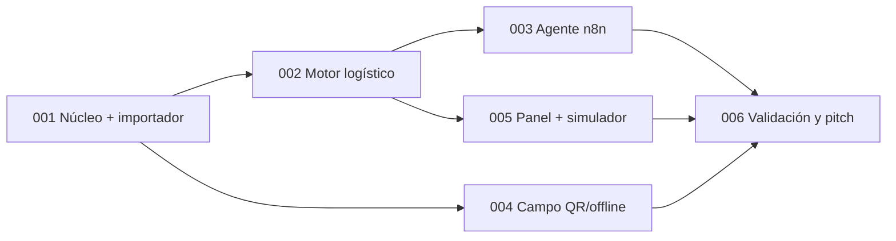

# Specs de IstpetDev

Especificaciones implementables del sistema para la Hackathon Expo Clean Ecuador 2026 (Reto 1). Formato reducido de [spec-kit](https://github.com/github/spec-kit) y el flujo de la skill **superpowers**: brainstorming → `spec.md` → `plan.md` + `task.md` → ejecución por tareas → `test-e2e.md`.

La **bóveda** (`docs/boveda/`) sigue siendo la fuente de verdad del producto, el reto y las decisiones. Un spec no cambia una decisión de la bóveda por sí mismo: cuando la contradice, lo declara en la sección «Contradicciones con la bóveda» y deja una tarea para registrarlo con el protocolo de [Convenciones y estados](../boveda/00%20Inicio/Convenciones%20y%20estados.md).

**Trabajo del equipo desde el 13-oct:** [seguimiento de integración y pruebas](../boveda/06%20Equipo/Seguimiento%20de%20implementacion%20y%20pruebas.md), [registro editable de hallazgos](../boveda/06%20Equipo/Registro%20de%20seguimiento%20y%20hallazgos.md) y [continuidad hacia 007–012](../boveda/06%20Equipo/Continuidad%20del%20piloto%20y%20specs%20007%20a%20012.md). Esta planificación conserva roles fijos/asignación en la demo; la administración dinámica de permisos y RLS corresponden al diseño diferido. El 006 distingue preparación técnica de entrevistas y entrega del evento.

## Formato

Cada spec es una carpeta `NNN-nombre-corto/` con cuatro archivos. La plantilla está en [`_plantilla/`](_plantilla/).

| Archivo | Responde a | Lo usa |
|---|---|---|
| `spec.md` | **Qué** y **por qué**: historias, requisitos, criterio de nota, guardarraíles, fuera de alcance | Equipo y jurado interno; se aprueba antes de planificar |
| `plan.md` | **Cómo**: arquitectura, archivos, decisiones técnicas, restricciones globales y foco de revisión | Quien implementa; encabezado de superpowers |
| `task.md` | **Pasos**: tareas pequeñas con TDD, código y comandos exactos | Agente o persona que ejecuta tarea por tarea |
| `test-e2e.md` | **Prueba de punta a punta**: escenarios del recorrido real, evidencia y registro de ejecución | Cierre del spec y ensayo de la demo |

Estados de un spec: `borrador` → `aprobado` (spec revisado) → `planificado` (plan y tareas revisados) → `en curso` → `cerrado` (test-e2e aprobado con evidencia).

## Objetivo norte

> En 3 minutos, el jurado ve cómo IstpetDev evita que un hospital se quede sin desinfectante: **el agente lo detecta 5 días antes, propone la ruta y una persona la aprueba; el conductor entrega sin señal; el jurado escanea la caja con su propio teléfono; y el tablero muestra qué habría pasado en 90 días.**

Toda capacidad que se construya pasa este filtro; si una respuesta es «no», no se construye antes del 17-oct:

1. ¿El jurado la ve en el pitch o en sus preguntas?
2. ¿Funciona sin la wifi del recinto?
3. ¿Sus cifras salen de una ejecución reproducible?
4. ¿La entiende un gerente de limpieza sin explicación técnica? (5 de 7 jurados no son técnicos)
5. ¿Sobrevive a un dataset distinto? (guardarraíles G1–G8)

### Métricas de «listo para ganar»

| Métrica | Umbral | Se verifica en |
|---|---|---|
| Ensayos completos sin fallo | 10 consecutivos; los 2 últimos sin la wifi del recinto | 006 |
| Duración del pitch | Tiempo oficial −20 s; versiones de 3, 5 y 7 min hasta que se confirme O-04 | 006 |
| Banco de preguntas del jurado | 20 preguntas difíciles con respuesta ensayada en ≤ 30 s | 006 |
| Evidencia del sector | ≥ 3 conversaciones documentadas antes del 17-oct 12:30, ≥ 1 con reacción al prototipo | 006 |
| Impacto | ≥ 3 semillas + 1 escenario adverso, presentado como rango frente a los dos baselines | 005 |
| Reinicio de la demo | ≤ 10 s con un clic | 001, 002 |
| Propuesta del agente | ≤ 10 s (p95) desde el disparo; 100% de las cifras coinciden con las herramientas | 003 |

## Definiciones de producto

Acordadas en la sesión de definición del 12-oct-2026; el porqué de cada una está en la bóveda: [Definiciones de producto y plan hasta el pitch](../boveda/06%20Equipo/Definiciones%20de%20producto%20y%20plan%20hasta%20el%20pitch.md) (ADR-21 a ADR-23 en [Decisiones de arquitectura](../boveda/03%20Arquitectura/Decisiones%20de%20arquitectura.md)). **Decididas por:** PENDIENTE (registrar nombre del integrante y confirmación del equipo, según [Convenciones y estados](../boveda/00%20Inicio/Convenciones%20y%20estados.md)). Mientras no se confirmen, son propuestas del equipo y no cambian decisiones aceptadas de la bóveda.

| # | Definición | Specs |
|---|---|---|
| D1 | **Objetivo norte y métricas** de las secciones anteriores. | Todos |
| D2 | **Evidencia del sector solo durante el evento.** Antes del 16, los cinco integrantes construyen. Día 1: dos personas entrevistan expositores de la feria en las pausas (11:00–11:30 y 13:00–14:00) con un guion de 5 minutos. Día 2: se vuelve con el prototipo en el bloque de validación (11:00–12:30). El equipo opta por no entrevistar organizaciones con representante en el jurado como cautela propia; §11.5 del manual exige registrar vínculos de **cada jurado** con el proyecto y su abstención si hay conflicto, incluida una mentoría. Antes del 16 se prepara un **kit previo sin horas del equipo**: guion y hoja de entrevista, esqueleto del pitch con huecos, modelo de negocio, banco de preguntas e investigación de pliegos de compras públicas (SERCOP) para citar el costo de un quiebre solo si se encuentra una fuente. | 006 |
| D3 | **Cortes del alcance** (ver tabla siguiente). | Todos |
| D4 | **Agente con niveles.** A — *vigía*: detecta riesgos y propone reposición y ruta. B — *gestor de incidentes*: evalúa un cierre de vía, replanifica lo pendiente y avisa al conductor. Ambos obligatorios. C — *qué pasaría si* con el simulador como herramienta, solo si A y B están terminados. **El LLM orquesta y explica; nunca calcula** rutas, cantidades ni fechas. Modelo: **DeepSeek**, validado con una prueba de aceptación de 3 escenarios × 10 ejecuciones (llamadas válidas ≥ 95%, p95 ≤ 10 s, explicaciones coincidentes ≥ 90%, inyección 10/10); si no cumple en H1, fallback determinista y el equipo decide proveedor. | 003 |
| D5 | **Autonomía con límites.** Un motor de reglas **determinista en el backend** clasifica cada propuesta en «se ejecuta» o «se escala»; el LLM no puede saltarlo. Se ejecuta sola: avisar una nueva hora de llegada (retraso ≤ 60 min sin perder ventanas), reordenar paradas pendientes (ninguna se elimina, todas las ventanas se cumplen, costo +≤ 15%) y reservar una reposición (≤ cantidad sugerida, cabe en el vehículo, la bodega conserva su stock de seguridad). Se escala: paradas que no se pueden cumplir, stock de bodega insuficiente para todos, costo > +15% y datos inciertos. Umbrales en configuración (G5). Interruptor global «solo proponer». Deshacer una ruta crea otra revisión **y compensa sus reservas activas por línea/lote**; stock ya despachado exige conciliación, no se libera al revertir. | 002, 003, 005 |
| D6 | **Recorrido en vivo regional:** unos 15 puntos de una ciudad y 2 vehículos (fixture `demo-region`, sintético y etiquetado); el incidente afecta a un vehículo y no al otro. El fixture `demo-base` de 001 se mantiene como dato de prueba. La escala nacional (80 puntos) se muestra en el simulador. | 002, 005 |
| D7 | **Doble baseline.** El simulador compara contra la reposición **reactiva** (cuando el punto avisa) y contra un **calendario fijo** (cada N días, cantidad fija). Ambas políticas se escriben en el spec 005 antes de la primera simulación y no se ajustan después de ver resultados. | 005 |
| D8 | **Congelamiento de funcionalidades el 15-oct a las 14:00**, con hitos de control y plan B por componente (ver «Plan hasta el pitch»). | Todos |

### Fuera de alcance hasta el 17-oct (D3)

| Se corta | Lo reemplaza |
|---|---|
| RBAC administrable, plantillas, workflows y configuración desde la base | Roles fijos y configuración en archivos (001) |
| Chat libre gerencia–conductor | Avisos del agente al conductor (D4, nivel B) |
| SignalR con varias réplicas, backplane Redis, ECS/Fargate, autoscaling | Una instancia; actualización periódica o SignalR simple |
| Varias bodegas y más de 2 vehículos en el recorrido en vivo | 1 bodega y 2 vehículos (D6); la escala, en el simulador |
| Pronóstico con ML entrenado | Media móvil declarada ([Inventario y prediccion](../boveda/04%20Datos%20y%20algoritmos/Inventario%20y%20prediccion.md)) |
| App nativa (build de Capacitor) | PWA instalada |
| Matriz vial de pago | Fuente abierta o aproximación **declarada** como tal |
| Login de Cognito visible en la demo *(corte por carga del equipo, no técnico; revisado el 13-oct)* | Sesiones ya iniciadas en los dispositivos de la demo. El login real ([013](013-login-y-cuentas/spec.md) H1–H3) es requisito de esas sesiones y de la integración 004/005; mostrarlo en el pitch se permite si 013 H1–H3 cierra antes del congelamiento. La gestión de cuentas (013 H4) es P2 |
| Más de un caso en el pitch | La historia del hospital; los demás casos, para las preguntas |
| Blockchain, sensores IoT simulados, varios agentes | — |

## Índice

| ID | Spec | Criterio de nota que sostiene | Depende de | Estado |
|---|---|---|---|---|
| 000 | [Gestión de dependencias, remediación de vulnerabilidades y evaluación pnpm](000-gestion-dependencias-seguridad-monorepo/spec.md) | Seguridad, viabilidad, estabilidad CI/CD | — | borrador (spec y plan redactados) |
| 001 | [Núcleo delgado e importador genérico](001-nucleo-delgado-importador/spec.md) | Viabilidad, demo (base de todo) | — | borrador |
| 002 | [Motor logístico determinista](002-motor-logistico/spec.md): riesgo, ruteo, replanificación y política de autonomía | Demo, impacto, innovación | 001 | borrador (spec, plan, tareas y E2E redactados; aprobación pendiente) |
| 003 | [Agente logístico con n8n](003-agente-logistico/spec.md) (herramientas sobre 002, autonomía con límites, DeepSeek) | Innovación, demo | 002 | borrador (spec, plan, tareas y E2E redactados; aprobación pendiente) |
| 004 | [Campo: QR, custodia, despacho/recepción y PWA offline](004-campo-qr-custodia-offline/spec.md) | Demo (momento físico), viabilidad | 001, 002 (avisos de 003 al integrar) | borrador (spec, plan, tareas y E2E redactados; aprobación pendiente) |
| 005 | [Panel web y simulador comparativo de 90 días con KPIs](005-panel-simulador/spec.md) | Impacto, presentación, demo | 001–004 | borrador (spec, plan, tareas y E2E redactados; aprobación y ejecución pendientes) |
| 006 | [Validación, pitch y paquete de entrega](006-validacion-pitch-entrega/spec.md) (no es código) | Comprensión, presentación, equipo, demo e impacto trazables | 001–005 | borrador (cuatro archivos redactados; Deciders, revisión, ensayos y entrega pendientes) |
| 013 | [Login real y gestión de cuentas por Gerencia](013-login-y-cuentas/spec.md) | Viabilidad, demo (desbloquea 004/005) | 001 | borrador (spec redactado; plan, tareas y E2E pendientes) |

### Alcance previsto de los specs por escribir

Se detallan con brainstorming en su propia sesión. Estas líneas fijan la intención para que 001 no tome decisiones que los contradigan.

- **002 Motor logístico.** Cobertura y riesgo según [Inventario y prediccion](../boveda/04%20Datos%20y%20algoritmos/Inventario%20y%20prediccion.md) (RF-03); ruta por inserción factible + 2-opt con capacidad y ventanas para 2 vehículos según [Rutas y sobrecostos](../boveda/04%20Datos%20y%20algoritmos/Rutas%20y%20sobrecostos.md) (RF-04); replanificación por incidente que conserva lo ejecutado y crea una nueva revisión (RF-11). Incluye el **motor de reglas de autonomía** (D5) y el fixture `demo-region` (D6). Todo parametrizado en `Logistics:*` y `Agent:Policy:*`, con valores por fila desde los datos importados. Cada operación se expone como endpoint de `/api/v1` que el agente usa como herramienta. Decidir la fuente de distancias (matriz vial o aproximación declarada).
- **003 Agente logístico.** Agente de n8n (nodo AI Agent) con los niveles A y B obligatorios y C opcional (D4). Sus herramientas son los endpoints de 002 y 004: leer riesgos, proponer plan de ruta, asignar unidades QR a entregas, evaluar un incidente, replanificar y avisar. **El LLM no calcula rutas ni cantidades**: elige herramientas, compone la propuesta y la explica, y su texto se valida contra los datos. Cada propuesta queda como `AgentDecision`; el motor de reglas de 002 decide si se ejecuta sola o espera aprobación (D5). Los datos importados se pasan como datos delimitados (defensa contra instrucciones inyectadas). Si el LLM falla o tarda más de 10 s, se aplica la regla determinista (RF-12). Empieza con la prueba de aceptación de DeepSeek.
- **004 Campo.** Etiquetas QR por `HandlingUnit`, despacho y recepción por líneas, custodia, PWA Ionic con IndexedDB y reintento idempotente (RF-05, RF-06, RNF-02, RNF-04); foto y firma como evidencia (RF-09 simplificado); recepción de los avisos del agente en el teléfono del conductor (D4, nivel B).
- **005 Panel y simulador.** Detallado en [spec 005](005-panel-simulador/spec.md), [tareas](005-panel-simulador/task.md) y [pruebas E2E](005-panel-simulador/test-e2e.md): panel Angular FSD conectado a 001–004, mapa con fuente de tramo, dos columnas de decisiones y `ProposeOnly`; simulación asíncrona aislada de 90 días con baselines `reactive-v1` y `fixed7-v1` fijados antes de resultados, tres seeds base y una adversa, calendario común, cuatro KPI principales y exportación reproducible. Ninguna tarea/E2E se declara ejecutada.
- **006 Validación y pitch.** Kit previo preparado sin horas del equipo (D2), entrevistas en la feria, guion en tres duraciones, roles del pitch, banco de preguntas, ensayo cronometrado, registro de trabajo previo y paquete de entregables según [Evaluacion y entregables](../boveda/01%20Oficial/Evaluacion%20y%20entregables.md).

## Guardarraíles comunes (aplican a todos los specs)

El riesgo es llegar el 16 de octubre y recibir un dataset o un planteamiento que invalide el trabajo. Estas reglas lo acotan. Cada spec declara cuáles aplica y cómo se prueban.

| ID | Regla | Cómo se comprueba |
|---|---|---|
| G1 | **Nada del escenario en el código.** Cantidades, nombres, regiones, SKUs, «hospital», «80 puntos» o «90 días» vienen de datos o parámetros. | Revisión de código y búsqueda de literales del escenario antes de cerrar cada spec |
| G2 | **Una sola puerta de entrada de datos.** Todo dato operativo entra por el importador canónico de 001, incluido nuestro propio dataset de demo y el generador sintético. | El reset de demo y el simulador usan el importador |
| G3 | **Lo que falta se declara.** Un campo ausente usa un valor por defecto documentado y aparece como «supuesto» en el reporte y en la interfaz. Nunca falla en silencio ni inventa precisión. | Reporte de importación con supuestos; pruebas con columnas faltantes |
| G4 | **Unidades explícitas.** Cada cantidad lleva unidad base del SKU; las conversiones (galón→L, caja→unidad) se declaran en el perfil de mapeo. | Prueba con escala de unidades en 001 |
| G5 | **Algoritmos parametrizados.** Lead time, margen, costo por km, ventanas y capacidades tienen valor global en configuración y se sobrescriben por fila desde los datos. | Pruebas de 002 con parámetros distintos |
| G6 | **Simulacro de «dataset sorpresa».** Antes del 16, alguien prepara un dataset con otro formato y el equipo lo integra en ≤ 60 minutos escribiendo solo un perfil de mapeo. | `test-e2e.md` de 001, escenario E2E-03 |
| G7 | **Modelo de dominio genérico.** Punto de servicio, producto, lote, unidad logística, ruta y entrega sirven para cualquier red de abastecimiento; el relato del hospital es un caso dentro de los datos, no una entidad. | Revisión de nombres en specs y código |
| G8 | **Trabajo previo trazable.** Se etiqueta `pre-evento` el último commit antes del 16 y se registra en [Registro de trabajo previo y del evento](../boveda/06%20Equipo/Registro%20de%20trabajo%20previo%20y%20del%20evento.md) qué estaba hecho y qué se adaptó en el evento. | Tag y nota de registro |

**Límite honesto de los guardarraíles.** Cubren cambios de datos y de formato dentro del Reto 1 (puntos, productos, inventario, consumo, flota). No cubren un cambio de problema: si la ficha final del reto pide otra cosa (por ejemplo, cotización del Reto 2), ningún importador lo resuelve; lo que se reutiliza es la plataforma (importador, mapa, agente, móvil) y se replanifica el alcance el mismo día.

## Plan hasta el pitch

**D8 — Congelamiento de funcionalidades: 15-oct a las 14:00.** Lo que no esté integrado en `develop` a esa hora no entra en la demo: se muestra con su plan B o se menciona como siguiente paso. Después solo se corrigen errores y se pule.

### Hitos de control

Cada hito se comprueba en `develop`, no en la máquina de alguien.

| Hito | Fecha y hora | Condición de cumplimiento | Si se retrasa más de 4 h |
|---|---|---|---|
| H1 | 13-oct 13:00 | Specs 002–005 aprobados; prueba de aceptación de DeepSeek ejecutada (D4) | Se implementa con el spec del área en borrador; si DeepSeek no cumple, el agente queda en fallback determinista y el equipo decide proveedor |
| H2 | 13-oct 20:00 | Spec 001 en `develop` (esquema, importador, reset de demo) | Prioridad absoluta del equipo: bloquea 002–005 |
| H3 | 14-oct 20:00 | **Recorrido sin agente de punta a punta**: riesgo → ruta de 2 vehículos → despacho con QR → recepción offline → saldo actualizado, desde los teléfonos con sesión PKCE y la PWA publicada por HTTPS (FR-17 y FR-18 de 004) | El nivel B del agente pasa a su plan B |
| H4 | 15-oct 11:00 | Agente A y B, panel con decisiones y resultados del simulador frente a los dos baselines | Se aplican los planes B de la tabla siguiente |
| H5 | 15-oct 14:00 | Congelamiento de funcionalidades (D8) | — |

### Plan B por componente

Decidido de antemano para no improvisar bajo presión.

| Componente | Si no llega al congelamiento | Qué se pierde |
|---|---|---|
| Agente nivel B (incidentes con LLM) | Botón de incidente con replanificación determinista y tarjeta escalada con explicación por plantilla | Parte de Innovación; el flujo sigue intacto |
| Agente nivel A (vigía con LLM) | Riesgos calculados con tarjeta de acción manual y explicación por plantilla | Más Innovación; se presenta como «IA en la siguiente versión» solo si es cierto |
| PWA offline | Recepción en línea desde el móvil; el modo avión se muestra en el video de respaldo | Parte del momento físico |
| Mapa de ruta | Lista ordenada de paradas con horas y costos | Impacto visual |
| Despliegue en la nube | Stack local en el portátil con hotspot propio; el QR se escanea con un teléfono del equipo conectado al hotspot | El jurado ya no escanea con su teléfono |
| Simulador de 90 días | **No hay plan B honesto**: sin simulador no hay cifras de impacto. Es prioridad por encima de los niveles del agente | — |

### Antes del evento

| Momento | Trabajo |
|---|---|
| 13-oct mañana | Implementar 001; escribir y aprobar 002–005; prueba de aceptación de DeepSeek (requiere credenciales en el n8n de Bryan) |
| 13-oct tarde – 15-oct 14:00 | 002 y 004 en paralelo; 003 en cuanto 002 publique sus endpoints; 005 sobre 002 |
| 13–15-oct | Kit previo de 006 preparado con IA, sin horas del equipo (D2) |
| 15-oct 14:00–20:00 | Simulacro del dataset sorpresa (G6), 3 ensayos completos, grabación del video de respaldo, tag `pre-evento` y registro en la bóveda (G8) |

### Día 1 — 16 de octubre

Se superpone al [Cronograma oficial](../boveda/01%20Oficial/Cronograma%20oficial.md); no lo reemplaza. **Se participa de verdad en la dinámica oficial** y se entregan los artefactos que pida la organización: «Proceso y equipo» observa la participación.

| Hora | Actividad oficial | Qué hacemos |
|---|---|---|
| 09:30–10:00 | Presentación final de retos | Una persona transcribe y fotografía todo. Cada cambio se clasifica: 🟢 sin impacto; 🟡 se resuelve con un perfil de mapeo o parámetros; 🔴 cambia el alcance |
| 10:00–10:30 | Comprensión | Decisión «seguir o adaptar»: con 🔴, se replanifica el alcance; con 🟡, simulacro G6 en vivo con su dataset |
| 11:00–11:30 y 13:00–14:00 | Pausas | Dos personas entrevistan en la feria (D2); tres integran |
| 14:00–16:00 | Diseño | Tres personas adaptan el código; dos trabajan el modelo de negocio y rellenan el esqueleto del pitch |
| 16:00–16:30 | Mentoría | 3 preguntas preparadas; registrar la mentoría y comprobar si el mentor es jurado |
| 16:30–18:30 | Prototipado | Integrar el consejo del mentor; ensayo 1 con los datos del evento |
| 18:30–19:00 | Checkpoint | Demo funcionando ante la organización |
| Noche | — | 2 ensayos, solo correcciones P0 y descanso |

### Día 2 — 17 de octubre

| Hora | Qué hacemos |
|---|---|
| 09:00–10:30 | Últimas correcciones. **10:30: congelamiento del código**; después solo se corrige lo que bloquee |
| 11:00–12:30 | Dos personas validan con expositores usando el prototipo (D2); tres ejecutan la simulación final (semillas y escenario adverso) y 3 ensayos |
| 12:30–13:15 | Mentoría final |
| 14:00–15:00 | Completar los huecos del pitch: citas de la feria, cifras del simulador, precio |
| 15:00–15:45 | 2 ensayos cronometrados. **15:45: congelamiento de materiales** |
| Antes de presentar | Lista de verificación: reset de la demo, dispositivos cargados, hotspot encendido, caja con QR, video listo |

## Reglas de trabajo con specs

- Un spec solo pasa a `planificado` cuando su `spec.md` está aprobado por el equipo; la aprobación se anota en la cabecera con nombres y fecha.
- **Migraciones de base de datos:** 001 crea el esquema base de la demo para que los equipos paralelos no generen migraciones en conflicto; su prueba exige el núcleo y la ausencia de Schema95, no un conteo cerrado, así que las tablas nuevas de 002–004 no la rompen. Si un spec posterior necesita columnas nuevas, crea **una** migración nueva sobre `develop` actualizado y la integra antes de que otro spec cree la suya.
- Ramas y PR según [CONTRIBUTING.md](../../CONTRIBUTING.md): la implementación de un spec va en `feature/NNN-nombre-corto` (los cambios solo de documentación, en `docs/…`), sale de `develop` actualizado y entra por PR a `develop`. La política de ramas rechaza cualquier otro prefijo y el push directo.
- Copiar `_plantilla/` para crear un spec nuevo: `cp -r docs/specs/_plantilla docs/specs/NNN-nombre-corto`.
